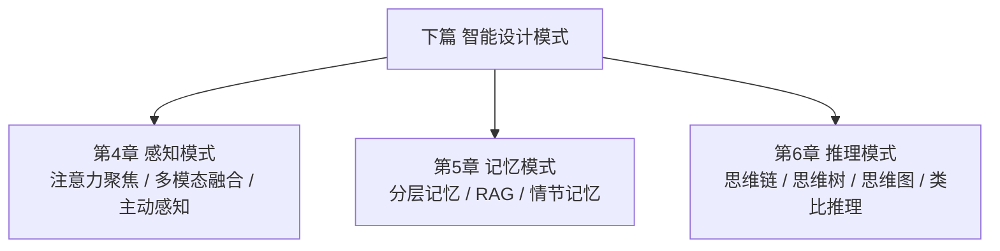
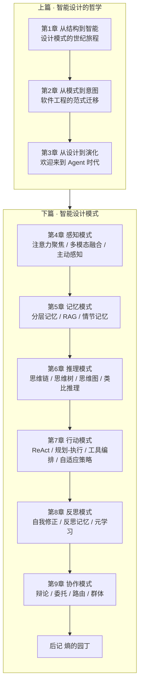

# Mermaid 图布局最佳实践

> 源自优化「Agent 设计模式 · 全书结构图」的实战总结。核心目标：**控制图的宽高比，让信息在屏幕宽度内可读**。本站 mermaid 版本 v11.12，默认布局引擎为 ELK。

## 一、先诊断：为什么会「横向爆宽」

原图用 `flowchart TD`，但「下篇」节点一次性扇出 7 个带 ` ` 副标题的子节点：

直觉以为 `TD` 一定是纵向的，其实不然：**同一父节点的多个子节点仍会横向并排**。当子节点 label 又长，宽度就爆炸。实测原图 `viewBox = 0 0 2777 222`，宽高比 12.5:1——在文档里要么缩到看不清字，要么横向滚动。

**诊断口诀**：宽 ≈ 同层最多兄弟节点数 × 单节点宽度。想控宽，就压这两个因子。

## 二、五条核心手法

| 手法 | 做法 | 效果 |
| --- | --- | --- |
| ① 扇出改链式 | 把 `A-->B1; A-->B2; ...` 改为 `B1-->B2-->B3-->...` | 兄弟节点数从 N 降到 1，**最有效** |
| ② subgraph 分组 + `direction TB` | 用 `subgraph` 包裹逻辑分组，组内显式 `direction TB` | 保住纵向、给图语义分块 |
| ③ 连 subgraph 本身，不连其内部节点 | 写 `UP --> DOWN`，不写 `A3 --> B1` | 避免组内 direction 失效（见第三节） |
| ④ 长 label 用 ` ` 换行 + 精简 | 副标题去掉冗余词，斜杠分隔项减到 3 个左右 | 压低单节点宽度 |
| ⑤ 隐形边 `~~~` 微调 | `A ~~~ B` 只影响位置不画线 | 修正个别节点错位 |

## 三、三个必须知道的坑

1. **外部边会让 subgraph 的 `direction` 失效**。官方文档明确：若 subgraph 内任一节点连到外部，该 subgraph 继承父图方向，`direction` 被忽略。
   - 错误：`outside --> top2`（`top2` 在 subgraph 内）→ 组内变横向
   - 正确：`outside --> subgraph1`（连容器本身）→ 组内方向保持
2. **别过度使用链式语法**。官方提醒 chaining（`A & B --> C & D`）用过头会让 Markdown 源码难读（`lagom` 原则）：图清晰与源码可维护要兼顾。
3. **TD/LR 只定主轴，不定每层排布**。别指望换个方向就能救一张扇出过度的图——先减少同层节点数。

## 四、渲染验证

不要只靠肉眼判断宽窄，量真实渲染后的 `viewBox`：

1. 执行 `npm run dev` 打开目标页。
2. 在浏览器 DevTools 中选中图的 `<svg>` 元素，读取 `viewBox="0 0 W H"`。
3. 计算宽高比 `W / H`，并对照正文宽度判断是否需要优化。

**判断标准**：文档正文宽度约 700–900px，图的 `W` 控制在这个范围内不缩放即可读；`ratio`（宽/高）远大于 2 基本就是「横向爆宽」，需要按第二节优化。

## 五、本次优化实测对照

| 版本 | viewBox 宽度 | 高度 | 宽高比 | 说明 |
| --- | --- | --- | --- | --- |
| 原图（一对多扇出） | 2777 px | 222 px | 12.5 : 1 | 横向爆宽，字看不清 |
| 优化后（subgraph 分组 + 链式 + `UP-->DOWN`） | 346 px | 1668 px | 0.21 : 1 | 宽度降 87.5%，副标题信息零丢失 |

优化后图源码（可直接套用到其他「总—分—续」结构的图）：

## 六、官方参考

- Flowchart 语法与 `direction`：https://mermaid.js.org/syntax/flowchart.html
- 布局引擎（ELK / Dagre）：同上「Layout」章节
- 渲染 API 与配置：https://mermaid.js.org/config/setup/modules/mermaidAPI.html
