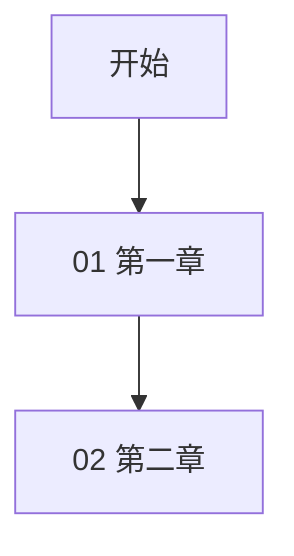

# 页面骨架与示例

按页面类型取用。骨架只约束顺序和必备节，不限制每节内部的写法；当前仓库里的真实页面是最终参照。

## 导读页

用于每个专栏的 `index.md`。读者读完应能判断「这个专栏解决什么问题、我怎么读、需要什么基础」。

````markdown
# <专栏名>：专栏导读

> 一到三句话说明这套内容面向什么场景、解决什么问题、覆盖到什么深度。

## 这个专栏解决什么问题

用具体故障或场景引入，说明只懂其中一部分会在哪里卡住。

## <核心概念> 是什么

拆开最小构成（可用表格或 Mermaid），给出能力边界和常见误解。

## 边界与选型

| 方案 | 特点 | 适用场景 |
| --- | --- | --- |
| …… | …… | …… |

指出什么时候不该用，以及需要提前接受的代价。

## 学习路径



## 章节地图

- [01 环境搭建与第一个应用](/electron/quick-start)
- [02 进程模型与运行原理](/electron/process-model)
````

要点：导读页不展开细节，只给地图和判断依据；章节地图的链接必须与 `_meta.json` 顺序一致。

## 系列课程章节

用于编号课程（`docs/ai/harness/01-*.md`、`docs/electron/*.md`）。文件名用零填充编号加 kebab-case 英文短语。

````markdown
# 01 · <标题>：<一句能记住的副标题>

> **一句话结论**：……
> **定位**：Part I · 基础
> **前置**：[课程总览](/ai/harness/) ｜ **下一课**：[第 02 课 · 标题](/ai/harness/02-tool-calling)

## 本课要回答的问题

用一个具体问题开场，说明它为什么决定后续设计。

## 核心原理

### 先建立直觉：<类比>

### <机制一>

配 Mermaid 或表格。

## 代码与实现

`mvp/harness-mvp.mjs:22-40` —— 这段代码只做一件事：……。

```js
// 可运行的最小实现
```

## 权衡与失效模式

| 选择 | 得到什么 | 付出什么 |
| --- | --- | --- |

## 四层定位

说明本课内容落在 Harness / Loop / Context / Prompt 的哪一层，以及变化如何传导到其他层。

## 动手实验

给出可复现的步骤、预期输出和观察点。

## 常见误区

1. ……

## 本课小结

- 三到五条可带走的结论。

## 自测

**Q1**：……

<details><summary>参考答案</summary>

……

</details>

## 延伸阅读与下一课

- 论文、官方文档或源码位置。

本课解决了……，还剩……，见[第 02 课 · 标题](/ai/harness/02-tool-calling)。
````

不是每章都要全节：没有四层视角的专栏删掉「四层定位」，没有配套代码的删掉「代码与实现」。但顺序保持一致，且必须有小结与下一课。

## 单篇主题笔记

用于独立知识页（`docs/network/http.md`、`docs/javascript/omission.md`）。没有固定节名，按概念递进组织：

```markdown
# <主题>

> 可选：一句话说明这页的结论或适用前提。

## <概念一>

先给定义或结论，再解释，再用表格/代码/示例落地。

### <概念一的子项>

## <概念二>

……

## 参考

- 规范、文章或源码链接。
```

要点：标题用读者会搜索的术语；每个 H2 自成一个可独立阅读的小节；概念之间有依赖时按依赖顺序排列。

## 排障手册

用于故障定位页（`docs/webrtc/troubleshooting.md`、`docs/webrtc/weak-network.md`）。

```markdown
# <场景>排障手册

## 1. 先量化：核心指标

| 指标 | 正常范围 | 异常含义 |
| --- | --- | --- |

## 2. 质量分级

## 3. 判定顺序

按「先排除哪个、再排除哪个」给出决策链，可用 Mermaid flowchart。

## 4. 高频问题与修复

### 症状：……

- 判定方法：
- 根因：
- 修复：

## 5. 检查清单

- [ ] ……
```

要点：每条结论都要能落到一个可观测指标或日志上；不要只给「检查网络」这类无法执行的建议。

## 附录

用于快速通读、版本差异或补充材料（`docs/ai/harness/agnes-harness.md`）。

- 标题标注「速读」「附录」等定位。
- 压缩正文，只保留关键结论、对照表和指向主线的链接。
- 不引入主线没有的新概念；确需引入时在正文对应章节补一段，再从附录链接过去。

## 主页与导航

`docs/index.md` 用 Rspress 首页 frontmatter，新增一级分类时才考虑加 feature：

```yaml
---
pageType: home

hero:
  name: 前端进阶笔记
  text: 从基础到深入，从全栈迈向AI
  tagline: 每天进步一点点
  actions:
    - theme: brand
      text: 开始阅读
      link: /javascript/es6/

features:
  - title: AI与前沿技术
    details: 机器学习、MCP协议、低代码平台等前沿技术探索
---
```

顶栏在 `docs/_meta.json` 加 `{ "text", "link", "activeMatch", "items" }` 项；`activeMatch` 用正则覆盖该分类下所有路径，例如 `^/ai/`。
