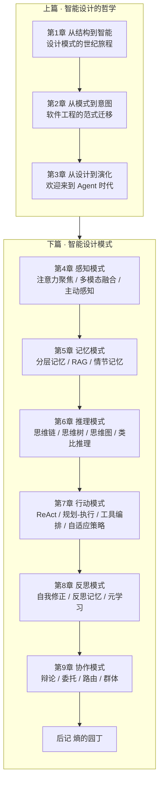

# Agent 设计模式

> 黄佳《Agent 设计模式：图解可复用智能体架构》读书笔记。

## 为什么要重读设计模式

2023—2024 年，几乎每个工程师都在接触 Agent：LangChain/LangGraph、AutoGen、CrewAI、MCP……框架层出不穷，教程汗牛充栋，但真正能让人停下来问一句**为什么要这么做**的文字并不多。

这本书的价值恰恰在这里——它不教你怎么调某个 SDK，而是把 Agent 放回软件工程的百年脉络里重新审视：**从 GoF 的 23 个模式出发，一路走到函数式编程、响应式流、微服务、软件 2.0，最后自然地收敛到 Agent 的心智架构与六大设计模式族**。

读完你会发现：
- 响应式编程的**背压**（Backpressure），正是多 Agent 协作里「慢消费者别被快生产者压垮」的理论原型；
- Karpathy 的「园丁 vs 建筑师」隐喻，能直接用来指导 Prompt + 结构化约束的组合设计；
- GoF 没有过时，它的**「问题—约束—解法—代价」**思考框架，仍然是分析任何 Agent 模式的第一把尺子。

## 全书结构

全书的主线可以概括成一句话：**软件的核心矛盾从「管理确定性」变成了「驾驭不确定性」**，设计模式也从「组织代码」演进为「组织意图、记忆与协作」。

## 读这本书你应该带着什么问题

建议带着你正在踩的坑读下去，效果会好很多：

- 我搭了一个 Agent，发现它经常跑偏，应该用哪种**反思模式**？
- 多个 Agent 互相调用，到底用**编排（Orchestration）** 还是**协同（Choreography）**？
- RAG 效果不好，到底是**分层记忆**的问题还是**感知注意力**的问题？
- Prompt + Function Calling + Constrained Decoding，这三者怎么组合才算「结构化强制」而不是「多此一举」？