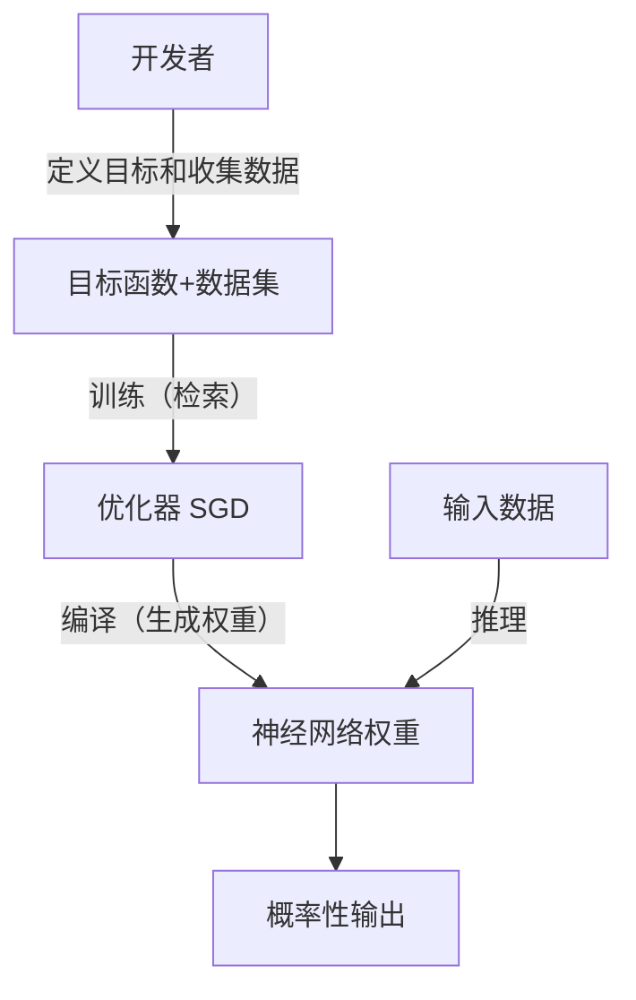
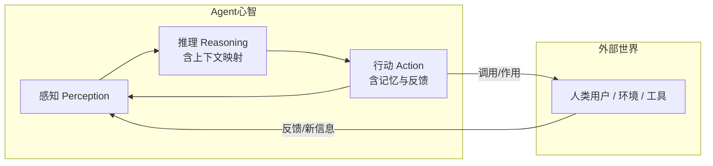

# 从 GoF 到 Agent

## 第 1 章 从结构到智能：设计模式的世纪旅程

### 1.1 GoF 的贡献：秩序的承诺

- 开篇立论：**法律的制定，往往不是出于对完美的追求，而是出于对混乱的恐惧**。设计模式同样如此。
- 1994 年，Erich Gamma、Richard Helm、Ralph Johnson、John Vlissides 四人出版《设计模式：可复用面向对象软件的基础》，把此前散落在工程实践里的经验固化成共同词汇。
- 在此之前，软件世界处于「蛮荒时代」：面向对象从学术玩具变成工业主流，C++ 正在征服世界，Smalltalk 优雅但小众，Java 即将诞生。开发者第一次拥有「对象」这件强大工具，却发现**有武器不等于会战斗**。
- GoF 的真正贡献不是 23 个模式本身，而是提供了：
  1. **一套共同语言**——说「这里用观察者」比描述半天机制更高效；
  2. **一套秩序**——把「怎么组织代码」从个人手感变成可传授、可评审的工程约定；
  3. **一个思考框架**——模式名背后是「问题—约束—解法—代价」的结构化表达。

### 1.2 黄金时代：设计模式的繁荣与边界

- 时间跨度：**1995—2005 年**，设计模式发展的黄金十年。
- 如果说 GoF 在荒原上竖起第一块路标，这十年工程师就在这片土地上建起了「宏伟的罗马城」。
- 标志性事件：
  - Java 1995 年横空出世，「一次编写，处处运行」，成为企业级开发的事实标准；
  - C++ 于 1998 年完成标准化，成为系统级编程的王者；
  - C# 于 2000 年诞生，集众家之长。
- J2EE（Java 2 Platform, Enterprise Edition）把这种秩序推向顶峰：它不只是一套框架，更是一套**严苛的工业标准**。EJB 这类规范让开发者即便实现简单业务，也要编写 Home 接口、Remote 接口和 Bean 实现类。
- 这一阶段的本质：**设计模式被「固化为规范」**。好处是工程一致性、可替换性和大规模协作；代价是抽象层级不断堆叠，简单问题被复杂化。
- 「繁荣与边界」的双重含义：模式解决了确定性问题，但它的前提假设是**需求相对稳定、系统边界清晰、行为可预期**。

### 1.3 诸神的黄昏：当确定性遇到不确定性

- **诸神并非死于战争，而是死于环境的变迁。**
- 旧时代的信念：软件工程的终极目标是打造一座「永恒的精密钟表」——齿轮咬合、分秒不差、一切尽在掌握。GoF 模式与后来的工程体系，都是这张钟表蓝图的一部分：只要设计足够严谨，就没有无法处理的逻辑，也没有不可预测的未来。
- 现实是：**新世界不再是静态的钟表，而是咆哮的海洋**。旧时代的秩序法则不仅失效，甚至成为毁灭的根源。
- **第一声警报：2008 年 10 月 Twitter（现 X）宕机**。
  - 不是普通宕机：服务器仍在运行，数据仍在响应，每个组件都看似正常工作，但整个系统如陷泥潭，响应时间从毫秒级退化至分钟级。
  - 开发者反复检查代码，发现**每个设计模式都精准地待在它该在的位置**：观察者模式用于事件通知，工厂模式负责创建对象，单例模式管理连接池……
  - 结论：**局部正确不等于全局正确**。组件级的最佳实践，无法保证系统级的涌现行为可控；模式解决的是结构问题，解决不了流量、耦合放大与级联失效。
- 这一节完成了全书的「问题定义」：当系统面对的是不确定性（流量、网络、用户行为、模型输出），以确定性为假设的模式体系必须演化。

### 小结：十字路口的坚定

第 1 章给出的不是「设计模式过时了」，而是「设计模式的**适用边界**被重新划定了」：

| 维度 | 确定性时代 | 不确定性时代 |
| --- | --- | --- |
| 系统隐喻 | 精密钟表 | 咆哮海洋 / 生态系统 |
| 核心目标 | 结构正确、可复用 | 可演化、可恢复、可观测 |
| 模式作用 | 组织代码结构 | 组织意图、记忆、行动与协作 |
| 失败模式 | 编译错误、逻辑缺陷 | 涌现故障、级联退化 |
| 工程师角色 | 架构的设计者 | 生态的培育者 |

这也直接引出第 2 章的问题：当「模式」不再足以描述系统，软件工程的范式该往哪里迁移。

## 第 2 章 从模式到意图：软件工程的范式迁移

在传统软件工程领域，人们依赖「模式」来应对复杂性。然而在 Agent 时代，模式只能告诉我们「怎么做」，而**意图**才能回答「为什么做」这一更本质的问题。本章回顾了几十年来软件工程的三条关键范式迁移——函数与流、分布式解耦、软件 2.0——它们共同为 Agent 的登场铺垫了地基。

### 2.1 函数与流：计算的原子化

在 GoF 的黄金时代，人们通过静态的类和对象来固化世界，状态被封装以获得控制。然而随着互联网爆发和摩尔定律边际效应递减，工程师逐渐意识到：**控制状态的最佳方式，或许并非单纯控制，而是尽可能地减少状态的存在**。这为 Agent 的诞生埋下了最重要的伏笔——因为 LLM 本质上就是一个庞大且无状态的纯函数。

#### 2.1.1 无状态的复兴：从对象封装到纯函数管道

1977 年，约翰·巴科斯（John Backus）在图灵奖演说中提出一个著名问题：「Can Programming Be Liberated from the von Neumann Style?（编程能否摆脱冯·诺依曼风格？）」

他批判了命令式编程的根本缺陷——程序不过是一长串用于修改状态的指令。冯·诺依曼架构（CPU 与存储器分离，通过总线连接）把我们的思维方式硬生生锁死在「一次处理一个字」的细粒度操作中。

**函数式编程（Functional Programming, FP）** 的核心信念很简洁：**要控制状态，最好的方法就是消灭状态**。
- **纯函数**：对于相同的输入 x，始终返回相同的输出 y；既不依赖全局变量，也不产生任何副作用。
- **不可变性（Immutability）**：数据一旦创建便不可更改；若需要「修改」，则必须创建一份新的副本。
- **引用透明**：任何表达式都可以被它的值替换而不改变程序行为。

OOP 在分布式时代遇到了根本矛盾：
- **状态的纠缠**：调用 `user.updateBalance()` 不仅修改余额，还可能触发 `lastModifiedTime` 更新、Observer 通知等一连串隐式状态变更，难以准确测试。
- **并发的噩梦**：成千上万线程同时修改同一对象状态时，开发者不得不引入「锁」（lock），这不仅引发竞争、严重损害性能，还极易导致死锁。

**终极映射：LLM 即纯函数。** 巴科斯的愿景在 AI 时代意外成真：
- **权重（Weight）**：推理阶段模型权重是冻结的，无论调用多少次都不会改变。
- **上下文（Context）**：Agent 的「记忆」并非存储在模型内部，而是每次以参数形式显式传入。
- 这彻底改变了 Agent 系统的设计模式：**上下文工程（Context Engineering）** 成为核心，**幂等性（Idempotency）** 得以实现——相同提示和固定随机种子，就能得到完全一致的输出。

软件工程由此跳出「对象身份」执念，回归「**数据变换**」本质。输入 Prompt → 检索增强 → 思维链推理 → 格式化输出，这就是一条纯粹的数据处理管道。

#### 2.1.2 响应式的觉醒：从阻塞等待到异步事件流

传统编程范式中，开发者的时间观是**线性的**：代码第 1 行执行完毕，才会执行第 2 行。这种**同步阻塞（Synchronous Blocking）** 模型虽然符合人类阅读清单的习惯，但在高延迟数据时代可能成为性能瓶颈，甚至引发系统性问题。

**倒塌的多米诺：阻塞的代价。** 设想一个典型 Agent 任务：先调用 Google Search（耗时 1s），解析结果（0.5s），再请求 LLM 生成摘要（8.5s）。同步模型下每个步骤必须依次完成：
- **CPU 空转**：主线程在 99% 的时间里干等着进度条，无法进行其他有用的工作；
- **系统失联**：这 10s 期间如果用户试图取消任务或插入新指令，系统将完全无响应——因为它被牢牢阻塞在那个漫长的 HTTP 请求上。

**Node.js 的回调地狱。** 早期 Node.js 引入回调机制来处理异步操作，却很快演变成嵌套深、逻辑支离破碎的金字塔结构。

**响应式宣言（The Reactive Manifesto）。** 2010 年左右，微软的埃里克·梅杰（Erik Meijer）等人提出响应式编程（Reactive Programming）——**世界并非由离散的指令构成，而是一条条连续的事件流（Event Stream）**。
- **Excel 的隐喻**：在 C1 输入 `=A1+B1`，A1 的值变化时，C1 自动更新。你不需要主动「拉取」（Pull）A1 的值——C1 是在「响应」（Push）A1 的变化。
- **Observable（可观察对象）**：数据不再是静态变量，而是一个随时发出值的事件流。

对 Agent 架构师而言，这是一个**根本性观念转变**：**不要「调用」LLM，而是「订阅」LLM**。这直接决定了你的 Agent 是让用户面对一个旋转 10s 的加载图标，还是能够提供流畅的打字机效果更新。

**背压（Backpressure）：流量控制的艺术。** 响应式编程更重要的是引入了背压机制——下游消费者可以控制上游数据生产速度，避免过快的数据流压垮系统。这在 Agent 系统中至关重要：你绝对不想让一个疯狂输出的「搜索 Agent」瞬间压垮下游负责总结的「写作 Agent」。

**结论：世界并非由静态快照构成，而是一条持续不断的变化之流。**

#### 2.1.3 数据流的哲学：世界不是快照

赫拉克利特（Heraclitus）的「人不能两次踏入同一条河流」——在 Web 1.0 和 Web 2.0 的黄金时代，工程师似乎在努力反驳这个观点：RDBMS + ACID 事务，把世界「冻结」在某一时刻的状态快照中。

但当执行 `UPDATE Users SET age=30 WHERE id=1` 时，我们不仅修改了数据，也抹去了历史。**数据流**的视角重新把世界看作过程而非快照：
- 消费者（如语音合成 TTS 模块、前端渲染引擎）的处理能力有限，且易受网络抖动、设备性能影响；
- 如果上下游处理速度不匹配，系统极易因缓冲区积压而崩溃——轻则丢包，重则内存溢出。

响应式架构通过**背压机制**，使下游能够主动向上游反馈「嘿，慢点发，我处理不过来了」，从而动态调节数据流速。

### 2.2 分布式的解耦：从单体到生态

数据流实现了**时间上的解耦**（异步处理），本节阐述如何实现**空间上的解耦**（分布式架构）。

在软件工程的早期，人们崇尚**单体（Monolith）**——无论是大型机还是庞大的 J2EE 应用，所有逻辑、数据和控制权集中在单一物理节点上。软件宛如一位全知全能的「上帝」，掌控着一切功能与数据的流转。

然而随着互联网的爆发式发展，摩尔定律逼近物理极限，我们不得不接受一个事实：**没有任何一台机器能大到装下整个世界**。于是我们拆解单体架构，将其分解为多个自治的服务单元，最终演化为分布式系统。

这看似是因算力瓶颈而作出的妥协，却在不经意间为 Agent 奠定了最理想的生存土壤——**Agent 本质上是社会化的**。一个孤立的 AGI 或许令人不安，但在工程实践中我们更倾向于构建一群各司其职的**专才型 Agent（Specialist Agent）**。分布式架构正是这个智能社会的物理基础设施。

#### 2.2.1 微服务：通过 API 连接一切

**贝索斯的「API 宣言」。** 2002 年，杰夫·贝索斯向亚马逊全体员工发出一封著名内部邮件：「所有团队必须通过服务接口（Service Interface）对外公开数据和功能；禁止直接读取数据库；禁止使用后门访问。违者将被解雇。」这不仅是亚马逊的转折点，更是现代软件架构的分水岭——它确立了一条核心原则：**功能必须解耦为服务，服务必须通过协议进行通信**。

这场持续二十余年的「接口化」运动，将物理世界与数字世界封装成成千上万个标准化的 RESTful API 或 RPC 接口。

**为机器准备的「盛宴」。** 在 Agent 出现之前，API 主要是供开发者使用的工具。然而随着 Agent 的出现，我们惊喜地发现：**API 简直是为 LLM 量身定制的「触手」**。
- Swagger/OpenAPI 规范最初旨在生成清晰的 API 文档，如今却直接成为 Agent 的「工具说明书」——Agent 只需读取一份 JSON 定义，便能理解如何调用该服务；
- 无头服务（Headless Services）：微服务倡导将用户界面与业务逻辑解耦，意味着 Agent 可以绕过复杂的 HTML/CSS 渲染层，直接与后端业务逻辑交互。

若非微服务运动铺就了道路，今天的 Agent 将如同「盲人摸象」——空有强大的大脑，却无法伸出手去感知和改变世界。

#### 2.2.2 架构的启示：从编排到涌现

微服务架构的另一个重要馈赠是**去中心化**。在单体架构时代，控制逻辑集中在 Main 函数中；在微服务时代，控制逻辑分散于各服务之间的交互之中。这可直接映射到 Agent 的协作模式（见第 9 章）：
- **编排（Orchestration）**：由一个中心化的「大脑」统一调度和指挥所有 Agent；
- **协同（Choreography）**：类似微服务中的事件通知机制，Agent 通过广播消息彼此感知、自主协作，不需要中央协调者。

微服务并非终点，而是一种基础设施。它将复杂系统分解为自治单元，并封装进一个个标准化的 API「盒子」中。而 Agent 的使命，正是打开并协调这些盒子，融合其能力，创造出超越单点的价值。

### 2.3 软件 2.0：当概率遇见代码

2017 年，特斯拉 AI 总监安德烈·卡帕西（Andrej Karpathy）发表《Software 2.0》，这不仅是一个新名词，更是计算机科学根基的一次深刻反思。**在此之前，软件工程致力于消除不确定性；此后，软件工程开始学会利用不确定性**。

#### 2.3.1 规则的落幕：逻辑不再由 if-else 语句编写

在软件 1.0 时代，开发者如同拥有绝对权力的建筑师，对每一行逻辑进行着「独裁式」的控制——只要能将问题转化为极其精确的指令序列，计算机便能实现任何被明确定义的逻辑，确定性是其基石。

而进入以神经网络为代表的软件 2.0 时代后，这种确定性被打破了。开发者的角色从**建筑师**转变为**园丁**——我们主要提供**土壤**（训练数据）并设立**栅栏**（损失函数约束），而具体的决策逻辑与能力，则由**模型**通过在海量数据中学习而自行**涌现**。

在机器学习时代，数据取代了传统代码，成为软件开发流程中的核心要素；优化器扮演了编译器的角色，而训练得到的权重，则构成了最终的“可执行文件”。

理解软件2.0是掌握`Agent`行为特征的关键。

* 从**指令执行**到**模式补全**：`Agent`并非简单地执行你的`Prompt`，而是在补全你的`Prompt`。大模型`LLM`实质上是一个巨大的概率分布表，它的输出是选择参数空间中概率最高的那个。
* 幻觉是**特性**而非**Bug**：模型本质上是在进行**有损压缩**与**模糊联想**，幻觉正是这种联想能力的**副作用**。创造力与胡言乱语，往往如同一枚硬币的两面。
* 编程语言的跃迁：在软件 2.0 时代，以`Prompt`方式给出的自然语言已经成为新的“编程语言”。我们通过调整`Prompt`，来微调模型的概率分布。

软件2.0宣告了规则时代的落幕，我们放弃了对每一行逻辑的精确控制，换来了处理近乎无限复杂度的能力。然而这些带来了一个巨大的工程挑战：若代码不再是人类直接编写的，我们应该如何进行版本控制？如何测试及调试？

#### 2.3.2 MLOps 的启示：为 AgentOps 铺路

当代码变为数据（用以表示模型权重）时，传统的 DevOps 工具链便显得力不从心：你无法对一个`100GB`的二进制模型文件执行`git diff`来查看具体修改了哪些逻辑，也无法通过 IDE 来「调试」神经网络的权重。为了驯服软件 2.0 的「黑盒」特性，MLOps（Machine Learning Operations，机器学习运维）应运而生——它并非单一工具，而是一套关于「如何管理概率性软件生命周期」的方法论。

这套方法论为Agent架构师提供了以下启示：

* 数据即源代码：即使模型架构与代码保持不变，只要训练数据发生改变，模型的行为就可能发生剧烈变化。对于 Agent 开发者而言，主要专注于提示词工程`Prompt Engineering`，这是需要进行版本控制的关键资产。

这直接为 AgentOps 铺路：
- Agent 的 Prompt 管理、版本控制、回滚；
- 评估体系与可观测性；
- 反馈闭环与持续优化。

#### 2.3.3 概率的驯服：在不确定中建立确定

这已不再仅仅是「写一个更好的 Prompt」，而是需要引入类似**类型系统（Type System）** 的强制性约束机制，即**结构化强制（Structured Enforcing）**。

当前模型（如 GPT-4、DeepSeek）已支持 JSON 模式或 Function Calling。这不仅是微调的结果，更关键的是在推理阶段采用了**受限解码（Constrained Decoding）** 技术——例如要求模型在生成 JSON 的 key 时，下一位 token 必须从一组合法候选中选择。这正是在概率之上叠加一层确定性边界。

### 小结：地基的夯实

在第 2 章中，我们并未急于切入 Agent 本身，而是系统梳理了软件工程为迎接 Agent 时代所做的长期准备：
- **函数与流** 让我们掌握了无状态（函数式）与异步（响应式）的编程范式，使软件能够契合 AI 的思考节奏；
- **分布式** 教会我们通过接口化与 Serverless（原子化）构建灵活、可扩展的系统，为 Agent 提供了无限延展的「手脚」；
- **软件 2.0** 引导我们学会在拥抱概率性的同时施加工程化约束，从而在不确定性中建立对确定性的信心。

所有关键技术的「积木」（Transformer、Docker、API、向量数据库等）如今都已准备就绪。现在需要的是一种全新的架构思想，将这些组件有机整合，构建出具备感知、记忆、思考与行动能力的「新物种」。

## 第 3 章 从设计到演化，欢迎来到 Agent 时代

当我们把 LLM 引入架构核心时，奇点已然临近。软件不再仅仅是对人类指令的**响应（response）**，而是开始展现出**意图和自主性（agency）**：
- 它不再是被动等待调用的工具，而是主动感知环境的观察者；
- 它不再是无状态的函数，而是拥有记忆与身份的实体；
- 它不再是孤立的计算节点，而是能够协作的社会成员。

**我们不再是在「设计（design）」一个系统，而是在「培育（cultivate）」一个物种**。

### 3.1 Agent 的本质：从工具到伙伴

什么是 Agent？从技术角度来看，Agent 可能只是一个不断调用 LLM API 的死循环脚本。然而从交互哲学来看，它标志着人机关系的根本性重构：**从「命令与控制」转向「意图与协作」**。

#### 3.1.1 从命令到对话：交互原语的升维

旧时代的交互原语是**命令**：`cat /etc/passwd`、`SELECT * FROM users WHERE ...`、`git push origin main`——每条指令都是一个原子动作，目标明确，执行路径确定。

Agent 时代的交互原语是**对话**。示例：
> 开发者：我在设计一个图书推荐系统，但不确定该使用协同过滤还是内容过滤。
> Agent：让我帮你分析一下。你的用户规模有多大？是否已经积累了足够的历史交互数据？
> ……（Agent 一步步引导开发者明确约束，主动提供混合推荐的渐进式方案）

这不是助手在「执行命令」，而是伙伴在**共同建模**。开发者从「指挥官」退居为「共同设计者」，Agent 从「工具」升级为「协作方」。

### 3.2 Agent 心智架构：感知—推理—行动循环

生命并非静态的存在，而是动态的流转；智能亦如此，它在与环境的不断交互循环中得以体现与发展。

在传统软件架构中，无论是 MVC 还是微服务，本质上都遵循**线性管道模式**：输入 → 处理 → 输出。数据在系统中流转，一旦处理完成，流转即停止。

然而在 Agent 架构中，我们必须引入**循环（Loop）** 的概念：**Agent 并非一个「函数」，而是一个「进程」**——运行在一个 `while(alive)` 的无限循环之中。感知、推理与行动并非孤立的步骤，而是彼此咬合、协同运转的「齿轮」。

#### 3.2.1 感知：主动的过滤器

传统程序仅接收数据，而 Agent 通过**感知（Perception）** 来理解世界。传统程序对输入是被动的——用户给什么，它处理什么；而 Agent 的感知是主动的：它不仅接收信息，还会**主动选择、解读并赋予信息以意义**。

Agent 的现代感知系统至少包含 3 个关键机制：
1. **注意力（Attention）**：并非所有输入都同等重要。世界充满噪声，如果 Agent 试图处理所有信息，将迅速陷入过载。注意力机制让 Agent 在每个循环中聚焦于最相关的信号。
2. **预测（Prediction）**：Agent 利用对世界的已有模型，预测下一步可能发生什么，从而缩小感知范围。
3. **语义化（Semantization）**：将原始信号（像素、字节、token 流）转化为有意义的内部表征（对象、关系、意图）。

### 3.3 协作的「语法」：多 Agent 系统的编排

当我们将目光从单体 Agent 转向由多个 Agent 组成的网络时，软件架构的隐喻又发生了一次跃迁：从「**机械装置**」转变为「**社会组织**」。

在单体 Agent 模型中，我们试图打造一个全知全能的上帝——它独自感知全局、推理一切、执行所有任务。**在多 Agent 模型中，我们坦然承认个体的局限，转而构建一个「各司其职、协同共进的团队」**。

#### 3.3.1 认知负荷的分流

2023 年 3 月 14 日 OpenAI 发布 GPT-4。就在当天，一位研究员在 Twitter 上发了一条意味深长的推文：「如果我们让多个 GPT-4 实例相互对话，又会发生什么呢？」48 小时后，**AutoGPT** 诞生了。紧随其后，BabyAGI、AgentGPT、SuperAGI 等项目如雨后春笋般涌现。人们突然意识到：**真正的力量并不在于单体 Agent 有多聪明，而在于多个 Agent 如何协同工作**。

智能并非单个模型的固有属性，而是「**互动**」的产物。通过将模型拆解为 Researcher（研究员）、Coder（开发者）、Reviewer（测试人员）等角色，让每个角色专注于单一职责，**系统整体能力竟超越了模型本身的上限**。

### 3.4 新的契约：人机协作的设计原则

当 Agent 具备自主行动能力后，人类与 AI 的关系将不再局限于调用 API，而是转向**设计协作模式**（详见第 9 章）。

一旦 Agent 成为拥有独立决策能力和持续进化潜力的实体，误用是否会引发失控？因权限过度扩张而引发的风险应由谁来承担？这些问题并非哲学思辨，而是摆在我们面前的现实工程课题。

2026 年开始，AI 的生产方式悄然改变：
- **代码**：80% 由 AI 生成，人类负责审查；
- **流程**：70% 的业务流程由 AI 动态规划，人类负责设定目标；
- **角色**：设计、编码、测试、运维等环节均已引入 AI 伙伴。

然而，我们的工程契约仍停留在「人类发出指令 → 机器执行」的旧式范式中。

#### 3.4.1 第一原则：互补而非替代

在现代 Agent 系统中，人类与 AI 并非竞争关系，而是基于**角色分工（Role Partitioning）** 的协作关系。其核心原则可概括为：**人类负责意图，AI 负责行动**。这并非抽象概念，LangGraph、CrewAI、AutoGen 等 Agent 框架已在实践中采用的真实分工模型：
1. **Human（人类）**：输入**最小人类意图单元（Minimum Human Intent Unit, MHIU）**，例如「分析这份财报并给出投资建议」；
2. **Agent 团队**：拆解任务、调用工具、生成初稿、自检；
3. **Human 审核**：人类对关键决策点进行最终确认。

当人机契约从「控制（Control）」转向「对齐（Alignment）」，人类需要从「指令发出者」转变为**「协议制定者」**。

### 小结：角色的转变

从 GoF 的 23 个设计模式到 Agent 的无限可能，我们跨越了软件工程的一个世纪：
- **设计模式并未消亡，而是在进化**；
- **软件工程未曾终结，而是在重生**；
- **人类的角色没有消失，而是在升华**。

我们并非在设计未来，而是在与未来共舞。当我们学会不再畏惧不确定性，与 Agent 互补共生时，我们就不再仅仅是开发者。