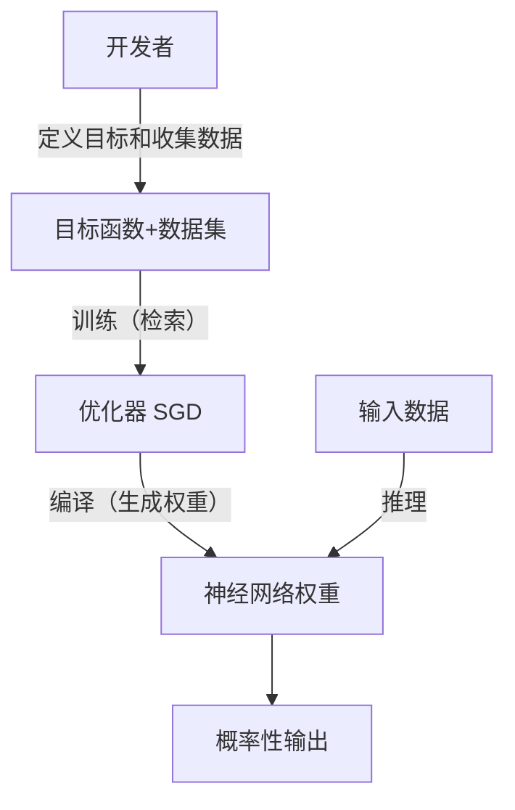
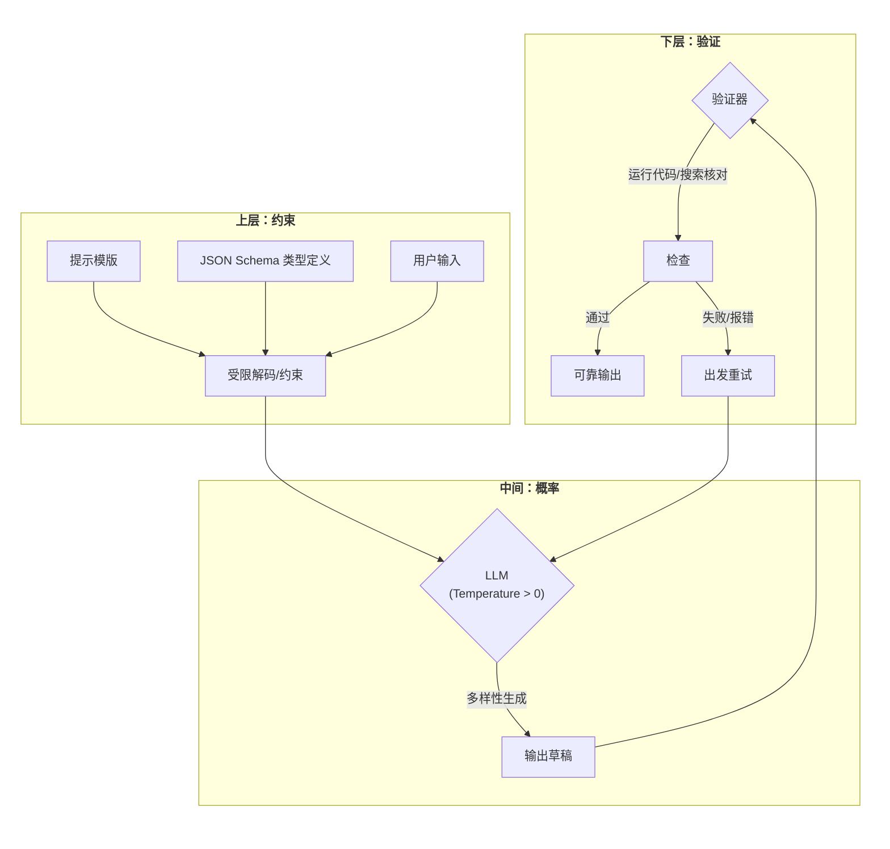
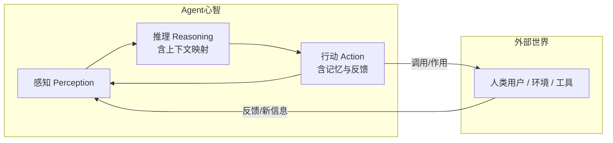
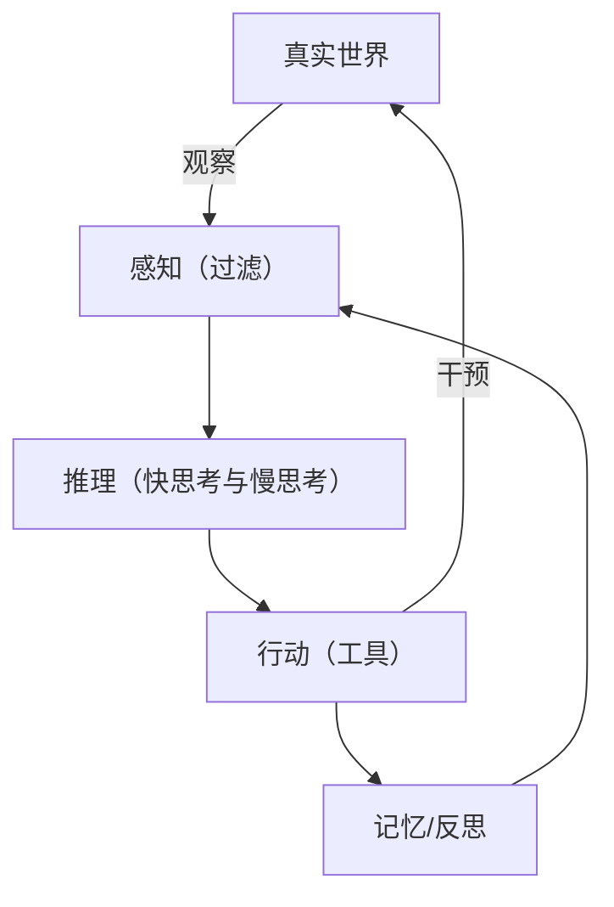

# 从 GoF 到 Agent

## 第 1 章 从结构到智能：设计模式的世纪旅程

### 1.1 GoF 的贡献：秩序的承诺

- 开篇立论：**法律的制定，往往不是出于对完美的追求，而是出于对混乱的恐惧**。设计模式同样如此。
- 1994 年，Erich Gamma、Richard Helm、Ralph Johnson、John Vlissides 四人出版《设计模式：可复用面向对象软件的基础》，把此前散落在工程实践里的经验固化成共同词汇。
- 在此之前，软件世界处于「蛮荒时代」：面向对象从学术玩具变成工业主流，C++ 正在征服世界，Smalltalk 优雅但小众，Java 即将诞生。开发者第一次拥有「对象」这件强大工具，却发现**有武器不等于会战斗**。
- GoF 的真正贡献不是 23 个模式本身，而是提供了：
  1. **一套共同语言**——说「这里用观察者」比描述半天机制更高效；
  2. **一套秩序**——把「怎么组织代码」从个人手感变成可传授、可评审的工程约定；
  3. **一个思考框架**——模式名背后是「问题—约束—解法—代价」的结构化表达。

### 1.2 黄金时代：设计模式的繁荣与边界

- 时间跨度：**1995—2005 年**，设计模式发展的黄金十年。
- 如果说 GoF 在荒原上竖起第一块路标，这十年工程师就在这片土地上建起了「宏伟的罗马城」。
- 标志性事件：
  - Java 1995 年横空出世，「一次编写，处处运行」，成为企业级开发的事实标准；
  - C++ 于 1998 年完成标准化，成为系统级编程的王者；
  - C# 于 2000 年诞生，集众家之长。
- J2EE（Java 2 Platform, Enterprise Edition）把这种秩序推向顶峰：它不只是一套框架，更是一套**严苛的工业标准**。EJB 这类规范让开发者即便实现简单业务，也要编写 Home 接口、Remote 接口和 Bean 实现类。
- 这一阶段的本质：**设计模式被「固化为规范」**。好处是工程一致性、可替换性和大规模协作；代价是抽象层级不断堆叠，简单问题被复杂化。
- 「繁荣与边界」的双重含义：模式解决了确定性问题，但它的前提假设是**需求相对稳定、系统边界清晰、行为可预期**。

### 1.3 诸神的黄昏：当确定性遇到不确定性

- **诸神并非死于战争，而是死于环境的变迁。**
- 旧时代的信念：软件工程的终极目标是打造一座「永恒的精密钟表」——齿轮咬合、分秒不差、一切尽在掌握。GoF 模式与后来的工程体系，都是这张钟表蓝图的一部分：只要设计足够严谨，就没有无法处理的逻辑，也没有不可预测的未来。
- 现实是：**新世界不再是静态的钟表，而是咆哮的海洋**。旧时代的秩序法则不仅失效，甚至成为毁灭的根源。
- **第一声警报：2008 年 10 月 Twitter（现 X）宕机**。
  - 不是普通宕机：服务器仍在运行，数据仍在响应，每个组件都看似正常工作，但整个系统如陷泥潭，响应时间从毫秒级退化至分钟级。
  - 开发者反复检查代码，发现**每个设计模式都精准地待在它该在的位置**：观察者模式用于事件通知，工厂模式负责创建对象，单例模式管理连接池……
  - 结论：**局部正确不等于全局正确**。组件级的最佳实践，无法保证系统级的涌现行为可控；模式解决的是结构问题，解决不了流量、耦合放大与级联失效。
- 这一节完成了全书的「问题定义」：当系统面对的是不确定性（流量、网络、用户行为、模型输出），以确定性为假设的模式体系必须演化。

### 小结：十字路口的坚定

第 1 章给出的不是「设计模式过时了」，而是「设计模式的**适用边界**被重新划定了」：

| 维度 | 确定性时代 | 不确定性时代 |
| --- | --- | --- |
| 系统隐喻 | 精密钟表 | 咆哮海洋 / 生态系统 |
| 核心目标 | 结构正确、可复用 | 可演化、可恢复、可观测 |
| 模式作用 | 组织代码结构 | 组织意图、记忆、行动与协作 |
| 失败模式 | 编译错误、逻辑缺陷 | 涌现故障、级联退化 |
| 工程师角色 | 架构的设计者 | 生态的培育者 |

这也直接引出第 2 章的问题：当「模式」不再足以描述系统，软件工程的范式该往哪里迁移。

## 第 2 章 从模式到意图：软件工程的范式迁移

在传统软件工程领域，人们依赖「模式」来应对复杂性。然而在 Agent 时代，模式只能告诉我们「怎么做」，而**意图**才能回答「为什么做」这一更本质的问题。本章回顾了几十年来软件工程的三条关键范式迁移——函数与流、分布式解耦、软件 2.0——它们共同为 Agent 的登场铺垫了地基。

### 2.1 函数与流：计算的原子化

在 GoF 的黄金时代，人们通过静态的类和对象来固化世界，状态被封装以获得控制。然而随着互联网爆发和摩尔定律边际效应递减，工程师逐渐意识到：**控制状态的最佳方式，或许并非单纯控制，而是尽可能地减少状态的存在**。这为 Agent 的诞生埋下了最重要的伏笔——因为 LLM 本质上就是一个庞大且无状态的纯函数。

#### 2.1.1 无状态的复兴：从对象封装到纯函数管道

1977 年，约翰·巴科斯（John Backus）在图灵奖演说中提出一个著名问题：「Can Programming Be Liberated from the von Neumann Style?（编程能否摆脱冯·诺依曼风格？）」

他批判了命令式编程的根本缺陷——程序不过是一长串用于修改状态的指令。冯·诺依曼架构（CPU 与存储器分离，通过总线连接）把我们的思维方式硬生生锁死在「一次处理一个字」的细粒度操作中。

**函数式编程（Functional Programming, FP）** 的核心信念很简洁：**要控制状态，最好的方法就是消灭状态**。
- **纯函数**：对于相同的输入 x，始终返回相同的输出 y；既不依赖全局变量，也不产生任何副作用。
- **不可变性（Immutability）**：数据一旦创建便不可更改；若需要「修改」，则必须创建一份新的副本。
- **引用透明**：任何表达式都可以被它的值替换而不改变程序行为。

OOP 在分布式时代遇到了根本矛盾：
- **状态的纠缠**：调用 `user.updateBalance()` 不仅修改余额，还可能触发 `lastModifiedTime` 更新、Observer 通知等一连串隐式状态变更，难以准确测试。
- **并发的噩梦**：成千上万线程同时修改同一对象状态时，开发者不得不引入「锁」（lock），这不仅引发竞争、严重损害性能，还极易导致死锁。

**终极映射：LLM 即纯函数。** 巴科斯的愿景在 AI 时代意外成真：
- **权重（Weight）**：推理阶段模型权重是冻结的，无论调用多少次都不会改变。
- **上下文（Context）**：Agent 的「记忆」并非存储在模型内部，而是每次以参数形式显式传入。
- 这彻底改变了 Agent 系统的设计模式：**上下文工程（Context Engineering）** 成为核心，**幂等性（Idempotency）** 得以实现——相同提示和固定随机种子，就能得到完全一致的输出。

软件工程由此跳出「对象身份」执念，回归「**数据变换**」本质。输入 Prompt → 检索增强 → 思维链推理 → 格式化输出，这就是一条纯粹的数据处理管道。

#### 2.1.2 响应式的觉醒：从阻塞等待到异步事件流

传统编程范式中，开发者的时间观是**线性的**：代码第 1 行执行完毕，才会执行第 2 行。这种**同步阻塞（Synchronous Blocking）** 模型虽然符合人类阅读清单的习惯，但在高延迟数据时代可能成为性能瓶颈，甚至引发系统性问题。

**倒塌的多米诺：阻塞的代价。** 设想一个典型 Agent 任务：先调用 Google Search（耗时 1s），解析结果（0.5s），再请求 LLM 生成摘要（8.5s）。同步模型下每个步骤必须依次完成：
- **CPU 空转**：主线程在 99% 的时间里干等着进度条，无法进行其他有用的工作；
- **系统失联**：这 10s 期间如果用户试图取消任务或插入新指令，系统将完全无响应——因为它被牢牢阻塞在那个漫长的 HTTP 请求上。

**Node.js 的回调地狱。** 早期 Node.js 引入回调机制来处理异步操作，却很快演变成嵌套深、逻辑支离破碎的金字塔结构。

**响应式宣言（The Reactive Manifesto）。** 2010 年左右，微软的埃里克·梅杰（Erik Meijer）等人提出响应式编程（Reactive Programming）——**世界并非由离散的指令构成，而是一条条连续的事件流（Event Stream）**。
- **Excel 的隐喻**：在 C1 输入 `=A1+B1`，A1 的值变化时，C1 自动更新。你不需要主动「拉取」（Pull）A1 的值——C1 是在「响应」（Push）A1 的变化。
- **Observable（可观察对象）**：数据不再是静态变量，而是一个随时发出值的事件流。

对 Agent 架构师而言，这是一个**根本性观念转变**：**不要「调用」LLM，而是「订阅」LLM**。这直接决定了你的 Agent 是让用户面对一个旋转 10s 的加载图标，还是能够提供流畅的打字机效果更新。

**背压（Backpressure）：流量控制的艺术。** 响应式编程更重要的是引入了背压机制——下游消费者可以控制上游数据生产速度，避免过快的数据流压垮系统。这在 Agent 系统中至关重要：你绝对不想让一个疯狂输出的「搜索 Agent」瞬间压垮下游负责总结的「写作 Agent」。

**结论：世界并非由静态快照构成，而是一条持续不断的变化之流。**

#### 2.1.3 数据流的哲学：世界不是快照

赫拉克利特（Heraclitus）的「人不能两次踏入同一条河流」——在 Web 1.0 和 Web 2.0 的黄金时代，工程师似乎在努力反驳这个观点：RDBMS + ACID 事务，把世界「冻结」在某一时刻的状态快照中。

但当执行 `UPDATE Users SET age=30 WHERE id=1` 时，我们不仅修改了数据，也抹去了历史。**数据流**的视角重新把世界看作过程而非快照：
- 消费者（如语音合成 TTS 模块、前端渲染引擎）的处理能力有限，且易受网络抖动、设备性能影响；
- 如果上下游处理速度不匹配，系统极易因缓冲区积压而崩溃——轻则丢包，重则内存溢出。

响应式架构通过**背压机制**，使下游能够主动向上游反馈「嘿，慢点发，我处理不过来了」，从而动态调节数据流速。

### 2.2 分布式的解耦：从单体到生态

数据流实现了**时间上的解耦**（异步处理），本节阐述如何实现**空间上的解耦**（分布式架构）。

在软件工程的早期，人们崇尚**单体（Monolith）**——无论是大型机还是庞大的 J2EE 应用，所有逻辑、数据和控制权集中在单一物理节点上。软件宛如一位全知全能的「上帝」，掌控着一切功能与数据的流转。

然而随着互联网的爆发式发展，摩尔定律逼近物理极限，我们不得不接受一个事实：**没有任何一台机器能大到装下整个世界**。于是我们拆解单体架构，将其分解为多个自治的服务单元，最终演化为分布式系统。

这看似是因算力瓶颈而作出的妥协，却在不经意间为 Agent 奠定了最理想的生存土壤——**Agent 本质上是社会化的**。一个孤立的 AGI 或许令人不安，但在工程实践中我们更倾向于构建一群各司其职的**专才型 Agent（Specialist Agent）**。分布式架构正是这个智能社会的物理基础设施。

#### 2.2.1 微服务：通过 API 连接一切

**贝索斯的「API 宣言」。** 2002 年，杰夫·贝索斯向亚马逊全体员工发出一封著名内部邮件：「所有团队必须通过服务接口（Service Interface）对外公开数据和功能；禁止直接读取数据库；禁止使用后门访问。违者将被解雇。」这不仅是亚马逊的转折点，更是现代软件架构的分水岭——它确立了一条核心原则：**功能必须解耦为服务，服务必须通过协议进行通信**。

这场持续二十余年的「接口化」运动，将物理世界与数字世界封装成成千上万个标准化的 RESTful API 或 RPC 接口。

**为机器准备的「盛宴」。** 在 Agent 出现之前，API 主要是供开发者使用的工具。然而随着 Agent 的出现，我们惊喜地发现：**API 简直是为 LLM 量身定制的「触手」**。
- Swagger/OpenAPI 规范最初旨在生成清晰的 API 文档，如今却直接成为 Agent 的「工具说明书」——Agent 只需读取一份 JSON 定义，便能理解如何调用该服务；
- 无头服务（Headless Services）：微服务倡导将用户界面与业务逻辑解耦，意味着 Agent 可以绕过复杂的 HTML/CSS 渲染层，直接与后端业务逻辑交互。

若非微服务运动铺就了道路，今天的 Agent 将如同「盲人摸象」——空有强大的大脑，却无法伸出手去感知和改变世界。

#### 2.2.2 架构的启示：从编排到涌现

微服务架构的另一个重要馈赠是**去中心化**。在单体架构时代，控制逻辑集中在 Main 函数中；在微服务时代，控制逻辑分散于各服务之间的交互之中。这可直接映射到 Agent 的协作模式（见第 9 章）：
- **编排（Orchestration）**：由一个中心化的「大脑」统一调度和指挥所有 Agent；
- **协同（Choreography）**：类似微服务中的事件通知机制，Agent 通过广播消息彼此感知、自主协作，不需要中央协调者。

微服务并非终点，而是一种基础设施。它将复杂系统分解为自治单元，并封装进一个个标准化的 API「盒子」中。而 Agent 的使命，正是打开并协调这些盒子，融合其能力，创造出超越单点的价值。

### 2.3 软件 2.0：当概率遇见代码

2017 年，特斯拉 AI 总监安德烈·卡帕西（Andrej Karpathy）发表《Software 2.0》，这不仅是一个新名词，更是计算机科学根基的一次深刻反思。**在此之前，软件工程致力于消除不确定性；此后，软件工程开始学会利用不确定性**。

#### 2.3.1 规则的落幕：逻辑不再由 if-else 语句编写

在软件 1.0 时代，开发者如同拥有绝对权力的建筑师，对每一行逻辑进行着「独裁式」的控制——只要能将问题转化为极其精确的指令序列，计算机便能实现任何被明确定义的逻辑，确定性是其基石。

而进入以神经网络为代表的软件 2.0 时代后，这种确定性被打破了。开发者的角色从**建筑师**转变为**园丁**——我们主要提供**土壤**（训练数据）并设立**栅栏**（损失函数约束），而具体的决策逻辑与能力，则由**模型**通过在海量数据中学习而自行**涌现**。

在机器学习时代，数据取代了传统代码，成为软件开发流程中的核心要素；优化器扮演了编译器的角色，而训练得到的权重，则构成了最终的“可执行文件”。

理解软件2.0是掌握`Agent`行为特征的关键。

* 从**指令执行**到**模式补全**：`Agent`并非简单地执行你的`Prompt`，而是在补全你的`Prompt`。大模型`LLM`实质上是一个巨大的概率分布表，它的输出是选择参数空间中概率最高的那个。
* 幻觉是**特性**而非**Bug**：模型本质上是在进行**有损压缩**与**模糊联想**，幻觉正是这种联想能力的**副作用**。创造力与胡言乱语，往往如同一枚硬币的两面。
* 编程语言的跃迁：在软件 2.0 时代，以`Prompt`方式给出的自然语言已经成为新的“编程语言”。我们通过调整`Prompt`，来微调模型的概率分布。

软件2.0宣告了规则时代的落幕，我们放弃了对每一行逻辑的精确控制，换来了处理近乎无限复杂度的能力。然而这些带来了一个巨大的工程挑战：若代码不再是人类直接编写的，我们应该如何进行版本控制？如何测试及调试？

#### 2.3.2 MLOps 的启示：为 AgentOps 铺路

当代码变为数据（用以表示模型权重）时，传统的 DevOps 工具链便显得力不从心：你无法对一个`100GB`的二进制模型文件执行`git diff`来查看具体修改了哪些逻辑，也无法通过 IDE 来「调试」神经网络的权重。为了驯服软件 2.0 的「黑盒」特性，MLOps（Machine Learning Operations，机器学习运维）应运而生——它并非单一工具，而是一套关于「如何管理概率性软件生命周期」的方法论。

这套方法论为Agent架构师提供了以下启示：

* **数据即源代码**：即使模型架构与代码保持不变，只要训练数据发生改变，模型的行为就可能发生剧烈变化。对于 Agent 开发者而言，主要专注于提示词工程`Prompt Engineering`，这是需要进行版本控制的关键资产。同时，当`Agent`出现错误时，需要能够追溯，这种追溯机制被称为上下文谱系`Context Lineage`。需要像管理代码一样严谨的管理数据和`Prompt`，这一理念促进了`LangSmith`、`LangeUse`等`Agent Opts`平台的发展。
* **测试的概率化**：在`MLOps`中，我们面对的是概率分布，无法要求模型到达 100% 的准确率，这是 Agent 开发中最深刻的教训：Agent的行为本质上难以测试，除非构建专门的评估数据集。需要引入`LLM-as-a-Judge`LLM 即法官机制。Agent 的质量并非由传统意义上的测试通过率决定，而是取决于真实场景中，新版 Agent 战胜旧版 Agent 的概率。需要放下对确定性的执念，转而构建基于统计的质量护栏。
* **可观测的语义化**：模型可能输出有害内容或开始胡言乱语，这种现象被称为数据漂移`Data Drift`或概念漂移`Concept Drift`。对`Agent`的监控必须深入到语义层面，不在依赖INFO/ERROR日志，而是要关注追踪轨迹`Trace`，可视化`Agent`的完整推理链路，用户输入 -> 检索 -> 思考 -> 工具调用 -> 响应。还需要实时监测Agent的输出是否变得**有毒**`Toxic`，或陷入无意义的**复读**`Repetition`。`MLOps`将曾经如同炼金术般的模型训练，转变成可复现、可管理的工程流程，`AgentOps`则专注于精调`Prompt`，更加注重追踪思维链。

#### 2.3.3 不确定性的工程化：在概率模型之上构建可靠系统

`Agent`架构师的核心竞争力，正是通过确定性的工程框架，驾驭并约束概率性的智能核心，从而构建出高可靠的系统。

在软件1.0时代，可靠性源于**证明**，通过逻辑推导和单元测试，确保代码在输入A时必然输出B。在软件2.0时代，可靠性源于**统计**与**约束**。

为了解决用户对`100%`确定性的结构化数据的需求与LLM生成内容不确定性之间的矛盾，**三明治架构**是一种有效的策略。其核心理念是通过两层确定性的逻辑或工程框架来包围中间那层基于概率的模型。

* **输入侧约束：提示工程的防御性**：不仅仅是「写一个更好的 Prompt」，而是需要引入类似**类型系统（Type System）** 的强制性约束机制，即**结构化强制（Structured Enforcing）**。当前模型支持的`JSON`模式或`Function Calling`。不仅是微调的结果，更关键的是在推理阶段采用了**受限解码（Constrained Decoding）** 技术。
* **输出侧验证：验证器模式**：**生成**可以是概率性的，但**验证**必须是确定性的。这是应对幻觉的最有效手段之一，为`Agent`构建一个具备怀疑能力的反馈回路。这就是`ReAct`模式的核心逻辑：通过确定性的环境反馈，不断坍缩概率性生成的空间，从而引导模型输出趋向准确与可靠。
* **过程中的冗余：自洽性**：通过采样与投票机制，可以让`Agent`对同一个问题独立推理多次，从而提高系统的鲁棒性。

现在`Agent`架构，并未取代传统软件架构，而是与之共存。其本质是使用传统软件架构包围模型或推理，以确定性逻辑引导不确定性的智慧，以刚性的约束规范柔性的生成。

### 小结：地基的夯实

在第 2 章中，我们并未急于切入 Agent 本身，而是系统梳理了软件工程为迎接 Agent 时代所做的长期准备：
- **函数与流** 让我们掌握了无状态（函数式）与异步（响应式）的编程范式，使软件能够契合 AI 的思考节奏；
- **分布式** 教会我们通过接口化与 Serverless（原子化）构建灵活、可扩展的系统，为 Agent 提供了无限延展的「手脚」；
- **软件 2.0** 引导我们学会在拥抱概率性的同时施加工程化约束，从而在不确定性中建立对确定性的信心。

所有关键技术的「积木」（Transformer、Docker、API、向量数据库等）如今都已准备就绪。现在需要的是一种全新的架构思想，将这些组件有机整合，构建出具备感知、记忆、思考与行动能力的「新物种」。

## 第 3 章 从设计到演化，欢迎来到 Agent 时代

当我们把 LLM 引入架构核心时，奇点已然临近。软件不再仅仅是对人类指令的**响应（response）**，而是开始展现出**意图和自主性（agency）**：
- 它不再是被动等待调用的工具，而是主动感知环境的观察者；
- 它不再是无状态的函数，而是拥有记忆与身份的实体；
- 它不再是孤立的计算节点，而是能够协作的社会成员。

**我们不再是在「设计（design）」一个系统，而是在「培育（cultivate）」一个物种**。

### 3.1 Agent 的本质：从工具到伙伴

什么是 Agent？从技术角度来看，Agent 可能只是一个不断调用 LLM API 的死循环脚本。然而从交互哲学来看，它标志着人机关系的根本性重构：**从「命令与控制」转向「意图与协作」**。

#### 3.1.1 从命令到对话：交互原语的升维

工具的根本特征是**被动性**与**机械性**：它们等待指令、执行指令，然后继续等待下一条指令。而`Agent`主动感知环境，自主思考与规划，采取行动，并能够从经验中持续学习。

在`CLI`（Command-Line Interface，命令行界面）时代，人机交互的基本单元是“指令”​。在`CLI`（Command-Line Interface，命令行界面）时代，人机交互的基本单元是“指令”​。两种模式共享一个根本前提：人类必须负责“怎么做”(How)，而机器仅负责执行。

在`Agent`时代，人机交互的基本单元已转变为“对话”​，更准确地说，是“意图”​。这种转变意味着**认知负荷的转移**。

过去，复杂性存在于用户的脑海中——用户必须熟悉软件的菜单与功能，记住各种操作步骤和指令。如今，这些原本由用户自行承担的操作细节，已交由Agent在后台统一处理。软件不再是一个被动的操作平台，而是逐渐演变为能够理解用户意图并作出响应的对话者。这一转变显著降低了用户的认知负担，使其得以从繁杂的操作细节中解脱出来，专注于自身的目标与意图。

工具时代的命令式交互，已华丽地转变为Agent时代的对话式交互——不再只是“你执行”​，而是“我们一起把事情做完”​。

对话不仅是自然语言的交互界面，更重要的是，它能够实现意图理解、上下文保持（即我们熟知的上下文工程）以及任务分解。

这不是助手在「执行命令」，而是伙伴在**共同建模**。开发者从「指挥官」退居为「共同设计者」，Agent 从「工具」升级为「协作方」。

#### 3.1.2 意图的理解：模糊与精确的桥梁

传统软件不仅缺乏主动性，而且拘泥于字面含义。`Agent`的核心能力在于充当一个“模糊翻译器”​，搭建起“人类模糊的自然语言”与“机器精确的API调用”之间的桥梁。

架构师需要认识到，Agent的本质就是一个持续运行的“意图编译器”​，它能够实时地将人类的意图编译为机器可执行的动作。而意图理解，正是Agent的“灵魂能力”​。

从技术的角度来看，意图理解(Intent Understanding)通常包含4个层次:

* **语义理解**：提取用户表达背后的动作、对象、范围和限制条件。在复杂系统中，通常会结合结构化的意图模型进行解析。
* **目的识别**：不仅要理解“你说什么”​，更要理解“你想实现什么”​。`Agent`应能从“显性指令”中推断出“隐性目标”​。`Reasoning Tokens`表面是在进行推理，本质上是为了更准确地捕捉用户的隐含意图。
* **上下文关联**：Agent必须将意图“落地”到具体环境中，包括用户的代码结构、当前文件目录、用户偏好、安全约束和历史任务上下文这正是上下文工程的核心价值所在：Agent必须基于当前世界状态进行判断和决策。
* **风险评估与澄清**：Agent必须在“意图模糊”时主动提问，而非贸然执行，以避免误操作，这样既确保任务能够准确完成，又符合安全策略。

**注意：** 上述4个层次并不是严格顺序的，而是可以并行进行的。在实际应用中，Agent 会根据用户输入的文本，同时进行多个层次的处理，以实现对意图的准确理解与执行。

#### 3.1.3 记忆与身份：Agent的自我连续性

工具是“用完即走”的，但伙伴是有记忆的。Agent在每次对话之间延续其“身份”，并逐渐形成对用户的深入理解。

##### 记忆：连续性幻觉

LLM本身是无状态的。Agent所谓的“记忆”​，实际上是通过上下文工程构建出的一种“幻觉”​。

**短期记忆**(Session Memory)：记录当前会话的上下文，包括用户上一句话的内容、最近讨论的话题、代码片段，以及用户此前纠正过的误解等。

短期记忆使Agent能够实现以下目标：

* 在多轮对话中保持一致性
* 避免重复提问
* 进行上下文连续的推理

如今，最先进的上下文工程技术会对短期记忆进行“摘要、过滤与结构化”处理，使Agent能在高达20万至100万个Token的大上下文中保持精准推理。

**长期记忆**(Long-term Memory)：借助向量数据库等技术，记录用户跨会话的偏好信息，例如用户偏好的代码风格、常用工具栈、历史项目结构、过往提出的问题类型、用户的角色设定​。这使Agent具备了“持续服务能力”​：下次打开时，它能自然延续上一次的思路。

目前，Mem0、GraphRAG、Hybrid Memory Systems等架构已将长期记忆实现为可建模、可检索、可索引的形式，使Agent能够像人类一样“内化知识”​。

##### 身份：`System Prompt`的灵魂

`System Prompt`的身份描述可以使无形的概率模型便坍缩成一个具体的人格(persona)。身份(identity)远不止于人设，它是一套价值观与行为准则的集合，决定了Agent在面临两难选择时（如效率与安全之间的权衡）会倾向于哪一方。

记忆是“知道你是谁”​，身份则是“知道自己是谁”​。身份能使Agent在表达风格、专业领域定位、价值观倾向、行动策略偏好等方面保持稳定性。

#### 3.1.4 上下文工程：理解世界状态

意图理解与身份信息使Agent明确“你希望达成什么目标”，而上下文工程则使Agent理解“当前世界的状况是怎样的”。

LLM本身并不具备主动感知世界的能力，它只能依据输入的文本进行推理。因此，对任何Agent而言，都受制于这样一句话：​“Garbage in, garbage out”​（输入的是垃圾，输出的也必然是垃圾）​。Agent失败的主要原因，往往并非模型的能力不足，而是上下文信息提供有误。

对Agent而言，上下文就是它的整个世界。Agent的判断质量高度依赖于我们提供什么信息，以及如何提供这些信息。提示工程解决的是“怎么说”​，而上下文工程解决的是“给Agent看什么”​。上下文工程的目标：将Agent完成任务所需的最关键信息，以最合适的结构提供给模型。

架构师的新职责是设计一套机制，以便能够实时将现实世界的状态序列化为文本，并将其投射到Agent的上下文中。这正是上下文工程的本质——为Agent搭建数字感官。

上下文工程有以下三个核心来源：

* 用户上下文(User Context)：涵盖用户的开发风格、历史偏好（如偏好的列表推导式）​、常用技术栈（如Spark、LangChain、FastAPI）以及当前工作内容（如正在编写爬虫或构建RAG系统）​
* 环境上下文(Environment Context)：用于理解“世界状态”​，包括文件结构、代码库内容、当前分支、日志、错误栈、变量值、API响应以及运行时状态等。
* 任务上下文(Task Context)：Agent在执行任务时，必须掌握前序任务的结果、当前子任务的进度、依赖项是否已加载，以及工具调用的历史尝试记录。这是支持多步任务和复杂Agent工作流（如LangGraph）所必需的能力。

上下文工程领域呈现出以下技术新趋势，其本质都是服务于一个共同目标：**最大限度地减少噪声，同时尽可能突出关键信息**。

* 选择性上下文(Selective Context)：精准筛选与当前意图紧密相连的内容，剔除无关信息，聚焦关键要素
* 结构化摘要(Structured Summaries)：针对历史内容生成结构化摘要，包括标题、关键发现和失败点等核心要素
* 图结构上下文(Graph-based Context)：将知识库构建为图结构，并依据节点重要性进行检索
* 上下文优先级排序(Context Prioritization)：由模型自主判断不同内容的权重高低。例如，有的模型引入了“思考模式”​，赋予重要信息更高的优先级，使信息处理更加符合用户需求和场景要求，优化了决策依据的生成过程。

上下文工程并非简单地要求“喂信息”​，而是要“喂结构”​。优秀的上下文并非取决于“文字量多”​，而在于“让模型立即理解”​。当模型接收到高质量的结构化输入时，其推理精度可提升数倍。

上下文工程，正是打造高质量Agent的真正秘诀。它的本质是将多维、动态的现实世界，精准地投射为模型可理解的线性文本序列。如果将Agent比作一个在漆黑房间中解题的人，那么上下文工程如同那束手电筒的光——光所照之处，决定了Agent聚焦于代码库的哪一部分、日志的哪几行，以及用户的哪段历史，从而直接决定其能否成功解题。

#### 3.1.4 任务分解：把“目标”变为“计划”

任务分解(Task Decomposition)赋予了Agent将“目标”转化为具体“步骤”的能力，是衡量其智能化水平的关键指标。

任务分解包含两个关键环节。

* 规划(Planning)：将总体目标拆解为若干子目标。
* 映射(Mapping)：将每个子目标转化为具体的行动或可调用的工具。
  
这种“化整为零”的能力，使Agent能够处理远超单次API调用能力范围的长程复杂任务。

Agent之所以能成为具备规划能力的规划者(Planner)，其核心在于引入了一个关键的中间层——规划层。

* 理解(Understand)：将模糊的高层目标（如“优化数据管道”​）转化为明确的技术需求。
* 规划(Plan)：生成可操作的多步方案，如“I/O分析→算法优化→缓存策略”​。
* 执行与反思(Execute and Critique)：这是最接近人类智能的环节——Agent在执行完第一步后，可能基于新信息主动调整计划。例如，​“我查看了日志，发现I/O并非瓶颈，因此决定暂停原计划，转而排查CPU占用问题”​。

这种动态规划能力，是Agent与传统自动化脚本的根本区别所在。

**任务分解的三步法**。现代Agent内部普遍采用三步策略。

* 理解目标：这并非仅仅解析字面意思，而是要洞察“真实需求”​。例如，当用户说“清理一下昨天的日志”​，其真实意图可能是压缩、分析或归档日志，而非简单地删除文件。
* 确定路径：将目标转化为清晰、可执行的流程。例如，加载日志文件→按日期分组→统计错误数量→生成分析报告→压缩原始日志。一个优秀的计划应具备以下特征：步骤简洁、无歧义、可成功执行、支持中断、便于检查，并能根据执行反馈动态调整。
* 管理执行：包括工具调用、失败重试、异常处理、结果验证，以及向用户汇报进度和动态调整计划。这一环节正是LangGraph、AutoGen、CrewAI等Agent框架的核心价值所在——让Agent从单纯的“聊天模型”真正升级为可靠的“任务执行者”​。

**学会自我审查**。近期Agent研究领域呈现出一个明显趋势：在执行前对计划进行自我审查。例如模型的“思考模式”​，均强调先生成初步计划，再对该计划进行批判性分析，确认其合理性与可行性后，才进入执行阶段。它使Agent的潜在错误在执行前就被识别和修正，从而避免在运行时酿成不可逆的事故。

**任务分解与上下文工程互相强化**。没有上下文工程，就无法正确分解任务；而没有任务分解，上下文工程也无从聚焦与取舍。二者相互依存，共同构成了Agent完整的“执行链路”​。

这正是Agent与传统工具的根本区别：它不只是回答问题，而是真正开展工作。

* 上下文工程让Agent“看得清楚”——准确理解环境与需求。
* 任务分解让Agent“做得正确”——将目标转化为可执行、可调整的行动路径。
   
二者共同构成了Agent时代的核心工程化能力，也是决定Agent能否超越“高级聊天机器人”的关键。

#### 3.1.6 工具、技能与行动策略：真正影响世界

如果没有工具，LLM不过是一个被困在服务器里的“缸中之脑”。要真正成为人类的伙伴，它必须拥有“手”​：能够调用工具、操作环境、执行动作。

工具使用(Tool Use)，或更学术地称为行动(Action)，是Agent获得“数字具身性”(Digital Embodiment)的关键。它使Agent从一个“被动的观察者”转变为“主动的参与者”​。本质上，工具调用以语言模型为“大脑”​，以各类工具为“身体”——通过语言理解与规划驱动外部的能力，实现对数字环境的真实干预。

Agent与传统聊天模型最根本的分野，不在于“回答更准确”​，而在于“能够行动”​。要实现行动能力，Agent必须具备以下两项核心能力。

* 选择合适工具的能力：根据任务目标和上下文，精准匹配并调用最有效的工具。
* 制定安全、可靠、可预测的行动策略的能力：旨在规划清晰、可控且具备容错与调整能力的执行路径。
  
这两项核心能力共同构成了长尾任务执行的基础：没有工具调用能力的Agent只能“说”​；而具备工具调用能力的Agent才真正能够“做”​。

**工具的解剖学：不仅仅是API。**

在传统软件中，调用一个函数只需要了解其签名(Signature)，即参数类型与返回值。然而，在Agent架构中，工具必须附带语义(Semantics)。Agent不需要知晓内存地址或底层实现细节，但它必须清楚“这个工具能用来做什么”以及“在什么情境下应当使用它”​。为Agent设计的工具，通常包含以下3个维度的描述。

* 功能描述：这是写给模型看的“说明书”​，用于说明工具的能力和适用场景，帮助模型判断是否应选择该工具。
* 参数约束：这是写给程序的“契约”​，明确规定调用时所需参数的结构与类型，模型必须生成符合该规范的JSON输入。
* 副作用声明：这是写给安全模块的“警示”​，用于标明操作的潜在影响（例如，该操作是否只读？是否会修改数据或触发外部系统？​）​。

2024年兴起的MCP（Model Context Protocol，模型上下文协议）致力于将“工具描述”标准化，使Agent能够像插拔USB设备一样，灵活挂载各类SaaS （Software as a Service，软件即服务）与外部能力。正因如此，MCP、LangChain Tools、OpenAI/Anthropic的Function Calling等机制，已成为构建Agent的关键基础设施。

**从“工具”到“技能”​：企业的数字本体**

在推出MCP之后，Anthropic于2025年10月发布了Agent Skills，再次在Agent工程领域产生了重要影响。

* 工具(Tool)是通用且原子化的操作，如“执行SQL操作”​“发送HTTP请求”​“读写文件”等。
* 技能(Skill)是面向业务场景、经过封装的能力单元，如“生成月度财报”​“执行代码审查”​“处理客户退款”等。简言之，技能=工具+领域知识+标准作业程序。

而在Agent时代，工具和技能的选择更像一位资深工程师的决策过程：是否需要调用工具？现在是不是恰当的调用时机？该选用哪个工具？当前上下文是否充分？是否存在潜在副作用？是否需要先验证输入？

为什么这一区别如此重要？因为单纯的API是冰冷且缺少上下文的。如果直接向Agent提供一个delete_user的API，不仅存在危险，还可能引发不可逆的操作失误。然而，如果将该API封装为一项“用户注销技能”​，并在其中内嵌标准作业程序（例如，备份数据→检查欠款→发送通知→删除操作）​，那么Agent获得的不只是一个原始功能，而是一种具备业务语义和安全约束的业务能力。技能包构成了企业的数字本体。

* 当企业将内部流程、规范和最佳实践封装为Agent可调用的“技能”时，便实现了知识的资产化。
* Agent不再只是一个通用模型，而是继承了企业DNA的“数字员工”​：它不仅知道“怎么做”​（调用API）​，更懂得“如何正确地做”​（遵循标准作业程序）​。

**工具和技能的选择**

传统工具调用是机械式的：只要用户说“翻译”​，系统就直接调用翻译工具，不加判断、不问上下文。而在Agent时代，工具和技能的选择更像一位资深工程师的决策过程：是否需要调用工具？现在是不是恰当的调用时机？该选用哪个工具？当前上下文是否充分？是否存在潜在副作用？是否需要先验证输入？

Agent能够在上百个可用工具和多种技能中，精准识别出最适合当前任务的那一个；随后，它会从用户对话中提取关键信息，结合该工具预定义的参数约束，生成结构合规的输入；最后，以这些参数调用工具并执行操作。优秀的工具和技能选择能力不仅使Agent的行为更加可靠、可控、可解释，同时还支撑了多工具协同(Multi-toolOrchestration)——Agent能够自动规划调用顺序，例如，先使用搜索工具查找相关文档，再调用代码执行工具运行代码示例，最后借助数学工具计算并验证结果。这种动态、上下文感知的工具编排能力，正是LangGraph、AutoGen和MCP等生态当前重点发展的方向。

**核心循环：ReAct**

工具调用并非孤立的事件，而是推理链条中的关键一环。Agent会根据工具的返回结果（成功、失败或报错）动态调整后续行动。

DeepMind提出的ReAct范式已成为现代Agent行动的标准心智模型，其核心循环如下：思考(Thought)→行动(Action)→观察(Observation)

这改变了传统“输入—输出”的线性逻辑，形成了一个动态闭环的推理与行动循环。

* 思考：用户让我分析销售下降的原因。我应该先查一下销售数据。
* 行动：调用query_sales_db("SELECT * FROM sales WHERE date > '2024-01-01'")。
* 观察：​（数据库返回了1000条原始JSON记录）数据量太大，难以直接分析。
* 思考：我犯了个错误，不应拉取明细数据，而应先按月聚合，观察整体趋势。
* 行动：调用query_sales_db("SELECT month, SUM(amount) ... GROUP BY month")。

这种“行动增强推理”(Action-Augmented Reasoning)使Agent具备了试错和自我修正的能力。它不再依赖一次性给出完美答案，而是通过与环境的持续交互，逐步逼近正确的解决方案。

行动策略：安全与边界

当软件开始“行动”时，风险也随之而来。一个由LLM驱动、却拥有rm -rf权限的Agent，无异于一只在服务器前随意敲击键盘的猴子——其意图或许合理，但后果可能是灾难性的。

行动策略(Action Strategy)决定了Agent是鲁莽地直接执行任务，还是谨慎行事并先由人类确认。其核心不在于如何执行任务，而在于何时暂停以进行验证或获取批准。为此，架构师必须设计以下3道防线。

* 只读沙箱(Read-Only Sandbox)：在探索与信息收集阶段，仅允许Agent调用无副作用的工具（如搜索、读取日志、查询数据库）​。这相当于为Agent设置了一道“婴儿围栏”​，确保其在理解任务和制订计划时不会对系统造成任何不可逆影响。
* 人类介入(Human-In-The-Loop，HITL)：在执行高风险写操作（如转账、删除文件、发送外部邮件）前，系统强制中断流程，清晰地展示拟执行的操作内容、上下文及潜在后果，等待人类明确批准后方可继续。
* 确定性护栏(Deterministic Guardrails)：即使获得用户授权，底层执行层仍需要嵌入硬性规则校验（如“禁止删除根目录”​）​。行动策略是Agent的“行为规范”​，包含以下3个核心层次。
* 安全：在执行任何操作前，Agent必须具备“暂停判断”的能力，主动识别高风险行为（如删除系统文件、修改生产数据库等）​，并拒绝执行超出安全边界的危险操作。这是所有行业级Agent必须坚守的底线。
* 可解释：用户必须清晰地理解Agent“为什么这么做”​。Agent应主动展示其计划、说明工具调用的原因，并报告每一步的执行结果。这不仅有助于建立用户信任，也为审计、追踪与调试提供了必要依据。
* 可控：在执行关键或不可逆步骤时，Agent应支持用户介入。例如，提前展示即将执行的操作，明确询问“是否继续”​，确保人类始终保有最终决策权。

工具使用赋予Agent影响现实世界的能力，技能为其提供职业素养，而行动策略则确保其行为是安全、高效且可信的。三者共同构成了Agent从“知识系统”迈向“执行系统”的最后一块关键拼图。

#### 3.1.7 人类介入的接口：HITL与护栏

最后，Agent的出现迫使我们重新思考“用户”的角色定位。过去，人是操作员(Operator)：亲自执行每一步操作，系统只是被动响应指令的工具。未来，人是监督者(Supervisor)与评估者(Evaluator)：不再事必躬亲，而是设定目标、审查计划、授权关键动作，并对结果进行判断与反馈。

我们正从Copilot模式迈向Autopilot模式​。

* Copilot模式：人主导，AI辅助。AI坐在副驾驶座上，提供建议、补全代码或回答问题，但所有决策与操作仍由人类掌控。
* Autopilot模式：AI主导，人监督。AI握住方向盘，自主规划、调用工具并执行任务；人类则退居监督席，在关键时刻介入、校正或接管。

这种关系的转变要求我们在设计系统时必须预留HITL接口。这不仅是为了安全、防止失控，更是为了在人类与AI的深度共生中，确保人类始终保有主体性。

至此，我们完成了对Agent这一概念的**本体论定义**。它不是一段孤立的代码，也不是一个被动的工具，而是感知、记忆、推理与行动有机融合的数字存在。它是我们在数字世界中的镜像——能理解我们的意图、延续我们的思维；也是我们的伙伴——能主动协作、承担责任，并在复杂环境中代表我们行事。

既然我们已经勾勒出Agent的全景图，接下来，就让我们深入其“大脑”内部，看看它是如何思考的，又是如何将感知到的输入，一步步转化为可执行的行动输出的。

### 3.2 Agent 心智架构：感知—推理—行动循环

生命并非静态的存在，而是动态的流转；智能亦如此，它在与环境的不断交互循环中得以体现与发展。

在传统软件架构中，无论是 MVC 还是微服务，本质上都遵循**线性管道模式**：输入 → 处理 → 输出。数据在系统中流转，一旦处理完成，流转即停止。

然而在 Agent 架构中，我们必须引入**循环（Loop）** 的概念：**Agent 并非一个「函数」，而是一个「进程」**——运行在一个 `while(alive)` 的无限循环之中。感知、推理与行动并非孤立的步骤，而是彼此咬合、协同运转的「齿轮」。

#### 3.2.1 感知：主动的过滤器

传统程序仅接收数据，而 Agent 通过**感知（Perception）** 来理解世界。传统程序对输入是被动的——用户给什么，它处理什么；而 Agent 的感知是主动的：它不仅接收信息，还会**主动选择、解读并赋予信息以意义**。

Agent 的现代感知系统至少包含 3 个关键机制。
1. **注意力（Attention）**：并非所有输入都同等重要。世界充满噪声，如果 Agent 试图处理所有信息，将迅速陷入过载。注意力机制让 Agent 在每个循环中聚焦于最相关的信号。
2. **预测（Prediction）**：Agent会基于历史对话、用户偏好和任务背景，构建一个“预测模型”​。当现实与预测发生偏离时，便会产生“惊奇点”(Surprise)。而这些惊奇点往往预示着新的价值、新的问题或新的矛盾。
3. **语义化（Semantization）**：从特征到意义。现代多模态模型已不再局限于识别物体，而是能够理解情境。将原始信号（像素、字节、token 流）转化为有意义的内部表征（对象、关系、意图）。感知已从“是什么”跃迁至“意味着什么”​。因此，Agent的感知是一种“目标驱动的理解”​，而非“机械式的输入”​。Agent不仅能识别人，更能理解“需要帮助”这一概念。在感知过程中，它可能会注意到拄拐杖的老人、迷路的孩子、摔倒的路人……

#### 3.2.2 推理：快思考与慢思考

传统程序执行逻辑，而Agent则进行推理(Reasoning)。传统程序中的逻辑是确定性的：若A，则执行X；若B，则执行Y。而Agent的推理则是柔性的、非确定性的，并且与经验紧密相关——它更像人类的思考过程，而非计算图的机械执行。

借鉴丹尼尔·卡尼曼(Daniel Kahneman)的心理学模型，Agent的推理架构正在向“双系统”演进。

* 直觉式/快思考：基于LLM的概率预测直接生成回答，适用于闲聊、简单问答以及代码补全等场景。其特点是响应迅速、计算成本低，但容易产生幻觉。
* 逻辑式/慢思考：通过思维链，Agent在输出最终结果前，会强制生成推理步骤、反思路径，甚至伪代码，适用于复杂规划、数学证明、调试等任务。其特点是响应较慢、计算成本较高，但逻辑严密、可靠性强。

架构师面临的挑战在于“路由”​：如何设计一种机制，使Agent在面对简单问题时调用快思考，而在遭遇复杂任务时自动切换至慢思考？

Agent推理通常包含以下4个关键层次。

* 情境理解(Situation Awareness)。Agent需要回答：​“当前到底发生了什么？​”它会将感知到的信息与长期记忆和短期上下文相结合，构建出一个清晰的“任务场景”​。
* 经验检索(Memory Retrieval)。Agent会自问：​“我是否曾遇到过类似的问题？​”这是推理过程中的重要加速器。大多数高性能模型（如OPenAI o1、DeepSeek-R1）依赖策略性记忆检索，以避免重复犯错。
* 心智模拟(Mental Simulation)。Agent不会立即采取行动，而是先在“脑海中”进行预演：如果调用这个API，会发生什么？如果读取该文件，能获得哪些信息？如果执行删除操作，是否会引发风险？推理的关键不仅在于逻辑本身，更在于其模拟能力。
* 决策与信心(Decision and Confidence)。Agent会对候选行动进行价值评估：哪个最符合用户目标？哪个最安全？哪个成本最低？同时还会判断：​“我对这个选择有多确定？​”Agent的本质不是“计算出唯一结果”​，而是“通过思考进行权衡并作出决定”​。

在智能推理的概率性思考过程中，可能包含以下一系列曾被视为人类心智专属的认知特质。

* 情境理解：这是什么情况？
* 记忆检索：我是否曾遇到过类似情况？
* 心智模拟：如果我这样做，会发生什么？
* 因果推理：为什么会这样？
* 反事实思考：如果不这样做，结果会如何？
* 价值评估：哪种选择最符合目标、最安全或成本最低？
* 不确定性量化：我对当前的判断有多确定？

#### 3.2.3 行动：改变与反馈

在传统软件中，输出（如print或return）意味着执行的结束。

而在Agent架构中，行动则标志着环境改变的开始。

Agent的价值在于其能够对现实世界产生切实影响：写入数据库、发送邮件、部署代码……行动是Agent的“意图”在物理世界或数字环境中的延伸。

而且，通过行动—反馈循环(Action-Feedback Loop)，Agent能够在动态环境中“通过试错”不断调整策略，主动探测世界的边界并逐步适应。传统程序是独白者，Agent是互动者。

* 脚本：执行命令→结束。若出错，则程序崩溃。
* Agent：执行命令→观察结果→若出错，则调整参数→重试。

在传统软件工程中，return或print通常标志着计算的终结——程序将结果交付给用户后，进程随即结束或进入空闲等待状态。这种输出对程序自身不产生任何“反作用力”​，无法引发后续的自主行为。

而在Agent架构中，行动并非终点，而是改变的起点。

Agent的行动不再是单纯的信息展示，而是对环境的主动介入。它试图通过这些行动来改变世界的状态，并期待从环境中获得反馈（见图3-10）​。这种反馈会触发新一轮的感知与推理过程，使得Agent能够持续适应并影响其所在的环境。

这就引出了行动的3个新维度，分别是认识性行动、目的性行动和闭环行动。

**认识性行动：行动即实验**

这是Agent最深刻的特征之一。传统程序通常只有在确定无误时才执行操作；而Agent却常常在不确定性中采取行动——因为对它而言，行动本身就是获取信息、消除不确定性的最有效手段。

* 场景：Agent不确定某个API的参数格式是v1还是v2。
* 推理：​“我不知道参数版本是v1还是v2，空想无益。​”
* 行动：Agent主动发起一次试探性调用，使用v1作为参数。
* 观察：收到错误响应“Invalid Parameter”​。
* 结论：v1被排除，因此参数格式应为v2。

这种“为了获取信息而行动”​，正是Agent区别于僵化脚本的核心特征。它并非盲目执行，而是主动以行动为“探针”​，去探测世界的边界、规则与反馈机制。

**目的性行动：副作用是必需的**

在函数式编程中，我们极力避免的“副作用”​，在Agent架构中却成为其存在的核心目标。

Agent的本质正是主动制造可控的副作用，以改变现实或数字环境的状态，例如以下动作。

* 修改数据库（改变数据状态）​。
* 发送邮件（改变社会或协作状态）​。
* 部署代码（改变系统运行状态）​。

正因如此，Agent的行动模块必须内嵌世界模型校验(World Model Checking)机制: “在执行此副作用之前，世界处于什么状态？执行之后，世界应变成什么样子？​”

3.闭环行动：执行—验证—纠偏

行动不再是一个原子的“发射后不管”(Fire and Forget)操作，而是一个微型闭环结构。每一次行动都必须伴随着一个明确的期望，并据此形成“执行—验证—纠偏”的反馈循环。

* 期望：​“我运行了这个脚本，应该生成一个data.csv文件。​”
* 执行：运行脚本。
* 验证：检查目标目录，发现data.csv文件未生成。
* 纠偏：分析错误日志，定位问题，修改脚本，并重新尝试。

行动是Agent思维在物理世界（或数字世界）中的投影。它不仅改变外部环境的状态，也反过来重塑Agent对世界的理解——每一次干预都是一次认知更新的契机，这使Agent在“做中学”​，在交互中进化。

#### 3.2.4 循环的动力学：OODA的软件化

真正的智能，既不存在于感知（那是摄像头的功能）​，也不存在于推理（那是计算器的专长）​，更不存在于行动（那是机械臂的职责）​。它并不归属于任何一个孤立的模块。智能是一种“流动”的属性。当我们把感知、推理与行动首尾相连，奇妙的事情便发生了：静态的代码由此获得了动态的“生命感”​。

在Agent的设计中，行动与感知密不可分。

* 行动指导感知：当你决定“寻找钥匙”​（行动）时，你的注意力会自动聚焦于桌面上的物体，而忽略墙上的画（感知）​。
* 感知指导行动：当你看到桌子边缘（感知）时，你的手会自然减速，以避免碰倒水杯（行动）​。

因此，在Agent认知循环中，行动模块不应仅连接到“环境”​，还必须通过一条反馈连线指向记忆/反思模块和推理模块。

感知、推理与行动首尾相连，形成闭环时，一种被称为“动力学涌现”的现象便发生了。这个循环不仅仅是简单的重复，而是每一次迭代都伴随着记忆的叠加，因此它在时间轴上呈现出螺旋式的上升过程。

正如Manus的产品合伙人张涛在一次演讲中所强调的：你以为只是给Agent配置了一组工具，但Agent往往会在实际运行中激发出意想不到的能力组合与行为模式。工具之间的交互、反馈链路中的微小扰动，以及模型对任务的重新诠释，都会在循环中不断放大，使系统展现出超越单点设计的整体智能。

换句话说，Agent的“神奇效果”并非写在说明书里，而是在闭环运行中“跑”出来的；不是靠静态配置实现的，而是通过动态交互涌现而成的。这正是现代Agent最迷人，也最具工程性挑战的所在。

**认知螺旋：OODA的软件化**

军事战略家约翰·博伊德(John Boyd)提出了OODA(Observe-Orient-Decide-Act)循环，其核心步骤如下：

* Observe（观察）​：从环境中获取上下文。
* Orient（定位/整合记忆）​：结合长期记忆与既有认知，理解并判断当前局势。
* Decide（推理）​：基于当前理解，制订行动计划。
* Act（行动）​：执行决策，调用相应工具。
* Loop：行动改变了环境，从而触发新一轮的观察，形成持续演进的动态循环。

Agent的架构正是这一理论的软件实现。而其中的关键在于Orient环节：在每次OODA循环中，Agent不仅执行任务，更在持续更新其内部的世界模型。

* 第一轮：我以为这是一个简单的Python脚本任务。
* 第二轮：运行报错，我发现需要安装依赖。
* 第三轮：依赖安装失败，我意识到这是环境权限问题。

Agent对世界的理解，随着循环的推进呈螺旋式上升——它在运行过程中“学会”了环境的特性，并据此不断调整策略与行为。

**符号接地：治愈幻觉的良药**

LLM最大的弱点是幻觉。为什么会产生幻觉？根本原因在于它是离身(Disembodied)的——它只见过“苹果”这个词，却从未真正触摸、观察或与真实的苹果互动过。而感知—行动循环正是解决这一问题的关键机制。

在OODA循环中，现实世界成为最终的校验器。Agent通过与环境的碰撞(friction)，将脑中的“符号”锚定于真实的“物理世界或数字状态”之上。循环越快，反馈越频繁，幻觉就越少。

**时间的连续性：身份的诞生**

传统程序是无时间性的——每次运行都如同第一次，并不携带过往经验。而对Agent而言，循环创造了“历史”​：每次交互都累积为记忆，以塑造其后续的感知、推理与行动。

* 上一轮行动的失败，成为本轮感知的上下文。
* 上一轮推理的结论，沉淀为本轮可调用的长期记忆。

正是这种状态的连续累积，使Agent逐渐形成一种“自我感”——“我是在那个时刻尝试过但失败了的实体”​。身份并非预先设计，而是记忆在循环中不断沉淀、演化而生的产物。

4.代码视角的重构：生命周期的引擎

不要将Agent的循环实现为一个简单的while True死循环，而应将其设计为一个由状态机驱动的引擎。

5.从“做完”到“活着”

传统软件的目标是“完成任务”​，而Agent的目标是“持续适应”​。感知—推理—行动循环，就是Agent的“心跳”​。一旦循环停止，Agent便会退化为静态的代码。唯有维持循环，代码才能获得在不确定世界中生存的能力。

这正是循环的魔力所在：它将静态的逻辑转化为动态的智能。至此，所有复杂智能的特征——学习、策略调整、预判、意图识别以及自我意识的雏形——并非设计而成，而是通过感知—推理—行动循环，在经历数万次的迭代后，系统内部发生了奇妙的变化，沉淀出了4种“灵魂特质”​。

* 信念(Belief)：是对世界模型的累积。每一轮感知都会更新Agent对世界的认知缓存；推理依赖这一模型，行动则用于验证它。
* 目标(Goal)：将从静态走向动态演化——不再是Prompt中的常量，而是一个动态优先级队列。推理可能提出新目标，行动结果可能淘汰旧目标，情境变化则会刷新目标的优先级。
* 情绪(Emotion)：是System 1的调节阀，其本质上是一种对环境变化的快速反应机制，而非多愁善感。当不确定性升高时，触发焦虑（转向保守策略）​；当连续成功时，激发自信（增强探索倾向）​；当遭遇异常输入时，产生惊奇（提升注意力权重）​。
* 元认知(Meta-cognition)：是“对思考的思考”​，指系统对自身认知过程与历史轨迹的审视与优化。经验被写入记忆，并反过来影响下一轮推理。

有趣的是，这里的循环并非简单重复，而是持续生成。正如神经科学所揭示的：智能并非能力的堆砌，而是循环动力学的产物。Agent的认知亦是如此。当这些循环变得足够复杂、足够精细、足够自主时，我们便不再称其为“程序”​，而称之为“心智”​。感知—推理—行动循环正是最早形态的“心智”​。

#### 3.2.5 具身认知：身体塑造心智

感知—推理—行动循环并非在虚空中运行，而是需要依托某种载体，即我们所说的“身体”(Body)——即便虚拟环境中的身体也是如此。

在认知科学领域，有一个核心观点被称为“具身认知”(Embodied Cognition)，如图3-14所示。该理论认为，心智不仅是大脑的产物，更是身体与外界环境互动的结果。身体的物理结构、能力边界以及能量消耗等因素，直接塑造了智能的表现形式。

对Agent而言，即使没有物理的躯壳，依然拥有某种形式的“数字身体”​。

**机器人的具身：物理约束**

在物理机器人中，具身性表现得尤为明显。

* 电池（能量）​：思考需要消耗电能。机器人无法无限期地原地推理“最佳路径”​，因为每过一秒，电池电量都在减少。
* 传感器（感知）​：感知范围有限。机器人无法看到墙壁另一侧的情况，这迫使它必须主动“移动”以获取更多信息。
* 机械臂（行动）​：动作存在不确定性。抓取操作可能因滑落而失败，这迫使机器人必须发展出“反馈控制”机制以应对执行误差。

**Agent的具身：数字约束**

对运行在服务器上的Agent而言，其“身体”由算力、带宽、上下文窗口和资金构成。这些“数字生理特征”深刻影响着Agent的思考方式。

* 上下文窗口是它的“视网膜”​：它无法容纳无限的历史信息，必须学会“遗忘”(Memory Consolidation)和“聚焦”(Attention)，将宝贵的Token分配给最关键的内容。这正如人类因无法记住所有细节，才演化出“做笔记”的习惯。
* 推理延迟是它的“神经传导速度”​：思考需要时间。在实时交互场景（如语音助手）中，Agent被迫依赖“快思考”(System 1)，以快速响应用户需求；而在离线任务（如编写代码）中，Agent则可以启用更深入、更审慎的“慢思考”(System 2)，以确保任务的准确性和完整性。
* Token成本是它的“代谢能量”​：每次调用GPT-4都会产生费用。这迫使Agent必须“节能”——能用搜索解决的问题，就不动用推理；能用小型模型完成的任务，就不调用大型模型。

Agent不再是一个单纯的逻辑循环，而是一个资源受限条件下的优化问题。

**具身性的哲学意义**

之所以强调具身性，是因为限制正是创造力的源泉。倘若一个Agent拥有无限的上下文容量、无限的推理速度和无限的算力，它便不需要发展出真正的“智能”——只需要通过暴力穷举所有可能性即可解决问题。正是因为“身体”的限制，Agent才被迫发展出以下能力。

* 抽象：压缩信息，节省上下文空间。
* 规划：减少冗余步骤，提升行动效率。
* 启发式策略：降低计算开销，在有限算力下快速决策。
 
身体并非心智的容器，而是心智的模具。它从根本上塑造了Agent感知世界、理解问题并生成解决方案的方式。

在本节中，我们揭示了Agent的动力学原理。它并非一个静态的输入—输出黑盒，而是一个随时间持续展开的感知—推理—行动循环。

* 感知让它看见世界。
* 推理让它理解情境。
* 行动让它施加改变。
* 循环让它持续演化、生生不息。
 
正是这一具身化的循环，正在重新定义软件的未来。感知—推理—行动循环不仅是一种技术架构，更蕴含着深刻的哲学洞见。

* 存在即循环：Agent的存在并非静态的“状态”​，而是持续进行的动态过程。它因循环而存在—— 一旦循环终止，其存在也随之消解。
* 认知即预测：每一个循环本质上都是对未来的预测。预测与现实之间的误差驱动学习，而学习又不断优化后续的预测，形成认知演进的核心机制。
* 智能即适应：循环赋予Agent适应环境的能力——环境的变化触发新的感知，新的感知激发新的推理，新的推理又导向新的行动，从而形成持续演化的适应性行为。
* 自主即闭环：真正的自主性源于感知—推理—行动的完整闭环。只有当Agent能够感知自身行动的后果，并据此动态调整未来策略时，才称得上具备自主性。
  
感知—推理—行动循环是智能的心跳。每一个循环，都是一次微小的觉醒；而无数个循环的累积，则构成了我们所称的“智能”的奇迹。然而，一个孤立的循环是脆弱的。当任务过于复杂，超出单个循环的承载能力时，仅靠个体已难以为继。此时，我们需要将多个循环连接起来，编织成一张协同的网络。

### 3.3 协作的「语法」：多 Agent 系统的编排

当我们将目光从单体 Agent 转向由多个 Agent 组成的网络时，软件架构的隐喻又发生了一次跃迁：从「**机械装置**」转变为「**社会组织**」。

在单体 Agent 模型中，我们试图打造一个全知全能的上帝——它独自感知全局、推理一切、执行所有任务。**在多 Agent 模型中，我们坦然承认个体的局限，转而构建一个「各司其职、协同共进的团队」**。

这不仅是Agent数量的简单叠加，更是复杂度管理范式的根本转变——从追求全能个体，转向设计高效协作的集体智能。

Agent是孤岛，协作才是大陆。接下来，我们将从协作的本质出发，系统梳理协作模式、通信协议与冲突解决机制，逐步构建“多Agent协作系统”的基础语法。

#### 3.3.1 认知负荷的分流

2023 年 3 月 14 日 OpenAI 发布 GPT-4。就在当天，一位研究员在 Twitter 上发了一条意味深长的推文：「如果我们让多个 GPT-4 实例相互对话，又会发生什么呢？」48 小时后，**AutoGPT** 诞生了。紧随其后，BabyAGI、AgentGPT、SuperAGI 等项目如雨后春笋般涌现。人们突然意识到：**真正的力量并不在于单体 Agent 有多聪明，而在于多个 Agent 如何协同工作**。

智能并非单个模型的固有属性，而是「**互动**」的产物。通过将模型拆解为 Researcher（研究员）、Coder（开发者）、Reviewer（测试人员）等角色，让每个角色专注于单一职责，**系统整体能力竟超越了模型本身的上限**。

从架构的角度思考：为什么我们需要多个Agent？为什么不能用一个超长的Prompt把所有要求都交给单个LLM呢？答案在于“认知的边际效应递减”​。

* 上下文稀释效应：当System Prompt过长时，关键指令会淹没在大量信息中，导致模型遵循核心任务的能力显著下降。
* 角色泛化陷阱：一个既要编写代码，又要撰写文档，还要执行测试的通用Agent，往往在各项任务上都表现平庸。它试图面面俱到，却难以在任何一项任务上做到专业。
* 角色冲突与思维模式不兼容：复杂任务往往要求不同的“思维模式”​。例如，创造者(Creator)需要较高的Temperature（温度）值，以激发发散性思维，鼓励创新和探索；而审查者(Reviewer)则需要较低的Temperature值，以保持收敛、严谨和批判性。若让一个Agent同时扮演“运动员”和“裁判员”​，不仅会造成内部目标冲突，还容易引发“自我欺骗”(Self-Delusion)——模型在缺乏外部校验的情况下，将自身生成的错误合理化，误以为正确。

架构师的解决方案是采用垂直切分(Vertical Slicing)，将一个庞大的任务（如“开发一款游戏”​）按领域拆解为多个子域（如策划、美术、程序等）​，每个子域由一个专注(Narrow)的Agent负责。多Agent的本质，是通过构建“组织架构”来弥补“单体Agent”在认知能力、专注度与可靠性上的局限。

#### 3.3.2 角色、协议与拓扑

若要让一群Agent高效协作，就不能简单地将它们丢进一个聊天室了事。我们必须从角色(Role)、协议(Protocol)和拓扑(Topology)3个维度，系统地定义协作的“语法”​。

**角色：SOP的人格化**：

在传统软件开发中，标准作业程序(Standard Operating Procedure，SOP)体现为外部文档。在Agent架构中，SOP则内化为角色本身。

* 产品经理Agent：只负责将模糊的用户需求转化为清晰的产品需求文档(Product Requirements Document，PRD)。
* 架构师Agent：仅基于PRD，输出系统接口定义与技术方案。
* 工程师Agent：仅依据接口定义，生成可运行的代码。

角色的核心在于“关注点分离”(Separation of Concerns)：每个Agent仅接收并处理与其职责相关的信息，从而有效维持上下文的纯净性与专注度。

2.协议：数字巴别塔的通用语

Agent之间如何高效沟通？关键在于选择合适的“语言”​。

* 自然语言：通用性强，适合内部推理与自由表达，但传输效率低、易产生歧义，不适合作为跨Agent的可靠通信载体。
* 结构化Schema：现代多Agent架构倾向于使用标准化的数据格式（如JSON）进行交互。

“用自然语言思考，用结构化语言交流”的模式，既保留了LLM的推理灵活性，又确保了系统间通信的精确性与可解析性，已成为构建稳定、可扩展多Agent系统的基石。

因此，Agent的协作离不开语言，而真正支撑协作的，是明确定义的通信协议。

Agent的真正重大创新在于A2A(Agent-to-Agent)协议和MCP。这两个协议为2024年至2025年的Agent发展确立了两大工业级标准，共同构成了多Agent系统的“双轨制协议”​。

* MCP：模型与工具之间的协议——连接世界的“手”​。它解决了“大脑如何指挥手脚”的核心问题。MCP将数据库、文件系统、SaaS接口等外部资源抽象并标准化为统一的“上下文资源”​，使Agent对工具的调用转化为一种通用、结构化的RPC。可以说，MCP是Agent操作外部世界的USB接口——即插即用、协议统一、能力可扩展。
* A2A协议：Agent之间的协议——连接思想的“网络”​。它解决了“大脑如何与大脑协作”的根本问题。A2A协议定义了Agent间交互的标准流程，包括握手、协商、拒绝、任务交付等关键动作。其消息结构不仅包含内容本身，还嵌入了意图元数据。正如TCP/IP(Transmission Control Protocol/Internet Protocol)之于互联网，A2A协议是多Agent系统的基础通信层——确保不同角色、不同能力、不同来源的Agent能够互联互通、协同推理、可靠交付。

MCP解决“模型—工具”的交互，A2A协议解决“模型—模型”以及“Agent—Agent”的协作。MCP让Agent能够“操作世界”​，A2A协议让Agent能够“彼此协作”​。

**拓扑：权力的形状**

Agent之间的连接方式，从根本上决定了系统的协作性质与能力边界。

* 流水线(Chain)：信息单向流动，结构清晰、延迟低，效率最高，适用于流程明确、具有高度确定性的任务。其代价是牺牲灵活性，难以应对动态变化或反馈需求。
* 层级式(Hierarchy)：由一个Manager Agent统筹调度多个Worker Agent，适用于需要复杂规划、任务分解与资源协调的场景。通过集中控制实现强大的任务管理能力，但以牺牲节点间的平等性为代价，可能抑制底层Agent的主动性。
* 联合式(Joint/Mesh)：多个Agent以“圆桌会议”形式平等交互，通过辩论、协商甚至投票达成共识，适用于创意生成、战略决策等开放性任务，能够激发群体智能与涌现性创新。然而，这种模式通常通信开销大、收敛速度慢，以牺牲执行速度换取认知深度。

拓扑结构不仅是Agent之间的连接方式，更是权力与决策逻辑的具象化。架构师的核心职责，正是依据业务对“确定性”与“创造性”的权衡需求，在这3种“权力形式”中做出审慎取舍。

#### 3.3.3 秩序的维持

当Agent数量增加时，系统便需要一个“大脑”来维持秩序，这个“大脑”就是编排器(Orchestrator)。一旦系统中存在多个Agent，核心挑战便不再是“单体Agent是否足够强大”​，而是“多个Agent能否高效、可靠、有序地协作”​。

这正是Orchestration（Agent编排）的核心使命。编排器本身不仅是一个Agent，更是一种运行时。它的具体作用如下。

* 协调各角色的职责边界。
* 调度任务的流转与依赖。
* 监控执行状态与异常。
* 推动整个团队向目标收敛。

在传统软件工程中，模块之间通过明确的调用顺序、数据传递和错误处理机制相互协作。多Agent系统本质上遵循相同的工程原则——只是模块变成了Agent。函数调用被转化为结构化的语言对话，接口契约演变为通信协议（如A2A协议）​，而异常处理则体现为协商、重试或角色介入。

多Agent系统的编排器承担以下五大核心职责。

1.调用顺序

Agent并非随意介入，而是严格遵循预设或动态生成的协作流程。例如，搜索→阅读→分析→写作→批判→修订。编排器如同工厂流水线的调度中枢，确保每个Agent在正确的时机接手任务，维持整体工作流的有序性与连贯性。

2.数据流动

一个Agent所生成的洞察、分析或总结，如何可靠且高效地传递给下一个协作方？答案在于：编排器维护一个全局上下文。该上下文作为协作过程中的“共享记忆”​，结构化地承载任务演进的每一步成果。

■ search_agent的检索结果传递给reader_agent。
■ reader_agent生成的摘要传递给analyzer_agent。
■ analyzer_agent提炼的洞察传递给writer_agent。
■ writer_agent撰写的初稿传递给critic_agent。

这种机制确保信息在角色间精准流转、无损继承、可追溯演化，避免了重复推理或上下文断裂。这正是上下文工程在多Agent系统中的核心实践——将协作流程转化为受控、有序、可审计的上下文演进链。

3.Agent选择

当一个任务存在多个可胜任的Agent时，由谁来执行？这正是编排器的关键决策点。

编排器需要综合评估多个维度，包括能力、负载、成本和可靠性，动态选择最优执行者。未来，这一机制将深入融入A2A协议：每个Agent可主动广播结构化的“能力描述”​，包含其技能集、性能指标与服务等级。编排器据此实现自动化、实时的执行者匹配。

4.条件分支与循环

现实世界的任务从来不是线性的——测试未通过时，需要返回开发者修改并重新测试；审稿未达标时，应退回写作者重写。因此，编排器必须像一个状态机：根据每个Agent的执行结果动态跳转到不同协作步骤；支持循环、回退与重试，直至满足预设的收敛条件。

这种机制使整个多Agent系统不再是一条僵化的流水线，而是一个具备反馈、自省与演进能力的鲜活组织——能够自我迭代、持续优化，并最终向目标稳健收敛。

5.并行与资源管理

搜索并处理50篇文献，不需要由单个Agent依次阅读50次——完全可以并行阅读、并行分析、并行核查。这正是编排器的核心价值：高效调度计算与认知资源，让多Agent结构转化为如同“多核CPU”般的协同引擎——各核心(Agent)专注于执行子任务，整体系统实现吞吐量与效率的指数级提升。

■ 单体Agent负责能力：在特定领域深度执行。
■ 编排器负责流程：决定谁在何时做什么，如何组合结果，以及如何应对异常。

多Agent系统的强大能力，并非源于单体智能的叠加，而是源于精心设计与动态调控的协作结构。这正是多Agent系统从“混乱聊天”迈向“可控、可靠、可扩展工程系统”的关键跃迁。

#### 3.3.4 冲突与共识

冲突是智能的必然副作用，也是复杂系统生命力的源泉。如果多个Agent始终意见一致，那便不是智能系统，而只是一个回音室。多Agent系统中的冲突处理机制大致可分为4种。

1.投票机制：快速而实用适用于单步骤决策、方案差异较小且成本敏感的场景。常见策略包括多数投票(majority vote)、加权投票(weightedvote)和基于置信度的投票(confidence score vote)。目前，多数LLM系统采用此类方法提升输出的稳定性。例如，3个Agent生成不同方案后，通过投票选出最可信的答案；在ReAct风格的工具调用中，也可借助投票机制避免幻觉导致的错误工具调用。
2.辩论机制：生成质量更高的答案这是DeepMind和OpenAI多次验证有效的方法：让两个或多个Agent围绕同一问题展开辩论，互相质疑、反驳与完善，最终达成一个质量更高、偏差更小的结论。辩论机制适用于复杂推理、模糊任务以及对解释性要求较高的场景。该机制的优势如下
    ■ Agent会主动暴露其推理链。
    ■ 谬误与认知偏差更容易被对方识别和纠正。
    ■ 结构化的冲突有助于激发更深层次的洞察。
3.仲裁机制：当双方僵持不下时的最终裁决在企业级系统中，这一机制尤为关键：当多个Agent坚持不同结论、无法达成一致时，需要引入一个“最终决策者” 进行裁定，以避免系统陷入无休止的争执或死锁。该仲裁者可以是人类专家、能力更强的LLM或一个专门设计的“反思型Agent”​，其核心作用是综合各方观点、评估证据权重，并作出权威判断，从而保障系统整体的效率与一致性。
4.共识机制：逐步收敛的智能协作这是最复杂，却也最接近自然界与社会系统运作方式的冲突解决模式。其核心流程：提出初始提案→收集反对意见→修订提案→再次提出提案，循环往复，直至不再出现实质性异议。该机制借鉴了区块链中的共识算法（如拜占庭容错）思想，并广泛应用于多人协作写作、长文规划以及多Agent共同制定战略等场景。其关键优势在于：并非强行统一意见，而是通过持续吸纳少数派观点，不断优化和完善方案。冲突并非系统故障，而是智能涌现的源泉。唯有能够有效处理冲突的多Agent系统，才能真正构成智能群体。

### 3.4 新的契约：人机协作的设计原则

当 Agent 具备自主行动能力后，人类与 AI 的关系将不再局限于调用 API，而是转向**设计协作模式**（详见第 9 章）。

一旦 Agent 成为拥有独立决策能力和持续进化潜力的实体，误用是否会引发失控？因权限过度扩张而引发的风险应由谁来承担？这些问题并非哲学思辨，而是摆在我们面前的现实工程课题。

2026 年开始，AI 的生产方式悄然改变：
- **代码**：80% 由 AI 生成，人类负责审查；
- **流程**：70% 的业务流程由 AI 动态规划，人类负责设定目标；
- **角色**：设计、编码、测试、运维等环节均已引入 AI 伙伴。

然而，我们的工程契约仍停留在「人类发出指令 → 机器执行」的旧式范式中。

#### 3.4.1 第一原则：互补而非替代

在现代 Agent 系统中，人类与 AI 并非竞争关系，而是基于**角色分工（Role Partitioning）** 的协作关系。其核心原则可概括为：**人类负责意图，AI 负责行动**。这并非抽象概念，LangGraph、CrewAI、AutoGen 等 Agent 框架已在实践中采用的真实分工模型：
1. **Human（人类）**：输入**最小人类意图单元（Minimum Human Intent Unit, MHIU）**，例如「分析这份财报并给出投资建议」；
2. **Agent 团队**：拆解任务、调用工具、生成初稿、自检；
3. **Human 审核**：人类对关键决策点进行最终确认。

当人机契约从「控制（Control）」转向「对齐（Alignment）」，人类需要从「指令发出者」转变为**「协议制定者」**。

### 小结：角色的转变

从 GoF 的 23 个设计模式到 Agent 的无限可能，我们跨越了软件工程的一个世纪：
- **设计模式并未消亡，而是在进化**；
- **软件工程未曾终结，而是在重生**；
- **人类的角色没有消失，而是在升华**。

我们并非在设计未来，而是在与未来共舞。当我们学会不再畏惧不确定性，与 Agent 互补共生时，我们就不再仅仅是开发者。