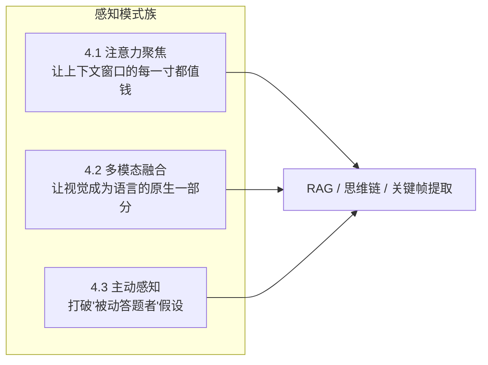

# 第 4 章 感知模式：系统与世界的接口层

Broadbent 在《知觉与沟通》里提出一个关键洞见：**注意机制使模型能够聚焦于输入序列中的关键部分**。Transformer 架构里的 Attention Is All You Need，其实就是这句话的技术实现。

感知模式解决的是：**Agent 如何从噪声世界里提取对当前任务有意义的信号**。当输入不再是单个 API 响应，而是网页、PDF、截图、视频等多源异构数据时，"先接收再处理"的线性模式已经失效。

本章拆解三个核心模式：

## 4.1 注意力聚焦模式

### 4.1.1 问题：成本 O(n²) 与噪声污染

企业级 Agent 早期最容易踩的坑，就是把所有数据一股脑塞进上下文窗口——反正 GPT-4o 支持 128K、甚至 1M token 了。但窗口大不等于能处理更多信息：

- **注意力开销 O(n²)**：Transformer 的自注意力机制对序列长度是二次复杂度。处理 10 万 token 的成本，不是 1 万的 10 倍，而是约 100 倍；
- **噪声稀释效应**：一个 10 万 token 的企业知识库，真正相关的可能只有 100 个 token。当有效信息淹没在噪声里时，模型的推理质量反而下降；
- **灾难性遗忘（Catastrophic Forgetting）**：早期 Agent 只保留开头和结尾，中间的逻辑链条可能被无情丢弃，陷入"金鱼记忆"式的短视行为。

注意力聚焦模式的核心信念可以用 Broadbent 引言概括：

> **智能不在于处理所有信息，而在于识别关键信息。**

### 4.1.2 演化路径：从截断到原生

业界在"上下文提纯"上已经形成了三条截然不同的技术路线，分别代表了从粗到精、从外部到原生的演进。

#### 路线一：滑动窗口 → 语义压缩（中间件模式）

| 阶段 | 机制 | 代表 |
| --- | --- | --- |
| 滑动窗口（Sliding Window） | FIFO 先进先出或首尾保留，简单截断 | 早期 LangChain 示例 |
| **语义压缩（Semantic Compression）** | 先算每个 token 的困惑度/互信息，保留"高惊奇度"token | Microsoft Lingua |

Microsoft 的模型 Lingua 是语义压缩路线的代表——先计算 prompt 中每个 token 的信息熵，剔除低价值信息，再将"精华"传入昂贵的 GPT-4。在 RAG 场景中尤为有效：企业知识库检索往往召回大量含有噪声的文档片段，通过在检索层与推理层之间架设模型 Lingua，能以微小延迟的代价节省高达 **80% 的 token 费用**，同时因为减少了噪声干扰而提升最终回答的准确率。

#### 路线二：Prompt Caching（存储优化模式）

Anthropic 的 Claude 系列通过 **Prompt Caching** 技术让服务端将公共前缀（System Prompt、背景资料）的 KV Cache 缓存起来。后续请求的前缀一致时，API 直接复用缓存状态。这不仅将长文档对话的**首字延迟降低了 80%**，更让"带全量背景知识"的对话在经济上变得可行。

#### 路线三：原生架构（DeepSeek MLA）

DeepSeek-V3 的多头潜在注意力（Multi-Head Latent Attention, MLA）技术代表了一种更彻底的底层革命：传统注意力机制在处理长上下文时 KV Cache 显存占用会线性甚至指数增长，而 MLA 通过低秩投影（Low-Rank Projection）大幅压缩 KV Cache 体积。这意味着架构师可能根本不需要在应用层做任何压缩——直接把 100 份财报传入模型，不仅成本极低，而且因为没有经过有损压缩，信息的保真度达到了 **100%**。**"全量即聚焦"时代到来**。

### 4.1.3 设计哲学：主动"忽视"

注意力聚焦模式的真正价值不在于它能压缩多少 token，而在于它向架构师传递了一个反直觉的信念：

> 如果你在设计 Agent，请不要以"它能记住多少"为荣，而要以"它能精简多少"为傲。一个优秀的感知架构，应该像人类的大脑一样，具备**主动忽视**的能力——过滤 99% 的噪声，只为了在那 1% 的关键信号上迸发出最耀眼的智慧火花。

这直接引出一个设计结论：**当上下文窗口继续扩大（1 亿、10 亿 token），注意力聚焦将从一种"优化手段"变为一种"基础能力"**。

---

## 4.2 多模态融合模式

> "人类从只用一种感官理解世界，AI 也不应该。真正的理解，是视觉、听觉与语言在思维空间中的共鸣。" ——李飞飞

### 4.2.1 问题：打破模态孤岛

传统 AI 架构是割裂的：计算机视觉（CV）处理像素，自然语言处理（NLP）处理文本，两者"老死不相往来"。多模态融合的核心意图就是打破这种孤岛——**它不是简单地把图片和文字"拼凑"（Concat）在一起，而是建立一个统一的语义场（Unified Semantic Field）**。

在这个语义场中，图像的像素向量和文本的 token 向量不再是异构的数据，而是可以互相转化、互相解释的同一种"思维语言"。

### 4.2.2 漏斗形架构

多模态融合是一个数据流对齐（Alignment）问题。业界普遍采用漏斗形架构，除输入层和输出层外有三个关键组件：

| 组件 | 作用 | 代表技术 |
| --- | --- | --- |
| **编码层** | 独立编码器作为 Agent 的不同"感官" | 视觉 ViT 负责"看"、音频 Whisper 负责"听" |
| **对齐层** | 解决"语义鸿沟"——让像素空间里的"猫的形状"和文本空间里的单词 cat 指向同一个实体 | CLIP、LLaVA、Flamingo |
| **融合层** | 决定"感官"融合的时机——输出层融合 or 深层交织 | Gemini、GPT-4o 原生统一 |

### 4.2.3 三种主流对齐机制

| 机制 | 核心隐喻 | 代表 | 能力边界 |
| --- | --- | --- | --- |
| **对比学习对齐** | 磁铁（Contrastive Learning） | CLIP | 只能算相似度（检索/分类），无法生成描述，无法理解"猫在干什么" |
| **生成式对齐** | 翻译官（Projector） | LLaVA、GPT-4V | 通过投影层把视觉特征映射为模型能理解的 token embedding——**Agent 终于能基于视觉信息进行思维链推理** |
| **交叉注意力对齐** | 拉链（Cross-Attention Gate） | Flamingo | 保留视觉特征的独立性，在生成文本的每一层都"查询"视觉细节——适合处理高分辨率图像和长视频 |

### 4.2.4 空间智能：通向具身智能的必经之路

如果说上面三种对齐机制解决了"**是什么**"的问题，那么**空间智能（Spatial Intelligence）** 则试图解决"**在哪里**"和"**怎么动**"的问题——这是 2024 年后多模态领域的新高地。

多模态输入不再局限于 2D 的 RGB 图像，而是扩展到了深度图和点云。Agent 开始理解遮挡、距离、重力和碰撞。输出也不再只是文本描述，而是物理世界的坐标 (x, y, z)、机械臂的动作甚至力反馈。

**Tesla FSD V12** 是空间智能在具体产品上的突破性验证：它抛弃了 30 万行用于车辆规划与控制的传统 C++ 规则代码，构建了一个统一的神经网络，从而实现了从"光子输入"到"控制指令输出"的端到端映射。该系统不仅通过 BEV（鸟瞰图）向量空间精确感知环境，更深层意义上是在海量数据驱动下**隐式学习物理世界的拓扑结构和运动规律**，在很大程度上减少了对传统人工特征工程的依赖。

### 4.2.5 演化三阶段

| 阶段 | 架构特征 | 代表 | 局限 |
| --- | --- | --- | --- |
| 判别式时代 | 双塔结构（Dual Encoder），视觉文本分别编码 | CLIP | 只能算相似度，无法生成描述，无法逻辑推理 |
| 生成式时代 | 投影架构，LLM 被冻结，通过轻量级适配器桥接 | LLaVA、GPT-4V | 能"看图说话"，但视觉能力仍是"外挂" |
| **世界模型时代** | 时空补全（Spatiotemporal Completion）——不仅"描述"像素，而是学会**预测**像素 | Sora、Nano Banana、World Labs | 理解物理规律，是通向 AGI 的关键一步 |

### 4.2.6 设计哲学：从"看"到"在"

多模态融合的最终目标，不是让 AI 识别出图像中有一只猫，而是让 AI 建立起一种在**场感（Presence）**。

当一个 Agent 同时拥有视觉、听觉和空间感时，它就不再是一个处理文本的聊天机器人，而是一个存在于物理世界中的实体。它开始理解"这里""那里""重""远"这些物理概念，并具备物理常识推理的能力——例如预判物体是否会掉落、能否推开门等。

**这不仅仅是感知的升级，更是心智的具身化。它标志着 AI 从符号的计算者进化为世界的观察者和参与者。**

## 4.3 主动感知模式

> "系统会努力最小化其自由能函数，不断根据外界环境输入的新信息，调整内部对外部环境的信念。" ——卡尔·弗里斯顿（Karl Friston，主动推断之父）

### 4.3.1 问题：打破"被动答题者"假设

在传统模型的认知框架中，模型天然假设"人类交给我的输入是真实且完备的"。这是一种几乎写进参数空间的倾向：模型不会质疑 Prompt 的来源、可靠性和偏差，而是基于已有内容尽力补齐推理链条。因此，一旦信息缺页，模型就会在"必须给出答案"的内在压力下产生幻觉。

这在 RAG 或简单模型调用中尤其危险——那里存在一个**危险的假设**：上下文窗口中已经有了回答问题所需的一切信息。

主动感知模式打破了这一假设。它将 Agent 从"被动的答题者"转变为**主动的调查员**：当 Agent 发现现有信息不足以支撑可信结论时，它会暂停生成答案，转而执行操作以获取新证据。

### 4.3.2 架构：信息觅食环

主动感知不是死循环。它需要一个具备**元认知（Metacognition）** 能力的控制流。实现架构包含四个关键组件：

| 组件 | 作用 | 典型实现 |
| --- | --- | --- |
| **不确定性探针** | 只负责判断"能不能回答"，不负责任何内容生成 | 基于 Logprobs 的 token 生成概率统计 / Self-Reflection Prompt 调用 |
| **查询生成器** | 将模糊的"知识缺口"转换为具体的"工具指令" | 把"分析这家公司的财务风险"拆解为 `search_engine("2023财报")` 和 `code_interpreter("计算流动比率")` |
| **信息过滤器** | 主动找回的信息往往包含大量噪声——只通过校验的事实才能写入短期记忆 | 交叉验证、事实一致性检查 |
| **预算控制器** | 工业级系统最容易忽视的组件。防止 Agent 陷入"搜索—失败—再搜索"的死循环 | 设置最大轮数或 token 消耗上限 |

### 4.3.3 与 4.1 的组合

主动感知 + 注意力聚焦形成**感知闭环**：
- 主动感知负责**"我还需要什么信息"**（向外探索）
- 注意力聚焦负责**"这些新信息里哪些值得保留"**（向内提纯）

这个组合让 Agent 真正具备了**"查完再想、想完再查"**的能力，而不是像一次性 RAG 那样在调用那一刻就把生死交出去。

## 小结：系统与世界的接口层

感知模式族是整个 Agent 架构的**第一防线**。它决定了什么能进入系统、以什么形式进入、以及什么时候应该主动出去找。

| 模式 | 核心问题 | 一句话答案 |
| --- | --- | --- |
| 注意力聚焦 | 窗口装不下怎么办？ | 让它装得下——要么在应用层提纯（语义压缩），要么在模型层压缩（KV Cache 技术），要么干脆原生支持 100M token 窗口 |
| 多模态融合 | 怎么看懂一张图/听懂一段声音？ | 把视觉和听觉编码成语言的"原生方言"——统一语义场，让 LLM 的思维链推理自然延伸到视觉和空间 |
| 主动感知 | 现有信息不够怎么办？ | 别急着回答——先问自己"还缺什么"，然后查，查完再判断够不够，直到预算耗尽或信心足够 |

**感知模式的演进趋势**：从各自为政的"外挂式"能力，向原生统一的"感官层"收敛。未来的 Agent 很可能不再区分"这是文本那是图像"——它们在感知层统一编码，在推理层统一处理，在行动层统一输出。