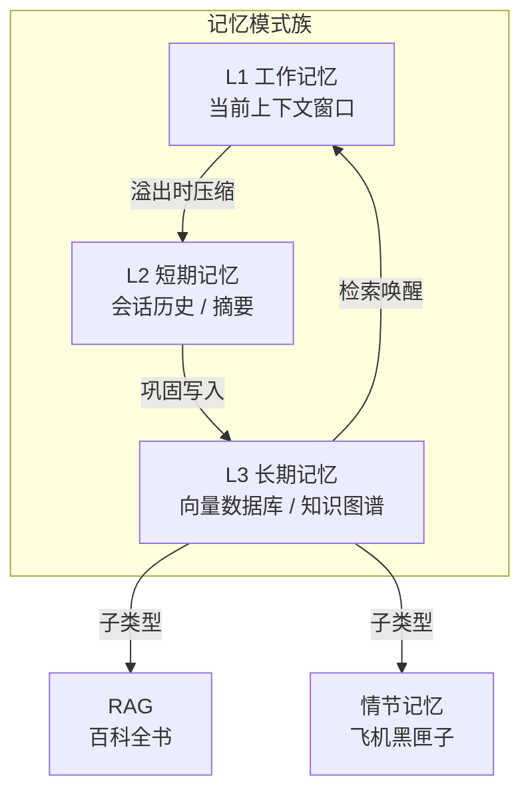

# 第 5 章 记忆模式：让 Agent 真正拥有"脑子"

> "LLM 是无状态的纯函数，Agent 的'记忆'必须显式地构建起来。记忆模式解决的是：Agent 如何记住该记住的、忘掉该忘掉的、在合适的时刻取出合适的。"

Agent 的"记忆"不是在模型内部（模型本身不存储任何东西），而是显式地构建在模型外部的**上下文工程（Context Engineering）** 之上。本章拆解三种核心记忆模式，它们共同构成了 Agent 的"脑子"：



## 5.1 分层记忆模式

### 5.1.1 四代记忆系统演化

Agent 记忆系统的演化轨迹，浓缩了整个 AI 工程从"玩具"到"基础设施"的 8 年：

| 代际 | 代表 | 核心特征 | 局限 |
| --- | --- | --- | --- |
| **第 1 代：无状态瞬时记忆** | GPT-3 API 原生 | 每次对话视为一次新的对话，模型内部零状态 | "金鱼记忆"——第二次对话完全不记得第一次 |
| **第 2 代：滑动窗口记忆** | 早期 ChatGPT | 仅保留最近 N 轮对话，超出即丢弃 | 信息丢失——早期用户画像或 System Prompt 被无情截断 |
| **第 3 代：分层记忆（当前主流）** | MemGPT、LangGraph | **数据分层**：热数据在上下文中，冷数据在向量数据库 | 依赖向量检索质量，仍有语义鸿沟 |
| **第 4 代：神经符号记忆** | 学术前沿 | 结合向量检索（模糊匹配）+ 知识图谱（精确关系） | 架构复杂、工程门槛高 |

### 5.1.2 三级缓存架构

分层记忆模式借鉴了操作系统的**内存分级**思想，形成了 Agent 的 L1/L2/L3 三级缓存：

| 层级 | 比喻 | 技术实现 | 存放内容 |
| --- | --- | --- | --- |
| **L1 缓存** | CPU 寄存器 | 模型原生上下文窗口（128K～1M token） | 当前推理所需的"热数据" |
| **L2 缓存** | 内存 RAM | 会话历史摘要（LLM 生成的压缩文本） | 高频访问但体积超窗口的"温数据" |
| **L3 缓存** | 磁盘 SSD | 向量数据库（VectorDB）+ 图数据库 + Key-Value 库 | 长期持久化的"冷数据"——知识条目、用户画像、历史经验 |

### 5.1.3 记忆生命周期管理

Agent 的记忆不是静态存储，而是一个**持续流转的过程**，包含四个阶段：

| 阶段 | 动作 | 关键技术 |
| --- | --- | --- |
| **编码（Encoding）** | 将原始交互转化为可存储的结构化条目 | Embedding、结构化摘要、标签化 |
| **巩固（Consolidation）** | 将短时记忆转化为长时记忆 | 定期"复习"重要记忆、防止向量数据库被重复数据污染 |
| **检索（Retrieval）** | 从 L3 "读回" L1 | 语义 × 新鲜度 × 可信度的多因子评估，召回的不是模糊印象，而是可验证的"证据链" |
| **遗忘（Forgetting）** | 衰减与删除 | 长时间未访问或重要性下降的记忆逐步衰减，标记为软删除或彻底清除 |

### 5.1.4 工程实践三大形态

记忆系统已成为 AI 应用基础设施，并逐渐形成独立赛道。三大核心架构形态分别解决不同工程痛点：

| 形态 | 代表 | 解决的问题 |
| --- | --- | --- |
| **中间件模式（Mem0 / MaaS）** | Mem0 | "数据孤岛"——客服 Agent 不知道代码助手 Agent 已经了解到的用户偏好，跨 Agent、跨应用共享记忆。MaaS（Memory-as-a-Service）是 Agent 互联的"USB-C 标准" |
| **检查点模式** | LangGraph Checkpoint | Agent 的状态持久化。将每一步（Step）的状态快照序列化到 PostgreSQL/MongoDB，赋予系统**"时间旅行"** 的能力——企业级风控与调试的基石（例如敏感操作前人类可以"暂停、修改、继续"） |
| **协议化治理（MCP）** | Anthropic MCP | Agent 互联的标准化协议。Client-Host-Server 拓扑将"记忆"和"工具"标准化为可发现资源。任何后端是本地文件 / Notion / PostgreSQL，Agent 都可以通过统一的 `read_resource` 语义访问——**跨模型、跨框架的互操作性** |

### 5.1.5 设计哲学：遗忘是智能的必要条件

传统数据库设计中，遗忘被视为绝对的故障。

> 但在 Agent 设计中，遗忘是一种**特征**，甚至是智能的必要条件。

博尔赫斯在小说《博闻强记的富内斯》中描述了一个失去遗忘能力的人——他记得每一片树叶的每一次摆动、每条路径的每一次踩踏，却因为"思考就是忘却差异、进行概括"而彻底"失忆"。

同样地，一个试图把所有历史都输入上下文窗口的 Agent，不仅效率极低、成本极高，而且会因为信息过载而推理质量下降。**遗忘不是 Bug，是让 Agent 保持轻盈、高效、可治理的"超能力"**。

## 5.2 RAG 模式

> "RAG 不是外挂知识库，而是 Agent 实时连接世界的'认知脐带'。"

### 5.2.1 问题：模型的"知识冻结"

LLM 的训练数据截止到某个时间点（GPT-4o 是 2024 年中），之后的世界发生了什么——Twitter 被收购、利率调整、公司财报发布——模型**一无所知**。而且即使训练数据中有过，随着时间推移也会产生幻觉。

RAG（Retrieval-Augmented Generation，检索增强生成）的核心意图就是打破"知识冻结"的墙。它不是让模型**记住**所有外部知识，而是让模型**学会访问**外部知识。

### 5.2.2 三代演化

| 代际 | 架构 | 代表 | 局限 |
| --- | --- | --- | --- |
| **Basic RAG** | 两阶段：检索 → 生成 | LangChain 早期示例 | 检索不到、语义不匹配、检索干扰三类错误 |
| **Advanced RAG** | 查询变换 + Hybrid Search + Re-Rank | 现代生产级 RAG | 仍是外挂式——检索与推理是串行的 |
| **Modular RAG（当前）** | 模块化组件，可按需融入推理循环 | DSPy、LlamaIndex | 更灵活，但架构复杂度更高 |

### 5.2.3 四类检索失败模式与对策

| 失败类型 | 症状 | 对策 |
| --- | --- | --- |
| **检索不到（Retrieval Miss）** | 向量空间里没有相关文档存在 | 扩展知识库 + 元数据过滤 + 多路召回 |
| **语义不匹配** | 找到了文档但内容方向不对 | 多查询扩展（Query Expansion）+ 元数据约束 |
| **检索干扰** | 检索到了正确信息但被噪声淹没 | Re-Rank 重排 + 窗口压缩 |

### 5.2.4 与其他模式的协同

RAG 的真正威力不在于它单独有多强，而在于它与其他记忆/感知/推理模式组合时产生的**涌现能力**：

| 组合 | 效果 |
| --- | --- |
| RAG + **思维链** | 一次性大规模检索被拆解为一系列微检索，推理每一步都可引入外部知识，有效抑制知识性幻觉 |
| RAG + **主动感知** | 从"硬编码固定流程"升级为"按需调用"。Agent 先评估置信度，再决定是否检索、怎么检索 |
| RAG + **分层记忆** | RAG 作为 L3 长期存储处理非结构化文档（PDF、Wiki），检索结果注入 L1 工作记忆 |
| RAG + **反思记忆** | 每次检索失败都成为"经验教训"——"上次这个查询检索失败，换个关键词" |

### 5.2.5 设计哲学：知识的解耦

RAG 模式最深刻的洞见在于将"推理能力"与"知识存储"解耦：

- **模型（CPU）**：负责推理、逻辑、语言组织——可以不断升级（GPT-3→GPT-4→GPT-5）
- **知识库（磁盘）**：负责存储事实、数据、细节——可以实时更新（包括添加、更新、删除）

这种解耦使得我们能以极低的成本保持系统的时效性和专业性，而不需要每次都重新训练昂贵的 LLM。**这正是 AI 从实验室玩具走向工程化落地的基石**。

## 5.3 情节记忆模式

> "经验不是发生在你身上的事，而是你对发生的事做了什么。" ——奥尔德斯·赫胥黎

如果说 RAG 是 Agent 的**百科全书**（存储静态事实），那么情节记忆就是 Agent 的**飞机黑匣子**（记录经验轨迹）。

### 5.3.1 问题：每次都从零开始？

新手 Agent 每次遇到 bug 都像初次见面，毫无经验可循。资深 Agent 则会检索"黑匣子"，发出感叹："啊，这个 bug 上周见过，当时是因为 API 超时，重试 3 次就解决了。"

**情节记忆**让 Agent 从"从零开始"进化为"举一反三"。

### 5.3.2 架构：经验的炼金术

情节记忆系统本质上是一个 **ETL（Extract-Transform-Load）管道**——数据如何流转，从原始的"日志"变成高价值的"技能"。三个关键组件：

| 组件 | 比喻 | 作用 |
| --- | --- | --- |
| **构建情节（Construct Episode）** | 裁剪师 | 将冗长的 API 日志切分为语义完整的片段，剔除 `ls`、`pwd` 等无意义操作，只保留**决策点（Decision Point）** 和**结果点（Result Point）** |
| **提炼成功（Extract Success）** | 泛化器 | 对高价值成功案例进行**去情境化（De-contextualization）**——"我删除了 `/tmp/logs/error.log`" → "当磁盘空间不足时，可优先清理 `*.log` 文件" |
| **技能库（Skill Library）** | 精华仓库 | 存储泛化提取并经验证的可执行代码或思维模板。新任务进入系统时，优先从技能库检索已有解决方案 |

### 5.3.3 三个核心机制

支撑情节记忆架构的关键算法有 3 种，分别解决"存什么""怎么查"和"怎么学"：

**1. 轨迹压缩 + 分层摘要**

为防止记忆膨胀导致性能下降，引入**关键帧提取**：只存储决策点（Decision Point）和结果点（Result Point）。再进一步做分层摘要：

```
L0 (Raw)  → 完成 HTTP 请求
L1 (Action) → 调用 GitHub API
L2 (Intent) → 修复登录模块的 bug
```

检索时先查询 L2，命中后再展开 L1。

**2. 双键检索策略**

传统 RAG 只检索"问题"。但在 Agent 场景下，**环境状态同样重要**：
- **目标相似性（Goal Similarity）**：我想做的事，以前做过吗？（"写贪吃蛇" vs "写俄罗斯方块"）
- **状态相似性（State Similarity）**：现在的报错，以前见过吗？（`Error: 404` vs `Error: 408`）

综合相似度 = α × 目标相似性 + β × 状态相似性。

**3. 经验参数化：从 Instance 到 Abstract**

一个标准情节包含以下要素：
- **Goal**：我想做什么？（"写一个贪吃蛇游戏"）
- **Trajectory**：我做了什么？（序列为思考、写代码、报错、修改代码、成功）
- **Outcome**：结果如何？（Success 或 Fail）
- **Reflection**：我学到了什么？（"Pygame 的 `init()` 必须在最开始调用"）

**参数化**是让 Agent 举一反三的关键：
- **Instance（实例）**：`delete_file("report_2023.txt")`
- **Abstract（抽象）**：`delete_file(filename)`
- **Constraint（约束）**：`if file.exists() and not file.is_system_file()`

Agent 通过对多个相似情节的对比，找出**不变的逻辑和变化的参数**，从而生成通用函数。

### 5.3.4 闭环：记忆 + 反思 = 持续进化

情节记忆与反思模式结合形成一个**持续进化的闭环**：
- 成功时：将代码固化为**技能（Skill）**，下次直接调用，不再重新推导
- 失败时：将错误原因固化为**规则**，下次主动规避

## 小结：从"金鱼"到"智慧体"的进化

记忆模式族让 Agent 从"无状态的函数"进化为"拥有历史的主体"。

| 模式 | 核心问题 | 一句话答案 |
| --- | --- | --- |
| 分层记忆 | 窗口装不下 + 历史太多 | 三级缓存（L1/RAM/SSD）+ 生命周期管理 + 遗忘是必要条件 |
| RAG | 世界在变化，模型不知道 | 解耦模型与知识，把模型当 CPU、知识库当磁盘；检索与推理可松耦合也可紧融合 |
| 情节记忆 | 怎么从"做过"变"会做" | 飞机黑匣子 + ETL 管道；轨迹压缩、双键检索、参数化迁移 → 从 Instance 到 Skill |

**记忆模式的演进趋势**：从各模式各自为政，向"分层记忆为底座、RAG 为知识脐带、情节记忆为经验炼金术"的三层融合架构收敛。