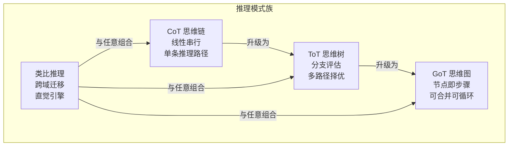
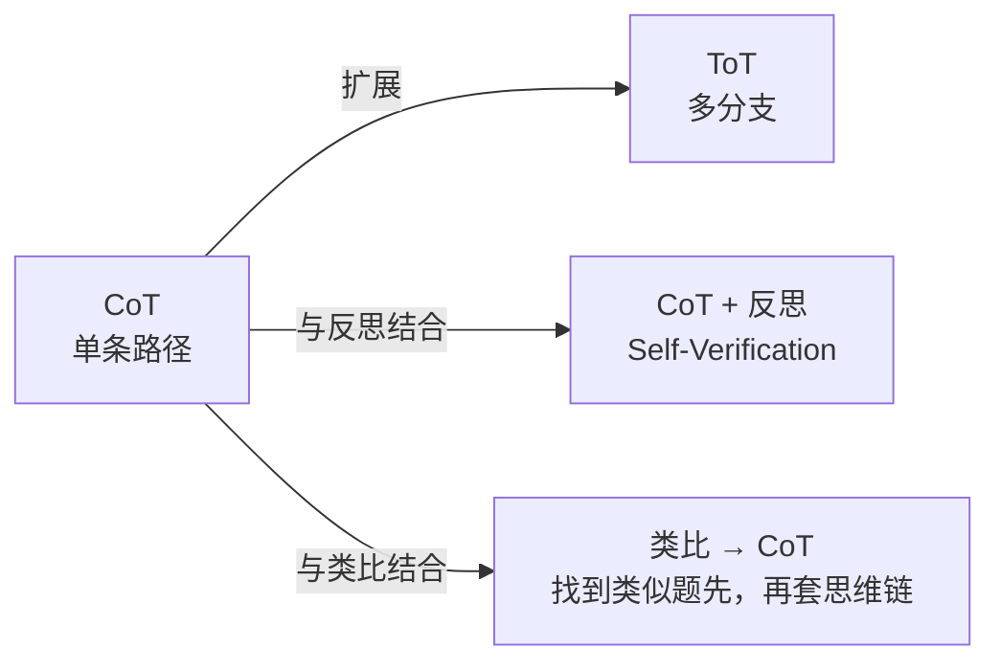
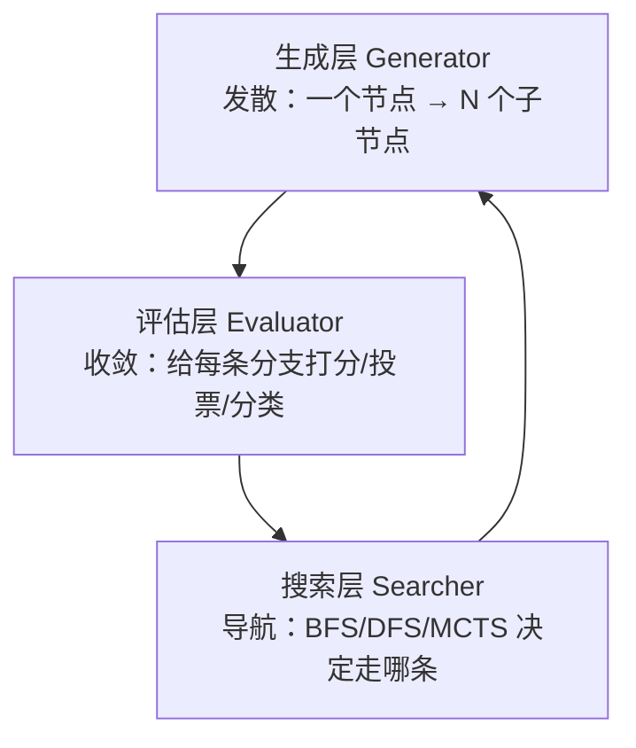
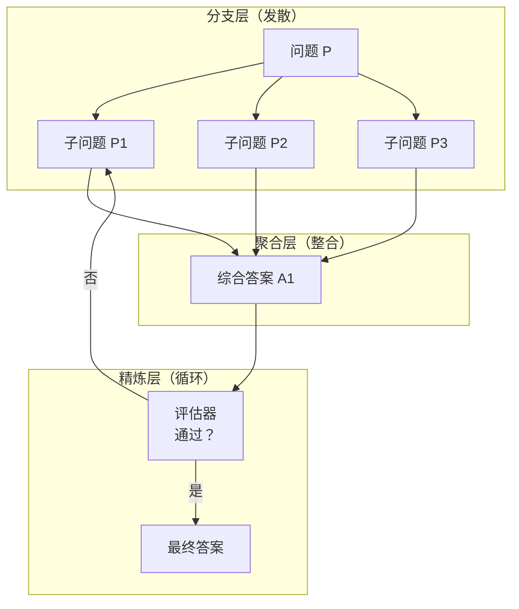
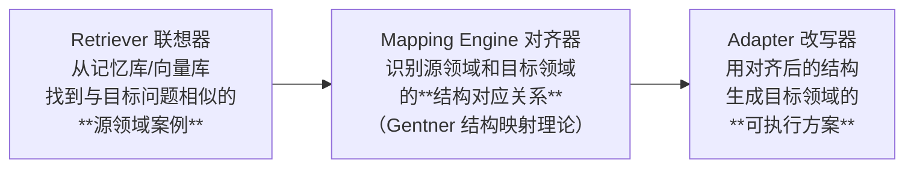

# 第 6 章 推理模式：让 Agent 真的"动脑子"

> "让模型一步步想"不只是一种 Prompt 技巧，而是一套可以系统拆解、组合、优化的推理架构。推理模式解决的是**Agent 如何把一个大问题拆成可执行的子问题，以及如何判断拆分/组合的时机**。

本章拆解四种核心推理模式，它们共同构成了 Agent 的"思维工具箱"：

## 6.1 思维链（CoT）：黑盒巅峰，开源突围

### 6.1.1 基础形态：让模型"说出思考过程"

思维链（Chain-of-Thought, CoT）的核心操作极其简洁：在 Prompt 里加一句"让我们一步步想"，模型就会输出中间推理步骤。这背后是对 LLM 内部工作方式的关键洞察——模型的生成过程本身就是一种**隐式推理**，让它把过程显式化反而能提升结果质量。

三种 CoT Prompt 形态：

| 类型 | 特征 | 适用场景 |
| --- | --- | --- |
| **Zero-shot CoT** | 只加一句"Let's think step by step" | 数学/逻辑/编程等结构化推理 |
| **Few-shot CoT** | 给示例：问题 → 推理过程 → 答案 | 需要模型理解"什么是好的推理" |
| **Self-instruct CoT** | 不给示例，让模型先生成推理再给答案 | 领域特定、难以给出通用示例 |

### 6.1.2 黑盒与开源的两条演进线

CoT 之后的推理能力升级分化为两条截然不同的技术路线：

**路线一：黑盒的巅峰——OpenAI o1/o3**

| 关键设计 | 效果 |
| --- | --- |
| **测试时计算（Test-Time Compute）** | 推理时展开一段隐藏思维链（不暴露给用户），计算量可以是 GPT-4o 的 10-100 倍 |
| **RL 对齐训练** | 用 GRPO 等强化学习方法训练模型"在推理中获得更高分" |
| 编程/SWE-bench | SWE-bench Verified 从 GPT-4 的 16% 跃升至 o3 的 71% |

**路线二：开源的突围——DeepSeek-R1**

| 关键设计 | 效果 |
| --- | --- |
| **GRPO 无参考模型** | 直接让模型在训练时尝试 CoT，奖励高置信度回答 |
| **"在推理中发现推理"** | 模型自己学出思维链模式，无需开发者手工设计 Prompt |
| 编程/SWE-bench | 67.5%，追平 o3 Mini，纯开源、可复现 |

### 6.1.3 推理质量的三个维度

| 维度 | 问题 | 对策 |
| --- | --- | --- |
| **正确性** | 模型在某个环节推理出错，后续全部白搭 | **Verification CoT**：先推理出一个答案，再让另一个 Prompt 验证这个答案；两次都对才算对 |
| **置信度** | 模型经常对错误答案也表现得非常自信 | **Self-Consistency**：让模型独立推理 N 次，取出现最多的答案（类似"专家投票"） |
| **可解释性** | 黑盒的内部推理过程无法审计 | 显式思维链、中间步骤 token logprob 分析 |

### 6.1.4 垂直落地：Agentic Coding 的雏形

CoT 在编码领域的落地催生了一类新工具——**影子工作区（Shadow Workspace）**：

| 形态 | 代表 | 机制 |
| --- | --- | --- |
| 推理时影子工作区 | Devin | 模型在思维链里模拟运行代码、修改文件，不直接操作真实环境 |
| 执行时影子工作区 | Cursor Agent Mode | 模型先在隔离的 Docker 容器里写代码、跑测试，测试通过再应用到用户项目 |

两种形态的核心洞察相同：**推理时计算（测试时计算）是让模型"在脑子里先跑一遍"，影子工作区是让模型"在沙盒里先跑一遍"，本质都是降低 Agent 在真实环境中犯代价高昂的错误的概率**。

### 6.1.5 与其他推理模式的组合

CoT 虽然强大，但有两个固有缺陷：**单路径不回头**（走到黑）和**一旦某步错了全错**（错误传播）。

## 6.2 思维树（ToT）：迷宫寻路的三条路

> "写一部关于岔路的小说，我会像博尔赫斯那样写；但如果是做一个高价值决策系统，我会选择 ToT。"

思维树（Tree of Thoughts, ToT）的核心隐喻来自 Borges《小径分岔的花园》——推理不是一条笔直的路，而是一棵不断分岔的树。你同时走多条可能的路，用评估器选出最值得继续走的分支，直到找到答案或预算耗尽。

### 6.2.1 三层架构

| 组件 | 作用 | 代表实现 |
| --- | --- | --- |
| **生成层** | 分解问题、生成候选步骤 | Prompt "把问题分解成 5 种不同思路" |
| **评估层** | 给每个候选打分或筛选 | 自我评分（LLM-As-Judge）、多数投票、分类（Good/Bad/Idle） |
| **搜索层** | 决定下一轮展开哪些分支 | BFS（广度优先）适合搜索空间小的场景；DFS（深度优先）适合有明确终态的场景 |

### 6.2.2 四个核心能力

| 能力 | 说明 | 例子 |
| --- | --- | --- |
| **分支（Branching）** | 生成多条不同的推理路径 | "解这个物理题，分别从能量守恒、动量定理、参考系变换三个角度思考" |
| **评估（Evaluating）** | 独立于生成器给每条分支质量打分 | 第二个 Prompt "评估上面三种思路哪个最可能得到正确答案" |
| **回溯（Backtracking）** | 发现当前路走不通时，可以退回来换一条 | "思路 A 走不通（验证失败），回到上一个决策点走思路 B" |
| **启发（Heuristics）** | 评估器的打分函数——什么算"好" | "数学题思路好 = 步骤简洁 + 逻辑严谨" |

### 6.2.3 三种评估策略

评估层的设计决定了 ToT 的成本和效果 trade-off：

| 策略 | 机制 | 成本 | 适用场景 |
| --- | --- | --- | --- |
| **评分（Scoring）** | 评估器给每个分支打 1-10 分，分高优先展开 | 高（需要 N 次额外 LLM 调用） | 数学、编程等可量化评分场景 |
| **投票（Voting）** | 让 M 个独立评估器投票"这个分支值得继续吗"，过半数就展开 | 中 | 自然语言推理、创意方案生成 |
| **分类（Classification）** | 把分支分为 Good / Bad / Idle 三类，Good 展开、Bad 丢弃、Idle 保留 | 低 | 快速筛选大量候选 |

### 6.2.4 三种搜索策略与 MCTS 进阶

| 策略 | 原理 | 代表 |
| --- | --- | --- |
| **BFS 广度优先** | 一层一层展开，每层内所有候选都评估 | 适合搜索空间小、需要全局视角 |
| **DFS 深度优先** | 沿一条路径走到头（成功或失败）再换一条 | 适合有明确终态的任务（如写代码直到测试通过） |
| **MCTS 蒙特卡洛树搜索** | 用 UCB1 = 收益估计 + 探索奖励 平衡"已知好分支"和"未知新分支" | AlphaGo 同款，适合大规模搜索空间 |

### 6.2.5 工业实践：成本与精准率的 trade-off

ToT 的代价显著高于 CoT——10-100 倍 token 消耗换精准率提升。这使它更适合**高价值低频次**场景：

| 场景 | CoT 精准率 | ToT 精准率 | 代价增量 |
| --- | --- | --- | --- |
| 高中数学竞赛题 | 约 60% | 约 85% | 5-10× |
| SWE-bench 编程修复 | 16% (GPT-4) | 25-40% (ToT variants) | 10-50× |
| 自主软件工程师 | 低（单路径走到黑） | 显著提升（多路径对比择优） | 20-100× |
| 红队安全审计 | 基础 | 显著提升（多条攻击路径并行探索） | 15-80× |

### 6.2.6 与其他模式的组合

| 组合 | 效果 |
| --- | --- |
| ToT + **RAG** | 每个分支都可以独立调用 RAG 检错——"思路 A 引用了哪篇论文？查一下是否存在矛盾" |
| ToT + **工具编排** | 评估器可以通过工具调用验证分支可行性——"思路 B 说的 API endpoint 真的存在吗？curl 一下" |
| ToT + **反思** | 失败分支的复盘可以形成"下次不要走这条路"的经验库 |

## 6.3 思维图（GoT）：织布机式的重组循环

> "思维树是迷宫，思维图是织布机。树只能分岔不能合并，图可以。"

思维图（Graph of Thoughts, GoT）将思维树的树结构升级为**有向图**结构——节点即推理步骤，边即依赖关系，允许合并、循环、回溯。这赋予了 Agent 三个思维树无法实现的能力：

| 能力 | 思维树 | 思维图 |
| --- | --- | --- |
| 合并（Merging） | ❌ 两条路径无法汇合 | ✅ 两个子路径的结论可以合并为一个综合结论 |
| 循环（Looping） | ❌ 只能沿深度方向前进 | ✅ 可以循环修正——"我觉得不对，回到节点 2 重做" |
| 层次化（Hierarchy） | ❌ 所有节点平级 | ✅ 子图作为黑盒节点嵌入父图 |

### 6.3.1 三层架构

| 层级 | 动作 | 目的 |
| --- | --- | --- |
| **分支层（Branching Layer）** | 一个问题 → 多条独立子路径 | 发散探索 |
| **聚合层（Aggregation Layer）** | 多路径结论 → 综合答案 | 收敛整合——思维树做不到的能力 |
| **精炼层（Refinement Layer）** | 评估 → 失败则回到分支层重做 | 循环修正——思维树做不到的能力 |

### 6.3.2 两个核心组件

| 组件 | 作用 | 代表实现 |
| --- | --- | --- |
| **Graph Constructor** | 构建图结构：节点是什么、边怎么连、允许哪些操作 | LangGraph StateGraph、AutoGen Sequential/Custom 图 |
| **Graph Executor** | 执行图：拓扑排序、并行/串行节点执行、状态传递 | LangGraph Runnable，支持 Checkpoint 和 Human-in-the-Loop |

### 6.3.3 三种拓扑对比：链 vs 树 vs 图

这三种推理结构没有绝对优劣，适用场景不同：

| 拓扑 | 结构特征 | 最适合什么 | 工业代表 |
| --- | --- | --- | --- |
| **链（CoT）** | A→B→C→D 线性串行 | 有明确终态、错误传播代价低 | 文本生成、基础编程任务 |
| **树（ToT）** | 根→N 分支，不可合并 | 探索型任务、需要多路径对比择优 | 数学竞赛、红队安全审计 |
| **图（GoT）** | 节点+边，可合并+可循环 | 需要多轮修正、跨领域整合 | 全库代码分析、深度搜索 Agent |

一个 GoT 典型工业案例：**全库代码分析 Agent**
1. 节点 1（Parse）：解析 10 万行代码，生成符号表
2. 节点 2（Map）：函数调用关系图
3. 节点 3（Merge）：符号表 + 调用图 → 完整依赖图
4. 节点 4（Reviewer）：LLM 评估依赖图完整性 → **不完整则回到节点 1 重新 Parse**
5. 节点 5（Report）：生成架构分析报告

思维树在"评估不通过后能不能回到 Parse"这一点上天然做不到——树是单向分岔不允许循环。

### 6.3.4 演化与组合

GoT 本身也在演化：**静态图谱 → 动态图**。早期 GoT 结构是开发者手工定义的静态拓扑，而新一代（如 LangGraph + LLM 动态添加节点）让 LLM 可以在推理过程中**自我扩展图结构**——"我觉得还需要一个新的分析节点，让我加进去"。

| 组合 | 效果 |
| --- | --- |
| GoT + **RAG** | 图上的每个节点都可以独立调用 RAG，形成"检索增强的推理节点" |
| GoT + **工具编排** | 图执行器把工具调用作为图节点——"跑一下这个测试 → 结果作为下一个节点的输入 → 失败则回退" |

## 6.4 类比推理：跨时空的传输门

> "推理的最高形式不是演绎（从公理推定理），也不是归纳（从样本找规律），而是**类比**（把 A 领域的经验迁移到 B 领域）。"

类比推理是唯一一个不完全依赖演绎逻辑的推理模式。它更像一扇跨时空的传输门：**把一个领域的成熟经验，映射到一个陌生领域的问题上**。

### 6.4.1 三组件架构

### 6.4.2 核心机制

类比推理的核心是 **Gentner 1983 年提出的结构映射理论**：

| 原则 | 说明 |
| --- | --- |
| **关系优于属性** | 属性可弃，关系必留。类比的核心不是"形状颜色像"，而是"结构功能像" |
| **高阶关系优先** | 两个系统的**因果结构**如果相似，低阶属性即使完全不同也可以类比 |
| **V 形抽象化-具体化** | 先把源问题抽象成**结构模板**（去掉领域专有名词），再用目标领域名词**具体化** |
| **自我生成能力** | 模型自己能生成类比关系——不只是从库里检索，还能创造新类比 |

### 6.4.3 三个工业案例

| 场景 | 源域 → 目标域 | 三组件工作流 |
| --- | --- | --- |
| **代码助手跨库迁移** （Copilot/Cursor） | `connect_to_mysql` → `connect_to_redis` | 检索（找到 mysql connector）→ 映射（host/port/timeout 参数结构相同）→ 迁移（生成符合项目风格的 redis 连接代码） |
| **法律判例推理** | "跨境电信诈骗" → "虚拟币诈骗" | 检索（找到相似判例）→ 映射（"虚拟币"类比"金融产品类型"，"交易平台"类比"金融中介机构"）→ 迁移（生成新案件的法律意见书） |
| **设计灵感** （Midjourney Prompt Helper） | "跑车流线型车身" → "鼠标整体造型" | 检索（跑车设计特征）→ 映射（流线型→整体造型、进气格栅→按键布局、金属漆→材质选择）→ 迁移（生成绘图 Prompt） |

### 6.4.4 演化路径

类比推理的 Prompt 设计经历了三代演进：

| 阶段 | 机制 | 局限 |
| --- | --- | --- |
| **静态少样本**（刻舟求剑） | 开发者在 Prompt 里硬编码 3 个固定示例 | 泛化力极差——新问题与这些固定示例领域差异大时失效 |
| **动态少样本** | 融合 RAG 理念，按查询需求从向量库检索 Top K 示例 | 提升了上下文自适应性，但仍是"表面类比"，缺乏可解释性 |
| **显式映射 Chain-of-Analogy** | 要求模型输出完整映射关系（"水流 ↔ 电流"） | 可解释性强，防止模型基于错误类比进行误导性推理 |

### 6.4.5 组合：直觉引擎 + 逻辑引擎

类比推理模式通常用作 Agent 的**直觉引擎（System 1）**，需要与**逻辑引擎（System 2）** 协同工作：

| 组合 | 机制 |
| --- | --- |
| **类比 + CoT = 启发式推理** | 类比模块提供战略方向（System 1 直觉），CoT 负责战术执行（System 2 逻辑） |
| **类比 + 工具编排 = 经验迁移** | 检索一个与当前问题相似的旧题 → 提取其解题框架 → 推导阶段逐步迁移 → 工具编排执行迁移后的操作（Copilot 的核心机制） |

## 小结：从"说出来"到"会选路"到"能迁移"

四种推理模式是 Agent 思维能力的层层递进，从"线性串行"到"多分支择优"到"循环重组"到"跨域迁移"：

| 模式 | 核心隐喻 | 结构 | 典型能力 | 适用场景 |
| --- | --- | --- | --- | --- |
| **CoT 思维链** | 笔直的路 | 链（线性） | 分解问题、显式推理 | 有明确终态的推理（数学/编程/逻辑） |
| **ToT 思维树** | 迷宫 | 树（不可合并） | 多路径并行探索、择优 | 探索型任务、高价值低频次 |
| **GoT 思维图** | 织布机 | 图（可合并可循环） | 多轮修正、跨领域整合 | 需要多轮验证、复杂工程分析 |
| **类比推理** | 跨时空传输门 | 映射（跨域） | 跨域经验迁移、创造新方案 | 陌生领域问题、创意生成 |

**推理模式的设计哲学**：**推理不是越多越好，而是越合适越好**。对一个简单的"写一段 Python 排序代码"，CoT 就够了；对"设计一个全球分布式支付系统的架构"，需要 CoT 分解 + ToT 探索 + GoT 整合；对"把你在电商领域的增长经验迁移到教育 SaaS"，类比推理是第一选择。

**四种模式的 cost/quality trade-off**：CoT（1×，基础）→ ToT（10-100×，提升）→ GoT（20-200×，高提升）→ 类比推理（灵活度最高，但依赖高质量的源域记忆）。成本评估是选择推理模式的第一决策依据。