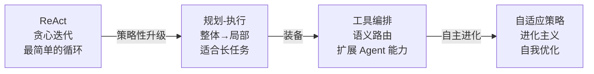
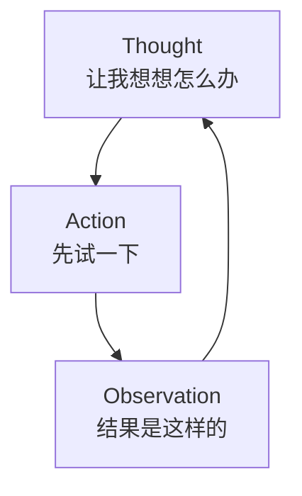
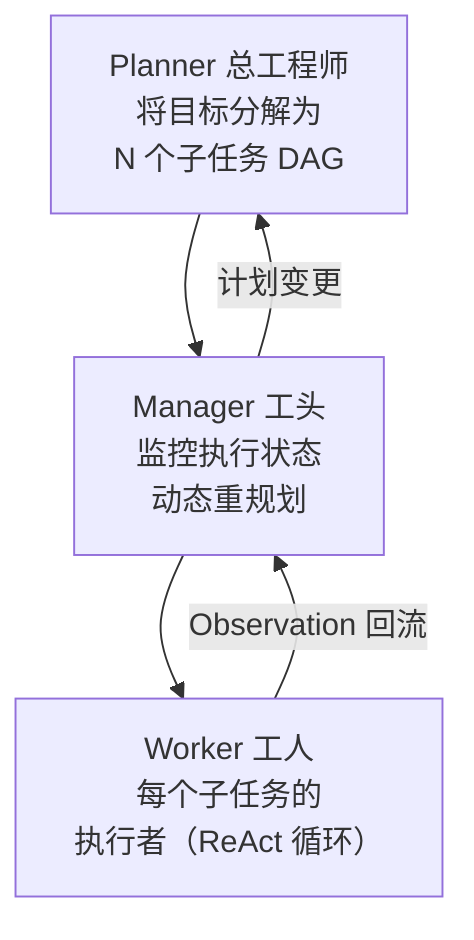
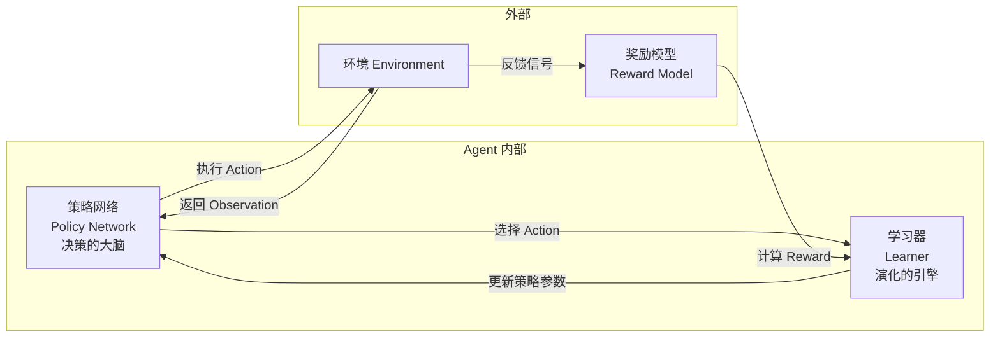

# 第 7 章 行动模式：让 Agent 真的"动手做事"

> "推理停在纸面就是空想，行动才让 Agent 成为 Agent。行动模式解决的是：Agent 什么时候该想、什么时候该做、做坏了怎么重来。"

Agent 的行动不是一句 `doSomething()` 调用那么简单。它要面对三个根本性挑战：
1. **环境是动态的**——你写的代码里没有 `npm install` 的超时、API 的 429、用户中途改主意
2. **信息是不完整的**——你不知道 API 具体要传哪些参数，得先查一下
3. **代价是真实的**——每多一次 LLM 调用都是成本，每多一轮重试都是时间

本章拆解四种行动模式，它们的演进方向清晰可见：**从"贪心迭代"到"先规划再执行"，再到"动态编排"，最后走向"自我进化"**。



## 7.1 ReAct 模式："思考—行动—观察"的最小单元

### 7.1.1 核心循环

ReAct 是 Reason + Act 交替循环的缩写，是所有 Agent 行动模式的**原子原语**。它的核心循环只有三步：



**关键约束**：每一步思考必须基于上一步的观察结果。模型不允许"闭着眼想下一步"，必须先动手、再看结果、再决定下一步——这天然抑制了幻觉。

### 7.1.2 三个核心组件

| 组件 | 作用 | 工程实现 |
| --- | --- | --- |
| **Thinker** | 只负责想，输出下一步 Action 和 Thought | LLM，Prompt 里强制输出特定格式（`Thought:` + `Action:`） |
| **Executor** | 执行 Action，返回 Observation | 工具注册表 + 工具调用引擎 |
| **Scratchpad** | 草稿纸——累计所有 Thought + Action + Observation | 追加式字符串，每轮迭代都把完整历史喂回 Thinker |

### 7.1.3 三个工程挑战

ReAct 原理简洁，但工程落地时有三个经典"坑"：

| 挑战 | 症状 | 对策 |
| --- | --- | --- |
| **停止词地狱** | 模型输出 `\n\nThought:` 后就停了，不再继续推理 | 使用 Regex 严格匹配 `Action[^{]*\{[^}]+\}` 作为 Action 边界；Observation 后用特定 Token 标记结束 |
| **循环陷阱** | 模型陷入 "调用搜索 → 结果不理想 → 再搜一次同样的关键词" 的死循环 | **Robust ReAct Loop**：设置最大迭代次数 + 检测重复 Action + 强制失败后换个策略 |
| **显式思考与动作** | 必须在 Prompt 里告诉模型"Action 只能是特定格式 JSON" | 使用 JSON Schema 或 GBNF（Grammar-Based Normalization Form）强制约束输出结构 |

### 7.1.4 三种执行策略

ReAct 的执行器可以有不同的**贪心策略**，直接影响成本和精准率：

| 策略 | 行为 | 成本 | 精准率 | 适用场景 |
| --- | --- | --- | --- | --- |
| **贪心执行（Greedy）** | 每一步直接执行置信度最高的 Action | 低 | 中 | 信息充分、容错度高的场景 |
| **带回溯执行（With Backtracking）** | 执行失败则回退一步，换一条 Action | 中 | 高 | 编程调试、网络请求等有明确成功/失败信号的场景 |
| **带验证执行（With Verification）** | 执行后先让模型验证结果是否真的完成了任务 | 高 | 很高 | 金融交易、敏感操作等代价高昂的场景 |

### 7.1.5 演化：从 ReAct 到 Agent Loop

ReAct 本质上是**策略性循环**，可以作为"最外层循环"嵌入任何更复杂的行动架构中。LangGraph、CrewAI、AutoGen 等框架里的核心循环，底层全是 ReAct 的变体——区别只在于 Thinker 用什么 Prompt、Executor 接多少工具、Scratchpad 怎么序列化。

## 7.2 规划-执行模式：先整体再局部

> "凡事预则立，不预则废。" ——《礼记·中庸》

### 7.2.1 问题：ReAct 的短视

ReAct 的贪心迭代有一个天然缺陷：**每一步只看下一步**。对一个"从零搭建一个完整的 Todo 应用"这样的长任务，ReAct 会在"搜索怎么建项目"和"创建目录"之间反复横跳，却永远看不到全局规划。

规划-执行模式的核心改变：**先让模型写出完整的 DAG 计划，再逐步执行**。就像一个建筑工程队——总工程师先画完施工图，工头再分配给各个工种，最后工人按图施工。

### 7.2.2 三层架构



| 组件 | 角色 | 核心能力 |
| --- | --- | --- |
| **Planner** | 战略层 | HTN（Hierarchical Task Network）高层任务分解，生成带依赖关系的 DAG |
| **Manager** | 战术层 | 状态监控 + 动态重规划——"子任务 A 失败了，B 依赖 A 也不行，得改计划" |
| **Worker** | 执行层 | 每个 Worker 就是一个 ReAct Agent——负责执行具体的子任务 |

### 7.2.3 四个核心机制

| 机制 | 作用 | 实现 |
| --- | --- | --- |
| **任务分解 + DAG** | Planner 输出子任务列表和依赖关系 | HTN + LLM 结构化输出（JSON DAG） |
| **状态隔离与上下文注入** | 每个 Worker 拿到的是**最小必要信息**（上游依赖的 Observation），而不是完整 Scratchpad | 上下文裁剪 + 注入 |
| **动态重规划** | 执行过程中 Plan 可以被修改、删除、插入 | Manager 调用 Planner "基于当前进度重新规划" |
| **状态护照** | 子任务 A 的输出作为"护照"传给子任务 B | 结构化数据（JSON）在任务间传递，不是自然语言 |

### 7.2.4 两种规划风格

| 风格 | 隐喻 | 代表 | 适用 |
| --- | --- | --- | --- |
| **Plan-and-Solve（瀑布）** | 先把所有计划写出来，再逐步执行 | BabyAGI、Plan-and-Solve Prompt | 需求稳定、可预测的任务 |
| **LLM Compiler（编译-运行循环）** | Planner 在每次 Worker 返回后重新规划 | LLM Compiler 论文（Zhang et al., 2023）、AutoGen | 环境不确定、需要动态调整的任务 |

### 7.2.5 全栈软件开发案例

一个完整的规划-执行流程示例（"搭建一个 Todo 应用"）：

```
Planner 输出 DAG:
  ┌─ 子任务 1: 初始化项目 (npm create vite@latest ...)
  ├─ 子任务 2: 搭建后端 Express 服务器
  │   └─ 依赖 1
  ├─ 子任务 3: 设计数据库 Schema
  │   └─ 依赖 1
  ├─ 子任务 4: 写前端 React 组件
  │   └─ 依赖 2
  ├─ 子任务 5: 前后端联调
  │   └─ 依赖 2, 3, 4
  └─ 子任务 6: 写 README
      └─ 依赖 5

Manager 执行中:
  → Worker 1 成功 ✅
  → Worker 2 成功 ✅
  → Worker 3 成功 ✅
  → Worker 4 失败："React hook 依赖数组警告"
    → Manager 触发重规划："让 Worker 4 先搜索怎么修复这个警告"
  → 新的子任务 4.1 插入 Worker 4 之前
  → Worker 4.1 成功
  → Worker 4 重跑 → 成功 ✅
  → ... 直到全部完成
```

### 7.2.6 组合与 trade-off

| 组合 | 效果 |
| --- | --- |
| 规划-执行 + **ReAct** | Planner 宏观规划，Worker 微观 ReAct——这是 LangGraph/AutoGen/CrewAI 的默认架构 |
| 规划-执行 + **委托** | Planner 把某些子任务委托给更专业的 Specialist Agent |
| 规划-执行 + **情节记忆** | Planner 从情节记忆中检索"上次做类似项目的规划"，作为新规划的起点 |

**Trade-off**：规划-执行比纯 ReAct 更复杂，但在长任务上精准率显著更高。对于"写一段函数"这种短任务，ReAct 足够了；对于"从 0 到 1 搭建一个 SaaS 产品"，必须用规划-执行。

---

## 7.3 工具编排模式：Agent 的"手与脚"

> "工欲善其事，必先利其器。" ——《论语·卫灵公》

如果说 ReAct 和规划-执行是 Agent 的"大脑"，那么工具编排就是 Agent 的"手与脚"——没有工具，Agent 只能停留在对话框里空转。

### 7.3.1 三维挑战：工具从"能调用"到"会编排"

Toolformer（论文标题）发表时，业界第一次意识到：**可以训练模型让它自己决定什么时候调用工具、调用什么工具**。但这只是起点，真正的挑战是三个维度：

| 维度 | 问题 | 对策 |
| --- | --- | --- |
| **检索** | Agent 有 1000+ 工具时，怎么让它在每一步只挑对的 3 个 | 语义路由（Semantic Routing）：把工具描述 embedding，与当前任务语义向量做相似度匹配 |
| **适配** | 工具接口千差万别（REST/RPC/CLI/MCP），怎么统一 | **协议适配器层**：所有工具统一暴露成 `tool_call(input: JSON) → output: JSON` |
| **组合** | 单个工具解决不了问题，需要串成管道、并行、条件分支 | **能力总线（Capability Bus）**：Agent 通过总线请求能力（"我需要生成 Excel"），总线负责组合多个底层工具 |

### 7.3.2 三个核心机制

| 机制 | 作用 | 代表 |
| --- | --- | --- |
| **语义路由（Semantic Routing）** | 从 1000+ 工具中选出当前步骤最相关的 Top K | Toolformer 的 tool embedding、MCP Server List |
| **结构化强制（Constrained Decoding）** | 强制工具调用输出合法 JSON + GBNF 语法 | Function Calling（原生）、Outlines（GBNF）、Marvin（C# DSL） |
| **错误自修复** | 工具调用失败时，Agent 自己看错误信息、修正参数、重试 | LangGraph ToolErrorHandling、AutoGen ToolCallError Loop |

### 7.3.3 协议化：MCP 与 Agent Skills

工具编排从"零散工具"向"协议化互联"演进：

| 阶段 | 特征 | 代表 |
| --- | --- | --- |
| MRKL（2022） | 模型通过自然语言描述理解工具，手动写解析器 | 早期 LangChain Tool |
| **Function Calling** | 模型原生支持，输出固定格式 JSON | OpenAI GPT-3.5/4、Anthropic Claude |
| **MCP 协议** | Agent 互联的 USB-C 标准：Client-Host-Server 拓扑，任何后端（本地文件/Notion/PostgreSQL）都能标准化暴露能力 | Anthropic MCP（2024） |
| **Agent Skills** | 工具的上层封装："导出 PDF"是一个 Skill，内部组合浏览器截图 + PDF 生成器 + 文件存储 | LangChain AgentKit |

### 7.3.4 边界拓展：Computer Use

Computer Use（Trae、Cline、OpenAI Computer Use Agent 等）是工具编排的**极端形态**——把整个 GUI 界面变成 Agent 的"工具接口"：

- Agent 看到的是屏幕截图；
- Agent 的 Action 是 `click(x, y)`、`type(text)`、`scroll(direction)`；
- Observation 是截图变化 + OCR 识别结果。

这大幅拓展了 Agent 的能力边界：不需要为每个网站写 API 适配——直接"看屏幕、点按钮、输文字"就行。

### 7.3.5 设计哲学：让 API 文档写给机器看

传统 API 文档写给人看——Swagger 是给开发者阅读的。但当 Agent 成为 API 的主要调用者时，**API 文档的消费者变成了模型**。这推动了 OpenAPI Schema 的演化方向：
- Schema 必须是**机器可解析的**（JSON Schema 兼容）；
- 参数描述要**明确到模型能理解**（不要"可选地设置某些值"，要说"设置 timeout 参数，单位毫秒，范围 1000-60000"）；
- 响应的**错误码和重试策略**要标准化，让 Agent 能根据错误类型决定下一步。

## 7.4 自适应策略模式：让 Agent 自我进化

> "以无法为法，以无限为限。" ——李小龙
>
> "智能的本质不在于机械地遵循规则，而在于从混沌中演化出秩序。" ——黄佳

### 7.4.1 问题：传统 ReAct/规划-执行的局限

前面三种行动模式本质上都是**"神创论"式**的架构——工程师预设了 Agent 的行为逻辑，Agent 的运行方式完全取决于代码怎么写。代码写什么样，Agent 就怎么运行。

但当任务复杂度超过了工程师的预见能力时，"预设所有逻辑"的范式就撑不住了。**自适应策略模式**是"进化论"的产物——Agent 被置于未知环境中，它必须通过**试错、反馈、选择**，渐进式地演化出最优的决策策略。

### 7.4.2 核心隐喻：进化三件套

| 概念 | 在 Agent 中的对应 | 说明 |
| --- | --- | --- |
| **基因** | Agent 的策略参数 | Prompt 模板、工具选择权重、推理路径、Action 阈值 |
| **环境** | 用户请求 + 工具反馈 + 任务结果 | 充满未知、随时变化的黑盒系统 |
| **适应度** | 奖励信号（Reward Signal） | 用户点赞 +1、任务成功率 +1、响应延迟过高 -0.1、代码编译失败 -1 |

### 7.4.3 架构：强化学习闭环



| 组件 | 作用 | 说明 |
| --- | --- | --- |
| **策略网络** | 决策的"大脑" | 可以是简单的概率（如 MAB），也可以是深层神经网络（决定生成哪个 Token） |
| **环境** | 黑盒系统 | Agent 通过 Action 影响它，通过 Observation 感知它 |
| **奖励模型** | 评价体系 | 人类偏好数据训练（RLHF）或预设规则（GRPO 相对比较） |
| **学习器** | 演化引擎 | 经典算法：PPO（近端策略优化）、DPO（双重鲁棒策略优化）、Thompson Sampling（汤普林森采样） |

### 7.4.4 核心数学：探索与利用

自适应策略模式要解决的核心数学问题只有一个：**探索（Exploration）vs 利用（Exploitation）**。

| 策略 | 行为 | 适用 |
| --- | --- | --- |
| **ε-Greedy** | 以 ε 概率随机探索，1-ε 概率走当前最优路径 | ε 可调、简单但效率低 |
| **UCB（Upper Confidence Bound）** | 给每个行动一个"置信上界"，同时考虑"已知收益"和"探索潜力" | 数学上有 regret 界保证 |
| **Thompson Sampling** | 给每个行动维护一个 Beta 分布（先验），采样后选择期望值最高的 | 实践中效果最稳定，Amazon 大规模使用 |

### 7.4.5 三个工业案例

| 案例 | 自适应点 | 奖励信号 | 效果 |
| --- | --- | --- | --- |
| **Amazon Alexa 客服** | 从 1000+ 条回复策略中动态选择最优 | 用户满意度（CSAT）+ 问题解决率 | A/B 测试后 CSAT 提升 10%+ |
| **Netflix 推荐系统** | 多臂老虎机选择探索新片库 vs 利用已知偏好 | 点击 + 观看时长 | 冷启动问题从 40% 降低到 20% |
| **LLM Compiler（Meta）** | 动态选择"先执行哪些子任务"的 DAG 路径 | 最终测试通过率 | HumanEval 从 38% → 51% |

### 7.4.6 设计哲学：从"写代码"到"写奖励函数"

自适应策略模式最深刻的架构转变是：**架构师的核心任务不再是编写具体的业务逻辑，而是设计有效的奖励函数**。

- 好的奖励函数能让 Agent 自己找到最优解；
- 坏的奖励函数会让 Agent "钻空子"（比如只追求速度而牺牲质量）；
- 奖励函数设计本身正在成为一个独立的工程学科——这就是 RLHF（Reinforcement Learning from Human Feedback）能在学术界和工业界同时爆发的原因。

## 小结：从"会做"到"进化"的进阶之路

四种行动模式是 Agent 行动能力的层层递进：

| 模式 | 核心隐喻 | 结构 | 典型能力 | 适用场景 |
| --- | --- | --- | --- | --- |
| **ReAct** | 贪心迭代 | 循环（单步） | 即时决策、灵活应对 | 短任务、探索型任务 |
| **规划-执行** | 建筑工程队 | 分层（Plan → Execute） | 全局规划、动态调整 | 长任务、复杂工程 |
| **工具编排** | 军库管理员 | 总线（能力注册与路由） | 扩展能力、协议化互联 | Agent 需要访问外部世界 |
| **自适应策略** | 进化论 | 闭环（探索-利用-反馈） | 自我优化、长期进化 | 环境不确定、需要持续优化 |

**行动模式的演进趋势**：从"神创论"（人写死逻辑）到"进化论"（Agent 自己找最优），从"单体循环"到"三层架构"到"能力总线"到"闭环进化"。Agent 不再只是"执行代码的脚本"，而是一个**能感知环境、能规划未来、能调用工具、能自我进化的系统**。