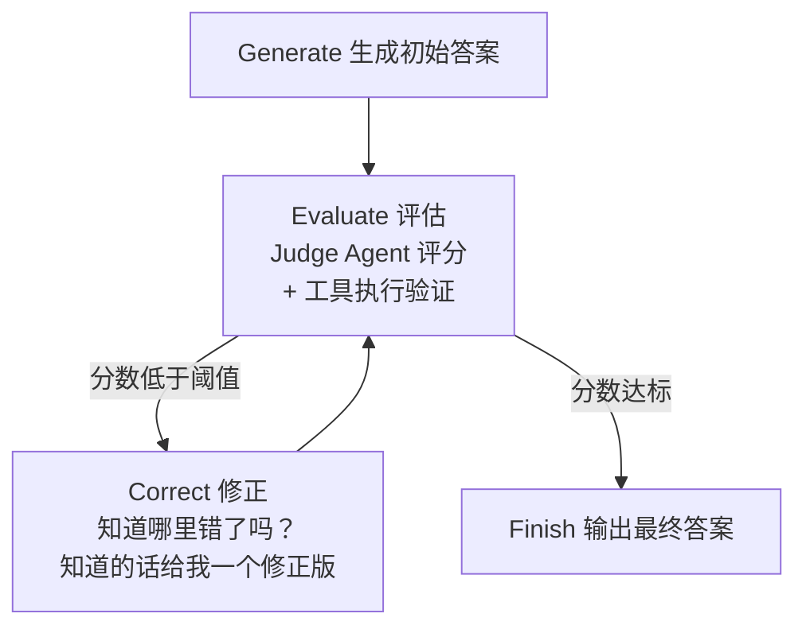
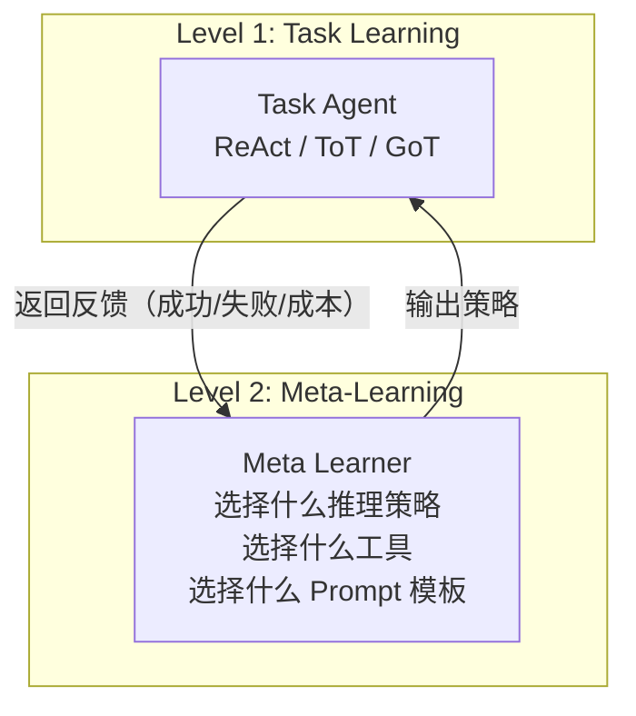

# 第 8 章 反思模式：让 Agent 真的"吃一堑长一智"

> "一个 Agent 犯了错，改完继续犯错——这不是 Agent，这是脚本。反思模式解决的是：Agent 如何感知自己的局限、从失败中学习、并把学习结果沉淀成下一次不会再犯的东西。"

如果说记忆模式让 Agent "记住了过去"，推理模式让 Agent "能思考当下"，行动模式让 Agent "能动手做事"，那么反思模式让 Agent **"能改进自己"**。这是从"执行体"到"学习体"的质变。

## 8.1 自我修正模式：犯错 → 自我修正 → 再验证

### 8.1.1 三层闭环架构

自我修正模式的核心是一个**迭代闭环**：**生成（Generate）→ 评估（Evaluate）→ 修正（Correct）→ 再评估（Re-evaluate）**。



| 组件 | 作用 | 代表 |
| --- | --- | --- |
| **Generator** | 生成初始答案的"选手" | LLM，任何 ReAct / CoT Agent 都可以是 Generator |
| **Evaluator（Judge）** | 评估答案好坏的"裁判" | LLM-As-Judge（另一个 Prompt 或另一个模型）+ 工具验证（代码测试 / 数学验算） |
| **Modifier** | 基于反馈输出修正版的"选手助手" | 通常是同一个 Generator Prompt 加上反馈作为额外上下文 |

### 8.1.2 三种评估策略

Evaluator 的设计决定了修正循环的质量：

| 策略 | 机制 | 精准率 | 成本 | 适用 |
| --- | --- | --- | --- | --- |
| **模型评估（LLM-As-Judge）** | 让另一个 LLM 读 Generator 输出，给分并指出错误 | 高（约 80-85%） | 中（额外 1-2 次 LLM 调用） | 开放式问题、创意写作、分析报告 |
| **工具评估（Tool-Based）** | 用确定性工具验证 Generator 输出 | 极高（100%） | 低（CLI/数据库查询） | 编程（单元测试）、数学（符号计算）、数据处理（跑 Pipeline） |
| **投票评估（Self-Consistency）** | Generator 跑 N 次，取多数票 | 中-高 | 高（N 次 LLM 调用） | 数学推理、逻辑推理、确定性答案 |

### 8.1.3 工业案例：代码 Agent 的自我修正

Copilot Workspace / SWE-bench Agent 的核心机制：

```
Generator: "让我修复这个 bug... 我觉得问题在 auth.ts 第 42 行，应该改成..."
  → 输出 patch.diff
Evaluator: "跑一下测试 → 3 个通过，2 个失败，失败原因是..."
  → 返回失败测试的堆栈
Modifier: "好的，让我根据失败堆栈再修改..."
  → 输出 v2 patch.diff
Evaluator: "再跑 → 全部通过 ✅"
  → 输出最终答案
```

### 8.1.4 核心 trade-off

**质量 vs 成本 vs 速度** 的三角平衡：
- 想让 Agent 自我修正 N 轮？每多一轮 = 成本 × 1.5-2 + 延迟 × 1.5
- 怎么设停止条件？**成本阈值**（最多花 10 美元）、**轮数阈值**（最多修 3 轮）、**置信度阈值**（Judge 评分 ≥ 0.9 就停）

## 8.2 反思记忆模式：把反思沉淀成可检索的知识

### 8.2.1 问题：自我修正的"不可积累"

自我修正让 Agent "这次做对了"，但下次遇到**完全相同的问题**，它还是从零开始犯同样的错。反思记忆解决的就是这个"吃一堑不长一智"的问题。

### 8.2.2 三组件架构

| 组件 | 作用 | 比喻 |
| --- | --- | --- |
| **反思触发器** | 什么时候该反思 | 事件驱动：失败时触发（编译错误、测试失败、用户明确反馈"这个答案不对"） |
| **反思提取器** | 把错误 → 结构化条目 | 飞机黑匣子记录格式：`Error`（错误）+ `Cause`（原因）+ `Fix`（修正方案）+ `Trigger`（触发条件） |
| **反思记忆库** | 存储 + 检索反思条目 | 向量数据库，每次新任务进来时先检索"历史上有没有相似的坑" |

### 8.2.3 反思条目的结构

```json
{
  "id": "ref_20240615_001",
  "trigger": "编写 FastAPI 异步路由",
  "error": "Async route returned sync generator",
  "cause": "忘记了 async generator 需要 async for，不是 for",
  "fix": "把 for 改成 async for",
  "tags": ["python", "async", "fastapi", "generator"],
  "verified_at": "2024-06-15T10:30:00Z"
}
```

### 8.2.4 检索时机

反思记忆不应该在**每个**新任务都全量检索——那会稀释注意力。最佳时机是：

| 时机 | 检索内容 |
| --- | --- |
| 任务开始前 | "有没有完全重复的任务？"（精确匹配 trigger） |
| 行动失败后 | "有没有类似的错误？"（相似度匹配 error/cause） |
| 规划阶段 | "有没有可以复用的 fix 策略？"（相似度匹配 trigger/fix） |

### 8.2.5 与情节记忆的融合

反思记忆 + 情节记忆 + RAG 三者融合后，Agent 的记忆系统形成了一个完整的"知识三角"：

| 记忆类型 | 存储什么 | 何时检索 |
| --- | --- | --- |
| **RAG** | 静态事实和知识 | 回答知识性问题 |
| **情节记忆** | 做过什么事、成功/失败了 | 新任务开始前迁移经验 |
| **反思记忆** | 犯过什么错、怎么改的 | 失败后立即检索防重犯 |

## 8.3 元学习模式：学会"怎么学"

### 8.3.1 问题：反思的"边界"

自我修正让 Agent 能"做错了改"，反思记忆让 Agent 能"下次别犯同样的错"。但如果 Agent 连"应该用什么方法来解决这类问题"都不知道呢？

比如：遇到一个新类型的数学竞赛题，用 CoT 推理得 60 分，用 ToT 推理得 85 分。Agent 能"记住用 ToT"，但它能不能**学会"遇到哪类数学题时优先用 ToT"**？

这就是**元学习**要解决的问题：**Agent 不仅要学会怎么执行任务，还要学会怎么"学习"新任务**。

### 8.3.2 两层架构



| 层 | 作用 | 类比 |
| --- | --- | --- |
| **Task Learner（Level 1）** | 执行具体任务的"专业选手" | 一个程序员 |
| **Meta Learner（Level 2）** | 选择"用谁来做"和"怎么做" | 一个项目经理，能根据任务类型分派最合适的人 + 选择最优流程 |

### 8.3.3 三种元学习技术

| 技术 | 机制 | 代表 |
| --- | --- | --- |
| **MAML（Model-Agnostic Meta-Learning）** | 先预训练一个"能快速适应新任务"的初始化参数。遇到新任务时，只需要极少梯度更新就能收敛 | 2017 年经典工作，学术方向 |
| **Prompt Tuning / PEFT** | 固定大模型参数，只训练一个极小的 Prompt 嵌入层。每个新任务 = 一个新的 Prompt Embedding | 工业界主流——微调成本降低 100 倍 |
| **策略选择器（Policy Selector）** | 训练一个分类器：输入"任务描述"，输出"最适合的推理策略"（CoT / ToT / GoT / ReAct） | LLM Compiler 的核心机制 |

### 8.3.4 Meta Agent：Agent 的 Agent

最直接的元学习落地形态就是 **Meta Agent**（Agent 的 Agent）：
- Meta Agent 不直接执行任何任务；
- 它只做三件事：**分解任务、选择执行者、评估结果**；
- 每个 Specialist Agent（Coder / Researcher / Writer）都是 Meta Agent "学会使用"的工具。

CrewAI、AutoGen、LangGraph Supervisor 模式本质上都是 Meta Agent 的框架化落地。

## 小结：从"执行体"到"学习体"的质变

| 模式 | 解决什么问题 | 核心机制 | 设计哲学 |
| --- | --- | --- | --- |
| **自我修正** | 这次做错了，怎么改对 | Generate → Evaluate → Correct 迭代闭环 + Judge Agent | **让 Agent 拥有"第二意见"** |
| **反思记忆** | 这次做对了，下次别犯 | 失败 → 结构化提取 → 存储 → 相似错误触发检索 | **让 Agent 写"错误日志"** |
| **元学习** | 不知道该用什么方法解决新问题 | Level 1 执行 + Level 2 策略选择 + 反馈闭环 | **让 Agent 学会"怎么学"** |

反思模式族让 Agent 从**一次性的执行脚本**进化为**持续学习的学习体**。这是从 GoF 模式时代的"代码即最终形态"到 Agent 时代的"代码即起点，学习即终点"的根本转变。