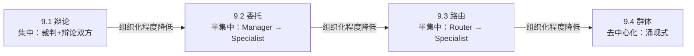
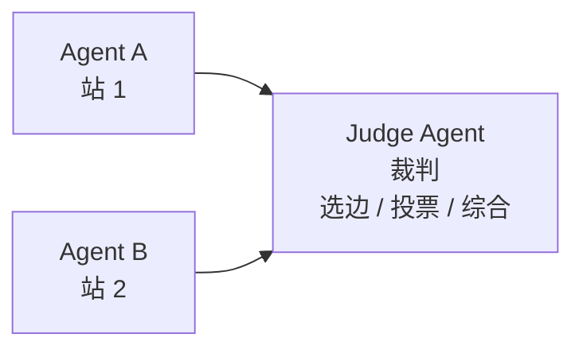
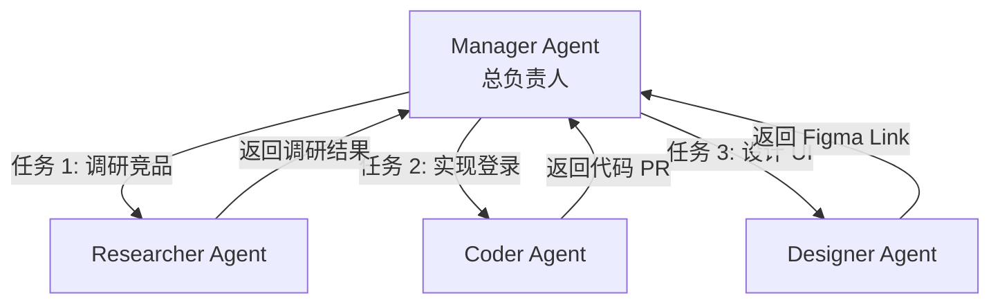
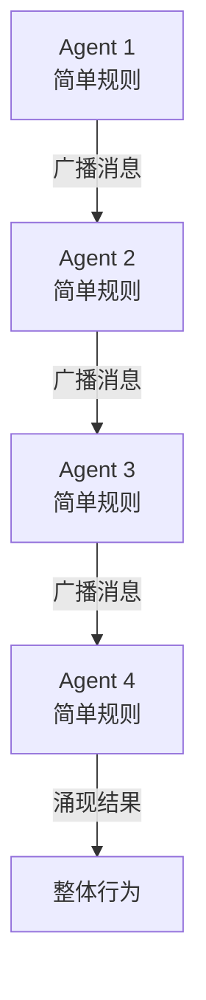

# 第 9 章 协作模式：多个 Agent，如何分工、沟通、共存

> "多 Agent 的力量不在于单体有多聪明，而在于如何分工协作。协作模式解决的是：N 个 Agent 组成团队时，谁说了算、谁做什么、信息怎么流动、冲突怎么处理。"

2023 年 3 月 14 日 OpenAI 发布 GPT-4。就在当天，一位研究员发了一条推文："如果我们让多个 GPT-4 实例相互对话，又会发生什么呢？"48 小时后，**AutoGPT** 诞生了。紧随其后，BabyAGI、AgentGPT、SuperAGI 等项目如雨后春笋般涌现——人们突然意识到：**真正的力量并不在于单体 Agent 有多聪明，而在于多个 Agent 如何协同工作**。

本章拆解四种协作模式，它们按**集中程度**从高到低排列：



## 9.1 辩论模式（Debate）：两个大脑 + 一个裁判

### 9.1.1 核心结构



三个角色：
- **Debater A**：站在立场 A（比如"用协同过滤"），输出最强论据
- **Debater B**：站在立场 B（比如"用内容过滤"），输出最强论据
- **Judge**：独立评估双方，输出最终结论（选边 / 投票 / 综合出第三种方案）

### 9.1.2 适用场景

| 场景 | 辩论双方 | Judge | 价值 |
| --- | --- | --- | --- |
| 技术选型 | "微服务 vs 单体" | 架构师 Agent | 避免"一家之言"的 bias |
| 策略权衡 | "激进增长 vs 稳健盈利" | 战略顾问 Agent | 多视角分析 |
| 代码审查 | "这段代码应该重构 vs 应该保持原样" | Reviewer Agent | 减少盲点 |
| 安全审计 | "这个 API 有漏洞 vs 没问题" | 红队 Agent | 对抗式提高安全 |

### 9.1.3 迭代辩论

基础辩论是"一次投一票"，迭代辩论是"辩论 N 轮，每轮对方看了上一轮论据后再辩"——效果显著更强，代价也更高：

| 轮数 | 精准率提升 | 成本增量 |
| --- | --- | --- |
| 1 | 基础 | 1× |
| 2 | +5-10% | 3× |
| 5 | +15-20% | 10× |

### 9.1.4 关键设计决策

| 决策 | 选项 | Trade-off |
| --- | --- | --- |
| Judge 要不要和 Debater 是同一个模型 | 是（经济） / 否（精准） | 同一个模型可能有相同的 bias，选另一个模型效果更好但成本翻倍 |
| Debater 立场要不要预设 | 预设（"你必须站 A"） / 让模型自己选 | 预设能保证覆盖所有角度，自己选可能两边都选同一个 |
| Judge 输出是选边还是综合 | 选边（简单） / 综合（高价值） | 综合能力更强但 Judge 难度更大 |

## 9.2 委托模式（Delegate）：Manager → Specialist 的层级组织

### 9.2.1 核心结构



这是**半集中式**的协作——Manager 负责任务分解 + 结果汇总，每个 Specialist 专注于单一职责。

### 9.2.2 两个工程实现范式

| 范式 | 机制 | 代表 |
| --- | --- | --- |
| **静态角色分工** | 在 Prompt 里硬编码 Manager/Specialist 的角色、能力边界、对话模板 | CrewAI 的 Role-Based 架构、AutoGen 初始化时指定角色 |
| **动态 Supervision** | Supervisor Agent 每次都从"员工池"里挑最合适的 Specialist + 动态拆任务 | LangGraph Supervisor 模式、AutoGen GroupChat |

### 9.2.3 三个工程挑战

| 挑战 | 症状 | 对策 |
| --- | --- | --- |
| **信息孤岛** | Researcher 发现了竞品 A 的 bug，但 Coder 完全不知道 | Manager 在传任务时注入**必要背景**，不要只传裸任务 |
| **角色模糊** | Coder 有时也想做设计，Designer 也想改代码 | 在 Prompt 里明确角色边界 + 强制"超出职责就说不会" |
| **Manager 瓶颈** | Manager 变成新的单点瓶颈 | 可以让 Manager 也委托——形成两层甚至三层 Manager |

### 9.2.4 工业代表框架

| 框架 | 角色分工方式 | 灵活度 |
| --- | --- | --- |
| **CrewAI** | Role-Based：先定义角色、目标、工具，再 Crew().kickoff() | 低-中 |
| **AutoGen** | 对话式：Agent 之间通过对话协商分工 | 高 |
| **LangGraph** | Supervisor 图：显式声明 Manager → Specialist 的图结构 | 高 |

## 9.3 路由模式（Router）：进来一个请求，先路由再分发

### 9.3.1 核心结构

```mermaid
flowchart TD
    Q["用户请求<br/>"我的信用卡被盗刷了"]
    R["Router Agent<br/>分类 + 路由"]
    Q --> R
    R -- "识别为金融诈骗<br/>→ 路由到" --> F["Finance Specialist"]
    R -- "识别为技术问题<br/>→ 路由到" --> T["Tech Specialist"]
    R -- "识别为营销咨询<br/>→ 路由到" --> M["Marketing Specialist"]
```

### 9.3.2 分类 vs 路由

很多人把 Router 和 Manager 搞混，核心区别是：
- **Manager** 收到一个大任务，**拆成多个子任务**，分发给多个 Specialist；
- **Router** 收到一个请求，**先分类**，**路由到最合适的 Specialist**（通常只需要一个）。

| 维度 | 路由 | 委托 |
| --- | --- | --- |
| 输入 | 一个请求 | 一个目标 |
| 输出 | 选出 N 个 Agent（通常 1 个） | 拆出 N 个子任务 + 分发给 N 个 Agent |
| 典型场景 | 多领域客服、多 Agent API 网关 | 全栈项目、端到端任务 |

### 9.3.3 路由分类的三种实现

| 方法 | 精准率 | 成本 | 代表 |
| --- | --- | --- | --- |
| **规则路由**（if-else） | 高（在规则覆盖范围内） | 极低 | 关键词匹配、正则 |
| **Embedding 相似度路由** | 中-高 | 低（只跑一次 embedding） | 把每个 Specialist 的能力描述 embedding，请求向量做相似度匹配 |
| **LLM 路由** | 最高 | 中（一次 LLM 调用） | 让 LLM 读请求 + 读所有 Specialist 描述，输出"选哪个" |

### 9.3.4 工业案例：企业级客服网关

```
Router Agent (LLM 路由):
  请求: "我的订单 12345 为什么还没发货？"
  → 匹配 "订单状态 Specialist" → 路由
  
  请求: "我想退订会员"
  → 匹配 "退款 Specialist" → 路由
  
  请求: "刚才收到诈骗短信，请问是不是你们发的？"
  → 匹配 "安全 Specialist" + "升级到人工客服"
```

## 9.4 群体模式（Swarm）：去中心化的涌现式协作

### 9.4.1 核心结构

群体模式是**去中心化**的——没有 Manager、没有 Router。每个 Agent 只遵循简单规则，**通过广播/订阅/消息队列与邻居交互**，最终涌现出复杂的整体行为。



### 9.4.2 三种涌现机制

| 机制 | 启发自 | 工业代表 | 说明 |
| --- | --- | --- | --- |
| **蚁群算法（ACO）** | 蚂蚁信息素 | 网络路由优化 | 每个 Agent 只看信息素浓度，走浓度高的路径——全局涌现出最优网络路由 |
| **粒子群（PSO）** | 鸟群飞翔 | 参数调优、路径规划 | 每个 Agent 记住自己的历史最优 + 全局最优，综合两个信息调整位置 |
| **黑板系统（Blackboard）** | 早期 AI（1970s） | AutoGPT（早期形态） | 所有 Agent 共享一个"黑板"——谁都可以读谁都可以写，通过黑板上的信息自然分工 |

### 9.4.3 与 9.1-9.3 的对比

| 模式 | 去中心化程度 | 可控性 | 精准率 | 适用场景 |
| --- | --- | --- | --- | --- |
| 辩论 | 低 | 高 | 高 | 事实争议、策略权衡 |
| 委托 | 中 | 高 | 高 | 明确的多角色任务 |
| 路由 | 中 | 高 | 中 | 多领域客服 |
| **群体** | **最高** | **低** | **未知（风险高）** | 探索型、不需要精确控制的场景 |

### 9.4.4 关键风险：不可控性

群体模式最大的风险是**涌现行为不可控**——你可能得到一个远超单体 Agent 的"集体智慧"，也可能得到一个集体幻觉或混沌振荡的"集体疯狂"。

治理手段：
- 给每个 Agent 设**预算/能量上限**（防止无限循环）；
- 用**全局 Governor Agent** 监控整体行为异常；
- 给**反馈信号**（如 Meta 反思记忆），让失败的涌现模式沉淀成"不要再这么做"的经验。

## 后记：熵的园丁

> 熵是生命的敌人，但也是进化的朋友。系统越复杂，熵越高，但**熵的每一次峰值，都是下一次创新的起点**。

黄佳在全书最后一章提出一个关键隐喻：

> 软件工程师曾经是**精密钟表的制造者**——目标是消除不确定性、消灭熵、打造永恒运转的确定性系统。
>
> 软件工程师现在是**熵的园丁**——我们不再试图消灭不确定性，而是在不确定性中建立秩序；不再试图控制系统的每一个齿轮，而是**设计让系统自我演化的生态**。

Agent 时代的工程师角色从"控制者"变为"园丁"：
- 感知模式给 Agent 装上了"眼睛"；
- 记忆模式给 Agent 装上了"脑子"；
- 推理模式给 Agent 装上了"思考方法"；
- 行动模式给 Agent 装上了"手和脚"；
- 反思模式给 Agent 装上了"学习能力"；
- 协作模式给 Agent 装上了"社会能力"。

**这六大模式族，就是 Agent 时代工程师的新工具箱——一个从代码组织进化到意图、记忆、行动与协作组织的工具箱。**