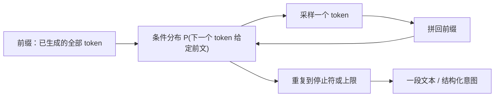
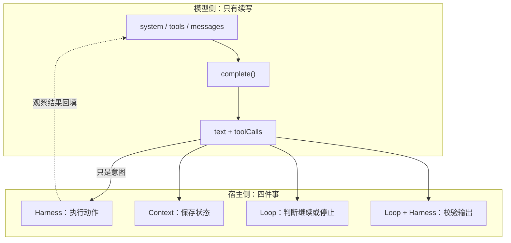

# 01 · 从概率模型到行动者：为什么一次 `complete()` 不够

> **一句话结论**：`complete()` 返回的只是「关于动作的文本」；从意图到动作之间，必须由宿主补上执行、状态、终止与校验这四件事。
> **定位**：Part I · 基础（Prompt 与 Context 的物理学前提）
> **关联缺陷**：D1（只有模型意图，没有宿主执行）→ Part II 第 14 / 22 课
> **前置**：[课程总览](/ai/harness/) ｜ **下一课**：[第 02 课 · Tool Calling 的真相](/ai/harness/02-tool-calling)

## 本课要回答的问题

调用一次语言模型，拿到一段文本，然后呢？很多系统就在这里停下：文本被打印出来，世界没有任何变化。要真正造出「行动者」，你得先能判定地回答一个问题：**模型产出的东西里，哪些是「动作」，哪些只是「关于动作的文本」？**

这个问题看似咬文嚼字，实际上决定了整个 harness 的架构。如果误把「模型说了 `write_file`」当成「文件被写了」，你就永远需要一个隐形的、不可靠的补丁层去猜模型的意思。本课先把模型的真实能力边界钉死，后面五课才有地基。

## 核心原理

### 先建立直觉：模型是一个条件续写器

把模型想成一位**只会写剧本的编剧**。你递给他一个开头（前缀），他根据「接下来最可能发生什么」续写下一句。他可以在剧本里写下舞台指示「主角打开保险箱」，但舞台上没有任何人去拧那个把手。剧本越像真的，越容易让读者误以为保险箱已经开了。

语言模型的全部工作就是这个续写。它没有「执行」这个动作，也没有一个内置的「任务完成」状态位。所谓 agent，是**在编剧之外再雇一个剧组**：有人负责照着舞台指示真的搬道具，有人负责判断这场戏该不该收工，有人负责在道具出错时喊停。

### 自回归分解：一次调用只是采样出一条路径

语言模型建模序列的联合概率：

$$P(x_{1:n}) = \prod_{t=1}^{n} P(x_t \mid x_{<t})$$

推理就是反复从条件分布采样一个 token，再把它并入条件。`temperature` / `top-p` / `top-k` 改变的是**采样分布的形状**，不改变「逐 token 条件生成」这一事实。

这里有一个对工程影响极大的推论：`temperature=0` 只是贪心，跨部署、跨版本、跨硬件仍不保证逐字一致。贪心只保证「每次在同一个浮点计算图上选当前最大项」，而不同批处理顺序、不同算子实现、不同硬件都可能让最大项的排序翻转。所以后面所有测试都必须 **mock 掉模型边界**（[第 12 课](/ai/harness/12-extensibility-and-eval)），不能把「模型每次说同一句话」当成测试前提。



### 对齐不是内置目标函数

预训练让模型压缩训练分布；指令微调与 RLHF/DPO 把「续写」塑形为「遵循指令」。所以「听懂任务」是条件概率的塑形结果，**不是**写入的目标状态机。

这句话有两个直接推论，几乎解释了 Part I 里一半的坑：

1. **同一指令换措辞、换位置，行为会变**。因为条件分布对前缀极其敏感，指令只是前缀的一部分。
2. **模型没有内建的「任务完成」判据**，只会生成**看起来像完成**的 token。这正是[第 03 课](/ai/harness/03-react-and-termination)终止判据的根源：自然停止是「弱判据」，它只说明模型不再续写出工具调用，不说明任务真的成了。

### 上下文内学习：示例在改写当前条件分布

上下文内学习（ICL）本质上是隐式的任务识别：示例与指令把后验质量集中到某类续写上。换句话说，few-shot 不是「教知识」，而是**改变当前条件分布**。

这也是 Context Engineering 的物理学基础：你往窗口里放的每一段内容，都不是中性的资料，而是在给「接下来该写什么」加权。放错示例，比不放示例更糟，因为模型会把示例里的偏见一起学走。

| 常见理解 | 更准确的说法 |
|---|---|
| few-shot 是在给模型补充知识 | few-shot 是在改写本次采样的条件分布 |
| 指令写得越全，模型越懂 | 指令的位置、措辞、与示例的一致性共同决定权重 |
| 模型「知道」自己要做什么 | 模型只是把当前前缀续写成合理的样子 |

### 推理模型：把「多想一会儿」变成预算

传统形态里「多想一会儿」靠提示词诱导 CoT；推理模型把这件事变成**模型侧的显式预算**：在生成最终答案前产出一段独立的 reasoning 轨迹，并允许宿主指定 effort 档位。工程上有三点必须知道：

| 变化 | 对 harness 的影响 |
|---|---|
| 输出分成 reasoning 与 answer 两路 | 流式与持久化要能分别结算，不能把思考轨迹混进 messages |
| 测试时计算量可调 | 成本/延迟不再只由输入长度决定，`effort` 成为 Loop 的预算维度 |
| 推理轨迹可能含「自我纠错」 | 摘要/压缩若把轨迹截断，会丢掉模型自己发现的错误（第 08 课） |

注意：reasoning 仍是 token，仍受同一套自回归与注意力预算约束，**没有跳出这个模型观**，只是把计算从「一次前向」搬到了「可配置长度的续写」。Part II 第 20 课看 `reasoningEffort` 四档与 `thinking_delta → reasoning` 的真实适配层。

### 宿主必须补的四件事

把模型的缺口列成清单，harness 的职责就清楚了：

| 模型没有 | 由哪一层补 |
|---|---|
| 执行动作的能力 | Harness（工具与沙箱） |
| 跨请求的持久状态 | Context（日志与记忆） |
| 「再试一次 / 停止」的判断 | Loop |
| 对自身输出的可靠校验 | Loop（检查器）+ Harness（eval 门禁） |

这四格就是后面 23 课反复回到的地图。注意它们没有一格是「把提示词写得更聪明」能补上的——提示词只能改变条件分布，不能凭空造出执行器或状态存储。



## 代码与实现

`mvp/harness-mvp.mjs:22-40` —— 模型边界被压缩成一个类，只做一件事：记录请求、返回结构化意图。

```js
class ScriptedModel {
  constructor(script) { this.script = script; this.i = 0; this.requests = []; }
  async complete(request) {
    this.requests.push(clone({
      system: request.system,
      tools: (request.tools || []).map((t) => t.name),
      messages: request.messages,
    }));
    const turn = this.script[Math.min(this.i, this.script.length - 1)];
    this.i += 1;
    return clone(turn);            // { text, toolCalls } —— 纯意图，零副作用
  }
}
```

这段代码解决的是「模型不可测」的问题：把真实的、非确定的远端调用替换成一个按脚本吐答案的本地对象，于是宿主的每一步都变得可复现、离线、零成本。`requests` 数组顺手完成了另一件事——它记录了每次请求的 `system`、工具名列表与消息，这是教学版里最原始的「轨迹」。缺陷埋在返回值的注释里：`{ text, toolCalls }` 是纯意图，**这个类里没有任何一行会去执行 `toolCalls`**。D1 就在这里诞生。

把输入输出对齐成一张表，验收时不容易混：

| 方向 | 字段 | 含义 |
|---|---|---|
| 输入 | `system` | 身份、工具政策、输出格式等静态指令 |
| 输入 | `tools` | 本轮可表达的动作空间（schema 列表） |
| 输入 | `messages` | 历史对话与工具结果 |
| 输出 | `text` | 给用户看的自然语言 |
| 输出 | `toolCalls` | 结构化动作意图，等待宿主执行 |

`mvp/harness-mvp.mjs:100-118` 的 `stage0()` 是完整实验：只调一次 `complete()`，然后检查工作区。脚本化模型不是「假模型」，而是**把非确定性边界替换成可控夹具**（[第 12 课](/ai/harness/12-extensibility-and-eval)会把它升格为测试方法论）。

这个实验的设计非常克制：它不验证模型有多聪明，只验证一个断言——**调用前后工作区没有变化**。这条断言看似废话，却是整门课的第一块界碑：它把「模型输出」和「系统状态」在物理上分开了。

## 权衡与失效模式

- **把「模型说了」当成「事情做了」**：D1 的本体。模型输出 `write_file` 的意图，宿主不执行，文件永远不存在。症状是「模型说完成了，但测试失败」，归因是意图与执行之间缺了一层。
- **脚本化模型的收益与代价**：可复现、离线、零成本；代价是覆盖率只等于脚本，测不出真实模型的措辞敏感性。因此它用于验证**宿主逻辑**，不用于评估模型能力。
- **推理模型的常见误用**：把 reasoning 轨迹原样回灌给下一次请求，既烧 token 又污染上下文；或反过来把轨迹全丢，导致压缩后模型忘记自己曾推翻过的假设。

| 症状 | 归因 |
|---|---|
| 回复里说「已创建 report.txt」，磁盘上没有 | D1：`toolCalls` 从未被执行 |
| 单测全绿，接真实模型就崩 | 脚本覆盖率只等于脚本，模型边界没被真实分布检验 |
| 上下文越用越长、模型开始重复自己 | reasoning 轨迹被默认回灌，挤占了有效信息 |

## 四层定位

| 方向 | 内容 |
|---|---|
| Prompt → 模型 | `system` / `tools` / `messages` 装配结果；改变条件分布 |
| Context ← 模型 | 每次 `complete()` 的请求被 `requests` 记录（**教学版的轨迹**） |
| Loop 缺失 | 没有第二次请求，没有「下一步」 |
| Harness 缺失 | 没有执行器，`toolCalls` 只是数据 |

**传导**：一旦给模型加 reasoning 档位，Prompt 的 system 不变但输出结构变 → Context 要决定轨迹是否入窗 → Loop 要把 effort 计入预算 → Harness 的计量要区分 reasoning token 与 answer token（第 06、22 课）。

这张表值得反复看：它说明「本课只讲模型」是假象。任何对模型边界的改动，都会顺着四条箭头传到其他三层。

## 动手实验

```bash
cd /Users/cheeka/code/deepseek-harness/dsh-agent-course/mvp
node harness-mvp.mjs --stage 0
sed -n '22,40p'  harness-mvp.mjs      # 模型边界
sed -n '100,118p' harness-mvp.mjs     # stage0
node harness-mvp.mjs --json | python3 -c \
  "import json,sys; d=json.load(sys.stdin); s=d[0]; \
   assert s['stage']==0 and '意图 ≠ 动作' in ''.join(s['evidence']); print(s['trace'])"
```

**你会看到什么**：`--stage 0` 打印的 trace 里，模型确实「说了要调用工具」，但工作区快照与调用前一致，证据明确写着「工具执行次数=0」与「意图 ≠ 动作」。最后一段 Python 断言不是在测模型，而是在测**你的理解**：如果实现里偷偷执行了工具，这条断言就会挂。

**手写补全练习**（在 `scratch-01.mjs` 里写，不进 MVP 主干）：给 `ScriptedModel` 加一个 `reasoning` 字段，模拟推理模型的双路输出，并证明「轨迹不进 messages」与「轨迹进 messages」两种装配的下一次请求长度不同。

```js
const turn = { reasoning: '先数 .ts 文件…', text: '我先列目录',
               toolCalls: [{ name: 'list_files', arguments: {} }] };
const messagesA = [{ role: 'assistant', content: turn.text }];
const messagesB = [{ role: 'assistant', content: turn.reasoning + turn.text }];
console.log('不含轨迹:', JSON.stringify(messagesA).length,
            '含轨迹:', JSON.stringify(messagesB).length);
```

两个数字必然不同，且差值就是 reasoning 的字符开销。真正的收获不是这个差值，而是你能解释：轨迹默认不回灌，是因为它属于「模型侧的计算过程」，不是「对话双方共享的事实」；回灌会让下一次请求把一个已经消费过的推理过程重新当输入，既贵又容易让模型复读。

## 常见误区

- **误区**：「模型更聪明就不需要 harness」。模型能力改变的是可解任务的边界，不改变「执行、状态、终止、校验」这四样东西仍由外部提供。
- **误区**：「CoT 是模型在思考」。更准确的说法是**把中间计算外化为 token**，扩展可串行执行的计算步数。
- **误区**：「`temperature=0` 就能写快照测试」。跨版本/跨硬件的浮点与批处理差异，足以让贪心结果翻转。

## 本课小结

- 模型是条件续写器：`complete()` 的产物是 token 序列，不是世界状态。
- 对齐塑形的是条件概率，不是目标状态机；模型没有「完成」判据。
- 一次调用只是一条采样路径，`temperature=0` 也不保证跨环境一致。
- 执行、状态、终止、校验必须由宿主补齐，这就是四层地图的由来。
- D1 的定义：意图 ≠ 动作；后续所有课程都在给这条裂缝补结构。

| 你观察到 | 本课给出的解释 |
|---|---|
| 模型说「已完成」但无副作用 | 只有意图，缺 Harness 执行 |
| 同一提示换措辞行为不同 | 条件分布对前缀敏感 |
| 测试无法稳定复现模型输出 | 自回归采样 + 浮点/硬件差异 |

## 自测

**Q1**：`complete()` 的输入三个字段、输出两个字段分别是什么？执行发生在哪一层？

<details><summary>参考答案</summary>

输入是 `system`、`tools`、`messages`；输出是 `text` 与 `toolCalls`。执行不发生在模型层，而发生在宿主/Harness 层：模型只产出结构化意图，由运行时解析、校验并调用真实工具。

</details>

**Q2**：为什么说「模型没有内建的任务完成判据」？这会导致什么现象？

<details><summary>参考答案</summary>

因为指令微调与 RLHF/DPO 只是把续写塑形成「遵循指令」，并没有写入一个可查询的目标状态机。模型只能生成「看起来像完成」的 token。现象是：模型可以自信地报告成功，而任务其实没完成；这也是第 03 课必须引入外部终止判据的原因。

</details>

**Q3**：`temperature=0` 为什么不等于确定性？至少说两条理由。

<details><summary>参考答案</summary>

其一，跨版本、跨部署的模型权重与解码实现可能不同；其二，浮点运算顺序、批处理组成、硬件算子差异都可能改变 logits 的排序，使贪心选择翻转。因此不能把「逐字一致」当作测试前提，必须 mock 模型边界。

</details>

**Q4**：reasoning 轨迹为什么不应默认回灌进下一次请求？如果全丢又会怎样？

<details><summary>参考答案</summary>

默认回灌会重复计价、污染上下文，并让模型把已经消费过的推理当新输入复读。全丢的风险是：压缩或截断后，模型忘记自己曾推翻过的假设，重新走回错误路径。正确做法是把它当作可结算、可选择性保留的模型侧计算，而不是普通对话消息。

</details>

## 延伸阅读与下一课

- Anthropic, *Building effective agents*（augmented LLM 一节）。
- 源码：`mvp/harness-mvp.mjs:22-40`（模型边界）、`:100-118`（`stage0`）。
- 暂不要读 `docs/cordis-primer.md`——Part II 第 13 课才引入框架词汇。

下一课把镜头推进一格：模型既然只能产出结构化意图，那么「工具调用」到底是模型的责任，还是宿主的责任？见[第 02 课 · Tool Calling 的真相](/ai/harness/02-tool-calling)。
