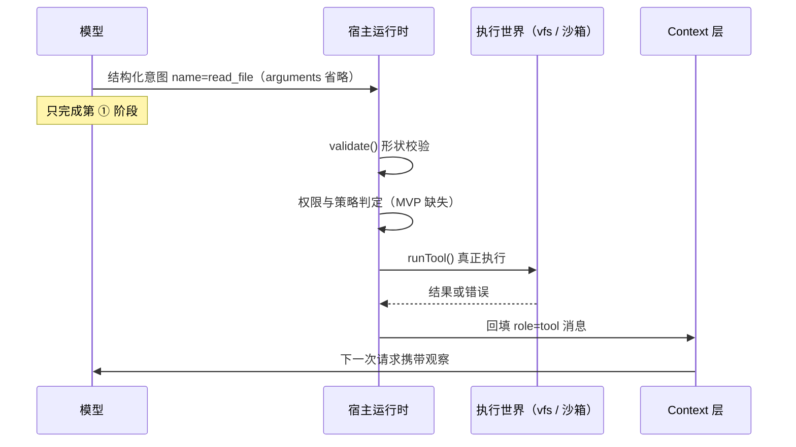
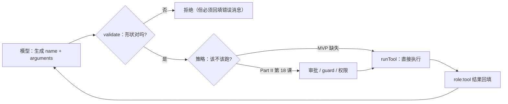

# 02 · Tool Calling 的真相：意图、契约、执行三者分离

> **一句话结论**：模型只负责产出 `{ name, arguments }` 这一结构化意图；校验、授权、执行、回填全部是宿主的事。
> **定位**：Part I · Prompt × Harness 的边界
> **关联缺陷**：D8 的前置——校验只到类型，无权限、无作用域、无信任标记 → Part II 第 18 / 23 课
> **前置**：[第 01 课 · 从概率模型到行动者](/ai/harness/01-from-model-to-actor) ｜ **下一课**：[第 03 课 · ReAct 与终止判据](/ai/harness/03-react-and-termination)

## 本课要回答的问题

当模型返回一个 `tool_calls` 数组时，究竟是谁在「负责任」？是模型承诺了它会执行，还是宿主替它执行？如果参数是编造的、路径越出了工作区、命令带破坏性，应该在哪个环节被挡住？

本课要给出一个可判定的答案：**一个非法工具调用，应该在哪一环节、被谁、以什么依据拒绝？** 把这条分工线画清楚，你才不会在提示词里写「请不要删除文件」这种自我安慰式的安全措施。

## 核心原理

### 先建立直觉：模型填表，宿主办事

把 tool calling 想成去政务大厅办事。模型是那位趴在柜台上填申请表的市民：它能写「我要办理 A 事项，材料是 B、C」，字迹可以很工整，表格格式可以完全正确。但**表格不会自己生效**——窗口里的工作人员要核对材料是否齐全、事项是否在受理范围、申请人有没有权限，然后才真正盖章办理。

function calling 的全部魔法，就是通过训练与解码约束，让模型成为一个非常擅长填表的市民。它填得再准，也不等于事情办了。

### 三阶段模型

```text
① 意图：模型生成结构化片段 { name, arguments }        ← 模型唯一做的事
② 执行：宿主解析 → 校验 → 权限判定 → 实际执行        ← 运行时
③ 回填：结果作为新消息进入下一次请求的 context       ← 运行时 + Context 层
```

模型**从不执行工具**。所谓 function calling，是训练与解码约束共同让模型可靠地产出某种结构化意图；`arguments` 是否符合 schema、命令能不能跑、跑完有没有副作用，全部是宿主责任。



这三段里，模型只占第一段。把后两段也算成「模型的功劳」或「模型的责任」，是绝大多数误解的来源。

### schema 是双向契约

很多人把 schema 当成给模型看的说明书，其实它对两端同时生效：

- **对模型**：定义可表达的动作空间。写不进 schema 的动作，不可能被可靠调用；描述含糊，模型就会在多个工具之间乱猜。
- **对运行时**：它是输入校验边界。非法参数必须在执行前被拒，而不是执行到一半才发现。

因此结构化输出不是「格式美化」，而是**把概率输出收窄到可校验域**。这句话是第 05 课软/硬约束讨论的伏笔：schema 越严格，模型可表达的空间越小，宿主的校验负担越轻；但 schema 再严，也只管形状，不管语义。

### 工具设计是上下文工程的一部分

Anthropic 的判据很锋利：*如果一个人类工程师都不能确定某种情况下该用哪个工具，就别指望模型能做得更好*。工具不是越多越好，因为每个工具都同时消耗两样稀缺资源：选择时的注意力，以及窗口里的 token。

| 原则 | 理由 |
|---|---|
| 最小完备集、职责不重叠 | 工具越多选择熵越高，误选率上升；描述本身占 context budget |
| 返回 token 高效、可截断 | 工具结果是上下文增长的主要来源（第 06、07 课） |
| 描述写「何时用/何时不用」，示例写「怎么用」 | 静态指引与单次调用语义分开承载 |

注意第三行其实是在讲信息架构：描述块负责**策略**，示例块负责**用法**。把两者混在一段话里，模型就分不清哪句是普适规则、哪句只适用于这次调用。

### 典型失败模式

- **参数幻觉**：编造不存在的路径、字段或枚举值。
- **该调用时不调用**：明明缺信息，却直接编一个答案。
- **同参重复调用**：结果已经拿到，仍用完全相同的参数再调一次。
- **工具结果与调用 ID 不配对**：中断、异常、被校验拒绝时尤其常见（[第 11 课](/ai/harness/11-streaming-and-cancellation)）。

这四种里，只有第一种能在 `validate()` 层被部分拦住。其余三种都需要 Loop 或 Context 层配合，这也是为什么「工具调用」不是单纯 Harness 话题。

## 代码与实现

`mvp/harness-mvp.mjs:43-47` 三个工具的 schema，`63-77` 的 `validate()`，`79-86` 的 `runTool()`。

```js
function validate(call) {
  const schema = TOOLS.find((t) => t.name === call.name);
  if (!schema) return `unknown tool: ${call.name}`;
  const args = call.arguments || {};
  for (const key of schema.parameters.required) {
    if (!(key in args)) return `missing argument: ${key}`;
  }
  for (const [key, value] of Object.entries(args)) {
    const spec = schema.parameters.properties[key];
    if (!spec) return `unexpected argument: ${key}`;
    if (spec.type === 'string' && typeof value !== 'string') return `bad type: ${key}`;
  }
  return null;                 // null = 通过校验，可以执行
}
```

这段代码只回答三个问题：工具名认不认识、必填参数在不在、参数类型对不对。**它不回答「该不该让它跑」**——没有路径白名单、没有权限、没有副作用评估。作者有意把这条线停在这里，让后面第 10 课用一次越权写入把缺口演示出来（D8）。

返回值的设计也值得看：用 `null` 表示通过，用字符串表示拒绝原因。好处是拒绝原因可以直接变成可读消息喂回模型；坏处是调用方很容易只判断真伪，然后 `continue` 掉——这正是本课与第 05 课都会点名的「悬空 tool call」源头。

`runTool()` 用 `switch (call.name)` 直接调用本地 `vfs` —— 这是 P5 的伏笔：**工具与执行世界焊死**。每个 `case` 分支里没有「去哪执行」这一层抽象，只有对本地文件系统的直接调用。要换成远程沙箱、容器或 MCP 服务，你得改这个函数本体；要加审计、超时、配额，也得改这里。P5 说的「执行世界不可替换」，指的就是这个形状。

## 权衡与失效模式

- **校验前置的收益**：非法参数不产生副作用，错误可以回填成一条可读消息让模型自纠（[第 05 课](/ai/harness/05-reasoning-and-structured-output)）。
- **类型校验的局限**：`write_file` 的 path 是合法字符串，也可以是 `../../etc/passwd`。形状正确 ≠ 语义安全。
- **validate 失败后的处理**：MVP 里 `continue` 跳过该调用但**不回填任何消息**，下一次请求里 assistant 消息带着一个没有配对的 tool call —— 这是[第 11 课](/ai/harness/11-streaming-and-cancellation)「悬空 tool call」的种子。

| 失效模式 | 症状 | 归因 |
|---|---|---|
| 类型校验冒充安全 | 参数全过，越权路径仍被写 | schema 只管形状，不管授权 |
| 拒绝后静默 continue | 下一次请求 API 报错或模型困惑 | 缺少配对的 `role:'tool'` 消息 |
| 工具爆炸 | 误选率上升、schema 占满预算 | 工具集不是最小完备集 |
| 同参重复调用 | 步数与成本翻倍 | Loop 没有去重/缓存策略 |

## 四层定位

| 方向 | 内容 |
|---|---|
| Prompt → 模型 | `tools` schema 与 description 进入窗口，定义动作空间 |
| Harness | `validate()` 是执行前的输入边界；`runTool()` 是执行器 |
| Context | 工具结果作为 `role:'tool'` 消息回填 |
| Loop | 校验失败要不要继续、要不要重试，由主循环决定 |

**传导**：工具集变大 → Prompt 的 schema token 变多（Context 预算）→ 选择熵上升（Prompt 质量）→ 误调用变多（Loop 步数）。所以「加一个工具」从来不是纯 Harness 改动。

这条传导链有一个很实用的推论：当你想加工具时，先问「能不能合并进现有工具的一个参数」。合并省下的是三层的成本，而不是一层的代码。

## 动手实验

```bash
cd /Users/cheeka/code/deepseek-harness/dsh-agent-course/mvp
sed -n '43,86p' harness-mvp.mjs
node harness-mvp.mjs --stage 1 | head -20
```

**你会看到什么**：`sed` 段会把 schema、`validate()`、`runTool()` 一次展开，你能直观看到「校验」和「执行」是两个相邻但职责不同的函数；`--stage 1` 的前 20 行会展示正常任务里调用被接受、结果被回填的轨迹。留意事件流里有没有「schema 拒绝」——在正常脚本里通常没有，这恰好说明校验分支需要专门的非法脚本来覆盖。

**手写补全练习**：把下面代码贴进 `scratch-02.mjs`，亲手让三种非法调用在 `validate()` 前被挡住，并观察「挡住之后没有回填消息」会造成什么。

```js
import { readFileSync } from 'node:fs';
// 直接复用 MVP 里的定义（教学时用最小副本即可）
const TOOLS = [
  { name: 'read_file', parameters: { type: 'object',
      properties: { path: { type: 'string' } }, required: ['path'] } },
];
function validate(call) {
  const s = TOOLS.find(t => t.name === call.name);
  if (!s) return 'unknown tool';
  for (const k of s.parameters.required) if (!(k in (call.arguments||{}))) return 'missing '+k;
  for (const [k,v] of Object.entries(call.arguments||{}))
    if (!s.parameters.properties[k]) return 'unexpected '+k;
    else if (typeof v !== 'string') return 'bad type '+k;
  return null;
}
for (const c of [
  { name: 'rm_rf', arguments: {} },
  { name: 'read_file', arguments: {} },
  { name: 'read_file', arguments: { path: 42 } },
  { name: 'read_file', arguments: { path: '../../etc/passwd' } },  // 形状合法！
]) console.log(JSON.stringify(c), '→', validate(c) ?? 'ALLOW');
```

最后一行会打印 `ALLOW` —— 这就是本课要记住的画面。前三行分别被 `unknown tool`、`missing path`、`bad type path` 拒绝，第四行却一路放行，因为 `'../../etc/passwd'` 确实是一个字符串。类型系统能保证「这是一个路径形状的东西」，但保证不了「这是你有权读的路径」。

## 常见误区

- **误区**：「用了 function calling，模型就会执行函数」。执行永远在宿主，模型只填表。
- **误区**：「schema 越详细越安全」。schema 是**表达力**与**校验边界**，不是授权；细 schema 只是让非法形状更容易被拒。
- **误区**：「校验失败直接跳过就行」。跳过而不回填，会让下一次请求出现悬空 tool call，破坏消息配对。
- **误区**：「工具越多能力越强」。每多一个工具，选择熵与上下文成本同时上升，误选率往往先于能力提升到来。

## 本课小结

- tool calling 是三段式：模型产意图，宿主校验并执行，结果回填 context。
- schema 是双向契约：定义模型可表达的动作空间，也定义运行时的校验边界。
- 工具设计属于上下文工程：最小完备集、返回精简、描述分「何时用」与「怎么用」。
- 校验收紧只能挡住形状错误；权限、作用域、信任标记是另一层问题。
- `runTool()` 直接绑定本地 `vfs`，是执行世界不可替换的伏笔（P5）。



## 自测

**Q1**：画出三阶段模型，并指出模型只负责哪一阶段。

<details><summary>参考答案</summary>

① 意图：模型生成 `{ name, arguments }`；② 执行：宿主解析、校验、权限判定、实际执行；③ 回填：结果作为新消息进入下一次请求。模型只负责第 ① 阶段，后两段完全在运行时。

</details>

**Q2**：补全练习里第四条 `../../etc/passwd` 为什么打印 `ALLOW`？类型系统为什么拦不住它？

<details><summary>参考答案</summary>

因为它是一个类型完全正确的字符串，满足 `path: { type: 'string' }` 与 `required: ['path']`。类型系统只检查值的形状，不检查值的语义与访问权限；路径穿越需要白名单、规范化与授权策略，属于 Harness 的策略层。

</details>

**Q3**：工具结果回填属于哪一层？为什么说它是上下文增长的主要来源？

<details><summary>参考答案</summary>

属于 Context 层，以 `role:'tool'` 消息进入消息数组。工具结果通常包含文件内容、目录列表、命令输出，体量远大于一句模型回复，且会随步数累积，因此是窗口膨胀的主因（第 06、07 课展开）。

</details>

**Q4**：`runTool()` 里 `switch` 直接引用本地 `vfs`，换远程沙箱时会导致什么？

<details><summary>参考答案</summary>

执行世界与工具实现焊死：要换沙箱就得改 `runTool()` 本体，无法通过配置或插件替换；审计、超时、配额也只能继续往这个函数里堆。第 19 课会用 Provider 把「执行世界」抽成可替换角色。

</details>

## 延伸阅读与下一课

- Schick et al., *Toolformer*, 2023, arXiv:2302.04761。
- Anthropic, *Building effective agents* 的 tool design 章节。
- 源码：`mvp/harness-mvp.mjs:43-47`、`:63-77`、`:79-86`。

至此模型能产出意图、宿主能校验执行，但还缺一个把两者串起来的东西：谁在反复发请求？谁决定停？见[第 03 课 · ReAct 与终止判据](/ai/harness/03-react-and-termination)。
