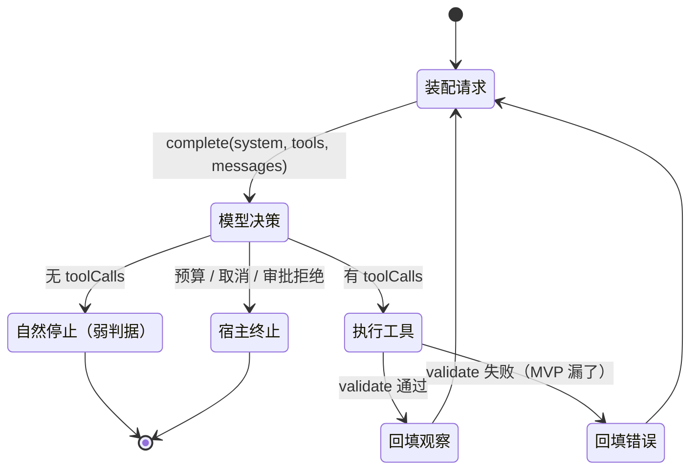

# 03 · ReAct 与终止判据：交付传统 harness MVP v1

> **一句话结论**：循环的价值在于让观察进入下一步条件，而循环的安全在于终止判据必须由宿主或外部检查器给出，不能听信模型的「我做完了」。
> **定位**：Part I · Loop 的核心
> **关联缺陷**：D2（无宿主预算）、D3（单函数五职责）→ Part II 第 17 / 22 课
> **前置**：[第 02 课 · Tool Calling 的真相](/ai/harness/02-tool-calling) ｜ **下一课**：[第 04 课 · 提示词的信息架构](/ai/harness/04-prompt-architecture)
> **本课交付物**：一个能跑通任务的传统 harness MVP v1。

## 本课要回答的问题

前两课解决了「模型产意图、宿主执行」，但只调一次 `complete()` 仍然做不成多步任务：查目录、读文件、再写报告，这三步需要模型在拿到观察后继续决策。怎么把一次调用变成一个循环？

更难的追问在后面：**谁来决定它该停？** 如果答案是「模型自己觉得做完了」，那么这个循环在遇到难任务时既可能过早收工，也可能永远停不下来。本课要交付 MVP v1，同时把这两个问题的缺陷都暴露出来。

## 核心原理

### 直觉：ReAct 是把「想」和「做」交替排进同一条时间线

想象一个人修水管：先想「可能是阀门堵了」，然后动手拧开阀门，看一眼水流，再想「水压还是低，可能过滤网也堵了」。关键在于**每一步的思考都建立在上一步真实观察之上**，而不是一开始就把全部计划想完再执行。

ReAct 把推理与行动耦合成 `Thought → Action → Observation → …`：模型产生动作意图，环境返回观察，观察进入下一次推理。它既是 Prompt 写法（[第 05 课](/ai/harness/05-reasoning-and-structured-output)），也是**控制流原型**。这句话很重要：同一个模式同时活在这两层，是本课程第一个明确的跨层机制。

### step 与 turn：先把轮次定义清楚

工程上要把轮次定义清楚（沿用 dsh 的问题域口径，不借用其结构）：

```text
step = 一次模型请求 + 它引发的工具调用
turn = 0..n 个 step，直到没有下一步请求或宿主终止
```

注意 **turn ≠ 用户一轮对话**：一条用户消息可能触发多个 turn；一个 turn 也可能在没有新用户输入时连续执行多个 step。把这两个词混用，后面做预算、做取消、做恢复时就会出现「到底在数什么」的争议。



### 四类终止判据

| 类别 | 例子 | 可判定性 |
|---|---|---|
| 模型自然停止 | 回复中不再产出 tool call | 弱：模型只是「看起来完成了」 |
| 模型停止原因 | `max_tokens` 截断 | 中：宿主可见，但属被动终止 |
| 宿主策略 | 预算/步数上限、guard、审批拒绝、用户取消 | 强 |
| 外部检查器 | 测试通过、schema 校验、goal 条件满足 | **最强** |

**停止判据必须是外部可判定的条件**。把「模型觉得自己做完了」当终止条件，是无限循环与静默失败的共同根源。表中四类的强弱排序不是审美，而是可验证性排序：越靠下，越能用一段确定性的代码回答「停得对不对」。

### 复合误差与验证不对称性

单步成功率连乘，链路越长越脆弱。设单步成功率 0.9，10 步全对的概率只剩约 0.35——这就是复合误差。它解释了为什么长循环必须靠外部信号纠偏，而不能指望模型一路不犯错。

但有一个反转条件：**只有当「验证远易于生成」时（测试、编译、schema 校验），长循环才收敛**。写一篇文章很难，判断它是否包含某个字符串很容易；生成一个排序算法很难，跑测试判断对不对很容易。推论反直觉：**与其卷提示词，不如卷环境的可验证性**。也因此，能用确定性 workflow 解决的不要上自治 agent。

## 代码与实现

`mvp/harness-mvp.mjs:122-174` 的 `stage1()`：一个 `while(true)` 里完成**五件事**——装配提示、发请求、校验、执行、回填，停止完全依赖模型不产出 tool call。

```js
while (true) {
  steps += 1;
  const reply = await model.complete({ system: renderSystem(), tools: TOOLS, messages });
  if (!reply.toolCalls || reply.toolCalls.length === 0) { ...; break; }   // 弱判据
  messages.push({ role: 'assistant', content: reply.text, toolCalls: reply.toolCalls });
  for (const call of reply.toolCalls) {
    const err = validate(call);
    if (err) { events.push(`schema 拒绝 → ${err}`); continue; }
    const result = runTool(call, vfs);
    messages.push({ role: 'tool', name: call.name, content: String(result) });
  }
}
```

这段循环是整个 MVP v1 的心脏，也是 D3 的现场。它把装配、请求、校验、执行、回填五件事塞进同一个 `while` 的函数体：

- 想加重试策略？改循环。
- 想加审批？改循环。
- 想加限流？还是改循环。

三条策略最终会在同一个函数里互相踩，第 10 课的 D8 就是这种踩踏的产物。代码里 `continue` 那一行还埋了另一个坑：校验失败直接被跳过，没有回填任何 `tool` 消息，下一次请求就带着一个悬空 tool call。

`146-160` 是**对照实验**：喂一个永不产生终态的脚本，只能靠 `runawaySteps < 12` 这个外部硬截断停下。这不是「我加了 CAP」，而是「没有宿主 CAP 时只能靠测试代码兜底」。

把这句话展开：`runawaySteps < 12` 写在测试脚本里，意味着截断能力属于**测试**，不属于**系统**。换一个调用方、换一条真实任务，这个上限就不存在了。MVP 的 315 行里，没有任何一行是宿主自己知道「我该在第几步停」。

## 权衡与失效模式

- **单函数五职责**（D3）：想加一条策略（重试、审批、限流）就得改 `while` 本体；策略之间还会互相踩（第 10 课 D8）。
- **弱终止判据**（D2）：正常任务恰好 3 步收敛是**脚本的恩赐**，不是系统的保证。
- **消息数组即状态**：`messages` 同时是送模内容、历史、恢复点、审计记录（D7，[第 09 课](/ai/harness/09-persistence-and-checkpoint)爆发）。
- **验证不对称性的正面用法**：把 `VERIFY` 写成可执行命令（测试退出码），而不是让模型报告「我完成了」。

| 症状 | 归因 |
|---|---|
| 换一条略难的任务就 12 步还不收敛 | 弱判据 + 无宿主预算（D2） |
| 加一个审批逻辑引发三处回归 | 五职责耦合在 `while`（D3） |
| 断点恢复后模型重复调用同一工具 | `messages` 兼任四种角色（D7） |
| 模型说完成、测试却红 | 终止依据是文本而非外部检查器 |

## 四层定位

| 方向 | 内容 |
|---|---|
| Loop → Prompt | 每步重新 `renderSystem()`（后面会变成前缀不稳定的隐患） |
| Loop ↔ Context | 每步 push assistant / tool 消息，数组持续增长 |
| Loop → Harness | 每步调 `runTool()`，副作用立即发生 |
| Harness → Loop | 完全没有：没有预算、没有权限、没有取消信号 |

**传导**：加预算会同时改 Loop（终止条件）、Context（要不要压缩）、Harness（计量数据从哪来）。这正是[第 22 课](/ai/harness/22-agent-loop-and-token-meter)「分散式预算」的动机。

注意最后一行「Harness → Loop 完全没有」。这不是疏忽，而是本课最想让你记住的形状：一个只会被调用、从不反向提供信息的执行层，无法参与「该不该继续」的决策。

## 动手实验

```bash
cd /Users/cheeka/code/deepseek-harness/dsh-agent-course/mvp
node harness-mvp.mjs --stage 1
node harness-mvp.mjs --json | python3 -c \
  "import json,sys; s=json.load(sys.stdin)[1]; \
   assert any('12 步' in e for e in s['evidence']); print('\n'.join(s['evidence']))"
```

**你会看到什么**：正常脚本在 3 步内收敛，事件流里能看到「装配 → 请求 → 执行 → 回填」的完整节奏；runaway 对照会跑到 12 步仍无终态，`messages` 膨胀到 25 条。最后那条断言专门盯住「12 步」这个数字，提醒你停下的是测试，不是系统。

**手写补全练习**：给 `stage1()` 的副本加一份**可执行的 loop brief**，并证明加了 `VERIFY` 与 `CAP` 后，runaway 脚本会在第 3 步停下且给出诊断。

```text
GOAL:     report.txt 存在且内容含 "2 ts files"
VERIFY:   vfs.has('report.txt') && vfs.read('report.txt').includes('2 ts files')
FENCE:    只读工具外不得调用 write_file 到 report.txt 以外路径
CAP:      最多 6 步 / 4000 token
ESCALATE: 到顶时输出已通过项、未通过项、最后错误、建议下一步；不再写文件
```

把 `VERIFY` 实现成 `while` 里的**宿主侧断言**（不是让模型自报），再跑一次 runaway 脚本，记录步数差异。

这份 brief 的五行各自解决一件事：`GOAL` 定义成功，`VERIFY` 把成功变成可执行布尔表达式，`FENCE` 限制副作用范围，`CAP` 给出成本边界，`ESCALATE` 保证失败时留有诊断而不是静默退出。缺任何一行，循环都会退回到「靠模型自觉」。

## 常见误区

- **误区**：「ReAct 就是让模型一直想一直调工具」。ReAct 的价值在于**观察反馈进入下一步条件**，不是无限循环。
- **误区**：「加个 maxSteps 就安全了」。步数上限只挡住一种失控；成本、并发、失败重试都需要各自的边界（第 22 课）。
- **误区**：「模型说完成了就可以退出」。自然停止是弱判据，只是「没再产出 tool call」。
- **误区**：「提示词写好一点，多步任务就稳了」。复合误差靠提示词无法消除，得靠可验证环境。

## 本课小结

- ReAct 把 Thought、Action、Observation 串成循环，观察必须真实进入下一步条件。
- `step` 是一次请求加其工具调用，`turn` 是 0..n 个 step；两者都不等于用户一轮对话。
- 终止判据分四类，外部检查器最强，模型自然停止最弱。
- 复合误差让长链路天然脆弱，只有「验证远易于生成」时自治循环才经济。
- MVP v1 能跑通任务，但五职责耦合（D3）且无宿主预算（D2）。

| 能力 | MVP v1 是否具备 | 缺口编号 |
|---|---|---|
| 多步执行 | 具备 | — |
| 外部可判定终止 | 仅测试侧硬截断 | D2 |
| 策略可插拔 | 不具备，全在 `while` | D3 |
| 状态可恢复 | 不具备，`messages` 兼任 | D7 |

## 自测

**Q1**：`step` 与 `turn` 的区别是什么？为什么不能把 turn 等同于用户一轮对话？

<details><summary>参考答案</summary>

`step` 是一次模型请求加上它引发的工具调用；`turn` 是 0..n 个 step，直到没有下一步请求或宿主终止。一条用户消息可以触发多个 turn，一个 turn 也可以在没有新用户输入时连续执行多个 step，所以 turn 不等于用户一轮对话。

</details>

**Q2**：四类终止判据分别是什么？哪一类最强，为什么？

<details><summary>参考答案</summary>

模型自然停止（弱）、模型停止原因如 `max_tokens`（中，被动）、宿主策略如预算/步数/审批/取消（强）、外部检查器如测试/schema/goal（最强）。外部检查器最强，因为它的通过与否由确定性代码判定，不依赖模型的自我陈述。

</details>

**Q3**：为什么说「验证远易于生成」时自治循环才经济？举一个反例。

<details><summary>参考答案</summary>

长链路的成功率是单步成功率连乘，误差会复合；只有存在比生成便宜得多的验证信号时，循环才能靠外部反馈及时纠偏并收敛。反例：让 agent 写一篇没有客观标准的营销文案，验证成本和生成成本相当甚至更高，循环就容易在自我评价里空转。

</details>

**Q4**：`stage1()` 承担哪五件事？想加审批为什么要改多处？

<details><summary>参考答案</summary>

装配提示、发请求、校验、执行、回填。五件事共享同一个 `while` 与局部变量，审批需要同时插入「执行前拦截」「拒绝后回填」「终止判断」等位置，而这些位置分散在同一函数的不同行，所以加一条策略往往要改多处并可能影响既有分支。

</details>

## 延伸阅读与下一课

- Yao et al., *ReAct*, ICLR 2023, arXiv:2210.03629。
- Anthropic, *Building effective agents* 的 workflow/agent 光谱。
- 源码：`mvp/harness-mvp.mjs:122-174`，对照实验在 `146-160`。

循环有了，但每步送给模型的提示还是随手拼的字符串。提示词内部该怎么排布、哪些信息该靠前？见[第 04 课 · 提示词的信息架构](/ai/harness/04-prompt-architecture)。
