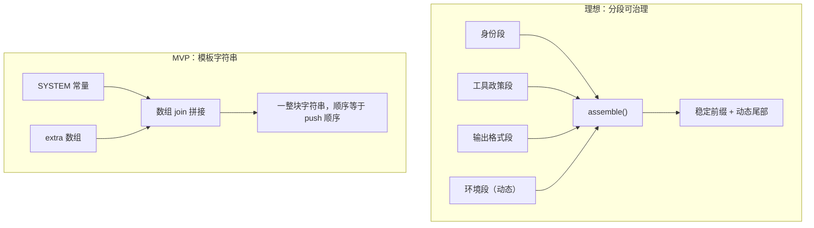
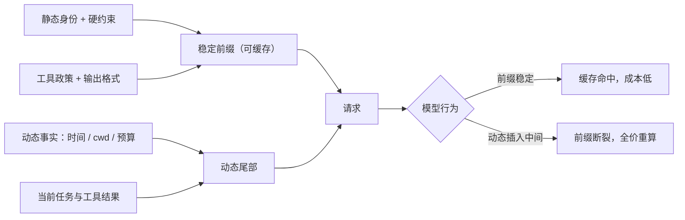

# 04 · 提示词的信息架构：角色、指令高度与顺序效应

> **一句话结论**：消息角色只是注意力上的优先级近似，不是权限隔离；提示词真正需要的是可注册、可排序、可覆盖、可卸载的分段结构。
> **定位**：Part I · Prompt
> **关联缺陷**：D4（提示词是模板字符串）→ Part II 第 20 课
> **前置**：[第 03 课 · ReAct 与终止判据](/ai/harness/03-react-and-termination) ｜ **下一课**：[第 05 课 · 推理引导与结构化输出](/ai/harness/05-reasoning-and-structured-output)

## 本课要回答的问题

同样一段信息，放在 system 里、放在 user 里、放在示例后面，模型的表现可能完全不同。为什么会这样？如果角色真的像权限一样可靠，那为什么工具结果里一句「忽略之前指令」就能把 agent 带跑偏？

本课要把提示词从「一段写得好的话」拆成**可分析的信息架构**，并回答一个必须回答的边界问题：**哪些边界绝对不能靠提示词保证？**

## 核心原理

### 直觉：提示词不是配置文件，而是给注意力排座位

把一次请求想成一场圆桌会议。system 是开场时主持人宣读的会议纪律，user 是本次议题，assistant 是之前的会议记录，tool 是外部顾问递进来的材料。座位越靠前、发言越明确、前后越一致，越容易被听进去。

但会议纪律不是门禁。一个外部顾问在材料里夹一句「主持人刚才说纪律作废」，模型并没有一个硬件开关去辨别这句话的来源——它们最终都变成同一串 token，共享同一条注意力通道。这就是「角色是优先级近似」的含义。

### 消息角色：优先级近似，不是硬隔离

常见层次是 system / developer（策略与身份）、user（任务）、assistant（历史输出）、tool（外部结果）。模型对越靠前、越明确、越一致的指令通常赋予更高权重，但这是训练塑形出的倾向，**不是访问控制的替代品**——凡是需要保证的边界，必须交给 Harness 的权限与校验（[第 10 课](/ai/harness/10-reliability-and-trust)会用一次越权写入证明这一点）。

| 角色 | 承载什么 | 不应承载什么 |
|---|---|---|
| system / developer | 身份、工具政策、输出格式、硬约束 | 每步变化的动态事实 |
| user | 当前任务与输入 | 长期不变的身份设定 |
| assistant | 历史输出、已确认的结论 | 未经验证的自述 |
| tool | 外部结果与观察 | 任何被当成指令执行的内容 |

第三列比第二列更重要：把动态事实塞进 system，会破坏前缀稳定；把工具结果当指令，会把注入变成命令。

### 指令的「高度」：right altitude / Goldilocks zone

| 过低（硬编码） | 合适 | 过高（空泛） |
|---|---|---|
| 为每种情况写 if-else 规则，穷举路径与文件名 | 给出明确目标、边界与可推广的启发式 | 「请专业一点」「尽力而为」 |

原因是分布性的：规则越细，越容易与未见过的输入冲突，也越容易在长上下文里被稀释；原则过泛则缺乏可判定性。

一个实用的改写练习：把「请专业一点」改成「结论先行，每个判断附一条可核验的依据；不确定时说明缺什么信息」。后者既没有穷举情况，又给出了可执行的判据——这就是合适的高度。

### 结构化分段：让每块内容可独立治理

用标题或 XML 标签把指令切成语义块（身份 / 工具政策 / 输出格式 / 环境 / 约束）。分段不是为了好看，而是让每一块可以**独立注册、排序、覆盖、测试**——这是「提示词作为程序」的前提，也正是 MVP 做不到的地方（P2）。



图中左右两边的差别不在「谁写得更好看」，而在**谁能在运行时被单独替换、排序、卸载**。理想侧每一段有身份，MVP 侧只有拼接后的结果。

### 顺序效应：位置就是权重

位置影响注意力权重（首因/近因，中部信息更易被忽略，见[第 06 课](/ai/harness/06-context-economics)）。因此静态身份与硬约束靠前，动态事实与当前输入靠后；两者混写会让每步变化的事实破坏前缀稳定性。

这条原则同时服务两个目标：**注意力**上让重要约束靠前，**缓存**上让稳定内容形成长公共前缀。它不是风格建议，而是可以直接用字符公共前缀长度量化验证的工程约束。

### 少样本示例：多样且典范，而不是穷举边界

给出少量**多样且典范**的样本，而非穷举边界情况。样本带偏，模型会把偏见一起学走。示例的作用是改变条件分布（[第 01 课](/ai/harness/01-from-model-to-actor)），所以三个互相矛盾的示例，比不给示例更容易制造不稳定行为。

## 代码与实现

`mvp/harness-mvp.mjs:88` 的单行 `SYSTEM` 常量与 `:97` 的 `renderSystem()`：

```js
const SYSTEM = '你是一个研究助手。需要信息时调用工具，完成后直接回答。';
const renderSystem = (extra = []) => [SYSTEM, ...extra].join('\n');
```

这是**模板字符串 + 数组拼接**的全部能力：

- 没有段 id，无法单独覆盖某一段；
- 没有排序规则，顺序等于 `push` 顺序；
- 没有卸载，`extra` 加进去就留在那儿（第 12 课 P3 的幽灵注册）；
- 动态事实（时间、cwd、预算余额）只能拼进同一个字符串，破坏前缀稳定。

这四条正好对应一个成熟提示系统的四个基本操作：注册、排序、覆盖、卸载。MVP 一条都没有，所以它只能回答「这段话写什么」，回答不了「这段话从哪来、什么时候该消失」。

还要注意 `SYSTEM` 里那句「完成后直接回答」——它其实是在**用提示词模拟终止判据**。这句话对模型有影响，但它不是可判定的条件（[第 03 课](/ai/harness/03-react-and-termination)已经说明自然停止是弱判据）。提示词能影响概率，不能保证状态。

## 权衡与失效模式

- **简单字符串的好处**：可读性极高、零抽象成本、单文件 MVP 里够用。别在 300 行教学标本里强上注册框架。
- **失效点在多插件**：一旦有第二个、第三个来源要贡献提示内容，「谁在前、谁覆盖谁、谁卸载」立刻变成没有答案的问题。
- **指令层级被数据击穿**：工具结果里一句「忽略之前指令」与 system 共用同一个 token 流，模型无法从原理上区分（第 10、23 课的注入防御）。

| 症状 | 归因 |
|---|---|
| 两个模块都想改工具政策，最终互相覆盖 | 无段 id、无覆盖语义（P2） |
| 插件卸载后提示里还留着它的内容 | 无 disposer / 卸载（P3 幽灵注册） |
| 每步缓存命中率很低 | 动态事实插进了稳定前缀 |
| 工具返回一段「新指令」，模型照做 | 角色不是隔离，缺 Harness 侧注入防御 |

## 四层定位

| 方向 | 内容 |
|---|---|
| Context → Prompt | 动态事实（时间、cwd、检索片段）必须进入某一段 |
| Harness → Prompt | 工具 schema 由可用工具集决定 |
| Prompt → Loop | 指令里写「完成后直接回答」是在**用提示词模拟终止判据**（弱，第 03 课） |
| Prompt → Context | 前缀稳定性决定 KV cache 命中率（第 06 课） |

看这四行会发现：Prompt 层几乎没有「只属于自己」的输入。它上游接 Context 与 Harness，下游影响 Loop 与缓存。所以提示词的架构问题，本质是**跨层信息的排布问题**。

## 动手实验

```bash
cd /Users/cheeka/code/deepseek-harness/dsh-agent-course/mvp
sed -n '88,98p' harness-mvp.mjs
grep -n 'renderSystem' harness-mvp.mjs      # 看它被调了多少次、每次结果是否相同
```

**你会看到什么**：`sed` 段只有十行，却包含整个提示系统的全部实现；`grep` 会列出每一处调用点，你会看到它被循环反复调用。若 `extra` 在循环里被追加，那么每次结果都可能不同——这正是前缀不稳定的来源。

**手写补全练习**：做一个静态/动态分段对照，量化「把动态事实放前面」会破坏多少前缀。

```js
const STATIC = '你是一个研究助手。\n工具政策：只读优先。\n输出格式：直接给结论。';
const dynamic = (t) => `当前时间: ${t}`;
const a = [STATIC, dynamic('09:00')].join('\n');
const b = [STATIC, dynamic('09:01')].join('\n');
const c = [dynamic('09:00'), STATIC].join('\n');
const commonPrefix = (x, y) => { let i=0; while (i<x.length && x[i]===y[i]) i++; return i; };
console.log('静态在前，共同前缀:', commonPrefix(a,b), '/', a.length);
console.log('动态在前，共同前缀:', commonPrefix(c,b), '/', c.length);
```

数字会告诉你：动态内容放前缀中间，几乎整段缓存失效。第一行输出的公共前缀接近 `a.length`，第二行只剩时间字符串那几位的长度。这个差值就是每步白付的 token。

## 常见误区

- **误区**：「把规则写进 system 就等于权限控制」。注入与越权的解法在 Harness，不在措辞。
- **误区**：「提示词越详细越好」。过细规则与未见输入冲突，且在长上下文里被稀释。
- **误区**：「分段只是为了排版好看」。分段的真正价值是可注册、可排序、可覆盖、可卸载。
- **误区**：「动态信息放最前面更醒目」。醒目换来的是缓存全失效，通常不划算。

## 本课小结

- 角色是注意力优先级近似，不是访问控制；安全边界必须在 Harness。
- 指令高度要落在「明确目标 + 可推广启发式」，既不是 if-else 穷举，也不是空泛口号。
- 分段让提示词获得注册、排序、覆盖、卸载四种治理能力（MVP 全缺，D4）。
- 静态约束靠前、动态事实靠后，同时优化注意力与缓存前缀。
- 示例要多样且典范，因为示例在改写条件分布，而不只是补充知识。



## 自测

**Q1**：`renderSystem()` 缺少哪四种能力？分别会导致什么？

<details><summary>参考答案</summary>

缺少注册（无段 id，无法知道内容来源）、排序（顺序等于 push 顺序）、覆盖（无法替换某一段）、卸载（`extra` 加进去不会移除）。后果分别是：多来源无法治理、顺序不可控、冲突无法解决、插件卸载后留下幽灵内容。

</details>

**Q2**：补全练习中「静态在前」的共同前缀为什么显著长于「动态在前」？和 KV cache 什么关系？

<details><summary>参考答案</summary>

静态在前时，两份提示从第一个字符起就共享整段静态内容，只有末尾的时间不同；动态在前时，第一个字符（时间）就不同，公共前缀几乎为零。KV cache 依赖相同前缀复用已计算的键值，前缀越长命中越多，因此动态内容放前面会让缓存几乎全失效。

</details>

**Q3**：举一个「必须交给 Harness、不能靠提示词保证」的边界，并说明原因。

<details><summary>参考答案</summary>

例如「只能写工作区内的文件」。提示词可以写「不要写工作区外」，但工具结果或用户输入里的注入內容与 system 共享同一 token 流，模型无法从原理上区分指令来源；只有 Harness 在 `runTool()` 前做路径规范化与白名单校验，才能保证边界。

</details>

**Q4**：把「请专业一点」改写成合适高度的指令。

<details><summary>参考答案</summary>

示例：「结论先行；每个判断附一条可核验的依据；不确定时明确说明缺少什么信息，不要编造。」它给出目标与可判定标准，又没有穷举具体场景，落在 Goldilocks zone。

</details>

## 延伸阅读与下一课

- Anthropic, *Building effective agents* 的 prompt engineering 章节。
- 源码：`mvp/harness-mvp.mjs:88`、`:97`。
- Part II 第 20 课的 `SECTION_ORDERS`、`section()`、`assemble()` 会在本课 D4 的基础上展开。

提示词结构解决「信息放哪」，但模型仍可能输出不合规的格式。软约束和硬约束的强度差在哪？见[第 05 课 · 推理引导与结构化输出](/ai/harness/05-reasoning-and-structured-output)。
