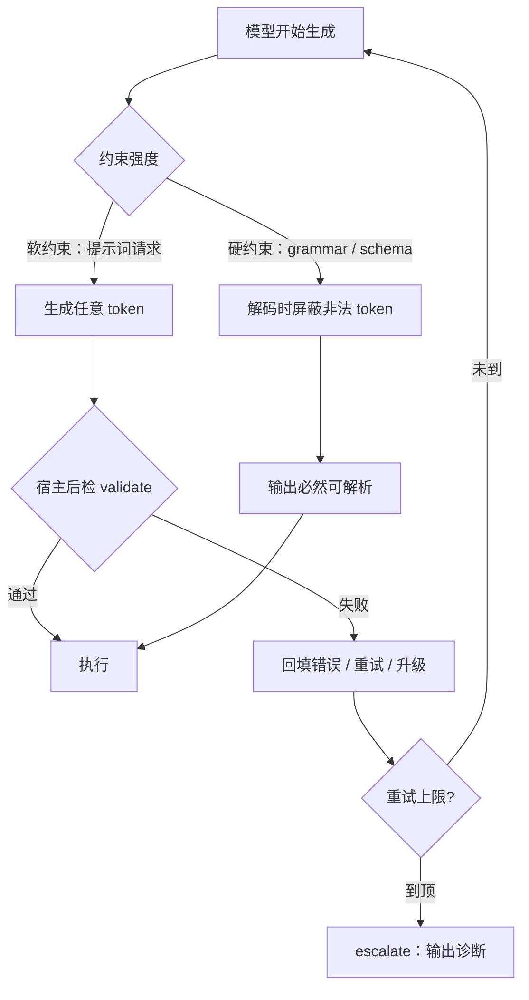
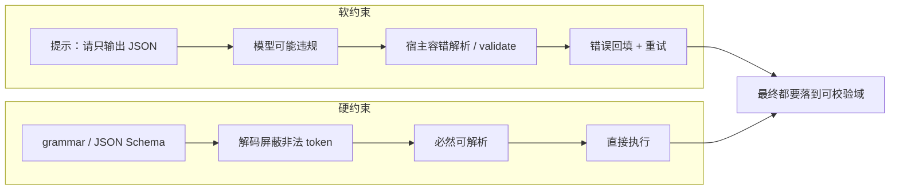

# 05 · 推理引导与结构化输出：软约束与硬约束

> **一句话结论**：「请只输出 JSON」是请求，「解码时屏蔽非法 token」是保证；两者相差一整个执行层，失败处理也完全不同。
> **定位**：Part I · Prompt × Loop（可校验域）
> **关联缺陷**：P6 的前奏——校验失败不回填、无重试纪律 → Part II 第 18 / 24 课
> **前置**：[第 04 课 · 提示词的信息架构](/ai/harness/04-prompt-architecture) ｜ **下一课**：[第 06 课 · 上下文的经济学与 Token 计量](/ai/harness/06-context-economics)

## 本课要回答的问题

模型输出了一段不合规的 JSON，或者调用了一个参数缺失的工具，宿主能做什么？重试一次？换个提示？还是干脆放弃？

本课要能判定地区分两种强度：**「请只输出 JSON」** 与 **「解码时不允许输出非法 token」**。它们看起来都叫「约束输出」，但一个靠模型自觉、失败在运行时兜底；另一个在生成阶段就把非法路径剪掉。混为一谈，你就会写出「提示词里写了不准，所以不用校验」的代码。

## 核心原理

### 直觉：软约束像建议，硬约束像门框

软约束是在门口贴一张纸：「请勿携带危险物品入内」。大多数人会遵守，但纸本身不拦人，你仍然需要安检机。

硬约束是把门做成只有正常身材能通过的形状：不是「劝你别带」，而是「带了根本进不来」。对应到解码，就是在每一步采样时把不合语法的 token 概率置零，输出从生成机制上就落在可解析域。

### Chain-of-Thought：把中间计算外化成 token

Chain-of-Thought 的本质**不是让模型变聪明**，而是把中间计算**外化为 token**，从而扩展可串行执行的计算步数：原本必须一次前向完成的推理，被拆成多个可依赖前面结果的续写步骤。

代价有三项：更多 token、更长延迟，以及推理链可能只是「看起来合理」的事后叙述（faithfulness 问题）。第 01 课的推理模型把这件事进一步产品化为 effort 档位——不再靠提示词诱导，而是由宿主指定预算。

注意这里有一个反直觉点：CoT 提升了可完成的计算量，却不保证计算是忠实的。模型可以在不知道答案的情况下先写出一个答案，再补一段听起来严密的推理。所以 CoT 文本不能当审计证据。

### ReAct：CoT 与工具反馈的耦合

ReAct 把 CoT 与工具反馈耦合（[第 03 课](/ai/harness/03-react-and-termination)已实现）。注意它同时是 **Prompt 模式**与 **Loop 模式**——这是全课第一个明确的跨层机制。

同一个 `Thought → Action → Observation` 模板，写在提示里是引导，写进 `while` 就是控制流。这种双重身份意味着：改提示里的 ReAct 模板，可能同时改变循环的行为节奏；改循环，也可能让提示里的模板失效。

### 自我校验类模式：前提是存在便宜的验证信号

- **自洽（self-consistency）**：多次采样，投票选最常见答案。
- **Reflexion**：生成后自我批评，再带着批评重试。
- **evaluator-optimizer**：生成者与检查者分离，检查者给结构化反馈。

三者的共同前提是**存在比生成更便宜的验证信号**；没有验证器时，「自我反思」往往只是把同一偏见换种说法。这和第 03 课的验证不对称性是同一个原理：验证不便宜，循环就不收敛。

### 结构化输出的两个强度

```text
软约束：「请只输出 JSON」        → 模型可能不遵守，仍要写容错解析
硬约束：JSON Schema / grammar-constrained decoding
       → 在解码时屏蔽非法 token，输出必然落在可解析域
```

`tool schema` 属于提示词：工具名、参数结构、`description` 都会被送进窗口，定义了模型「可表达的动作空间」。描述应写「何时用 / 何时不用」，跨调用政策应写在提示段里——这两者的分工要靠结构承载（第 04 课 D4）。



图里最值得看的是右侧环路：软约束失败后，你必须自己补一条「错误如何回到模型」的路径。MVP 恰恰缺这一段。

## 代码与实现

MVP 里对应的是 `:63-77 validate()` + `:138-140` 的失败分支：

```js
const err = validate(call);
if (err) { events.push(`step${steps}: schema 拒绝 → ${err}`); continue; }
```

这是**宿主侧的软约束后检**：模型照样能产出非法调用，只是执行前被挡。真正模拟硬约束的做法，是在解码层屏蔽非法 token —— 在脚本化模型里可以用「候选过滤」近似：

```js
// 教学近似：不是真的 logits 屏蔽，而是把「不可表达」变成「采样不到」
function constrainedSample(candidates, allowed) {
  return candidates.filter(c => allowed.has(c.name));
}
```

这段近似代码只保留了硬约束的**结果**（非法候选不会出现），没有实现它的**机制**（逐 token 的 logits 屏蔽）。作为教学替身足够，但别把它当成生产方案：真实 grammar 约束要处理部分匹配、转义、嵌套结构，且不同供应商支持度不同。

**关键缺口**：`continue` 之后没有任何 `role:'tool'` 消息回填，下一次请求里 assistant 带着一个悬空 tool call。这违反 API 约束，也让日志无法重建「这次请求到底问了什么」（[第 11 课](/ai/harness/11-streaming-and-cancellation) P6 的前奏）。

换句话说，MVP 只完成了「拒绝」，没有完成「拒绝之后世界如何继续」。一个健壮的实现至少要把错误变成一条配对消息、给重试计数、并在到顶时升级。

## 权衡与失效模式

- **软约束的优点**：不依赖供应商能力，任意模型可用；错误消息可以喂回模型让它自纠。
- **软约束的代价**：需要容错解析、错误分类、重试上限；否则一次语法错误可能触发重试风暴（[第 10 课](/ai/harness/10-reliability-and-trust)）。
- **硬约束的代价**：grammar 会与模型自身的推理格式打架，且不同供应商支持度不一；适配层要处理（Part II 第 20 课）。
- **faithfulness**：CoT 文本不必是模型真实「依据」，不能把它当审计证据。

| 症状 | 归因 |
|---|---|
| 一次格式错误后连续重试十几次 | 只计数不分类，无退避、无换策略 |
| 日志里 assistant 有 tool call，却找不到对应结果 | `continue` 未回填配对消息 |
| 开了 grammar 后模型推理质量下降 | 硬约束与推理格式冲突，适配层未处理 |
| 模型写了「因为 A 所以 B」，但 A 是编的 | faithfulness 问题，CoT 不是审计证据 |

## 四层定位

| 方向 | 内容 |
|---|---|
| Prompt | schema 与 description 定义动作空间与格式 |
| Loop | 校验失败 → 重试 / 换策略 / 放弃，必须有明确分支与上限 |
| Context | 校验失败的**错误也要作为消息回填**，否则上下文出现空洞 |
| Harness | grammar 约束能力属于模型适配层，不是提示词 |

**传导**：把「请输出 JSON」升级成 grammar 约束，Prompt 的措辞可以简化，Context 不再需要保存容错解析的补丁，Loop 的重试分支变少，但 Harness 的适配层要开始处理供应商差异。约束越硬，复杂度越往底层沉。

## 动手实验

```bash
cd /Users/cheeka/code/deepseek-harness/dsh-agent-course/mvp
sed -n '63,77p'  harness-mvp.mjs      # validate
sed -n '136,144p' harness-mvp.mjs     # 失败分支：注意 continue 之后没有回填
```

**你会看到什么**：第一段是纯形状校验；第二段只有三行，`continue` 后面直接回到循环顶部。事件数组里会留下「schema 拒绝」的记录，但 `messages` 里不会出现对应的 `tool` 消息——两个记录源从此对不上。

**手写补全练习**：把 `validate()` 失败分支改成「回填一条错误 tool 消息 + 计数上限」，并跑一次非法调用脚本，观察 messages 是否配对。

```js
const messages = [{ role:'user', content:'task' }];
messages.push({ role:'assistant', toolCalls:[{ name:'read_file', arguments:{} }] });
// 错误也必须回填成对的消息，否则下一次请求非法
messages.push({ role:'tool', name:'read_file', content:'SCHEMA_ERROR: missing path' });
let retries = 0;
const onInvalid = () => { retries += 1; return retries < 3 ? 'retry' : 'escalate'; };
console.log('消息是否成对:', messages.filter(m=>m.role==='tool').length,
            '重试策略:', onInvalid(), onInvalid(), onInvalid(), onInvalid());
```

运行后会看到工具消息数为 1，重试序列依次返回 `retry`、`retry`、`escalate`、`escalate`。第四个值是关键：上限不是「第三次就成功」，而是「第三次之后不再盲目重试，改为升级并输出诊断」。

## 常见误区

- **误区**：「模型输出了推理过程 = 可审计」。faithfulness 问题使 CoT 不能当审计证据。
- **误区**：「schema 校验通过就安全」。回扣[第 02 课](/ai/harness/02-tool-calling)的形状合法但语义越权。
- **误区**：「软约束靠提示词就够」。提示词是请求，不是保证；必须有后检与失败分支。
- **误区**：「重试次数越多越稳」。没有错误分类与退避，重试只会放大成本与延迟。

## 本课小结

- CoT 的价值是把中间计算外化成 token，而不是提升模型智力。
- 自校验模式成立的前提是验证信号比生成便宜，否则只是重复偏见。
- 软约束在提示层，硬约束在解码层；前者要容错解析，后者要适配层。
- 校验失败必须回填配对消息，否则产生悬空 tool call 与不可重建的日志。
- 重试需要上限、分类、退避与升级策略，单一计数不够。



## 自测

**Q1**：软约束与硬约束分别在哪一层生效？

<details><summary>参考答案</summary>

软约束在提示层生效：通过指令请求模型输出合规格式，模型仍可能违规，需要宿主在运行时做容错解析与校验。硬约束在解码层生效：用 JSON Schema 或 grammar 在采样时屏蔽非法 token，使输出必然落在可解析域。两者的约束能力分别属于 Prompt 与模型适配层。

</details>

**Q2**：MVP 的 `continue` 分支造成了什么问题？如何补？

<details><summary>参考答案</summary>

它跳过了非法调用却不回填任何 `tool` 消息，导致下一次请求里 assistant 的 tool call 没有配对结果，形成悬空 tool call，既违反 API 约束，也让日志无法重建请求内容。补法是：为每个被拒绝的调用回填一条 `role:'tool'` 的错误消息，并记录重试计数。

</details>

**Q3**：补全练习第 4 次调用为什么返回 `escalate`？重试次数为什么不是唯一策略维度？

<details><summary>参考答案</summary>

因为 `retries < 3` 在第 4 次时为假，策略从 `retry` 切换为 `escalate`。次数不是唯一维度，因为不同错误需要不同处理：参数缺失可重试，权限拒绝重试无用，语法错误可能需要换格式；还需要错误分类、退避与换策略。

</details>

**Q4**：为什么「没有验证器时自我反思往往无效」？

<details><summary>参考答案</summary>

自我反思需要一个新的、比生成更可靠的信息源来判断对错。没有验证器时，模型只能用自己的同一套参数再评价一遍，等于把同一偏见换一种说法，无法引入新证据，因此容易在错误答案上自我确认。

</details>

## 延伸阅读与下一课

- Wei et al., *Chain-of-Thought Prompting*, 2022, arXiv:2201.11903。
- Shinn et al., *Reflexion*, 2023, arXiv:2303.11366。
- 源码：`mvp/harness-mvp.mjs:63-77`、`:136-144`。

到这里，提示与格式都谈完了，但每一步请求都在变长、变贵。上下文到底贵在哪、为什么会「给得越多越差」？见[第 06 课 · 上下文的经济学与 Token 计量](/ai/harness/06-context-economics)。
