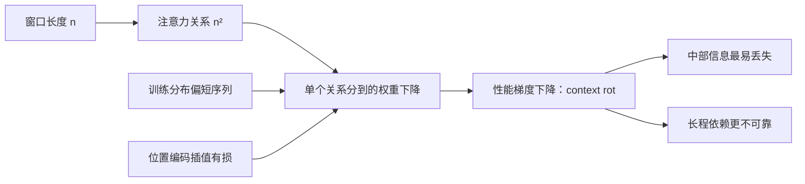
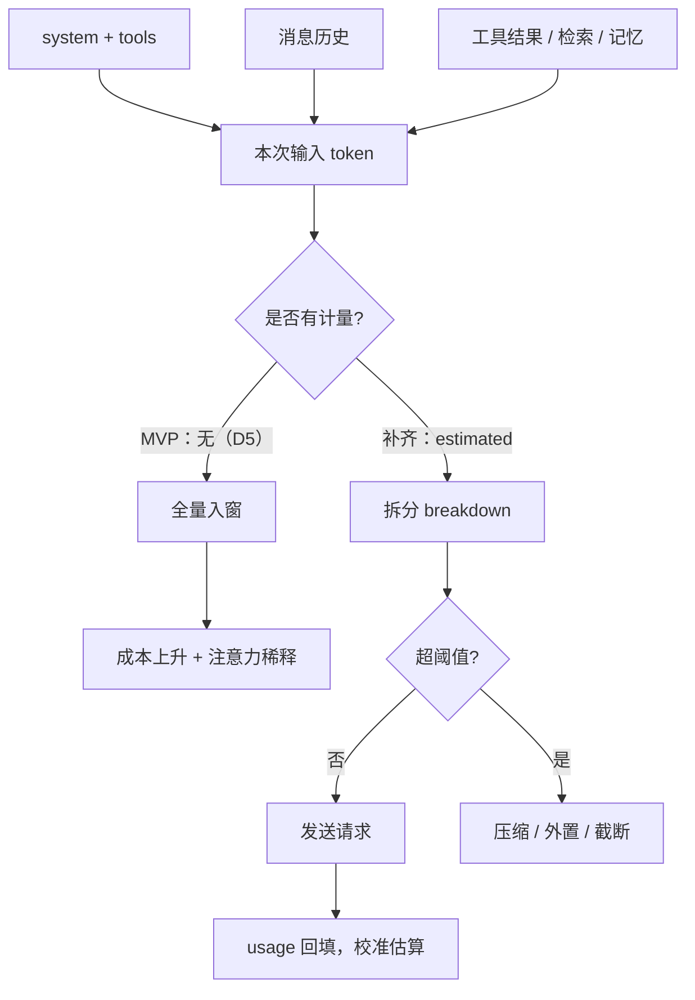

# 06 · 上下文的经济学与 Token 计量：为什么「给更多信息」会降低表现

> **一句话结论**：上下文是有限且边际收益递减的资源；不能计量，就无法压缩、无法定预算、无法解释成本异常。
> **定位**：Part I · Context（含 P0：成本/延迟定量）
> **关联缺陷**：D5（无计量、全量入窗）→ Part II 第 22 课
> **前置**：[第 05 课 · 推理引导与结构化输出](/ai/harness/05-reasoning-and-structured-output) ｜ **下一课**：[第 07 课 · 上下文装配](/ai/harness/07-context-assembly)

## 本课要回答的问题

「感觉上下文有点长了」——这句话在工程上等于什么都没说。到底多长？这次请求贵了多少？预算还能撑几步？如果用户问「这个任务最多花多少钱」，你能不能当场算出量级？

本课的目标是把直觉升级为可计算：**量化一次请求的成本与风险**，从「感觉长」变成「能算出这个 step 花了多少、超没超预算」。同时解释一个反直觉现象：为什么把更多资料塞进窗口，表现反而下降。

## 核心原理

### 定义先行：context 不等于 prompt

`context` = 采样时进入模型的**全部 token**，包含系统指令、工具定义与结果、检索内容、消息历史、记忆、当前输入。Prompt 工程只覆盖「怎么写指令」；上下文工程覆盖整个集合在**每个推理步**的构成。

这个区分很关键，因为成本与性能退化由整个集合决定，而不是由那段「精心写的提示」决定。你可能只改了 system 一句话，但真正把窗口撑爆的是上一轮 `list_files` 的输出。

| 组成 | 谁产生 | 是否随步数增长 |
|---|---|---|
| 系统指令 | Prompt 层 | 否（理想情况下稳定） |
| 工具定义与 schema | Harness | 否（但每个工具都常驻） |
| 工具结果 | Context 回填 | 是，主要增长源 |
| 检索内容 | Context 装配 | 每步可能变化 |
| 消息历史 | Loop / Context | 是 |
| 当前输入 | 用户 / Loop | 每步一次 |

### 注意力预算：为什么变长会变差

1. Transformer 中每个 token 与其他所有 token 做注意力交互，n 个 token 有 **n² 对关系**；窗口变长，关系被摊薄；
2. 训练分布里短序列远比长序列常见，模型对跨全窗口依赖的经验与参数更少；
3. 位置编码插值让模型能吃下更长序列，但位置理解精度有损。

把注意力想成一间会议室里的对话：三个人时每句话都被听清；三十个人时，中间位置的人说话最容易被漏掉，因为注意力被摊到太多关系上。窗口变大不是「容量变大所以更好」，而是**信号被更多噪声摊薄**。

结果是**性能梯度而非硬悬崖**：Anthropic 称 **context rot**；Chroma 2025 年在 18 个模型上的实测显示输入越长表现越不稳定；*Lost in the Middle*（arXiv:2307.03172）发现中部信息更易被忽略。



### 工程结论：追求最小高信号集合

上下文是有限、边际收益递减的资源，目标是最小的**高信号** token 集合：

$$C_t^* = \arg\max_{C \subseteq U_t,\; |C| \le B} \text{(期望任务收益)} - \lambda \cdot \text{(token 成本 + 注意力稀释)}$$

公式有两层含义：不是「能放多少放多少」，而是「在预算 B 下选收益减成本最大的子集」；惩罚项里同时有 token 成本与注意力稀释，说明**多放内容即使不花钱也要付注意力代价**。

### 四类上下文病理

- **poisoning**：幻觉进入上下文并被反复引用，越滚越像事实。
- **distraction**：上下文压过训练所得，模型被眼前材料带偏。
- **confusion**：无关信息影响回答，模型把噪声当信号。
- **clash**：上下文内部互相矛盾，模型随机选一边。

这四类都不是「窗口不够大」造成的，反而常因塞得太多而加剧。它们也解释了为什么「把全部文档都给它」经常不如「检索三条最相关」。

### 成本模型：本课的可计算部分

```text
step_cost ≈ input_tokens × p_in  +  cached_input_tokens × p_cache_read
          + output_tokens × p_out + reasoning_tokens × p_out
latency   ≈ TTFT(input_len, cache_hit) + output_tokens / decode_rate
```

三个容易漏的项：**缓存读比全价便宜但不免费**；**reasoning token 按输出计价**（第 01 课的 effort 直接进账单）；**多模态输入按视觉 token 折算**。于是 CAP 不该是拍脑袋的「10 步」，而应从预算反推：`CAP_steps ≈ budget / (avg_input × p_in + avg_output × p_out)`。

这条反推公式把「成本」和「终止」连了起来：CAP 不是策略偏好，而是预算除以单步均价的结果。预算变了、单步均价变了，CAP 就该跟着变。

### 两条计量基线必须并存

**计量数据来源**：`usage`（供应商回报，权威但滞后）与 `estimated`（本地估算，即时但近似）两条基线必须并存，因为触发压缩的决策发生在请求**之前**，拿不到本次 usage。

这解释了一个常见困惑：既然 `usage` 更准，为什么还要估算？因为决策时点不同。压缩发生在发请求之前，你只能拿历史 `usage` 校准 `estimated`，再用 `estimated` 做当下判断。

## 代码与实现

MVP 在这课是**反面标本**：`stage1()` / `stage2()` 都把 `messages` 原样全量塞给 `complete()`，没有任何计量（`mvp/harness-mvp.mjs:131`、`:185`）。`stage2()` 的证据里明确写着「工具结果原样入窗：第 1 次 list_files 结果占用 N 字符，无溢出外置」。

这两处调用点说明 D5 不是「忘了写一个函数」，而是**主循环的默认形状就是全量入窗**：`messages` 只增不减，也没有任何代码在发送前问一句「现在多大」。

**手写补全**（贴进 `scratch-06.mjs`，不进 MVP 主干）：一个最小但可计算的计量器。

```js
const PRICE = { in: 1, cacheRead: 0.1, out: 4 };          // 相对单位，便于口算
const estimateTokens = (s) => Math.ceil(String(s).length / 4);
function measure(messages, system, tools) {
  const parts = [system, ...tools.map(t => JSON.stringify(t)),
                 ...messages.map(m => m.content ?? JSON.stringify(m.toolCalls ?? ''))];
  const input = parts.reduce((n,p) => n + estimateTokens(p), 0);
  return { input, estimated: true, breakdown: {
    system: estimateTokens(system),
    tools: tools.reduce((n,t)=>n+estimateTokens(JSON.stringify(t)),0),
    messages: input - estimateTokens(system) - tools.reduce((n,t)=>n+estimateTokens(JSON.stringify(t)),0),
  }};
}
const m = measure([{role:'user',content:'统计 .ts 文件'}], '你是研究助手。', [{name:'list_files'}]);
const capSteps = Math.floor(1000 / (m.input * PRICE.in + 80 * PRICE.out));
console.log(m, '→ CAP ≈', capSteps, '步');
```

这段代码做了三件事：用 `len/4` 粗估 token、把输入拆成 system/tools/messages 三段、用预算反推步数上限。它刻意返回 `estimated: true`，提醒你这个数字永远不是权威值。`capSteps` 则会随预算单调变化——这是验收时最容易验证的性质。

**前缀亲和**：把第 04 课的 `commonPrefix()` 接进来，就能给出「本步是否命中缓存前缀」的近似判据；静态头逐字稳定时 `cacheRead` 成立，动态事实插在中间时整段退化成全价 `in`。

## 权衡与失效模式

- **估算器的误差**：`len/4` 对中文、代码、JSON 偏差很大；生产要用供应商 tokenizer 或供应商回报的 `usage` 校准（Part II 第 22 课）。
- **估算的成本本身**：每步都精确数 token 会变成 O(n) 扫描，长会话里不可接受——需要增量或影子价格（shadow price）。
- **只有估算会误判**：流式输出、reasoning、视觉 token 都可能在请求前估不准；因此 `estimated` 与 `usage` 必须能对照，而不是二选一。
- **D5 的直接后果**：没有计量就无法触发压缩（[第 08 课](/ai/harness/08-compaction-and-isolation)）、无法回答「这个任务最多花多少钱」、成本异常时没有第一证据。

| 症状 | 归因 |
|---|---|
| 长会话突然变慢、变贵 | 全量入窗，无计量（D5） |
| 中文/代码场景估算偏差离谱 | `len/4` 不适配字符分布 |
| 想压缩却不知何时触发 | 只有 `usage` 事后值，缺请求前 `estimated` |
| 预算超支才发现 | 无累计成本，无 CAP 反推 |

## 四层定位

| 方向 | 内容 |
|---|---|
| Context | 计量决定何时压缩、保留多少、什么溢出外置 |
| Prompt | 前缀稳定性决定缓存读比例 |
| Loop | CAP 从预算反推；触发 `agent/pre-step` 的压力判据 |
| Harness | 计量器是基础设施，且要区分 `usage` / `estimated` 两个基线 |

**传导**：改压缩阈值看似 Context 改动，实际同时改 Prompt 前缀、Loop 的步数预算、Harness 的计量口径。这就是每课都要写「四层接口」的原因。

一个具体例子：把阈值从 80% 降到 60%，压缩更早发生 → 前缀更频繁变化 → 缓存命中率下降 → 单步成本结构改变 → 原本反推的 CAP 不再准确。一个数字牵动四层。

## 动手实验

```bash
cd /Users/cheeka/code/deepseek-harness/dsh-agent-course/mvp
node harness-mvp.mjs --stage 2 | grep '证据'
sed -n '128,143p' harness-mvp.mjs        # 看 messages 全量入窗
```

**你会看到什么**：证据里会出现「工具结果原样入窗」以及具体的字符数，说明 MVP 自己也知道问题在哪，只是没有计量能力去处理。`sed` 段里能看到完整的 `messages` 被直接传入 `complete()`，没有任何截断或外置。

**手写补全练习**：把 `scratch-06.mjs` 的 `measure()` 接到 `stage1()` 的副本上，每步打印 `input` 与累计成本，然后回答两个问题：

1. 第几步会超过 1000 单位预算？
2. 若把 system 换成含时间的动态串，`cacheRead` 从哪一步开始失效？

第一个问题的答案取决于工具返回体量，通常会在几次 `list_files` 之后突然跳变；第二个问题的答案是「第一步就失效」，因为前缀第一段每步都不同，之后全部退化为全价。两个问题合起来说明：**增长不是线性的，缓存也不是免费的**。

## 常见误区

- **误区**：「窗口够大就不用管 token」。性能退化是梯度，不是溢出才发生。
- **误区**：「缓存命中 = 免费」。缓存读有价，且前缀中间插入动态内容会让后续全部失效。
- **误区**：「有了 `usage` 就不需要估算」。压缩决策发生在请求前，拿不到本次 `usage`。
- **误区**：「CAP 拍一个 10 步就行」。CAP 应从预算与单步均价反推，否则既可能浪费也可能超支。

## 本课小结

- context 是采样时进入模型的全部 token，不只 prompt。
- 注意力有 n² 关系与训练分布偏差，窗口变长导致梯度退化（context rot）。
- 目标是预算内的高信号子集，多放内容即使免费也要付注意力稀释代价。
- 成本模型含缓存读、reasoning、视觉 token 三个易漏项，CAP 由预算反推。
- `usage` 与 `estimated` 双基线并存，前者校准、后者决策（D5 的解法起点）。



## 自测

**Q1**：写出 step_cost 公式，并指出三个容易漏的计价项。

<details><summary>参考答案</summary>

`step_cost ≈ input_tokens × p_in + cached_input_tokens × p_cache_read + output_tokens × p_out + reasoning_tokens × p_out`。三个易漏项：缓存读（便宜但不免费）、reasoning token（按输出计价）、多模态输入（按视觉 token 折算）。

</details>

**Q2**：`scratch-06.mjs` 的 `breakdown` 为什么三段之和等于 `input`？`capSteps` 如何随预算变化？

<details><summary>参考答案</summary>

因为 `messages` 一项是用 `input` 减去 system 与 tools 两份估算得到的，相当于把总量拆成互斥的三块。`capSteps = floor(budget / 单步均价)`，预算增大时步数上限单调增大，预算减小时单调减小。

</details>

**Q3**：为什么压缩触发只能用 `estimated` 基线？

<details><summary>参考答案</summary>

压缩决策发生在发送请求之前，而 `usage` 是供应商在请求完成后才回报的值，此时拿不到本次请求的用量。只能先用本地 `estimated` 判断是否接近阈值，再用历史 `usage` 校准估算偏差。

</details>

**Q4**：MVP 的 `--stage 2` 证据里哪一条直接证明 D5？

<details><summary>参考答案</summary>

「工具结果原样入窗：第 1 次 list_files 结果占用 N 字符，无溢出外置」这一条。它同时说明结果被完整塞进窗口、没有任何计量或外置机制，对应 D5 的「无计量、全量入窗」。

</details>

## 延伸阅读与下一课

- Anthropic, *Effective context engineering for AI agents*（2025-09）。
- Chroma, *Context Rot*（2025-07）。
- Liu et al., *Lost in the Middle*, arXiv:2307.03172。
- 源码：`mvp/harness-mvp.mjs:128-143`、`:131`、`:185`。

知道了上下文贵在哪，下一步是决定「这一轮到底该放哪些东西进去」。见[第 07 课 · 上下文装配](/ai/harness/07-context-assembly)。
