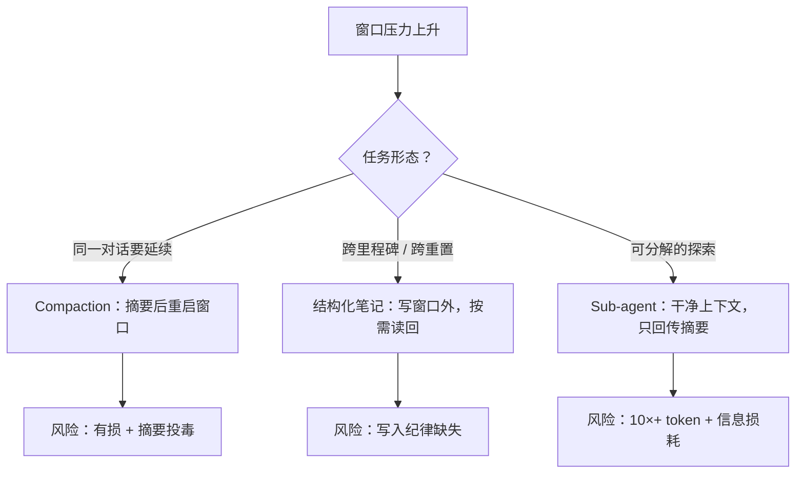
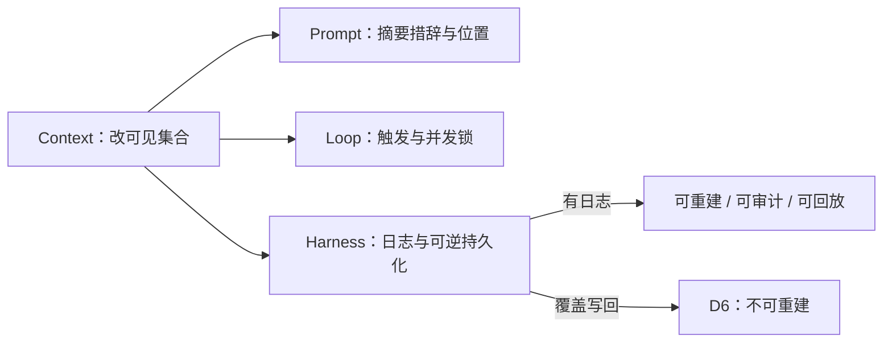

# 08 · 压缩、遗忘与隔离：长任务的三种续命术

> **一句话结论**：压缩应该改「模型看得见什么」，而不是删「系统记得什么」；一旦两者混为一谈，你就永远回答不了「第 1 步它到底看到了什么」。
>
> 定位：Part I · 四层位置：Context（本课制造全课最重要的反面证据）
> 关联缺陷：**D6：压缩即删除，请求不可重建**（并引出 P6 / P7）
> 前置：[第 07 课](/ai/harness/07-context-assembly) · 下一课：[第 09 课](/ai/harness/09-persistence-and-checkpoint) · [课程总览](/ai/harness/)

## 本课要回答的问题

第 07 课把上下文变成了「每步求值的函数」，但没回答：如果算出来的结果永远超预算怎么办？这就是压缩登场的地方。

真正棘手的问题不是「怎么压」，而是第二问：**压缩之后，还能不能回答「第 1 步模型到底看到了什么」？** 这个问题的答案，决定了一个 Agent 是可运维的产品，还是只能演示的玩具——客户投诉、事故复盘、离线评测、A/B 对比，全都依赖这条能力。

## 核心原理

### 三种正交的「续命术」

长任务超过窗口是一条硬约束，业界收敛出三种手段，它们**互不替代**，因为它们解决的是不同形态的「忘」：

| 技术 | 机制 | 适用 | 主要代价 |
|---|---|---|---|
| **Compaction** | 接近上限时摘要历史，用摘要重启窗口 | 需要延续同一对话 | 有损；摘要本身要花一次 LLM 调用 |
| **结构化笔记 / agentic memory** | 把状态写在窗口外（NOTES.md 等），需要时读回 | 跨里程碑、跨重置 | 需要设计写入/读取纪律 |
| **Sub-agent 架构** | 专用子代理用干净上下文做聚焦任务，只回传凝练摘要 | 可分解的 research / 探索 | 10×+ token、有损自然语言通信 |

用生活化的类比来区分：Compaction 像「把一段长会议压缩成纪要，然后只带纪要进下一场会」；结构化笔记像「把关键结论写进笔记本，需要时翻回去看」；子代理像「派一个实习生去查资料，只要他交一页纸的结论」。

最容易误判的是第三种。子代理的首要价值是 **context 隔离**，不是「协作智能」——它真正解决的是「这一大堆探索细节没必要污染主上下文」，而不是「几个 Agent 一起商量会更聪明」。由此推出使用纪律：只读/探索类任务可以并行（互不依赖、结果可合并）；写入/决策类任务应当串行（避免并发改同一状态）。



### 压缩的正确语义：改 surface，不删事实

这是本课的核心命题，也是本课要**亲手违背**的原则。

设想一个只有两个概念的系统：`log`（发生过的一切，只追加）和 `surface`（模型此刻能看见的集合）。压缩的正确做法是：**往 log 里追加一条「遮蔽事件」，让 surface 计算时跳过被遮蔽的旧节点**。log 一个字节都没少，模型看到的内容却变短了。

一处好的压缩设计需要五个要件：

1. **摘要作为显式事件**（带对被遮蔽内容的引用），日志不删任何东西；
2. **投影时遮蔽**旧节点，模型看到 checkpoint；
3. **摘要本身是提示词工程**：固定结构、保留精确路径/命令/错误串/用户纠正、不得提及「本次压缩」、遇旧 checkpoint 要合并；
4. **前缀亲和**：压缩指令作为最后一条 user message 追加，复用主请求前缀以命中 KV cache；
5. **并发锁**：同一 session 不允许两个压缩同时改 surface。

逐条解释「为什么」：

- 第 1、2 条是**可审计性**的根。摘要成为事件，就意味着它有时间戳、有因果关系、有「它遮蔽了哪些 seq」的引用。审计时你能沿引用回溯到原文。
- 第 3 条是**保真度**的根。摘要由模型生成，模型最容易丢的恰恰是「精确的路径、命令、错误串」——这些无法从语义推断，一旦丢失就永久丢失。「不得提及本次压缩」是为了避免模型在后续回答里反复说「根据之前的摘要」，污染语气与置信度。
- 第 4 条是**成本**的根。压缩请求若另起一段全新前缀，KV cache 全失效；把它作为最后一条 user message 追加，则能复用前面所有内容的缓存。
- 第 5 条是**一致性**的根。两个压缩并发改 surface，后写的会覆盖先写的遮蔽集合，产生「谁也不完整」的中间态。

这五条合起来说明：压缩看着是「省 token」，实际是一次**跨层的有状态转换**。

### 带外字段的适用边界（提前埋的伏笔）

有一条容易被忽略的边界：并非所有输入都占 model-input token。像 `dsh_*` 这类控制字段在 `messages` 之外传递，不进入送模文本。

这直接影响后面那条不变量的精确表述：「模型可见即可重建」约束的是**送模内容**，不是所有元数据。别把控制字段也硬塞进事件模型里，那既浪费又混淆语义。Part II 第 21 课会把这条不变量精确化。

## 代码与实现

`mvp/harness-mvp.mjs:192-206` 是**朴素压缩 + fork** 的完整反面标本，短到可以全文引用：

```text
const before = clone(messages);
// 传统压缩：保留最后两条，其余换成一句摘要，原内容直接丢弃
messages.splice(1, messages.length - 3, { role: 'user', content: '[此前历史已摘要]' });
const after = clone(messages);
const sessionJson = JSON.stringify(after);          // 整体覆盖写回
const forkA = clone(after), forkB = clone(after);  // 两个独立副本
```

这几行代码值一整课，因为它用最小的篇幅制造了三个灾难：

| 行为 | 后果 | 证据（运行输出） |
|---|---|---|
| `splice` 原内容丢弃 | 无法重建第 1 步请求 | 「被丢弃的消息=N 条，无任何日志可查」 |
| `JSON.stringify(after)` 覆盖写回 | 压缩前版本永久丢失 | 「session.json 长度=N 字节，压缩前版本已丢失」 |
| 两个 `clone()` | 无共同祖先 seq，无法对齐/合并/审计 | 「forkA 尾=… / forkB 尾=…，无共同祖先 seq」 |

再补一刀：`messages` 数组**同时是状态和送模内容**，所以 `splice` 一执行，「历史」和「审计记录」一起没了。这就是「一个变量承担两个职责」的经典代价——你为了改 A 顺手改坏了 B，而且没有任何中间层可以拦一下。

注意 `clone()` 那两行的微妙之处：它们看起来像「分叉」，实际上是「复制」。两者的差别不在实现难度，而在**是否记录分叉点**。真 fork 需要共同祖先 seq，复制不需要，所以复制永远无法回答「两个分支从哪一步分开」。

**对照实现**（`scratch-08.mjs`）：append-only 日志 + 投影。

```js
const log = [];                                   // 只追加
const append = (e) => log.push({ seq: log.length + 1, ...e });
append({ type: 'user/message', text: '统计 .ts 文件' });
append({ type: 'tool/result', text: 'src/a.ts\nsrc/b.ts\nREADME.md' });
append({ type: 'user/message', text: '改用 JSON 输出' });

// 压缩 = 追加一个「遮蔽」事件，而不是删除
append({ type: 'compaction/summary', text: '前 3 步在统计 .ts 文件', covers: [1,2,3] });
const surface = (l) => {
  const hidden = new Set();
  for (const e of l) if (e.type === 'compaction/summary') e.covers.forEach(s => hidden.add(s));
  return l.filter(e => !hidden.has(e.seq) && e.type !== 'compaction/summary');
};
console.log('模型可见:', surface(log).map(e => e.text));
console.log('历史可重建(压缩前):', log.filter(e => e.seq <= 3).map(e => e.text));
```

逐段解读：

- `append` 只做一件事：给事件配上单调递增的 seq 并推入数组。**日志里没有「修改」这个操作**，这是全部可审计性的来源。
- `covers: [1,2,3]` 是摘要事件的「指向」：它明确声明自己遮蔽了哪几步。没有这个字段，摘要就只是一段孤立的文本，无法回溯。
- `surface` 是**纯函数**：扫描所有摘要事件收集被遮蔽的 seq，再过滤掉它们和摘要本身。它不修改 log，因此可以任意次调用、任意时刻调用。
- 两行 `console.log` 是本课的验收核心：**模型可见变得很短，压缩前的历史仍然完整可读**。

把两行输出与 `--stage 2` 的证据并排贴进笔记：这就是 P6 的全部内容。前者证明「可重建」，后者证明「不可重建」，同一张纸上的两个世界。

顺带体会一下这个实现的代价：`surface` 每次全量扫日志，O(n)。教学版无所谓，生产中需要投影快照来加速——但快照只能落后于日志，绝不能超前（第 09 课）。

## 权衡与失效模式

**朴素压缩唯一的好处**必须承认：实现只需一行，立刻见效，窗口不再溢出。它是一个合格的**应急补丁**，问题只在于它被当成了**正式设计**。

其余全是代价：

- **不可审计**：客户问「它为什么删了那个文件」，你拿不出当时的请求。你手里只有一个摘要，而摘要恰恰可能没提那件事。
- **不可回放 / 不可评测**：eval 需要固定输入重跑；状态被改写后没有基线，你无法判断「这次改动到底让结果变好还是变坏」。
- **摘要投毒（poisoning）**：压缩摘要由模型生成，一次幻觉会被后续每一步反复引用，错误获得「事实」的地位，且越滚越难纠正。
- **fork 语义崩塌**：两个分支各持副本，无法回答「它们从哪一步分叉」「谁的结论更新」。多分支调试、并行实验、A/B 都失去了共同基线。

症状到归因：

| 症状 | 归因 |
|---|---|
| 事故复盘时找不到原始请求 | 压缩即删除，无 append-only log |
| 改了压缩提示后指标乱跳 | 无固定基线，不可回放 |
| 一个错误被反复放大 | 摘要投毒，幻觉进了每个后续前缀 |
| 两个分支结论冲突且无法合并 | 无共同祖先 seq，fork 是复制 |

## 四层定位

| 方向 | 内容 |
|---|---|
| Context | 本课本体：压缩改的是「可见集合」 |
| Prompt | 摘要指令的措辞与位置决定信息保真度、缓存命中 |
| Loop | 触发条件（pressure / overflow）与并发控制 |
| Harness | 日志与持久化是压缩能否可逆的前提 |

**传导**：压缩策略看着是 Context 层的事，实际上同时改 Prompt 前缀、Loop 触发点、Harness 的数据模型。Part II 第 21 课会把它作为「跨层机制」的样板——一个看似局部的优化，牵动四层，这也是为什么第 12 课坚持「每条机制必须说明它修哪条 P、改哪一层」。



## 动手实验

```bash
cd /Users/cheeka/code/deepseek-harness/dsh-agent-course/mvp
node harness-mvp.mjs --stage 2
node harness-mvp.mjs --json | python3 -c \
  "import json,sys; s=json.load(sys.stdin)[2]; \
   assert any('无任何日志可查' in e for e in s['evidence']); print('\n'.join(s['evidence']))"
sed -n '192,206p' harness-mvp.mjs
```

**你会看到什么**：第二条命令的断言会通过——说明「无任何日志可查」确实是 stage 2 的真实证据，不是文档里编的。第三条命令打印出的正是上面那段 `splice` + `JSON.stringify` 的源码，你能逐行对上「三行代码三个灾难」。

**手写补全练习**（这是全课最重要的一次对照）：把 `scratch-08.mjs` 写成「append-only 日志 + 投影」的最小版本，跑同样的压缩，证明**旧请求仍可重建**。检验标准不是「看起来对」，而是：同一份 log 上，`surface(log)` 变短而 `log` 长度只增不减。

## 常见误区

- **「压缩就是省 token」**。压缩是**有损状态转换**，必须配套可审计性设计。只盯着 token 数字，等于把最贵的东西（可复现性）免费送掉。
- **「fork 就是复制数组」**。复制丢掉了共同祖先，分叉点必须显式建模，否则「哪个分支更新」永远无法回答。
- **「摘要写详细点就行」**。摘要的质量不取决于长度，而取决于**是否保留了不可推断的信息**：精确路径、命令、错误串、用户纠正。
- **「压缩完就能继续跑」**。还要问：并发下两个压缩谁赢？旧 checkpoint 怎么合并？摘要里的幻觉怎么发现？

## 本课小结

1. 三种续命术正交：Compaction 延续对话、笔记跨重置、子代理做隔离。
2. 子代理的首要是 **context 隔离**，不是协作智能；只读并行、写入串行。
3. 正确语义是**改 surface、不删事实**：摘要作为显式事件 + 投影时遮蔽。
4. `splice` + 覆盖写回 + `clone` 三行代码，制造「不可重建 / 不可合并 / 不可审计」三灾。
5. 摘要本身是提示词工程，且要前缀亲和的放置方式与并发锁。

| 维度 | 朴素压缩 | 日志 + 投影 |
|---|---|---|
| 旧请求可重建 | 否 | 是 |
| 压缩前版本 | 丢失 | 保留 |
| fork 可对齐 | 否 | 是（有 seq） |
| 实现成本 | 1 行 | 需要事件模型 |

## 自测

**1. 为什么说 `messages` 数组「同时是状态和送模内容」是灾难的根源？**

<details><summary>参考答案</summary>

因为对送模内容做的任何裁剪（`splice`）会直接改写唯一的状态与审计记录。没有中间层区分「事实」与「视图」，压缩就无法既缩短可见内容又保留历史。解法是 log 与 surface/投影分离。

</details>

**2. `--stage 2` 的几条证据分别对应哪种后果？**

<details><summary>参考答案</summary>

「被丢弃的消息=N 条，无任何日志可查」对应不可审计/不可重建；「session.json 长度=N 字节，压缩前版本已丢失」对应覆盖写回导致历史永久丢失；「forkA 尾=… / forkB 尾=…，无共同祖先 seq」对应 fork 语义崩塌、不可合并。

</details>

**3. 摘要指令必须优先保留哪四类信息？**

<details><summary>参考答案</summary>

精确路径/命令、错误串、用户纠正、待办状态。它们共同的特征是「无法从上下文语义推断」，一旦摘要丢掉就永久丢失。

</details>

**4. 压缩指令为什么放在最后一条 user message，而不是单独开一个请求？**

<details><summary>参考答案</summary>

为了复用主请求的前缀以命中 KV cache。单独开请求意味着全新前缀，缓存全失效，压缩本身的成本会显著上升。

</details>

**5. 为什么「摘要投毒」比普通幻觉更危险？**

<details><summary>参考答案</summary>

因为摘要会进入此后每一步的前缀，一次幻觉被反复引用后获得「事实」地位，且会诱导后续摘要继续沿用，错误具有自我强化性，难以靠单步纠错恢复。

</details>

## 延伸阅读与下一课

- Packer et al., *MemGPT*, 2023, arXiv:2310.08560——分层记忆与窗口外状态的经典论述。
- Anthropic 长任务三法（compaction / memory / sub-agent）——本课表格的原始来源。
- `docs/deepseek-llm-api-wire-extensions.md`——带外字段的边界，理解「送模内容」与「元数据」的区分。
- Part II 第 21 课的精读清单：`packages/core/session/src/index.ts:1079` 的 `deriveMessages()`；`packages/compaction/compaction-basic/src/region.ts:507` 的 `surfaceOp: replace`（遮蔽而不删除）；`summarizer.ts:35` 的 `COMPACTION_INSTRUCTION`（八节固定结构 + 前缀亲和）；`packages/session/session-format-v0-to-v1/` 的相邻单步迁移链。
- 下一课 [第 09 课 · 持久化、检查点与格式演进](/ai/harness/09-persistence-and-checkpoint)：本课说「不能删」，下一课回答「那到底该存什么、怎么存、旧格式怎么办」。
