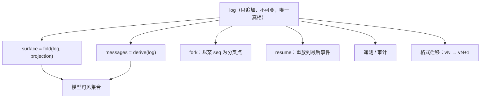
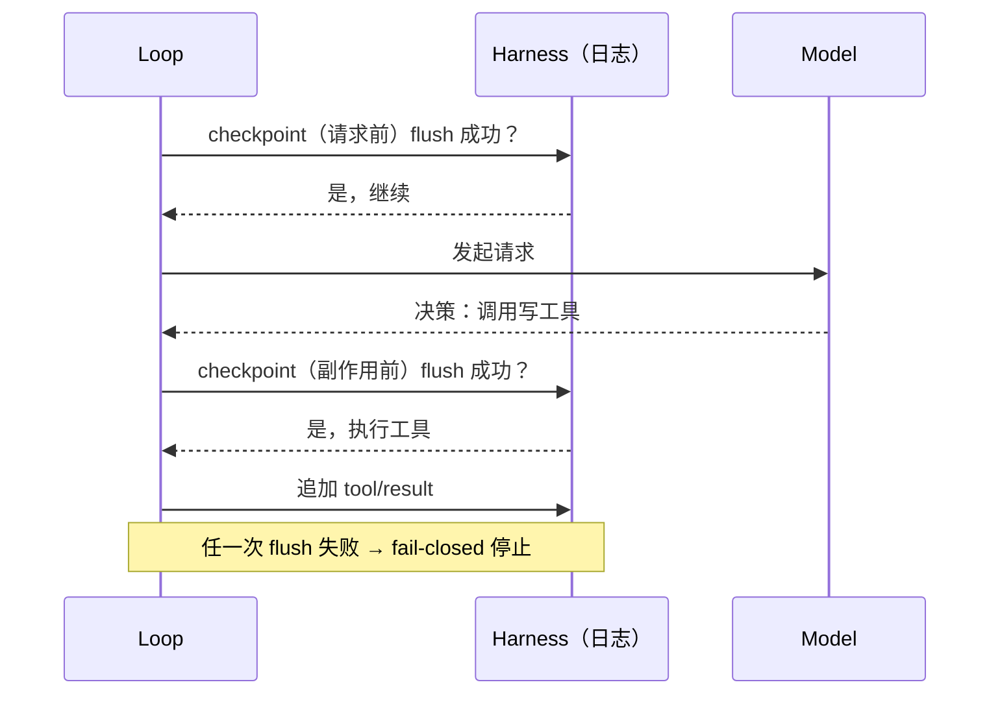

# 09 · 持久化、检查点与格式演进：状态到底是什么

> **一句话结论**：状态不是「当前那个消息数组」，而是「全部不可变事件的折叠结果」；数组只是某个时刻的一个投影。
>
> 定位：Part I · 四层位置：Context × Harness
> 关联缺陷：**D7：消息数组即状态、无 seq、无法合并**（→ P7）
> 前置：[第 08 课](/ai/harness/08-compaction-and-isolation) · 下一课：[第 10 课](/ai/harness/10-reliability-and-trust) · [课程总览](/ai/harness/)

## 本课要回答的问题

上一课证明了「删掉历史」是灾难，但只说「要保留」还不够工程化：保留成什么形状？存在哪里？什么时候必须落盘？具体要能判定地回答三问：**「已提交」的边界在哪**（写到什么程度才算真的发生了）？**fork 与 resume 从哪一步开始**（分叉点和恢复点的锚是什么）？**格式升级时旧数据怎么办**（半年前的文件今天还能读吗）？

这三问的答案构成一个统一的数据模型，而不是三套各自补丁。

## 核心原理

### 事件溯源：唯一真相 + 多个投影

```text
log     = [e1, e2, e3, ...]                  ← 唯一真相，只追加
surface = fold(log, projection)             ← 当前可见 surface
messages= derive(log)                       ← 送模历史（又一个投影）
```

`log` 是唯一真相，只追加、不可变。`surface` 和 `messages` 都是它的**派生结果**，各自用不同的折叠函数算出来。

为什么要这样？因为需要从历史里派生的东西太多了：fork、resume、转写、遥测、审计、压缩、格式迁移——七种以上的消费方。如果每一种都「自己存一份」，它们迟早漂移：审计记录里有的消息，送模历史里没有；遥测统计的步数与实际 step 不符。**各存各的，必然漂移**；从同一份事实派生，才可能永远一致。这就像会计：不保存「当前余额」，只保存流水；余额永远是流水求和的结果，任何一次差错都能追溯到具体一笔。



### 核心不变量：Model-visible means logged

这是全课程最重要的一句话，原文如下：

> *Model-visible means logged. Every model request must be reconstructable from the log. New model-visible inputs require session events.*

翻译成工程语言：任何进入窗口的新输入，都必须先成为事件。不存在「临时塞进去、不记录」的输入。这条不变量把上下文工程从**字符串管理**升级为**数据模型管理**：以前你关心「这个字符串拼得对不对」，现在你关心「这个输入有没有对应的事件类型」。判据从主观变成可断言——给一条请求，问「能不能从 log 重建」，答案只有能或不能。

第 08 课的 `scratch-08.mjs` 之所以成立，就是因为它遵守了这条不变量：摘要不是凭空出现的一句话，而是一条带 `covers` 的事件。

### 持久性屏障：什么时候算「已提交」

有了日志，还要定义「怎么算写成功」。三条纪律：

- **一次完成的 flush 才算屏障**。写进缓冲区不算，只有落盘返回成功才算。
- **每 session 单写者**。多个写者并发追加会破坏顺序与连续性。
- **追加批次必须连续**（`assertContiguous`）。序号出现空洞就说明丢了事件，必须报错而不是跳过。

接着是**语义 checkpoint 的三个时机**：

1. **模型请求前**（否则「问了但没记」——重启后不知道模型被问过什么）；
2. **顶层工具副作用前**（否则「改了文件但没记下意图」——留下无法解释的副作用）；
3. **下一步之前**（否则恢复后状态不连续，可能重复执行或跳过）。

这三个点全部 **fail-closed**：落盘失败就不继续。代价是延迟（每次都要等 fsync 级别的确认），收益是**崩溃后不会留下无法解释的副作用**。用类比说：这相当于数据库的 WAL（预写日志）——先记「我要做什么」，再真的去做；区别只在于 Agent 的「事务」边界是「一步」。

### 版本演进：相邻单步迁移

格式必然演化。规则只有两条，但都很硬：

- 迁移只做**相邻单步** `vN → vN+1`，多个迁移串成链；
- 已提交的 generation **永不改名、永不删除**。

为什么不做「一步到位」的 v1 → v5 大迁移？两个理由：

1. **任何历史版本都可能被引用**——旧客户端、旧快照、备份文件。你无法确认「没人还在读 v1」。
2. **单步迁移可独立测试、可组合、可回滚**。v1→v2 是一个小函数，v2→v3 是另一个；链起来就是任意跨度，坏了能定位到具体一跳。

这和 Git 的提交链、数据库的 migration 文件是同一个思路：小步、单向、可重放。

### 投影快照：只能落后，不能超前

日志全量重放会越来越慢，所以需要快照。快照的定义要精确：**从已提交事件折叠出的当前值 + 「反映到的最后事件 seq」**。关键约束：**日志仍权威；checkpoint 只会落后、绝不会超前，落后部分靠重放补齐**。

为什么不能超前？如果快照比日志新，意味着快照里包含了「日志中不存在的事实」。恢复后系统会「看见没发生过的事」——这是最难查的一类 bug，因为它无法通过重放复现。

## 代码与实现

`mvp/harness-mvp.mjs:198-205` 的全部持久化就是一行覆盖写回：

```text
const sessionJson = JSON.stringify(after);   // 没有 seq、没有 append、没有版本号
const forkA = clone(after), forkB = clone(after);
```

它无法回答四个问题，每一个都对应一个真实场景：

1. **这次写回之前是什么？**——事故复盘要对比前后状态，没有历史。
2. **两个 fork 的共同祖先是哪一步？**——多分支实验要合并结论，没有锚点。
3. **崩溃在写回中途怎么办？**——撕裂写，文件既不是旧状态也不是新状态。
4. **半年后加了一个字段，旧文件怎么读？**——没有版本号，只能到处猜。

**手写补全**（`scratch-09.mjs`）：JSONL 追加 + seq + 版本号 + 单步迁移。

```js
import { appendFileSync, readFileSync } from 'node:fs';
const FILE = '/tmp/session-course.jsonl';
const VERSION = 2;
let seq = 0; const nextSeq = () => ++seq;
const append = (e) => appendFileSync(FILE, JSON.stringify({ v: VERSION, seq: nextSeq(), ...e }) + '\n');

// 相邻单步迁移：v1 的 {text} → v2 的 {content, trust}（返回新对象，不改写原始事件）
const migrate1to2 = (e) => e.v === 1 ? { ...e, v: 2, content: e.text, trust: 'user' } : e;
const readAll = () => readFileSync(FILE, 'utf8').trim().split('\n').filter(Boolean)
                        .map(JSON.parse).map(migrate1to2);
```

逐段解读：

- `appendFileSync` 是关键选择：**追加**而不是覆盖。只有 append 才能让「压缩前版本」继续存在。这行代码和第 08 课的 `append` 是同一个设计的两面。
- 每条记录都带 `v` 与 `seq`。`v` 供迁移链识别，`seq` 供连续性校验与 fork 锚定。
- `migrate1to2` 用展开运算返回**新对象**，注释特意强调「不改写原始事件」。原始事件的不可变性是迁移安全的前提：迁移可以反复执行，不会产生副作用累积。
- `readAll` 把「读取」定义为「解析 + 迁移」的流水线。读入即升版，内存里永远是当前版本。

注意这段代码的诚实之处——它没有实现 `assertContiguous`、没有 torn tail 处理、没有 generation 管理。它是**形状**的演示，不是完整实现。补全练习正是让你补上这些缺口。

## 权衡与失效模式

**覆盖写回的好处**要承认：实现一行、文件小、读起来直观。单用户短会话（比如一次十分钟的问答）确实够用。问题出在「把它当成通用方案」。四类失效：

- **撕裂写（torn write）**：进程在写一半时崩溃，文件既不是旧状态也不是新状态。这是覆盖写的固有风险，只有 append-only + 世代发布才能避免。
- **格式漂移**：没有版本号时，新旧字段只能靠 `if (e.text ?? e.content)` 到处猜。这种判断会散落到全代码，最后没人知道哪个字段才是真的。
- **快照超前风险**：如果允许快照比日志新，恢复后会「看见没发生过的事」。
- **单写者缺失**：两个进程同时追加，seq 交错，连续性断言失效，日志的因果序被破坏。

症状到归因：

| 症状 | 归因 |
|---|---|
| 崩溃后文件无法解析 | 撕裂写，无 append-only |
| 升级后老会话读不出来 | 无版本号 / 无迁移链 |
| 恢复后出现了「没做过的操作」 | 快照超前于日志 |
| 遥测步数与实际不符 | 多份状态各自存储，漂移 |

## 四层定位

| 方向 | 内容 |
|---|---|
| Context | 投影决定模型可见内容 |
| Loop | checkpoint 时机决定恢复后从哪个 step 继续 |
| Harness | 持久化后端、单写者、迁移链、fail-closed 都属基础设施 |
| Prompt | 格式变化不应影响送模文本（迁移的正确性判据） |

最后一行值得强调：**格式迁移的正确性判据是「送模文本不变」**。如果你的 v1→v2 迁移改变了模型看到的内容，那它不是格式迁移，而是语义变更——应该作为显式事件记录，而不是藏在迁移函数里。



## 动手实验

```bash
cd /Users/cheeka/code/deepseek-harness/dsh-agent-course/mvp
node harness-mvp.mjs --stage 2 | grep 'session.json'
sed -n '198,206p' harness-mvp.mjs     # 覆盖写回 + 两个独立 fork
node harness-mvp.mjs --json | python3 -c \
  "import json,sys; s=json.load(sys.stdin)[2]; print('\n'.join(s['evidence']))"
```

**你会看到什么**：第一条命令打印出「session.json 长度=N 字节，压缩前版本已丢失」，第三条命令把 stage 2 的全部证据逐条列出。第二条命令打开的源码里，你能看到 `JSON.stringify(after)` 与两个 `clone` 并排——「覆盖写回」和「复制式 fork」其实是同一个数据模型的两种症状。

**手写补全练习**：在 `scratch-09.mjs` 里造一条 v1 事件混入 v2 日志，运行 `migrate1to2` 后断言所有事件都有 `content` 与 `trust`；再模拟「写到一半崩溃」——手工截断 JSONL 最后一行，实现一个跳过 torn tail 的读取函数，确认前面事件仍可恢复。这个练习有两个落点：迁移必须是「读时升版」而不是「写时改历史」；恢复必须容忍「最后一行不完整」这一现实，否则一次断电就能毁掉整个会话。

## 常见误区

- **「快照就是为了不用日志」**。快照是加速手段，权威永远是日志。删掉日志只留快照，等于放弃了可重建与可迁移。
- **「加个 version 字段就够了」**。还需要迁移链、拒读未知必需事件、generation 不改名。版本号只是入口，不是方案。
- **「迁移就是把旧数据改一遍」**。迁移应该是读时派生新对象，原始事件保持不可变，这样迁移才能重复执行、可回滚。
- **「一条会话一个文件，随便写」**。单写者与连续性断言是日志可信的前提，缺了它们，seq 只是装饰。

## 本课小结

1. 事件溯源：`log` 唯一真相，`surface`/`messages` 都是折叠出的投影。
2. 核心不变量：**模型可见必已记录**，每个请求必须能从日志重建。
3. 持久化屏障 = 完成的 flush + 单写者 + 连续 seq；三个 checkpoint 时机全部 fail-closed。
4. 迁移只做相邻单步，generation 永不改名/删除；快照只能落后。
5. MVP 的 `JSON.stringify` 覆盖写回，至少留下四个无法回答的问题。

| 能力 | 消息数组覆盖写 | 事件日志 |
|---|---|---|
| 压缩前可重建 | 否 | 是 |
| fork 可找祖先 | 否 | 是（seq） |
| 崩溃可恢复 | 撕裂写风险 | 跳到 torn tail |
| 格式演进 | 到处猜字段 | 单步迁移链 |

## 自测

**1. 为什么 fork / resume / 遥测 / 审计都要从同一份日志派生？**

<details><summary>参考答案</summary>

因为它们描述的是同一段事实的不同视角。各存一份会因写入时机、崩溃、版本差异而漂移，导致「审计里有、送模里没有」这类矛盾。同一份日志派生保证永远一致，且任一派生逻辑可独立演进。

</details>

**2. 三个 checkpoint 时机分别防止哪种「无法解释」？**

<details><summary>参考答案</summary>

请求前：防止「问了但没记」，重启后不知道模型被问过什么；副作用前：防止「改了文件但没记下意图」，留下无法解释的写入；下一步之前：防止恢复后状态不连续，导致重复或跳过执行。

</details>

**3. 为什么迁移只做相邻单步，而不是一步到位？**

<details><summary>参考答案</summary>

一是任何历史版本都可能被旧客户端、旧快照、备份引用，无法确认可以跳过；二是单步迁移可独立测试、可组合成任意跨度、坏了能定位到具体一跳并回滚。

</details>

**4. 快照为什么必须「只能落后、不能超前」？**

<details><summary>参考答案</summary>

快照超前意味着包含了日志中不存在的事实，恢复后系统会「看见没发生过的事」，且无法通过重放复现或纠正。落后则是安全的，重放补齐即可。

</details>

**5. 迁移的正确性判据为什么是「送模文本不变」？**

<details><summary>参考答案</summary>

格式迁移只应改变数据的表示（字段名、结构），不应改变语义。若迁移后模型看到的内容变了，那是一次语义变更，必须作为显式事件记录，否则不可审计。

</details>

## 延伸阅读与下一课

- Martin Fowler, *Event Sourcing*——本课数据模型的经典表述。
- Part II 第 21 课将精读 `packages/core/session/src/types.ts` 的 `SESSION_FORMAT_VERSION` 与 `packages/session/session-format-v0-to-v1/` 的相邻单步迁移链；并看 `SessionEvent` 单一真相如何派生 fork/resume/遥测/迁移，以及 `ignorable` 兼容性契约——未知且必需的未知事件必须**拒读**，不能静默跳过。
- 下一课 [第 10 课 · 可靠性与信任边界](/ai/harness/10-reliability-and-trust)：记录得再完整，如果权限检查能被后续 handler 洗掉，日志里只会留下一条「越权但合规」的记录。
