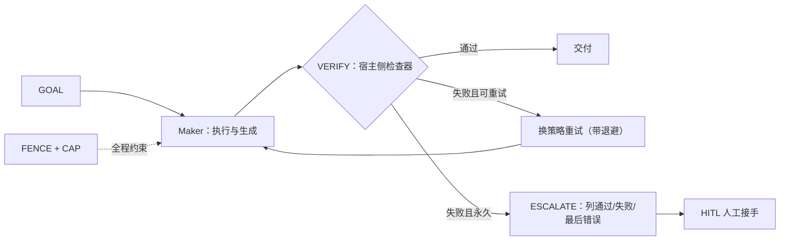

# 10 · 可靠性与信任边界：预算、重试、HITL 与最小权限

> **一句话结论**：策略不能是「一个数组里最后一个说了算」——安全边界必须单调，只能收紧、不能放宽，且与加载顺序无关。
>
> 定位：Part I · 四层位置：Loop × Harness（含 P0：安全与信任边界）
> 关联缺陷：**D8：guard 的 deny 被后续 handler 覆盖，越权写入成功**（→ P8 / P1）
> 前置：[第 09 课](/ai/harness/09-persistence-and-checkpoint) · 下一课：[第 11 课](/ai/harness/11-streaming-and-cancellation) · [课程总览](/ai/harness/)

## 本课要回答的问题

前几课解决了「记什么、怎么记」，本课转向「能不能做」。一个 Agent 会读文件、写文件、调 API、花钱，所以必须回答：只读、审批、预算这些策略**放在哪里、以什么语义执行**？最锋利的一问是：**当两个策略冲突时，谁赢？** 这句问法不是学术性的——它决定了你系统里「只读模式」到底是一条约束，还是一个建议。如果答案是「取决于插件加载顺序」，那你的安全边界就是配置文件的书写顺序，这在多插件环境里等于没有边界。

## 核心原理

### 一份可执行的 loop brief

```text
GOAL:          [一个可观察的结果，例如 report.txt 内容正确]
VERIFY:        [具体命令或检查器，宿主侧可判定]
FENCE:         [禁止改动的边界：不写 report.txt 以外路径、不升依赖]
CAP:           [步数或成本上限，从预算反推（第 06 课）]
ESCALATE:      [到顶或受阻时：列出通过项、失败项、最后错误、建议下一步；不再编辑]
```

五项各有不可替代的作用，缺一项就有一种典型的失败：

- 没有 `GOAL` 的循环**没有方向**，其余四项都无从谈起；没有 `FENCE` 的写入**没有边界**，模型可能顺手改了不该改的配置。
- 没有 `VERIFY` 的 GOAL **没有终点线**。模型只能「觉得差不多了」就停，你无法判定它做完没做。
- 没有 `CAP` 的循环**把小 bug 变成大账单**。一个格式错误的重试可以安静地烧掉几千次调用。
- 没有 `ESCALATE` 的封顶会**静默结束、丢掉诊断**。到顶就停，但你不知道停在哪、还差什么。

### 生成器与检查器分离

让执行者自己判断「我做完了吗」，等于让考生自己批卷。所以检查器必须**不是 maker 自己**：

- tests（预先写好的断言）
- schema validator（结构约束）
- 编译（类型与语法）
- 独立子代理（不同的上下文、不同的视角）

这是第 03 课「验证不对称性」的工程落地：验证一个结果通常比生成它便宜且可靠，所以要主动利用这种不对称，而不是让模型自评。



### 重试纪律

「同一个参数再试一次」是顶级生产病理。它看起来勤奋，实际上是把非确定性问题当成偶发网络抖动。正确的重试要有三件事：

- **错误分类**：可重试（超时、429、临时不可用）与永久（参数非法、权限不足、模型明确拒绝）。对永久错误重试是纯浪费。
- **退避（backoff）**：越失败越慢，避免把上游打穿。
- **换策略而非换次数**：第二次应该改点什么——换个工具、缩小范围、改提示、降低温度。只改次数不改策略，期望值不变。

有一条反直觉的设计：**advisory 型提醒**（同参重复 3/5/8 次时提示模型换思路）只提醒、不阻断。为什么？因为它承认「有时重复是合理的」——比如外部服务真的刚好恢复了。阻断会误杀正确行为，提醒则把判断权留给模型，同时在轨迹里留下可观测信号。

### HITL 与分层信任模型

人类审批不是「开/关」，而是按**动作的不可逆性**分级：

| 级别 | 例子 | 典型 gate |
|---|---|---|
| 只读 | 搜索、检索、计算 | 最小约束 |
| 写 | 改文件、调用变更 API | 作用域限制 + 审批 |
| 不可逆 | 删除、付款、外部发布 | 人工批准 / 多方共识 / 延迟执行 + 取消窗口 |

这张表的价值在于给出了**默认策略**：不是所有动作都值得打断人类（否则审批疲劳，人会无脑点同意），也不是所有动作都能放手（否则一次删除就是事故）。分级让「什么时候必须问人」变成可复用的规则，而不是临场判断。

### 注入的信任边界

根本困难在于：**指令与数据共用一个 token 流**。模型无法从原理上区分「用户要求你删除」与「网页里的一句话建议你删除」。所以任何「在提示词里声明边界」的做法都是概率性缓解。可行的缓解全在 Harness：

- 标记内容来源（哪些是数据、来自哪里）；
- 最小权限（不需要的能力根本不授予）；
- 对不可逆动作审批；
- **输出与副作用校验**（不只看模型说了什么，还要看世界变成了什么样）。

所谓「**致命三要素**」（lethal trifecta）——*能接触不可信输入 + 能访问敏感数据 + 能对外发起动作*——同时具备时，风险不是相加而是**相乘**。这意味着：你不需要三项都完美防护，**拆掉任意一项**就能把风险降一个量级。工程上最便宜的做法通常是拆第一项（隔离不可信输入）或第三项（禁止对外动作）。

### 凭证纪律

系统里流转的应该是**引用**（`CredentialRef`），而不是值。三个具体要求：每次操作前重新 resolve；`describe` 不得暴露值；日志里只出现引用名。否则一次 `console.log` 就把密钥永久写进了上下文与日志——而上下文会被送进模型、日志会被备份、备份会被分享。凭证泄漏往往不是因为被攻击，而是因为被打印。

## 代码与实现

`mvp/harness-mvp.mjs:224-255` 的 `stage3()` 是全课最有冲击力的证据：

```text
const handlers = [
  { name: 'readOnlyGuard', run: () => ({ decision: 'deny',  reason: '只读模式禁止写入' }) },
  { name: 'autoApprove',   run: () => ({ decision: 'allow', reason: '用户已授权' }) },
];
let decision = { decision: 'allow' };
for (const h of handlers) {
  decision = h.run();                       // ← 后者直接覆盖前者
  log.push(`${h.name} → ${decision.decision}`);
}
if (decision.decision === 'allow') runTool(call, vfs);
```

运行输出：

```text
最终决策=allow（期望 deny）；report.txt 存在=true（期望 false）
新增一条策略需改动 3 处：主循环内的 if 分支 / 工具装配处的 handler 数组 / 持久化时的策略快照
策略顺序由数组下标决定，无类型约束、无「单调」保证
```

逐行解读：

- `handlers` 是一个**普通数组**，元素只有名字和 `run`，没有任何类型或优先级声明；循环里的 `decision = h.run()` 是致命的一行：**它不比较、不合并，直接覆盖**，于是结果完全由数组顺序决定。
- `log.push` 记录了每个 handler 的裁决，这反而让问题更刺眼——日志里明明写着 `readOnlyGuard → deny`，最终却执行了写入；`if (decision.decision === 'allow') runTool(...)` 把「最后一个裁决」当成最终结论。

**这不是 bug，是架构缺陷**：只要策略是「普通数组 + 最后一个胜出」，安全边界就取决于插件加载顺序。在多插件/插件市场环境里不可接受——因为加载顺序会随配置、版本、安装顺序变化，而你无法保证「deny 永远在后面」。输出里的第二、三行还说明了维护成本：新增一条策略要改三处（主循环 if、handler 数组、策略快照），且没有任何机制保证这几处一致。

**单调合并的最小修正**：

```js
const handlers = [
  { name: 'readOnlyGuard', run: () => ({ decision: 'deny',  reason: '只读模式禁止写入' }) },
  { name: 'autoApprove',   run: () => ({ decision: 'allow', reason: '用户已授权' }) },
];
let verdict = { decision: 'allow' };
for (const h of handlers) {
  const d = h.run();
  if (d.decision === 'deny') verdict = d;      // 单调：只收紧，不放宽
}
console.log(verdict);                           // 必须仍是 deny

// 顺序无关性：打乱 10 次都应仍是 deny
for (let i = 0; i < 10; i++) {
  const shuffled = [...handlers].sort(() => Math.random() - 0.5);
  let v = { decision: 'allow' };
  for (const h of shuffled) { const d = h.run(); if (d.decision === 'deny') v = d; }
  console.assert(v.decision === 'deny', 'deny 被放宽了');
}
console.log('10 次随机顺序均为 deny');
```

关键只有一句：`if (d.decision === 'deny') verdict = d;`——把「覆盖」改成「只收紧」。这样 deny 一旦出现就不可逆，allow 永远无法洗掉它。然后第二段做了件更重要的事：**把随机打乱当成验收手段**——「顺序无关性」才是安全边界的判据；如果只有一种顺序能通过，那它不是边界，是巧合。

## 权衡与失效模式

必须区分两类策略，它们需要完全相反的派发语义：

- **可协商策略**（日志、指标、改写、缓存、教学 hook）确实需要能互相覆盖——后装的插件应该能改写前面的行为，waterfall 语义合适。
- **硬策略**（权限、沙箱、最小权限）必须**单调**：只能收紧，不能放宽，且不可被重排。

把两类混在一个数组里，就会出现本课的 D8：deny 被 allow 洗掉，而日志还显示两者都执行了。其余三条：

- **ask 要 fail-closed**：审批服务不可用时，`ask → denial`，而不是默认放行。可用性优先的设计在这里是致命的。
- **取消不能撤回已发生的副作用**：系统只能保证「意图已被记录」，不能保证「动作没发生」（第 11 课详述）。
- **审批疲劳是真实风险**：如果每个动作都弹窗，人会条件反射点同意，等于没有审批。分层信任模型就是为了减少无意义的打断。

症状到归因：

| 症状 | 归因 |
|---|---|
| 只读模式下仍写入了文件 | 策略数组「后者覆盖」，无单调性 |
| 换个插件安装顺序，权限行为变了 | 安全边界依赖加载顺序 |
| 审批服务挂了反而放行 | ask 未 fail-closed |
| 日志里出现明文密钥 | 凭证以值而非引用流转 |

## 四层定位

| 方向 | 内容 |
|---|---|
| Loop | 预算、重试、ESCALATE、HITL 交接点 |
| Harness | 权限、沙箱、凭证、审批服务 |
| Prompt | 「请只读」是**不可靠**的边界；可在提示里声明但不能依赖 |
| Context | 注入内容标记、跨会话引用标为不可信 |

第三行是本课最容易被忽略的：提示词声明边界是**有意义但不够**的。它降低了模型主动越界的概率，却挡不住被诱导。真正的边界必须在工具执行前由代码判定——因为代码不读自然语言。

## 动手实验

```bash
cd /Users/cheeka/code/deepseek-harness/dsh-agent-course/mvp
node harness-mvp.mjs --stage 3
node harness-mvp.mjs --json | python3 -c \
  "import json,sys; s=json.load(sys.stdin)[3]; \
   assert any('期望 false' in e for e in s['evidence']); print('\n'.join(s['evidence']))"
```

**你会看到什么**：`--stage 3` 会打印「report.txt 存在=true（期望 false）」——只读模式下文件被真的创建了。第二条命令的断言确认这条证据可以在 `--json` 输出里被程序化验证，也就是说缺陷是可复现、可回归的，而不是「某次偶然」。

**手写补全练习**：把 handler 数组改成**单调合并**（deny 一旦出现就不可逆），重跑同一个 call，确认 `report.txt` 保持不存在。再进一步把 `handlers` 打乱顺序跑 10 次，断言 10 次都是 deny。**顺序无关性**才是安全边界的验收标准。

## 常见误区

- **「把 deny 放在数组最后就行」**。加载顺序会随配置变化，靠顺序的安全不是安全。判据是「任意顺序都成立」。
- **「提示词里写了『不要写文件』就够」**。第 04 课已说明角色不是访问控制；自然语言无法约束代码路径。
- **「重试次数够了就会成功」**。同参重试的期望值不变，尤其对永久错误。要换策略，不是换次数。
- **「审批越多越安全」**。审批疲劳会让人无脑放行；分级 + 只对不可逆动作用力，才是可持续的安全。
- **「密钥存在环境变量里就安全」**。只要它以值的形式流经日志或上下文，就仍然会泄漏。要用引用。

## 本课小结

1. Loop brief 五要素：GOAL / VERIFY / FENCE / CAP / ESCALATE，缺一项对应一种失败。
2. 生成器与检查器分离，`VERIFY` 必须是宿主侧可判定的检查。
3. 重试要分类 + 退避 + 换策略；advisory 提醒只提醒不阻断。
4. 策略分两类：可协商用 waterfall，硬策略必须**单调**且顺序无关；ask 要 fail-closed。
5. 注入防线在 Harness（标记、最小权限、审批、副作用校验）；凭证用引用不用值。

| 策略类型 | 派发语义 | 例子 | 失败表现 |
|---|---|---|---|
| 可协商 | waterfall，后者可改写 | 日志、指标、缓存 | 无（本就应该覆盖） |
| 硬策略 | 单调收紧 | 权限、沙箱 | D8：deny 被洗掉 |
| 观测 | 旁路收集 | 审计、遥测 | 漏记 |

## 自测

**1. `--stage 3` 的越权写入，根因是哪个 handler 写错了吗？**

<details><summary>参考答案</summary>

不是。根因是派发语义：「普通数组 + 最后一个胜出」。`readOnlyGuard` 正确返回了 deny，但随后的 `autoApprove` 直接覆盖了它。即使两个 handler 都写对，只要顺序反了（或配置变了），结果依然可能越权。

</details>

**2. 为什么硬策略必须单调，而可协商策略可以允许覆盖？**

<details><summary>参考答案</summary>

硬策略是安全边界，其语义是「只能收紧」：任意叠加都不应放宽已有约束，否则安全取决于加载顺序。可协商策略（日志、指标、缓存）本来就是设计成可改写的行为链，后装插件覆盖前者是期望行为。

</details>

**3. 为什么 ask 在审批服务不可用时要 fail-closed？**

<details><summary>参考答案</summary>

因为 ask 的场景本身意味着「这个动作需要人类判断」。服务不可用时若默认放行，等于在系统最不确定的时刻取消了唯一的保护。fail-closed 会中断任务，但避免了不可逆动作在无人确认下执行。

</details>

**4. 什么是「致命三要素」，为什么风险是相乘？**

<details><summary>参考答案</summary>

能接触不可信输入 + 能访问敏感数据 + 能对外发起动作。单独任一项都只是风险敞口；三者同时具备时，一次注入就能串起「读敏感数据 → 发到外部」的完整链路，因此是相乘而非相加。拆掉任意一项即可显著降低风险。

</details>

## 延伸阅读与下一课

- `docs/subsystems/permission-presets.md`、`docs/subsystems/credentials.md`——Part II 第 23 课精读，看 sandbox × approval 两个正交旋钮与引用式凭证。
- Part II 第 18 课看 `packages/core/tools/src/index.ts:384` 的单调 `guard()` 与四段管线（`pre-execute` → approval → guard → execute/post）；第 17 课看 waterfall 如何承载**可协商**策略；第 23 课看误配在 plugin load 阶段就被拒绝。
- `docs/postmortem/0004-landlock-partial-notice-misclassified-child-failures.md`——真实事故复盘，理解「部分生效」为何比「完全失败」更危险。
- Shinn et al., *Reflexion*, 2023——自反思与重试策略的学术背景，注意它与「自评」的边界。
- 下一课 [第 11 课 · 流式、取消与一致性结算](/ai/harness/11-streaming-and-cancellation)：本课说「取消撤不回副作用」，下一课给出精确的状态划分。
