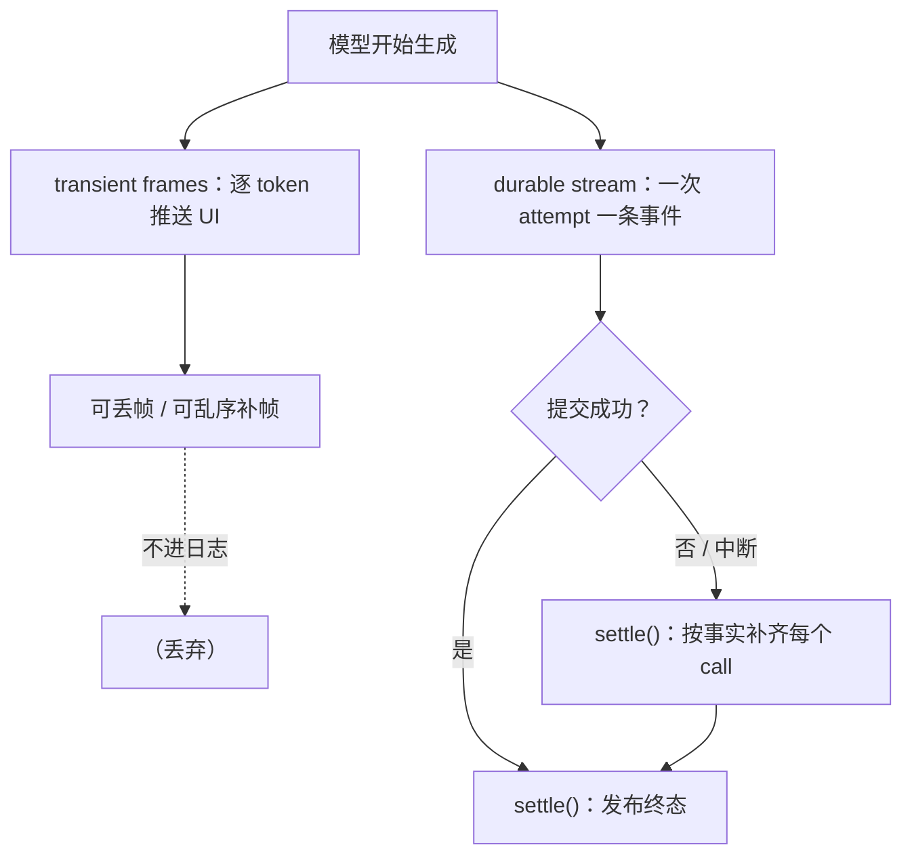
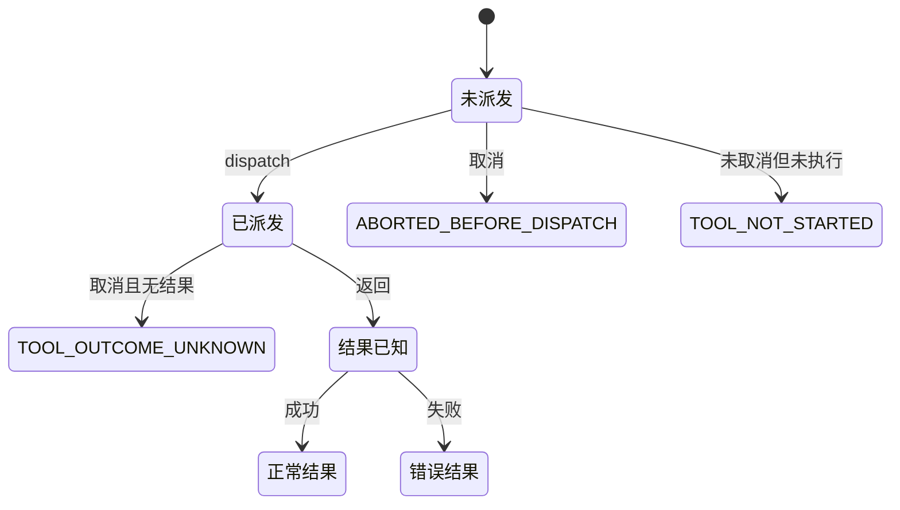

# 11 · 流式、取消与一致性结算：中断时到底发生了什么

> **一句话结论**：取消不是「什么都没发生」，而是一串必须被结算的事实；系统要保证的不是「动作没发生」，而是「每个 tool call 都有配对结果，且状态不说谎」。
>
> 定位：Part I · 四层位置：Loop × Context
> 关联缺陷：**取消后留下悬空 tool call**（中断语义完全缺失，无结算、无双轨）
> 前置：[第 10 课](/ai/harness/10-reliability-and-trust) · 下一课：[第 12 课](/ai/harness/12-extensibility-and-eval) · [课程总览](/ai/harness/)

## 本课要回答的问题

用户点了「停止」，或者网络在流式输出中途断了，或者进程收到 SIGTERM。这些时刻系统里有一堆悬而未决的东西：已经显示了一半的回答、已经派发出去但还没回来的工具调用、已经写入但还没记录的副作用。

要能判定地回答：**中断之后，哪些东西必须仍然成立？** 最短的判据是——**每个 tool call 是否都有配对结果？** 如果没有，消息序列就是非法的，日志也无法重建。

这一问之所以难，是因为大部分系统把「取消」实现成一个布尔开关：置位、停下、收工。但真实的中断发生在调用链的任意深度，且伴随已经发生的外部副作用。

## 核心原理

### 双轨流式：UI 的流不是日志的流

先分清两种完全不同的「流」：

```text
transient frames    → UI 增量显示，可丢、可乱序补帧，不进日志
durable stream      → 紧凑定形的一次性事件，提交后才算发生
settle()            → 在匹配的 durable 事件提交后发布终态
```

- **transient frames** 服务于人的眼睛。它们可以丢（丢一帧无非是画面卡一下）、可以乱序补帧（只要最终追上），**不进日志**。
- **durable stream** 服务于系统的记忆。它是**紧凑、定形、一次性**的事件：一次 attempt 对应一个 durable 事件，提交后才算「这件事发生了」。
- **settle()** 是结算器：等匹配的 durable 事件提交完成后，发布终态，并补齐所有未配对的调用。

为什么不能把每个 token 增量写进持久日志？三个理由，每个都致命：

1. **体积**：日志会膨胀几十上百倍，迁移、备份、读取全部变慢；
2. **难以迁移**：token 级的格式一旦改变，历史数据无法用单步迁移处理；
3. **表达力不足**：token 流无法表达「这次生成最终是什么」——它只有过程，没有结论。

正确做法一句话：**一次 attempt 对应一个紧凑 durable stream + 有序 transient frames，结算时只对终态负责**。



### 取消传播：信号，不是开关

`AbortController` / `signal.throwIfAborted()` 必须出现在**每一个可能产生副作用的边界**，而不是主循环里的一个 `if`。

一句判断很有用：**取消不是一个状态，是一条沿调用链传播的信号**。状态只能描述「当前是否取消」，信号能保证「每一个正在等待的地方都收到通知」。

这就像火警：你不能只在门口贴一张「正在疏散」的告示，必须让警报在每个房间都响。否则深处正在执行写操作的子过程完全不知道要停。

### 结算第一原则：不能有悬空 tool call

这是本课的硬约束：每个 `call` 必须有配对的 `tool/result`，否则 messages 非法且日志无法重建。

中断时，要按**事实**分状态补齐，而不是一律写成「失败」：

| 状态 | 含义 |
|---|---|
| `ABORTED_BEFORE_DISPATCH` | 调用未派发 |
| `TOOL_NOT_STARTED` | 未开始执行 |
| `TOOL_OUTCOME_UNKNOWN` | 已派发、结果未知（**不能写成「失败」**） |
| 正常结果 / 错误结果 | 已完成，按实记录 |

四种状态的区别不是措辞讲究，而是**下游行为不同**：

- `ABORTED_BEFORE_DISPATCH` 和 `TOOL_NOT_STARTED`：确定没发生，可以安全重试。
- `TOOL_OUTCOME_UNKNOWN`：可能已经发生了。重试可能造成重复写入，所以必须交给幂等键、事务或人工确认。
- 正常/错误结果：有确定的事实，按实记录即可。

把 `TOOL_OUTCOME_UNKNOWN` 写成「失败」是危险的：下游看到「失败」会合理地重试，而这次重试可能是对一个**已经执行过的写操作**再来一次。这就是分布式系统里 at-least-once 语义的老问题在 Agent 场景的复现——只不过这次「重复写入」的可能是你的生产数据库。

### 幂等与副作用的边界

必须接受一个残酷事实：**取消不能撤回已发生的外部副作用**。

系统能保证的只有两件事：意图已被记录；状态标签不说谎。系统不能保证「动作没发生」。所以凡是涉及外部写操作，都要另配机制——幂等键（同一请求重复执行也只生效一次）、事务、或人工确认——而不能指望 AbortController。

### 失败尝试：进日志，不进模型历史

一次失败或被中断的尝试，应当**保留在日志供审计**，但**不进入模型历史**。

理由很直白：否则模型会看到一个「没发出去的回答」，然后在下一轮继续引用它、修补它，产生奇怪的自我指涉。审计要全量，送模要干净——这又回到第 08/09 课那句「日志 ≠ 投影」。

## 代码与实现

MVP 没有真正的流式实现（这是 T2 红线：≤350 行）。但 `stage1()` 的 `continue` 分支（`:138-140`）和 `stage2()` 的压缩都制造了「消息不配对」的等价问题。

换句话说，MVP 没有流式，却有流式最典型的 bug：某个分支跳过了 result 回填，assistant 消息里的 `toolCalls` 就永远等不到对应的 `tool` 消息。

**手写补全**（`scratch-11.mjs`）：一个最小 settle 骨架。

```js
function settle({ calls, results, aborted }) {
  const byId = new Map(results.map(r => [r.id, r]));
  return calls.map(c => {
    if (byId.has(c.id)) return byId.get(c.id);
    if (aborted) return { id: c.id, status: c.dispatched
      ? 'TOOL_OUTCOME_UNKNOWN' : 'ABORTED_BEFORE_DISPATCH', content: '' };
    return { id: c.id, status: 'TOOL_NOT_STARTED', content: '' };
  });
}
const calls = [{id:'c1',dispatched:true},{id:'c2',dispatched:false}];
const out = settle({ calls, results: [], aborted: true });
console.log(out);
// 每个 call 都有配对结果；已派发的绝不写成「失败」
console.assert(out.length === calls.length &&
              out.every(r => calls.some(c => c.id === r.id)), '存在悬空 tool call');
```

逐段解读：

- `byId` 先把已有结果索引化，这是「配对」的实现方式：按 id 匹配，而不是按顺序。
- `calls.map(...)` 的关键在于**它以 calls 为驱动**，而不是以 results 为驱动。这保证了「每个 call 都必有输出」，天然不会悬空。
- 两个分支的判定顺序很重要：先看 `aborted`，再看 `dispatched`。已派发且中止 → `TOOL_OUTCOME_UNKNOWN`；未派发 → `ABORTED_BEFORE_DISPATCH`。
- `content: ''` 是占位，让消息结构合法（消息需要内容字段），但不伪造任何事实。
- 最后的 `console.assert` 就是本课的验收：数量一致 + id 全覆盖。

注意 `TOOL_OUTCOME_UNKNOWN` 的措辞：它要求下游**不要盲目重试**，而不是给一个可以安全重试的「失败」。状态名本身就是接口契约的一部分。

## 权衡与失效模式

- **transient / durable 分离的代价**：两套通道要对齐序号，UI 可能出现短暂不一致（终态还没到，画面已经显示完了），需要 settle 收敛。这是可接受的代价——不一致是短暂的，日志的正确性是永久的。
- **失败尝试不进模型历史**：审计与送模是两种视图——这又回到第 08/09 课「日志 ≠ 投影」。维护两套视图有成本，但混成一套会同时损害两者。
- **取消不是回滚**：涉及外部写操作时要靠幂等键、事务或人工确认，不能靠 AbortController。这条必须写进团队规范，否则一定会有人以为「调了 abort 就安全了」。
- **`TOOL_NOT_STARTED` 可能掩盖 bug**：如果 `aborted=false` 且 `results=[]`，settle 会给所有 call 补 `TOOL_NOT_STARTED`——这看起来合法，实际上说明「有 call 被派发了却没执行」。所以这个状态要配告警，而不是静默通过。

症状到归因：

| 症状 | 归因 |
|---|---|
| 中断后下一轮模型行为怪异 | 悬空 tool call / 失败尝试进了送模历史 |
| 下游出现重复写入 | `TOOL_OUTCOME_UNKNOWN` 被写成「失败」 |
| 日志巨大且无法迁移 | token 增量被直接写入持久日志 |
| UI 与最终结果不一致 | 缺 settle，终态未收敛 |

## 四层定位

| 方向 | 内容 |
|---|---|
| Loop | 取消信号传播、turn 结束时的统一补齐 |
| Context | 结算结果回填为 tool 消息；失败尝试不进模型历史 |
| Harness | durable stream 提交是「发生」的定义；幂等基础设施 |
| Prompt | 几乎无关——这层问题不能靠措辞解决 |

最后一行值得强调：这是本课程里少数几个「提示词完全帮不上忙」的问题。你无法通过写「请确保每个调用都有结果」来解决悬空调用——它必须在 Loop 与 Harness 的结构里被保证。

## 动手实验

```bash
cd /Users/cheeka/code/deepseek-harness/dsh-agent-course/mvp
sed -n '136,144p' harness-mvp.mjs     # continue 之后没有回填
node harness-mvp.mjs --stage 1
```

**你会看到什么**：第一条命令打开 `stage1()` 里 `continue` 附近的那几行，你会看到某个分支直接跳到下一轮，**没有为已产生的 tool call 写回 result**。第二条命令跑 stage 1，输出的证据里能对上「消息不配对」的等价现象。

**手写补全练习**：给 `scratch-11.mjs` 加一个断言——「结算后 messages 中每个 assistant toolCalls 都有同 id 的 tool result」；然后把 `aborted=false`、`results=[]` 传进去，观察它如何给每个 call 都补一条 `TOOL_NOT_STARTED`，并讨论这是否掩盖了一个真实 bug（提示：应该是，所以这个状态要配告警）。

这个练习的训练点是：**「合法」不等于「正确」**。补齐保证了结构合法，但 `TOOL_NOT_STARTED` 在非中断场景下是一个异常信号，需要区分「正常的未开始」与「异常丢失」。

## 常见误区

- **「取消 = 什么都没发生」**。外部副作用无法撤回。取消只是停止继续推进，并如实记录已发生的事。
- **「UI 显示的流就是日志」**。UI 可丢帧、可乱序、可补帧；日志只认提交后的终态。
- **「把 UNKNOWN 归成失败，简单」**。这会把「可能已执行」误标为「确定未执行」，诱发重复副作用。
- **「流的每个 token 都该进日志」**。那会让日志变成传输协议的镜像，体积与迁移成本都无法接受。
- **「补一条 result 就完事了」**。补齐要带正确的状态语义，否则只是把悬空换成了谎报。

## 本课小结

1. 双轨：transient frames 给 UI（可丢、不进日志），durable stream 给系统（提交即发生）。
2. 取消是沿调用链传播的信号，必须覆盖每个副作用边界。
3. 结算第一原则：**不能有悬空 tool call**；四种状态按事实补齐。
4. `TOOL_OUTCOME_UNKNOWN` 不可写成「失败」，否则诱发 at-least-once 重复；取消不是回滚。
5. 失败尝试进日志、不进模型历史——日志与投影是两种视图。

| 状态 | 可安全重试 | 说明 |
|---|---|---|
| `ABORTED_BEFORE_DISPATCH` | 是 | 未派发 |
| `TOOL_NOT_STARTED` | 是（但需告警） | 未开始执行 |
| `TOOL_OUTCOME_UNKNOWN` | 否 | 已派发，结果未知 |
| 正常 / 错误结果 | 视错误类型 | 有确定事实 |



## 自测

**1. 为什么不能把 token 增量直接写进持久日志？**

<details><summary>参考答案</summary>

三个原因：体积膨胀几十上百倍；token 级格式难以做单步迁移；token 流只表达过程不表达「这次生成最终是什么」。正确做法是一次 attempt 一条紧凑 durable 事件，transient frames 只走 UI。

</details>

**2. 为什么说取消不是一个状态，而是一条信号？**

<details><summary>参考答案</summary>

因为取消需要送达每一个「正在等待或即将产生副作用」的位置。若只维护一个布尔状态，主循环之外的深层子过程不会感知到，仍会继续写入。AbortController 的传播语义才能保证整体一致。

</details>

**3. 把 `TOOL_OUTCOME_UNKNOWN` 写成「失败」会导致什么后果？**

<details><summary>参考答案</summary>

下游看到「失败」会合理地重试，而该调用可能已经执行过，从而造成重复写入或重复扣款。这是 at-least-once 语义下的经典事故。

</details>

**4. 为什么失败尝试要留在日志里、但不能进入模型历史？**

<details><summary>参考答案</summary>

日志是审计视图，需要全量与可追溯；模型历史是送模视图，必须干净，否则模型会看到一个「没发出去的回答」并继续引用它。两者是不同投影，不能混为一谈。

</details>

**5. 在 `aborted=false`、`results=[]` 时补出 `TOOL_NOT_STARTED`，为什么需要告警？**

<details><summary>参考答案</summary>

因为这表示「已派发的调用没有结果」或「流程跳过了执行」，是异常而非正常未执行。补齐只是让结构合法，若静默通过就掩盖了真实 bug。

</details>

## 延伸阅读与下一课

- at-least-once 与幂等键的经典分布式文献——理解「状态标签即接口契约」的根源。
- Part II 第 22 课将读 `packages/core/agent-loop/src/assistant-stream.ts` 的紧凑 timed stream、`ToolCallRecovery` 在 turn 失败时统一补齐，以及 `turn/end` 记录的 `TurnEndCancelCause`；第 18 课要求「错误也必须产生配对的 `tool/result`」。
- 下一课 [第 12 课 · 可替换性、插件化与非确定性系统的评测](/ai/harness/12-extensibility-and-eval)：把本课与前十课的所有缺陷汇总成 P1–P10，并交付一份能复现它们的评测脚本。
