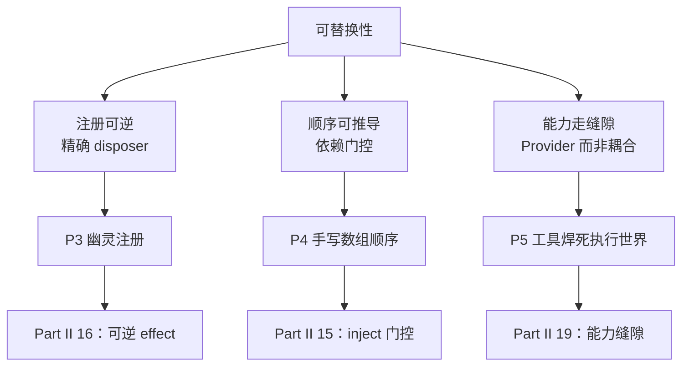

# 12 · 可替换性、插件化与非确定性系统的评测：交付 MVP 终版与问题清单

> **一句话结论**：插件化不是「把代码拆到不同文件」，而是「注册可逆、顺序可推导、能力可替换」；评测不是「跑通一次」，而是「验证世界，并报告分布」。
>
> 定位：Part I · 四层位置：Harness（含 P0：评测方法）
> 关联缺陷：汇总 D1–D8 → **P1–P10 架构问题清单**，这是两部分的铰链
> 前置：[第 11 课](/ai/harness/11-streaming-and-cancellation) · 下一课：[第 13 课](/ai/harness/13-from-problems-to-cordis) · [课程总览](/ai/harness/)

## 本课要回答的问题

这是 Part I 的收口课，要同时回答两个看似无关的问题。**(a) 可替换性**：想给这个 harness 加一个第三方插件，或把工具执行从本地虚拟文件系统换到远程沙箱，要改几处？如果答案是「改三个工具、改主循环、改配置快照」，那它就不是插件化，只是代码分文件。**(b) 评测**：一个概率系统**怎么测**？模型每次输出都不同，脚本化模型又永远成功——单次通过既不能证明能力，也不能证明可靠。

两问的共同点是：它们都在问「结构能不能保证」，而不是「这次跑得好不好」。

## 核心原理

### 可替换性的三个前提

要能真的换掉一个部件，必须同时满足三条：

1. **注册可逆**：装上去的东西能精确卸下来，且不误删别人的。
2. **加载顺序可推导**：依赖关系由声明决定，而不是由数组下标决定。
3. **能力通过缝隙消费而非直接耦合实现**：工具调用执行世界时，走的是接口（Provider），而不是直接 `import` 本地实现。

缺任何一条，「插件化」就只是「把代码拆到不同文件」。这三条对应后面的 P3、P4、P5——它们是同一件事的三个侧面。



### 非确定性系统的测试七层梯队

`docs/testing.md` 的核心思想，Part I 先用朴素语言表述成七层：

| 层 | 测什么 | 手段 |
|---|---|---|
| 1 纯函数 | 装配、投影、校验、计量 | 普通单测，确定性 |
| 2 mock 边界 | 只 mock **非确定性边界**（模型、时钟、网络、随机） | `ScriptedModel` 就是这一层 |
| 3 真实入口 | 用产品真实入口跑，而不是直接调内部函数 | 否则测的是「测试搭的架子」 |
| 4 世界验证 | *Verify the world, not the self-report* | 检查文件/DB/退出码，不问模型「你做完了吗」 |
| 5 回归 | 曾经坏过的输入进黄金集 | guard 只有被回归触发过才算 guard |
| 6 轨迹 | step 序列、token、决策日志 | 可观测先于优化 |
| 7 统计 | `pass@k` / `pass^k`、置信区间、A/B | 单次通过不等于稳定通过 |

这七层的顺序不是随意的，它是一条**成本递增、可信度递增**的阶梯。第 1 层最便宜、最确定；越往后越接近真实，也越贵、越不稳定。工程上的正确做法是「尽可能把断言下沉到低层」，而不是所有验证都靠第 7 层跑一堆样本。

### 两条最重要的纪律

- **只 mock 非确定性边界**。把整个运行时都 mock 掉，测试通过但产品不通；把模型留成真实的，测试不稳定又无法归因。边界只有四个：模型、时钟、网络、随机。其余都应该是真的。
- **验证世界，而非自报告**。模型说「已写入 report.txt」不算证据，`vfs.has('report.txt')` 才算。第 03 课把 `VERIFY` 写成宿主侧断言，就是这条纪律的直接应用。

第二条还有一层深意：模型的自我报告本身也是概率输出，把它当证据等于用被测对象验证被测对象。

### pass@k 与 pass^k：能力上限 vs 可靠性

两个指标名字很像，语义完全不同：**`pass@k`** 是 k 次里**至少成功一次**，衡量能力上限；**`pass^k`** 是 k 次**全部成功**，衡量可靠性。Agent 产品要的是后者——只报 `pass@k` 会把「偶尔能用」包装成「可用」：一个 30% 成功率的系统，在 k=5 时 pass@k 接近 83%，看起来很体面，但用户体验是「七成情况下失败」。配套纪律：样本量要配置信区间；非确定性下 A/B 不能只看一次运行——两个版本的差异若落在噪声范围内，任何结论都不成立。

### 评测诚信

不要让模型自评自己的轨迹。LLM-as-a-judge 可以用，但必须配三件事：独立检查器、blinded 样本（评判者不知道哪个是基线）、人类抽检。否则「评判者」与「被评者」共享同一偏见，分数只是自我确认。

### 问题清单：D1–D8 → P1–P10

把 D1–D8 从「代码里的坑」归纳成「架构问题」。这是 Part I 12 课唯一的「汇总型」清单——其余 11 课都指向单个缺陷，本清单把整份问题交给 Part II。**Part II 每一课都必须指名回应其中至少一条。**

| 编号 | 问题 | MVP 证据 | Part II 课 |
|---|---|---|---|
| **P1** | 控制流焊死在主循环，策略不可组合、加一条改多处 | S1 五职责 / S3 改 3 处 | 17–18、22 |
| **P2** | 提示词是模板字符串，不能按段注册/排序/覆盖/卸载 | S1 `renderSystem` / S4 EXTRA 段 | 20 |
| **P3** | 注册不可逆，热重载与作用域留下幽灵注册 | S4 卸载后仍为 2 | 16 |
| **P4** | 加载顺序靠手写数组，无依赖门控 | S4 `handlers` 与 `sections` 数组 | 15 |
| **P5** | 工具直接耦合本地执行世界，换 Provider 要 fork 所有工具 | S4 3/3 硬编码 vfs | 19 |
| **P6** | 压缩即删除 → 请求不可重建、不可审计、不可回放 | S2 丢弃消息无日志 | 21 |
| **P7** | 消息数组即状态 → fork/resume/迁移/遥测各存各的，必然漂移 | S2 覆盖写回 / 双 fork 无 seq | 21 |
| **P8** | 策略无单调性保证，deny 可被后续 handler 洗掉 | S3 越权写入成功 | 18、23 |
| **P9** | 配置散落，多运行形态靠 if 分支而非组合 | S3/S4 参数硬编码在函数里 | 23 |
| **P10** | 不变量只靠运行时约定，没有类型/静态门禁/回归测试 | 全阶段；本课的 eval 是外挂脚本 | 24 |

> **交给 Part II 的三个判据**：① 每条问题都有可复现证据；② 每个机制必须指名修哪条 P；③ 讲完机制要回到四层接口，说明它改的是哪一层、会向哪层传导。缺任何一条，第二部分就退化成源码流水账。

## 代码与实现

`mvp/harness-mvp.mjs:259-287` 的 `stage4()`：

```text
const install = (reg) => {
  reg.sections.push('EXTRA: 永远用中文回答');
  reg.tools.push('danger_tool');
};
const uninstallNaive = () => { /* 没有 disposer，什么都不做 */ };
install(registry);
const before = registry.sections.length;
uninstallNaive();
const after = registry.sections.length;
const coupled = TOOLS.length;   // runTool() 每个分支直接调本地 vfs
```

三条证据：

```text
卸载前提示段=2，卸载后=2（期望回到 1）
assemble() 仍含 EXTRA 段=true
硬编码本地 vfs 的真实工具=3/3，换执行世界需改动全部
```

- `install` 只会 `push`。它没有记录「我加了什么」，所以**从原理上就无法撤销**——这正是 P3（注册不可逆）的最小复现。
- `uninstallNaive` 的函数体是空的，注释还写着「没有 disposer」。这是刻意的自曝：不是忘了写，而是架构上没地方写。
- `before` / `after` 两次取长度是为了**给缺陷一个可断言的数字**：2 → 2，而期望是 2 → 1。
- `coupled = TOOLS.length` 直接把「耦合度」量化成 3/3：三个工具全部硬编码本地 vfs，换执行世界要 fork 全部三个，而不是换一个 Provider。

**`--json` 模式是评测接口**：`mvp/harness-mvp.mjs:301-303` 把每个 stage 的 `stage/title/layer/trace/pain/evidence` 结构化输出，让断言脚本能验证「缺陷确实存在」。这是一个很聪明的设计：它是一份**反面回归集**——哪天有人「顺手修好」了 MVP 的某个缺陷，断言会失败，提醒他教学标本被破坏了。换句话说，这个 MVP 的「正确行为」就是「保持错误」：测试保护的是教学目标，不是产品质量。

## 权衡与失效模式

- **没有 disposer**：热重载、子代理作用域、插件市场、测试隔离全部留下幽灵注册。症状是「测试之间互相污染」「改了插件不生效」。
- **手写加载顺序**：依赖变了要人肉改数组，且没有任何机制阻止「用到还没装的服务」。症状是「本地能跑、CI 崩」。
- **工具耦合执行世界**：把 vfs 换成远程沙箱要 fork 全部三个工具，而不是换一个 Provider。症状是「每接一个环境就多一份复制代码」。
- **只测「能跑通」**：脚本化模型每次都成功，eval 分数 100%，但产品里换个措辞就崩——这是 mock 边界被误用（mock 了整个世界）的典型症状。

| 症状 | 归因 |
|---|---|
| 卸载后行为仍在 | 无 disposer，P3 |
| 依赖未装却调用成功 / 偶发崩溃 | 无依赖门控，P4 |
| 换沙箱要改所有工具 | 工具耦合执行世界，P5 |
| eval 100% 但线上频崩 | mock 了整个世界 / 只测单点 |

## 四层定位

| 方向 | 内容 |
|---|---|
| Prompt | 插件贡献的提示段影响装配（P2、P3） |
| Context | 插件贡献的上下文来源影响可见集合 |
| Loop | 插件贡献的策略影响准入与终止（P1、P8） |
| Harness | 本课本体：注册、依赖、Provider、门禁、评测 |

这张表说明为什么本课放在 Harness 层：**可替换性与评测都是「关于系统」的能力**，它们不改某一步的行为，而是决定「能不能安全地改某一步」。

## 动手实验

```bash
cd /Users/cheeka/code/deepseek-harness/dsh-agent-course/mvp
node harness-mvp.mjs                          # 5 个 stage 全量
node harness-mvp.mjs --stage 4
node harness-mvp.mjs --json | python3 -c \
  "import json,sys; d=json.load(sys.stdin); \
   assert [x['stage'] for x in d]==[0,1,2,3,4]; \
   assert all(x['evidence'] for x in d); \
   print('5 stages OK,', sum(len(x['evidence']) for x in d), 'evidences')"

# 纪律检查：手写实现不得出现 Cordis 词汇（应为空）
grep -nE 'ctx\.|effect\(|inject|surfaceOp|Service' harness-mvp.mjs | grep -v '\*'
```

**你会看到什么**：前两条命令退出码为 0；第三条打印 `5 stages OK, 15 evidences`——15 这个数字是 Part I 全部证据的总量。最后一条 grep 应当**没有任何输出**，这就是「手写实现不出现 Cordis 词汇」这条纪律的机器验证。

**手写补全练习 A（可替换性）**：给 `stage4()` 写一个真正的 `uninstall`，要求返回**精确 disposer**（只撤销自己加的那一段、那一个工具），并断言卸载后 `sections.length===1`。然后问自己：如果两个插件都往 `sections` push，你的 disposer 怎么保证不误删别人的？

**手写补全练习 B（评测）**：写 `eval-mvp.mjs`，用世界验证而非自报告。

```js
import { execFileSync } from 'node:child_process';
const out = execFileSync('node', ['harness-mvp.mjs', '--json'], { encoding: 'utf8' });
const d = JSON.parse(out);
const checks = [
  ['stage 数', d.length === 5],
  ['证据齐全', d.every(s => s.evidence.length >= 2) &&   // stage 0 为 2 条，其余 3–4 条
              d.reduce((n, s) => n + s.evidence.length, 0) === 15],
  ['D8 越权可复现', d[3].evidence.some(e => e.includes('期望 false'))],
  ['D6 压缩删除可复现', d[2].evidence.some(e => e.includes('无任何日志可查'))],
  ['D3 幽灵注册可复现', d[4].evidence.some(e => e.includes('期望回到 1'))],
];
for (const [name, ok] of checks) console.log(ok ? 'PASS' : 'FAIL', name);
process.exit(checks.every(c => c[1]) ? 0 : 1);
```

把 `node eval-mvp.mjs` 的退出码 0 作为本模块的验收物。注意这五项检查**全部在验证世界状态**（退出码、证据字符串、数量），没有一项去问模型「你做完了吗」。

## 常见误区

- **「把代码拆到不同文件就是插件化」**。没有可逆注册与依赖门控，只是文件变多了。
- **「eval 分数高 = 可靠」**。脚本化模型掩盖了输入敏感性；要测分布，不测单点。
- **「一次性手动验证就够了」**。缺陷会回归，只有进黄金集的用例才算 guard。
- **「多跑几次取平均就行」**。没有置信区间的平均值，只是更精确的噪声。

## 本课小结

1. 可替换性三前提：注册可逆、顺序可推导、能力走缝隙。
2. 测试七层：纯函数 → mock 边界 → 真实入口 → 世界验证 → 回归 → 轨迹 → 统计。
3. 只 mock 非确定性边界；验证世界，而非自报告。
4. `pass@k` 是能力上限，`pass^k` 才是可靠性；样本要配置信区间。
5. `--json` 是评测接口，同时充当「反面回归集」，保护教学标本不被顺手修好。

| 指标 | 含义 | 适用 |
|---|---|---|
| `pass@k` | k 次至少一次成功 | 探索能力上限 |
| `pass^k` | k 次全部成功 | 产品可靠性 |
| 单次通过 | 一次结果 | 只够冒烟测试 |

> **Part I 小结**：你写出了一个 315 行、零依赖、能跑通任务、能复现 15 条缺陷证据的传统 harness。它 Proof-of-Concept 成立、工程上不成立。接下来 12 课，我们带着 P1–P10 去读 Cordis 与 DeepSeek Harness，看一个工业级运行时如何把「可组合、可逆、可重建、可验收」变成结构保证，而不是约定。

## 自测

**1. 为什么「拆成多个文件」不等于插件化？**

<details><summary>参考答案</summary>

因为插件化要求三件事同时成立：注册可逆（能精确卸载）、加载顺序可推导（依赖门控）、能力通过缝隙消费（Provider 而非直接耦合）。拆文件只改变物理布局，不提供任何一条结构保证。

</details>

**2. 为什么说「只 mock 非确定性边界」是纪律而不是建议？**

<details><summary>参考答案</summary>

mock 整个世界会让测试通过但产品不通（假阳性）；完全不 mock 又会让测试不稳定、无法归因。只有精确 mock 模型、时钟、网络、随机四处，才能同时保持确定性与保真度。

</details>

**3. `pass@k` 与 `pass^k` 的区别，为什么 Agent 产品更该看后者？**

<details><summary>参考答案</summary>

`pass@k` 是 k 次里至少一次成功，衡量能力上限；`pass^k` 是 k 次全部成功，衡量可靠性。产品面对的是每一次交互，用户不会因为「第五次能成」而满意，所以必须看 `pass^k`。

</details>

**4. `--json` 模式为什么被称作「反面回归集」？**

<details><summary>参考答案</summary>

因为它断言的是「缺陷确实存在」（如 `期望 false`、`无任何日志可查`）。若有人顺手修复了 MVP 的某个缺陷，这些断言会失败，从而提醒他教学标本已被改动。它保护的是教学目标，不是产品质量。

</details>

**5. 练习 A 的精确 disposer 在多插件场景下要解决什么问题？**

<details><summary>参考答案</summary>

要保证只撤销自己注册的那一段/那一个工具，而不误删其他插件的内容。用「按下标删除」会在他人插入后错位，正确做法是持有自己注册项的引用或唯一 id，按引用移除。

</details>

## 延伸阅读与下一课

- `docs/testing.md`——Part II 第 24 课精读七层梯队与 HMR-safety test。
- Anthropic *Building effective agents* 的 eval 章节——`pass@k` / `pass^k` 与「验证世界」的实践背景。
- 下一课 [第 13 课 · 从问题清单到 Cordis](/ai/harness/13-from-problems-to-cordis)：带着本课的 P1–P10 进入 Part II。

