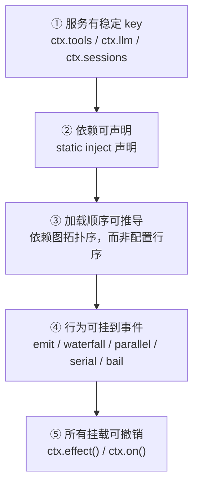

# 13 · 从问题清单到 Cordis：`Agent = Model + Harness` 的总图

> **一句话结论**：P1–P10 不是十个互不相干的 bug，而是同一条缺失链的十个投影——只要补齐「服务有稳定名字 → 依赖可声明 → 加载顺序可推导 → 行为可挂到事件 → 挂载可撤销」，十条缺陷就能被压缩成一套可机械检查的结构。
>
> **对照缺陷：P1–P10 全景**（本课只建立映射，第 14–18 课逐条机械化解）。
>
> **本课修的是哪个 MVP 缺陷**：本课不修单点，而是给全部十条缺陷建立「缺陷 → 机制 → 课程」的索引。其中 P1、P5 的修法从服务仓库起步，P4 从 `inject` 起步，P3 从 `effect()` 起步，P8 由单调 guard 收口。
>
> **前置**：[第 12 课 · 可替换性、插件化与评测](/ai/harness/12-extensibility-and-eval)（P1–P10 清单的来源）｜**总览**：[`/ai/harness/`](/ai/harness/)｜**下一课**：[14 · Plugin = Service / Context = 服务仓库](/ai/harness/14-plugin-as-service)

## 本课要回答的问题

Part I 手写的 harness MVP 一路修修补补，到第 12 课终于攒出了一份 P1–P10 的架构问题清单。新手看到这份清单的第一反应通常是：**十个问题、十处补丁**。但补丁式修法有个致命问题——每修一个，另外两个又冒出来，因为这些问题共享同一批结构性缺失。

所以本课真正要回答的是：

- P1–P10 看起来是十个互不相干的问题，有没有**一组少于五个的机制**能同时回答它们？
- 如果存在，这组机制之间的**依赖关系**是什么？能不能说清「少一环，后面全塌」？
- 面对一个 382 个包、53 个顶层组的真实代码库，怎样用这套总图决定「先读哪里、不读哪里」？

这些抽象问题必须先落到 MVP 的具体失败现象上，否则总图只是口号。请回想 Part I 的几处现场：

- `stage1()` 把执行环境、上下文生命周期、可观测、策略、失败处理五件事焊死在一个函数里（→ P1、P5）；
- `--stage 3` 新增一条策略要同时改主循环的 `if`、`handlers` 数组、策略快照三处（→ P1），而且 `readOnlyGuard` 的 `deny` 会被后面的 `autoApprove` 洗成 `allow`（→ P8）；
- `--stage 4` 里 `uninstallNaive()` 什么都不做，卸载后提示段仍然是 2（→ P3），`sections` / `handlers` 靠数组下标决定语义（→ P4），真实工具 3/3 全部硬编码本地 `vfs`（→ P5）。

换句话说，本课不是「再学一个框架」，而是**给已经见过的失败找到统一的解释框架**。

## 核心原理

### 先看没有 harness 的世界

在传统软件测试里，harness 是包住被测组件的**夹具**：控制输入、观察输出、隔离副作用。它的存在前提是——被测组件是确定的、副作用可控的、不会自己决定下一步。

AI Agent 把这三个前提全部打破：模型是概率性的，工具调用有真实副作用，模型还会自己决定下一步调用什么。如果没有 harness，你要面对的是：

- 模型看到什么由调用方临时拼字符串决定，没有任何可重建的记录；
- 工具直接 `import fs` 或 `exec`，换一个执行环境要改遍所有工具；
- 失败之后没有回退链，一次越权写入就永久落地；
- 想加一条「先审计再执行」的策略，只能改主循环。

harness 的本质，就是把这四类事情从「调用方的自觉」提升为**一等运行时关注点**。

### `Agent = Model + Harness`

原文给出的总公式只有一行：

```text
Agent = Model + Harness
```

分工可以这样理解：

| 角色 | 决定什么 | 类比 |
|---|---|---|
| Model | 能理解什么、生成什么 | 一个博学但没有手脚、也没有记忆的顾问 |
| Harness | 它看到哪些信息、能碰哪些系统、出错后怎么继续、结果由谁确认 | 顾问所在的办公室：文件柜、门禁、电话、监控、值班表 |

生产可用的 harness 有六项职责：

| 职责 | 具体内容 |
|---|---|
| 执行环境管理 | 沙箱运行时、工具调用面、资源治理 |
| 提示与上下文生命周期 | 结构化提示装配、窗口管理、会话状态 |
| 可观测与追踪 | 逐步记录推理、工具调用、模型调用、token 计量 |
| 策略执行 | 限流、成本上限、输出过滤、权限与行为护栏 |
| 失败处理与恢复 | 重试、回退链、优雅降级、取消结算 |
| 多 Agent 协调 | 路由、委派协议、跨 agent 信任边界 |

这张表值得和 MVP 对照着看：Part I 的每一课，其实都在手工补其中一行；而 Part II 要做的，是让这六行各自成为**可独立替换的结构**。

### 三个让 harness 不可避免的驱动力

为什么不能「等模型变强就好了」？原文给了三个驱动力：

1. **自治度阶梯**：从「一问一答」到「长时无人值守」，失败后果呈非线性上升。一个会自己跑两小时的 agent，越权一次就够造成事故。
2. **多 Agent 复杂度**：一旦出现委派，信任边界就变成分布式系统问题——A 把任务交给 B 时，B 继承多少权限？
3. **规模成本**：token 消耗不是线性的，harness 是**经济控制面**，决定一次任务最多花多少钱。

这三条共同说明：harness 不是「模型不够强时的拐杖」，而是系统变大之后绕不开的基础设施。

### 模型无关资产：什么会被淘汰，什么会增值

这是本课最容易被略过、但对学习路线最重要的一段判断：

- **会被淘汰的**：替模型思考的 scaffold——手写计划模板、固定推理 DAG。模型变强后，这些硬编码反而限制它。
- **会增值的**：工具、环境反馈信号、外置记忆、eval 集。模型越强，越能利用这些资产。

由此得出投资建议：**把精力偏向 harness，而不是更复杂的提示链**。这也解释了 Part I 的 MVP 里最值得保留的东西——不是那段精心雕琢的提示词，而是**验证器与日志**。

### 不变量优先的设计

原文提出的方法论是：先写清「什么必须永远成立」，再选机制去保证。

三条不变量在这一部分会反复出现：

- 模型可见即可重建（`Model-visible means logged.`）；
- 注册即可逆；
- 扩展不改核心。

顺序很重要。**机制会换，不变量不会**。如果先选机制再去凑不变量，很容易得到一个「看起来能跑、但说不清保证什么」的系统；反过来，先钉死不变量，机制就是可替换的实现细节。

### Cordis 五概念

`docs/cordis-primer.md` 的 `## Cordis In Five Ideas` 给出五个概念。注意右列不是「功能清单」，而是「它们各自回答哪条缺陷」：

| 概念 | 含义 | 回答哪条缺陷 |
|---|---|---|
| **Plugin = Service** | 插件就是向共享 context 贡献服务的对象 | P1、P5 |
| **Context = 服务仓库** | 服务以稳定 key 挂载（`ctx.tools` / `ctx.llm` / `ctx.sessions`），消费者按 key 找服务 | P5 |
| **inject 声明依赖** | 插件声明所需服务，框架等依赖齐备才加载 | P4 |
| **Typed Events** | 事件用 TS 声明合并定义，`emit / waterfall / parallel / serial / bail` 五种派发 | P1 |
| **注册是可逆 effect** | 提示段、工具 schema、监听器都通过 `ctx.effect()` / `ctx.on()` 安装，卸载自动回滚 | P2、P3 |

五个概念不是五个功能，而是**一条因果链**：



原文对这条链的判词是：**少了任何一环，后面的保证都不成立**。把它展开成反例更容易记住：

- 服务没有稳定名字 → 依赖只能写成「import 某个具体文件」，第②环失效；
- 依赖不能声明 → 加载顺序只能手写数组，第③环失效，回到 P4；
- 加载顺序不可推导 → 事件监听器谁先谁后靠运气，策略可能被洗掉；
- 挂载不可撤销 → 事件越多，卸载后的幽灵越多，回到 P3。

所以 14–16 课讲前三环（服务仓库 / 依赖门控 / 可逆 effect），17 课讲第四环（事件），18 课用「单调 guard」补上事件机制留下的安全缺口——这正好解释了为什么第 18 课必须存在：**waterfall 天生允许后者覆盖前者**，这是 P8 的温床。

## dsh 源码精读

### `docs/cordis-primer.md`：全课最短、最该精读的文档

原文点名了四个锚点，每个都对应一个具体问题：

| 位置 | 读什么 | 为什么关键 |
|---|---|---|
| 五概念（7 行起） | 五个概念的定义与相互关系 | 这是全部六课的总纲，后面所有源码都是它的展开 |
| `## Dispatch Modes`（15 行） | 五种派发模式的语义 | 决定你「加一条策略」时该选哪个 API |
| `## Cordis Waterfall Semantics`（29 行） | `next()` 的委托语义与截断风险 | P1 的解法在这里，P8 的坑也在这里 |
| `## Practical Rules`（41 行） | 实践守则 | 把概念落成「写插件时该做什么、不该做什么」 |

注意这份文档的体量：它在 45 行内讲完了内核的心智模型。读它的正确方式不是扫过，而是**每读一个概念就回到 MVP 找对应失败**。

### `docs/architecture.md`：目标与不变量的锚点

- `## Capability seams`（约 144 行）：一张「目标 → 机制」的扩展点表。它回答的是「我想扩展某个能力，应该动哪里」，这是第 19 课的地图。
- `**Model-visible means logged.**`（约 130 行）：三条不变量之一。它的含义是——凡是进入模型上下文的内容，都必须能在日志里重建。这条不变量会在第 21 课（日志即真相）被反复引用。

### `vendor/cordis/src/`：第 14–16 课的四个文件

| 文件 | 对应课程 | 核心内容 |
|---|---|---|
| `context.ts` | 14 | Context 即服务仓库，`registry` 方法被 mix 到 `ctx` |
| `service.ts` | 14 | `Service` 基类：构造即注册，随 fiber 卸载 |
| `registry.ts` | 15 | `Inject.resolve`：把三种 inject 形态归一化 |
| `fiber.ts` | 16 | `effect()`：LIFO disposer、幂等、可等待 |

读源码的顺序建议与课程一致：先 `service.ts` 看「服务怎么挂上去」，再 `registry.ts` 看「依赖怎么等」，最后 `fiber.ts` 看「怎么撤下来」。

### 一条重要的目录事实

这个 checkout 实测 **382 个含 `package.json` 的包 / 53 个顶层组**，`docs/subsystems/` 下有 69 份英文主题文档。

这两个数字的唯一用途是提醒你：**不要试图通读**。正确姿势是按锚点读——本课给了四个文档锚点、四个源码文件；后面每课同样只给锚点。

原文还提醒：包族归属在 developer preview 阶段会变，例如 `hooks/*` 已并入 `experimental/`，`agent-team` 升为 `team/`。这意味着任何「目录结构权威论」都会过期，**以 `ls packages/` 的当下结果为准**，这也是第 13 课实验里那条 `ls` 的位置。

## 权衡与失效模式

- **五概念的代价是间接性**。debug 时「这个工具是谁注册的」不再能靠全局搜索找到，要靠 `--dump-config` 与装配树。这是为可替换性付出的真实成本，不是免费的抽象。
- **不变量优先的代价**。类型与静态检查只能覆盖「不执行系统就能判定」的性质；涉外部时序的保证（副作用前 checkpoint、取消结算）仍要留在运行时——第 24 课会专门处理这条边界。
- **最常见的误读**：把 Cordis 当成 DI 容器。它同时是**生命周期管理器**（可逆 effect）与**策略总线**（typed events）。DI 只解释第 14 课，解释不了 P1 与 P3；后两者才是回答 P1/P3 的部分。

## 四层定位

| 层 | Cordis 落在哪 |
|---|---|
| Prompt | 提示段注册到 `ctx.systemPrompt`（第 20 课） |
| Context | 会话服务挂 `ctx.sessions`，投影与压缩是缝隙（第 21 课） |
| Loop | 主循环通过事件暴露 `agent/pre-step` 等挂载点（第 22 课） |
| Harness | 本课本体：插件树、依赖、effect、门禁（第 23–24 课） |

这张表的读法是：Cordis 不是「Harness 层的一个组件」，而是**四层共用的底座**。Prompt 层靠它注册提示段，Context 层靠它挂会话服务，Loop 层靠它暴露挂载点，Harness 层则直接由它构成。

## 动手实验

```bash
cd /Users/cheeka/code/deepseek-harness
sed -n '1,45p' docs/cordis-primer.md
sed -n '126,150p' docs/architecture.md
ls vendor/cordis/src/
grep -hoE '^## [0-9]{2} ·' /Users/cheeka/code/deepseek-harness/dsh-agent-course/part-*.md | wc -l    # 24
node /Users/cheeka/code/deepseek-harness/dsh-agent-course/mvp/harness-mvp.mjs --stage 4               # 回看 P3/P4/P5 证据
```

**预期观察**：

1. `sed -n '1,45p' docs/cordis-primer.md` 的输出应该能在 45 行内看到五概念、`## Dispatch Modes`、`## Cordis Waterfall Semantics` 三个标题。如果只看到概念列表就没往下翻，说明漏了后面两个关键章节。
2. `sed -n '126,150p' docs/architecture.md` 应覆盖 `Capability seams` 与 `Model-visible means logged.` 两处锚点。这两处一个是扩展地图、一个是不变量，后面 19/21 课会回来。
3. `ls vendor/cordis/src/` 应能看到 `context.ts`、`service.ts`、`registry.ts`、`fiber.ts` 四个文件——它们分别就是 14 / 14 / 15 / 16 课的正文。
4. `grep ... | wc -l` 输出 **24**。这个数字不是装饰：它确认你手上的课程版本完整，后面引用「第 N 课」时不会错位。
5. `--stage 4` 的输出里，重点找三句话：卸载前提示段=2、卸载后=2（期望回到 1）、仍含 `EXTRA` 段=true（P3）；`sections` / `handlers` 靠数组下标决定语义（P4）；硬编码本地 `vfs` 的真实工具=3/3（P5）。这三句就是本部分要逐条消灭的对象。

## 常见误区

- **误区：「Everything is a Plugin 只是口号」**。它意味着**连 Agent 循环本身**都是可替换插件，没有特权核心可 patch。这条如果只是背下来，你会低估后面所有设计的激进程度。
- **误区：「不变量写进运行时断言最保险」**。第 24 课会用 v0.2.0-rc.2 的移除决策反驳这个直觉——运行时断言本身也会成为负担与故障源。
- **误区：「先学机制，不变量以后再说」**。不变量是选择机制的依据；顺序反了，就会陷入「每修一个 bug 冒出两个」的循环，这正是 MVP 的经历。

## 本课小结

1. harness 从测试夹具升级为运行时关注点，因为 Agent 的输入、副作用与下一步都不可控。
2. `Agent = Model + Harness`：模型负责理解与生成，harness 负责可见信息、可碰系统、失败恢复与结果确认。
3. 模型无关资产（工具、环境信号、记忆、eval）会增值，替模型思考的 scaffold 会被淘汰，因此投资应偏向 harness。
4. 五概念是一条因果链，不是五个功能；缺任何一环，后面的保证都不成立。
5. 本课建立映射，不消灭缺陷——真正的机械化解从第 14 课开始。

| 缺陷 | 首个接手机制 | 课程 |
|---|---|---|
| P1 策略焊死 | 服务仓库（拆职责）→ typed events | 14 → 17 |
| P3 幽灵注册 | `effect()` LIFO disposer | 16 |
| P4 手写顺序 | `inject` 依赖门控 | 15 |
| P5 耦合执行世界 | 服务仓库 | 14 |
| P8 deny 被覆盖 | 单调 `guard()` | 18 |

## 自测

**1. 用一句话说出五概念的因果链，并指出「少一环」会退化成哪个缺陷。**

<details><summary>参考答案</summary>

服务有稳定名字 → 依赖可声明 → 加载顺序可推导 → 行为可挂到事件 → 所有挂载可撤销。若服务没有稳定 key，依赖只能写成具体 import，加载顺序退化为手写数组（P4）；若挂载不可撤销，每次重载叠加一份，退化为幽灵注册（P3）。

</details>

**2. 「模型变强」会淘汰什么、让什么增值？这对学习路线意味着什么？**

<details><summary>参考答案</summary>

淘汰替模型思考的 scaffold（手写计划模板、固定推理 DAG）；让工具、环境反馈信号、外置记忆、eval 集增值。因此应把精力放在 harness 而非更复杂的提示链上；Part I 里最值得保留的是验证器与日志，而不是提示词。

</details>

**3. `docs/cordis-primer.md` 中讲 waterfall 语义的章节标题是什么？它为什么同时是 P1 的解法和 P8 的坑？**

<details><summary>参考答案</summary>

`## Cordis Waterfall Semantics`。waterfall 让策略成为独立监听器，所以解决 P1（主循环零改动）；但它的语义是链式委托、后者可以看到并改写前者结果，因此安全策略可能被后续插件洗掉，这正是 P8 的温床，需要第 18 课的单调 guard。

</details>

**4. 把 P1–P10 中至少 7 条映射到「五概念 + 事件溯源 + 单调 guard + profile 分层」中的某一项。**

<details><summary>参考答案</summary>

示例：P1→Typed Events / 四段管线；P2→可逆 effect（提示段注册）；P3→可逆 effect；P4→inject；P5→服务仓库；P6→`surfaceOp: replace`（事件溯源）；P7→事件溯源；P8→单调 guard；P9→profile 分层；P10→类型 + 静态门禁 + 回归测试。答出 7 条即可，关键是每条能说出机制而非只报课程号。

</details>

## 缺陷闭环与下一课

| 缺陷 | MVP 证据 | 本课给出的解法方向 | 还留下什么、交给谁 |
|---|---|---|---|
| P1 策略焊死 | `stage1()` 五职责焊死；`--stage 3` 新增一条策略要改 3 处 | 服务仓库拆职责 + typed events 挂策略 | 17 事件总线、18 四段管线、22 `pre-step` |
| P2 模板字符串 | 提示由模板字符串拼装（第 12 课 P2） | 注册改为可逆 effect，为提示段装配铺路 | 20 提示段可逆注册与 `assemble()` |
| P3 幽灵注册 | `--stage 4`：卸载前提示段=2、卸载后=2（期望 1），仍含 `EXTRA`=true | `effect()` 精确 disposer | 16 展开；24 静态门禁检查导出契约 |
| P4 手写顺序 | `--stage 4`：`sections` / `handlers` 靠数组下标决定语义；第 10 课证明顺序能击穿安全边界 | `inject` 让依赖决定加载 | 15 展开；环与可选依赖交给 23 profile |
| P5 耦合执行世界 | `--stage 4`：硬编码本地 `vfs` 的真实工具=3/3，换执行世界需改动全部 | 服务仓库把执行世界变成可替换 key | 14 展开；19 补齐三角色与共享执行世界 |
| P6 压缩删历史 | 第 12 课 P6：压缩直接删历史 | 本部分不处理 | 21 `surfaceOp: replace` |
| P7 消息数组即状态 | 第 12 课 P7：消息数组即状态 | 本部分不处理 | 21 事件溯源与迁移链 |
| P8 deny 被覆盖 | `--stage 3`：最终决策=allow（期望 deny），`report.txt` 存在=true | 单调 guard 的语义 | 18 展开；23 权限预设 |
| P9 配置 if 分支 | 第 12 课 P9：配置里堆 if 分支 | 本部分不处理（依赖声明已消掉一类条件） | 23 bundle/profile/patch |
| P10 不变量靠约定 | 第 12 课 P10：不变量只写在文档与约定里 | 本部分埋下类型化错误码的伏笔 | 24 类型 + 静态门禁 + 回归测试 |

下一课从链条的第一环开始：[14 · Plugin = Service / Context = 服务仓库](/ai/harness/14-plugin-as-service)。它要回答的是一个非常具体的问题——怎样让「换个远程沙箱」从「改三个工具」变成「换一个 `ctx` key」。
