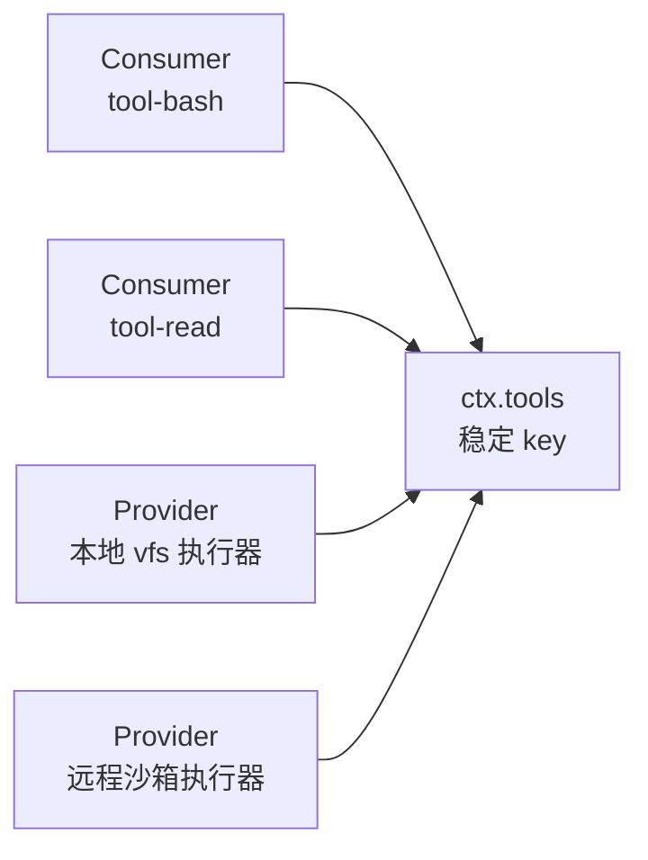
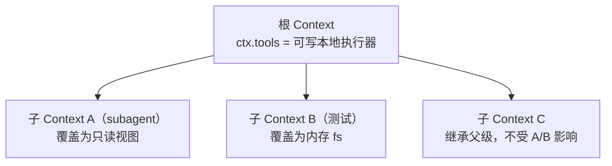

# 14 · Plugin = Service / Context = 服务仓库

> **一句话结论**：插件不是「在某处被 import 的模块」，而是向共享 context 贡献服务的对象；工具只认 `ctx.tools` 这个稳定 key，执行世界退化成可替换的 Provider。
>
> **对照缺陷：P1（策略焊死）、P5（工具耦合执行世界）**。
>
> **本课修的是哪个 MVP 缺陷**：主修 P5——MVP 的 `runTool()` 用 `switch (call.name)` 直接调本地 `vfs`，「工具」与「执行世界」是同一个函数；顺带为 P1 铺垫，把焊死在 `stage1()` 里的五个职责拆成可独立替换的服务。
>
> **前置**：[13 · 从问题清单到 Cordis](/ai/harness/13-from-problems-to-cordis)｜**总览**：[`/ai/harness/`](/ai/harness/)｜**下一课**：[15 · `inject` 依赖门控](/ai/harness/15-inject-dependency-gating)

## 本课要回答的问题

MVP 的 `runTool()` 用 `switch (call.name)` 分发，每个分支直接对本地 `vfs` 调 `read` / `write` / `list`。它跑得很好，直到你想做三件事中的任何一件：

1. 把本地 `vfs` 换成远程沙箱；
2. 给 subagent 一个只读的、隔离的文件视图；
3. 在测试里注入一个内存文件系统。

这三件事在 MVP 里都要**改工具本身**。如果工具是 3 个，就要改 3 处；如果是 20 个，就要改 20 处；而且每改一次，schema、描述、回填格式都要重新检查一遍。

所以本课的问题是：**要让「换个远程沙箱」变成一次配置改动而不是改三个工具，最低需要什么结构？**

MVP 的失败现象很直白：`--stage 4` 报告「硬编码本地 `vfs` 的真实工具=3/3，换执行世界需改动全部」。注意这个 3/3——它不是「大部分耦合」，而是**全部耦合**。只要还有一个工具直接 `import fs`，执行世界就没有真正可替换。

## 核心原理

### 先看没有服务仓库的世界

没有服务仓库时，依赖关系是**编译期硬连线**：`tool-bash`、`tool-read`、`tool-write` 各自直接 `import` 本地 fs（`tool-bash` 还直接 `import` 本地 child_process）。后果有三个：

- **N×M 爆炸**：N 个工具 × M 个执行世界，改动点接近 N×M；
- **测试只能 mock 模块**：mock 路径与真实 import 路径绑定，重构就断；
- **作用域无法隔离**：全局只有一份 fs，subagent 想只读也做不到。

### 服务以稳定 key 挂载

Cordis 的做法是把「谁提供能力」变成运行时的 key 查找：

```text
ctx.tools      → 工具注册表（谁注册了哪些工具、怎么执行）
ctx.llm        → 模型适配缝隙
ctx.sessions   → 会话日志与投影
ctx.systemPrompt → 提示段装配
```

消费者不再 `import` 具体实现，而是向 context 要 `ctx.tools`；Provider 也不再被谁 import，而是把自己注册成 `ctx.tools`。两端只共享一个**字符串契约**。



图中关键的一点是：**Consumer 不认识任何 Provider**。连线是「Consumer → key ← Provider」的两段式，而不是 Consumer 直连 Provider；运行时按 key 解析出当前作用域的 Provider。MVP 缺的正是中间这一段和右半边。

### 两个性质

原文把收益收敛成两条：

1. **接口与实现解耦**。`tool-bash` 消费的是「在某个执行世界里跑命令」这个契约，不感知本地路径语义。它不需要知道对面是 `vfs`、容器还是 SSH。
2. **实现可替换且作用域可控**。服务挂在一个 Context 上，子 Context 可以覆盖父级服务而不影响兄弟作用域——这正是 subagent 上下文隔离与测试隔离的基础。

第二条值得单独画一遍，因为它常被误解成「全局单例」：



覆盖是**沿作用域向下**生效的：A 的只读不会污染 B，也不会反向改根。这就是为什么「服务仓库」和「全局单例注册表」是两种东西。

### Plugin = Service

原文的定义需要逐字读：

> 插件不是「在某处被 import 的模块」，而是**向共享 context 贡献服务的对象**。

这句话有两层含义：

- **贡献**：插件的工作是往 context 上放东西（服务、监听器、提示段），而不是被谁调用；
- **对象**：贡献出去的是一等对象，有名字、有生命周期，能被框架追踪。

`Service` 基类的构造函数里就完成了注册，并在所属 fiber 卸载时自动移除。注意这里已经埋下了第 16 课的答案——**注册与卸载不是两件事，而是一次安装的两端**。

### 为什么这回答 P5

回到 MVP 的那行代码：

```js
case 'read_file': return vfs.read(...)
```

「工具」和「执行世界」被写进了同一个函数体。拆成服务仓库后：

| 角色 | 在 dsh 里是谁 | 知道什么 | 不知道什么 |
|---|---|---|---|
| Consumer | 工具定义 | 我要读一个路径 | 这个路径在本地还是远端 |
| Key | `ctx.tools` | 谁注册了什么 | 具体实现 |
| Provider | 执行器 / 文件系统服务 | 怎么真正读写 | 谁在调用、为什么调用 |

换 Provider 时，工具的 schema、描述、回填格式全部不变。这不是「设计得比较优雅」，而是**改动点从 N 处收敛到 1 处**的可测量收益。

## dsh 源码精读

### `vendor/cordis/src/service.ts:1-40`：服务基类的契约

```ts
/**
 * Base class for services that expose a named API on `ctx`.
 * Subclasses call `super(ctx, name)` from their constructor. The service is
 * registered immediately and is automatically removed with the owning fiber.
 */
export abstract class Service<out T = never> {
  static readonly init: unique symbol = symbols.init
  static readonly check: unique symbol = symbols.check
  static readonly invoke: unique symbol = symbols.invoke
  ...
  /**
   * Register this instance as `name` in the current context.
   * Calls `ctx.reflect.provide(name, this, this[Service.check])`, so the
   * service is unregistered automatically when the owning fiber unloads.
   */
```

逐段读：

- **类注释的前三行**定义了整套机制的契约：子类在构造函数里调用 `super(ctx, name)`，服务**立即注册**，并**随所属 fiber 自动移除**。这三句话就是「Plugin = Service」的全部。
- **`init` / `check` / `invoke` 三个 symbol** 是基类预留的三个扩展点：构造后要跑的初始化、提供给 `ctx.provide()` 的可用性判定、让服务本身可被调用（例如 `ctx.logger()`）。它们解释了为什么「服务」不只是 `ctx.foo = obj` 这么简单。
- **第二段注释**给出了实现方式：`ctx.reflect.provide(name, this, this[Service.check])`。注册动作被收敛到 `reflect` 这一层，所以卸载时也只需要在同一层回收。

原文在这里加了一句提醒：

> **注意这一句**：服务「automatically removed with the owning fiber」——它已经把第 16 课的 P3 答案提前埋在服务基类里了。

这句话值得反复看。很多框架的「注册」是主动动作、「注销」是另一个需要人记得的动作；Cordis 把两者绑在 fiber 生命周期上，于是「忘记注销」这个 bug 类别在结构上消失了。

### `vendor/cordis/src/context.ts`：Context 既是仓库也是入口

原文点名了四处：

| 位置 | 内容 | 读它解决什么疑问 |
|---|---|---|
| 16 行 | `export interface Context` | Context 的公开形状：服务都以属性形式出现 |
| 32 行 | `registry: RegistryService`（注释「Its methods are mixed onto `ctx`（`ctx.plugin`, `ctx.inject`）」） | 为什么插件里可以直接写 `ctx.plugin(...)` |
| 42 行 | `export class Context` | 实现类：context 是可创建的，不是全局单例 |
| 81 行 | `this.registry = new RegistryService(self)` | 每个 Context 自带一个 registry，作用域由此而来 |

第三、四行合起来回答了本课最容易被忽略的问题：**Context 不是进程级全局对象，而是可实例化的**。每个子作用域 `new` 一个 Context，就有自己的一份服务视图；`registry` 里的方法被 mix 到 `ctx` 上，所以写插件时看到的是 `ctx.plugin` / `ctx.inject`，而不是 `ctx.registry.plugin`。

### `packages/core/tools/src/index.ts:98-100`：一个真实服务

```ts
/** Concrete tool registry and scoped executor dispatcher. */
export class ToolsService extends Service {
  static inject = ['systemPrompt']
```

三行代码，三种机制：

- `extends Service`：构造即注册，随 fiber 卸载——第 14 课的机制；
- `static inject = ['systemPrompt']`：声明依赖，第 15 课的机制；
- 类名与注释 `ToolsService`：它向 context 贡献的 key 是 `ctx.tools`，这是工具注册表与执行分发的入口。

也就是说，**一个真实的服务同时用到了三课的内容**。原文特意选这段作例子，是想说明这些机制不是分开的教学玩具，而是同一行代码里的三个维度。

这里还有一个跨层事实值得注意：工具注册表（Harness 层）依赖提示服务（Prompt 层）。为什么？因为工具 schema 要自动进入提示。这条依赖在第 15 课会被再次拿出来当「跨层依赖实例」。

## 权衡与失效模式

- **间接性的代价**：定位「某个 key 当前由谁提供」需要装配树，不能靠 IDE 跳转。这也是 `--dump-config` 与启动诊断为什么是一等工具，而不是调试时临时想起来的技巧。
- **服务命名是契约**：key 一旦发布就难改，破坏性变更要更新所有 consumer。在 pre-stable 阶段这是现实成本——你会看到改名比改实现更痛。
- **作用域覆盖的风险**：子 Context 覆盖父级服务时，如果语义不一致（例如只读 view 冒充可写），会出现难以归因的行为差异。工具以为自己能写，实际被只读视图挡住，报错位置离根因很远。
- **只换一半会撕裂**：换掉 fs 但没换 subprocess，于是「读文件在沙箱、跑命令在本地」。这不是服务仓库的错，而是 Provider 集合没换全——第 19 课会用「三角色 + 共享执行世界」补齐这个设计。

## 四层定位

| 层 | 内容 |
|---|---|
| Harness | 服务仓库与生命周期是基座 |
| Prompt | `ctx.systemPrompt` 的服务 presence 决定 schema 能否进入提示 |
| Context | `ctx.sessions` 提供投影 |
| Loop | `ctx.agents` / `ctx.agentLoop` 本身也是服务，可被替换 |

最后一行值得停一下：如果连主循环都是服务，那么「换一个 agent 循环实现」也不需要改核心——这是第 13 课「Everything is a Plugin」的具体落点。

## 动手实验

```bash
cd /Users/cheeka/code/deepseek-harness
sed -n '1,40p' vendor/cordis/src/service.ts
sed -n '16,45p' vendor/cordis/src/context.ts
sed -n '96,104p' packages/core/tools/src/index.ts
ls packages/core/ | tr '\n' ' '        # 看脊柱六包
```

**预期观察**：

1. `service.ts` 前 40 行里，类注释与构造函数注释应该把「立即注册 + 随 fiber 卸载」说全。如果只看到类定义没看到第二段注释，说明 `sed` 范围选窄了，往后看几行。
2. `context.ts` 的 16–45 行应能同时看到 `interface Context`、`registry: RegistryService` 的注释、`class Context` 的开头。三者在同一段里，正好对应「仓库 / 入口 / 实现」三层。
3. `tools/src/index.ts` 的 96–104 行应输出 `ToolsService extends Service` 与 `static inject = ['systemPrompt']`。请把这两行与你刚读的基类注释对上：`extends Service` 解释了它为什么能 `ctx.tools`。
4. `ls packages/core/` 的输出是一串包名。原文的注释是「看脊柱六包」——不要急着给每个包分类，先确认 `tools`、`session`、`system-prompt`、`agent-loop` 这些第 13 课提到过的名字都在，说明你找对了目录。

补一个对照实验：回到 MVP，把 `runTool()` 里的 `vfs` 换成 `remoteVfs`，数一数改了几处。再想想如果工具是 20 个、执行世界是 3 个，改动量是多少——这个乘法就是本课要消灭的东西。

## 常见误区

- **误区：「服务仓库 = 全局单例」**。它按 Context 分层，子作用域可覆盖。全局单例恰恰是本课要避免的：一旦只有一份，subagent 的隔离就无从谈起。
- **误区：「插件就是 npm 包」**。插件是运行时向 context 贡献服务的对象，发布单位（bundle）是另一回事——那是第 23 课的内容。一个 npm 包里可以有多个插件，一个插件也可以来自不同包。
- **误区：「有了 `ctx.tools` 就等于可替换」**。key 只是接口；如果 Provider 内部仍然写死本地路径语义，换实现时照样撕裂。可替换性取决于契约是否真的抽象掉了执行环境。

## 本课小结

1. 服务以稳定 key 挂载，消费者按 key 找服务，而不是 import 具体实现。
2. 这套结构把改动点从 N×M 收敛到 1 处，并让子 Context 能覆盖实现而不污染兄弟作用域。
3. `Service` 基类「构造即注册、随 fiber 卸载」，已经预埋了第 16 课的可逆性。
4. `ToolsService` 同时展示了继承服务、声明依赖、贡献 `ctx.tools` 三个维度。
5. 换 Provider 不改工具的前提是契约抽象完整；只换 fs 不换 subprocess 仍会撕裂，留给第 19 课。

| 问题 | MVP 的做法 | 服务仓库的做法 |
|---|---|---|
| 换执行世界 | 改每个工具函数 | 换一个 Provider |
| 隔离测试 | mock 模块 | 子 Context 覆盖 |
| 定位实现 | 全局搜索 | 装配树 / `--dump-config` |
| 复用工具 | 复制粘贴 | 同一 Consumer 对不同 Provider |

## 自测

**1. 画出「Consumer → ctx key → Provider」三段图，并说明 MVP 的 `runTool()` 缺哪两段。**

<details><summary>参考答案</summary>

MVP 只有「Consumer 直接调用具体实现」一段：`case 'read_file': return vfs.read(...)`。缺的是中间的稳定 key（`ctx.tools` 之类的解析层）和右侧可替换的 Provider（执行器/文件系统服务）。因此消费者与实现被编译期绑定。

</details>

**2. 引用 `service.ts` 的注释说明「服务为什么会自动随 fiber 卸载」。**

<details><summary>参考答案</summary>

类注释写明子类在构造函数里 `super(ctx, name)`，服务立即注册且「automatically removed with the owning fiber」；构造函数注释进一步说明它调用 `ctx.reflect.provide(name, this, this[Service.check])`，所以所属 fiber 卸载时服务被注销。注册与卸载共享同一个生命周期。

</details>

**3. 举出三个真实 `ctx.*` key 及其职责。**

<details><summary>参考答案</summary>

`ctx.tools`：工具注册表与执行分发；`ctx.llm`：模型适配缝隙；`ctx.sessions`：会话日志与投影。另一个可选答案是 `ctx.systemPrompt`：提示段装配。

</details>

**4. 「换 Provider 不改工具」为什么成立？什么情况下仍会撕裂？**

<details><summary>参考答案</summary>

成立的前提是工具只消费契约（“在某个执行世界里读一个路径”），schema、描述、回填格式都不含本地语义。若只替换 fs 而不同时替换 subprocess，或 Provider 内部仍假设本地路径语义，就会出现「读在沙箱、跑在本地」的撕裂，第 19 课用三角色与共享执行世界解决。

</details>

## 缺陷闭环与下一课

- **P5 → 服务仓库**。MVP 证据：`--stage 4`「硬编码本地 `vfs` 的真实工具=3/3，换执行世界需改动全部」。本课修法：把执行世界变成可替换的 `ctx` key，工具退化为 Consumer。还留下：只换 fs 不换 subprocess 的撕裂，交给 [第 19 课](/ai/harness/19-capability-seams) 的「三角色 + 共享执行世界」。
- **P1 → 服务仓库打地基**。MVP 证据：`stage1()` 五职责焊死。本课修法：让执行环境、上下文、可观测、策略、失败处理各自成为独立服务，从而有地方挂监听器。还留下：策略如何挂上去，交给 [第 17 课](/ai/harness/17-typed-events-waterfall)。

下一课解决服务仓库带来的新问题：服务多了，谁先加载？答案是 [15 · `inject` 依赖门控](/ai/harness/15-inject-dependency-gating)——用依赖图代替手写数组。
