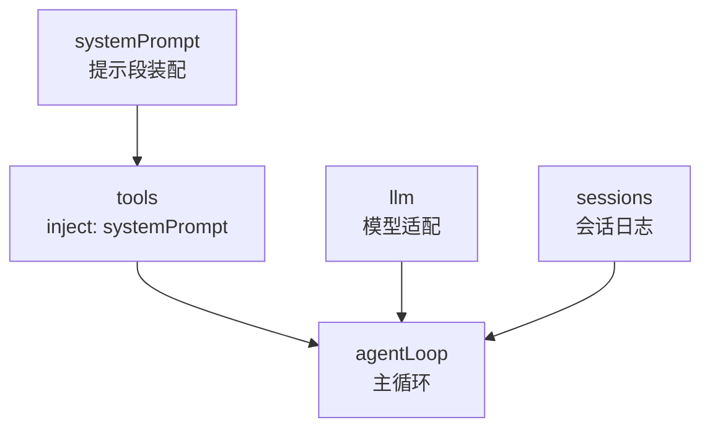
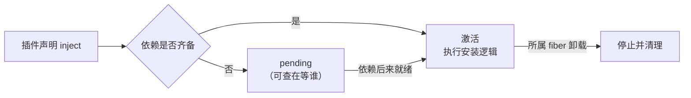

# 15 · `inject` 依赖门控：加载顺序由依赖图推导

> **一句话结论**：插件用 `static inject` 声明「我需要哪些服务」，框架把依赖不齐的插件留在 pending，齐备才激活；于是加载顺序是依赖图的拓扑序，而不是配置文件的行序。
>
> **对照缺陷：P4（加载顺序靠手写数组，无依赖门控）**。
>
> **本课修的是哪个 MVP 缺陷**：MVP 的 `handlers` 与 `sections` 都是手写数组，数组下标即语义；`--stage 4` 里 `sections` / `handlers` 靠下标决定行为，而第 10 课已经证明顺序能直接击穿安全边界（P8）。
>
> **前置**：[14 · Plugin = Service / Context = 服务仓库](/ai/harness/14-plugin-as-service)｜**总览**：[`/ai/harness/`](/ai/harness/)｜**下一课**：[16 · 注册是可逆 effect](/ai/harness/16-reversible-effect)

## 本课要回答的问题

第 14 课把执行世界变成了可替换的服务。但服务一多，新问题立刻出现：**谁先加载？**

MVP 的答案写死在代码里：

- `handlers` 是一个数组，`[readOnlyGuard, autoApprove, ...]` 的先后就是策略的先后；
- `sections` 也是一个数组，谁排前面，谁就先进提示；
- 主循环按数组顺序遍历，没有任何地方声明「这个 handler 需要那个服务」。

这种写法在插件只有两三个时还能靠人维护。一旦插件开始互相依赖，问题就变成：

- 新插件应该插到数组的哪个位置？没有依据，只能试；
- A 依赖 B 的服务，但 B 排在 A 后面，运行时报 `undefined is not a function`；
- 想让某条策略「只在审批服务存在时生效」，只能在主循环里写 `if (approvalInstalled)`。

第 10 课还给出了更严重的证据：**数组顺序能直接击穿安全边界**。`readOnlyGuard` 排在 `autoApprove` 前面时 deny 生效，一旦有人调整顺序，deny 就被洗掉——这就是 P8，而它的根因是 P4：顺序承载了它不该承载的语义。

所以本课的问题是：**多个插件互相依赖时，怎样让「谁先加载」不再由人决定？**

## 核心原理

### 先看没有依赖门控的世界

没有 inject 时，启动序列是一张**全局有序清单**：

```text
加载 logger → 加载 sessions → 加载 systemPrompt → 加载 tools → 加载 agentLoop
```

它看起来很清楚，但每一行都隐含一个人为约定：tools 必须在 systemPrompt 之后，因为要往提示里塞 schema。这个约定没有任何机器可检查的表达，只能靠注释和口口相传。

后果有三种：

1. **插入位置靠猜**：新插件依赖谁、被谁依赖，只能读源码；
2. **缺依赖的报错很晚**：不是「在等 systemPrompt」，而是运行到某一行才 `undefined`；
3. **行顺序被迫承载语义**：为了「让工具能注册 schema」，配置文件里的顺序不能随便动，配置变得脆弱。

### 声明式依赖

Cordis 的做法是把「我需要什么」写进插件：

```ts
export class ToolsService extends Service {
  static inject = ['systemPrompt']
```

框架看到这条声明后：

1. 把插件放进 **pending**；
2. 检查 `systemPrompt` 是否已就绪；
3. 齐备才**激活**插件，执行它的安装逻辑。

于是加载顺序变成**依赖图的拓扑序**。配置里谁写在前面只影响人阅读，不影响激活顺序。



实线是实际激活顺序。注意 `tools` 之所以能在 `systemPrompt` 之后，不是因为它排在配置文件后面，而是因为它**声明了自己需要它**。

### pending 不是失败，是可诊断的状态

「等依赖」这个状态在 MVP 里不存在——要么加载成功，要么运行时炸。inject 把它变成一个**可观测的中间态**：



这张图里有两点值得记住：

- pending 是**正常状态**，不是错误。启动诊断能回答「现在卡在谁身上」；
- 激活条件是动态的：依赖后来就绪仍会激活。这就是为什么它比「一次性排序」更强。

### 三个直接收益

原文把收益收敛为三条：

1. **加插件不用改启动序列**：新插件自带依赖声明，插到任何位置都一样。这是「可扩展」最实际的检验标准。
2. **缺依赖可诊断**：pending 状态会说明「在等谁」，而不是运行时 `undefined is not a function`。
3. **行顺序不承载语义**：配置行的先后顺序只为方便人读。第 23 课的 patch 分层会再次用到这条——如果顺序有语义，分层合并就没法做。

### 与「手写 if 分支」的对比

MVP 里想让某个策略只在有审批服务时生效，主循环里得写：

```js
if (approvalInstalled) {
  // 挂上审批策略
}
```

这类条件的本质是「我的前置能力在不在」。声明式门控把它移到框架：

- 业务代码只写「我需要什么」；
- 「在不在、什么时候在」由框架回答；
- 精简 profile 里缺少某个服务时，插件安静地留在 pending，而不是走到一半才炸。

注意最后一句的微妙之处：**安静**是优点也是成本。它不会打扰你，但也意味着「插件没生效」这件事本身需要诊断工具才能看见——这一点在后面的失效模式里会展开。

### `Inject` 形态的归一化

依赖声明允许三种写法：

| 写法 | 例子 | 适用 |
|---|---|---|
| 数组 | `static inject = ['systemPrompt']` | 只关心「有没有」 |
| 对象 | 键为服务名、值为拦截配置 | 需要带配置注入 |
| 类继承 | 父类的 inject 元数据被子类继承 | 插件家族共享依赖 |

三种形态都会被归一化成普通 map（`registry.ts` 的 `Inject.resolve`，约 71–84 行），因此装饰器写法与类写法可以混用。归一化的意义不只是「方便」——它让后续的门控逻辑只需要处理一种数据结构。

## dsh 源码精读

### `vendor/cordis/src/registry.ts`：门控的三个锚点

原文给出的六行摘录（保留行号）：

| 行 | 内容 | 读什么、为什么关键 |
|---|---|---|
| 29 | `* On classes it contributes to the plugin's static \`inject\` map. On methods it ...` | 装饰器在类上写 static inject；在方法上则是「延迟调用直到依赖可用」 |
| 71 | `export function resolve(inject: Inject \| null \| undefined, result: Dict = Object.create(null))` | 归一化入口：三种形态都收进一个普通 map |
| 73 | `if (Array.isArray(inject)) { ... }` | 数组分支：每个名字映射为 `null`（只要存在性） |
| 77 | `else if (Reflect.has(inject, symbols.checkProto)) { ... }` | 类继承分支：先递归父类，再合并自身 |
| 169 | `* Shorthand for \`ctx.plugin({ inject, apply: callback })\`` | 说明 `ctx.inject()` 只是 `ctx.plugin` 的语法糖 |
| 176 | `inject(deps: Inject, callback: Plugin.Function<void>): Fiber & PromiseLike<Fiber>` | 返回 `Fiber & PromiseLike<Fiber>`：门控对象本身可被等待 |

**第 29 行**解释了一个容易混淆的点：`@Inject()` 在类上和在方法上的语义不同。类上是「整个插件需要这些服务」；方法上是「这个方法等到依赖齐备再被调用」。后者相当于把门控粒度降到方法级。

**第 71–84 行**是单一事实源：无论你写数组、对象还是继承，最后都变成 `{ 服务名: 配置或 null }`。这就是为什么插件作者可以自由选择写法，而框架只有一条判断路径。

**第 169、176 行**说明 `ctx.inject()` 不是新机制，而是 `ctx.plugin({ inject, apply })` 的简写；返回值既是 Fiber（可卸载），又是 PromiseLike（可等待激活）。一个返回值同时回答「什么时候好了」和「怎么撤销」，这是 Cordis 一贯的风格。

### `packages/core/tools/src/index.ts:100`：活的跨层依赖

```ts
static inject = ['systemPrompt']
```

`ToolsService` 需要 `systemPrompt`，因为工具 schema 要自动进入提示。这条依赖值得单独强调，因为它**跨越了两层**：

- `ToolsService` 在 Harness 层；
- `systemPrompt` 在 Prompt 层。

原文的判词是：**Harness 层的工具注册表，依赖 Prompt 层的提示服务**。

这打破了一个常见直觉——以为分层就是「上层依赖下层，层内不回头」。真实系统里，工具要出现在提示中，就必须依赖提示装配服务；与其在 tools 里手写拼字符串（那就退回 P2 模板字符串），不如显式声明这条跨层依赖。

### `vendor/cordis/src/context.ts:31-32`：为什么声明只有一行

这两行说明 `registry` 的方法被 mix 到 `ctx` 上（`ctx.plugin` / `ctx.inject`）。所以「声明依赖」在插件作者看来只有两种形态：

- 一行静态属性：`static inject = [...]`；
- 一次调用：`ctx.inject(deps, callback)`。

机制藏在 registry 与 fiber 里，作者不需要看见。这是好的抽象：**声明面极小，保证面很大**。

## 权衡与失效模式

- **循环依赖**：声明式依赖不能消除环，只让它更早可见。A 等 B、B 等 A 时，两个插件都会停在 pending。解法只能是分层设计——把共享部分下沉成第三个服务。
- **可选依赖**：不是所有依赖都是硬的。把可选能力写成硬 inject，会让插件在精简 profile（如 `sdk-minimal`）里**无法加载**。这是「安全默认」与「可裁剪」之间的真实取舍。
- **pending 的诊断成本**：依赖没齐时插件静默不动。静默本身是设计（不 crash），但必须配启动诊断快照才能看清——第 24 课的 `startup-diagnostics.ts` 就是为这个存在的。
- **声明正确 ≠ 顺序正确**：如果两个插件互相不声明依赖，却隐含假设对方的副作用已经发生，门控帮不了你。inject 只解决「服务是否可用」，不解决「副作用是否已发生」。

## 四层定位

| 层 | 内容 |
|---|---|
| Harness | 本课本体：门控与插件生命周期 |
| Prompt | `ToolsService.inject = ['systemPrompt']` 是跨层依赖实例 |
| Context / Loop | 各自服务也可用 inject 声明对会话/循环服务的依赖 |

## 动手实验

```bash
cd /Users/cheeka/code/deepseek-harness
sed -n '25,90p' vendor/cordis/src/registry.ts
grep -rn "static inject" packages/core/ | head -15
grep -rn "static inject" packages/session/ | head -10
```

对照 MVP：

```bash
node /Users/cheeka/code/deepseek-harness/dsh-agent-course/mvp/harness-mvp.mjs --stage 3 | grep '策略顺序'
```

**预期观察**：

1. `sed -n '25,90p'` 应覆盖第 29 行的类/方法注释、`resolve` 的三个分支（数组 / 类继承 / 普通对象），以及 `Inject` 命名空间的开头。重点看三个分支最后都写入同一个 `result`。
2. `grep ... packages/core/` 的输出里应出现多条 `static inject`。请挑三条，逐个回答「它在等什么服务、为什么」——这是本课验收标准里最难的一条。
3. `grep ... packages/session/` 用来对照另一个包族的依赖声明。如果某条声明让你意外（例如会话服务依赖提示服务），那正是跨层依赖的活例。
4. `--stage 3 | grep '策略顺序'` 的输出是反面证据：策略的生效顺序由数组下标决定。把它与刚才看到的 `static inject` 并排看，差异就很清楚——一个是「人排的序」，一个是「依赖图推出来的序」。

**进阶观察**：在输出里找有没有「依赖没齐」的痕迹。真实项目里这类信息通常不在正常启动日志里，而要靠诊断快照；这也解释了为什么 pending 需要专门工具才可见。

## 常见误区

- **误区：「inject 就是依赖注入」**。它同时是**激活条件**——依赖不齐插件根本不加载，而不是拿到一个 `null` 再自己判断。这个区别决定了故障形态：DI 是运行时 NPE，inject 是 pending。
- **误区：「声明了依赖就保证顺序正确」**。环与可选依赖仍需设计。声明只把「谁等谁」显式化，不替你做架构决策。
- **误区：「配置顺序完全无所谓」**。对**激活**顺序无所谓，对人阅读仍有所谓；第 23 课的 patch 分层还要求配置结构可合并，因此行序虽不承载语义，仍应保持可读的组织方式。

## 本课小结

1. `static inject` 声明「我需要哪些服务」，框架让插件在依赖齐备前保持 pending。
2. 加载顺序因此是依赖图的拓扑序，而不是配置文件的行序。
3. 收益有三：加插件不改启动序列、缺依赖可诊断、行顺序不承载语义。
4. 三种 inject 写法被归一化成普通 map，装饰器与类写法可混用。
5. inject 解决「服务是否可用」，不解决「副作用是否已发生」；安全策略还需要第 18 课的单调 guard。

| 需求 | MVP 的改法 | inject 的改法 |
|---|---|---|
| 新增一个策略 | 找数组位置插入 | 插件自带依赖声明 |
| 缺依赖 | 运行时 `undefined` | pending，可诊断 |
| 只在有审批时生效 | 主循环写 `if` | 声明依赖审批服务 |
| 调整加载顺序 | 改数组 / 配置行序 | 不改，依赖图决定 |

## 自测

**1. 为什么配置行的顺序不承载加载语义？那它承载什么？**

<details><summary>参考答案</summary>

因为激活顺序由依赖图的拓扑序决定：插件声明 inject，框架等依赖齐备才激活，与它在配置里写第几行无关。行序只承载「方便人阅读」的组织语义；第 23 课 patch 分层还会利用这一点，但不会把行序当加载顺序。

</details>

**2. 找到至少 3 个真实 `static inject` 声明，并说明各自在等什么服务。**

<details><summary>参考答案</summary>

示例：`ToolsService` 等 `systemPrompt`，因为工具 schema 要自动进入提示；会话相关服务可能等 `sessions` 以读写会话日志；主循环相关服务等 `llm` 与 `sessions`。具体名字以 `grep` 输出为准，关键是说清「为什么需要」。

</details>

**3. `ToolsService` 为什么依赖 `systemPrompt`？这条依赖跨越了哪两层？**

<details><summary>参考答案</summary>

因为工具定义要变成提示里的 schema，工具注册表必须能向提示装配服务贡献内容。`ToolsService` 属于 Harness 层，`systemPrompt` 属于 Prompt 层，所以这是一条 Harness → Prompt 的跨层依赖。

</details>

**4. 同一个「新增一个策略」需求，MVP 与依赖门控的改动点各在哪？**

<details><summary>参考答案</summary>

MVP：要改主循环（加 `if` 分支或调整遍历）、改 `handlers` 数组位置、更新策略快照，共三处。依赖门控：新写一个插件，声明它依赖的服务，插到配置任意位置；启动序列与主循环都不用改。

</details>

## 缺陷闭环与下一课

- **P4 → inject**。MVP 证据：`--stage 4` 中 `sections` / `handlers` 靠数组下标决定语义；第 10 课证明顺序能直接击穿安全边界（P8）。本课修法：让依赖决定加载，`--dump-config` 可观测 pending。还留下：inject 只保证「服务可用」，不保证「硬策略不可被覆盖」，这一半交给 [第 18 课](/ai/harness/18-tool-pipeline-guard) 的单调 guard——两者是互补的两道锁，不能互相替代。
- **P8 的伏笔**。MVP 证据：顺序一变 deny 就被 allow 洗掉。本课只是把「顺序」从人手里拿走，但事件机制本身仍可能让后者覆盖前者；真正的语义封闭在 18 课。
- **留给第 23 课**：可选依赖与精简 profile（`sdk-minimal`）的取舍，最终要靠 bundle / profile / patch 分层来回答；`packages/bundle/base/cordis.patch.yml` 前 14 行注释会在那里精读。

下一课处理另一个方向的正确性：[16 · 注册是可逆 effect](/ai/harness/16-reversible-effect)。依赖门控解决「什么时候装」，可逆 effect 解决「怎么干净地拆」。
