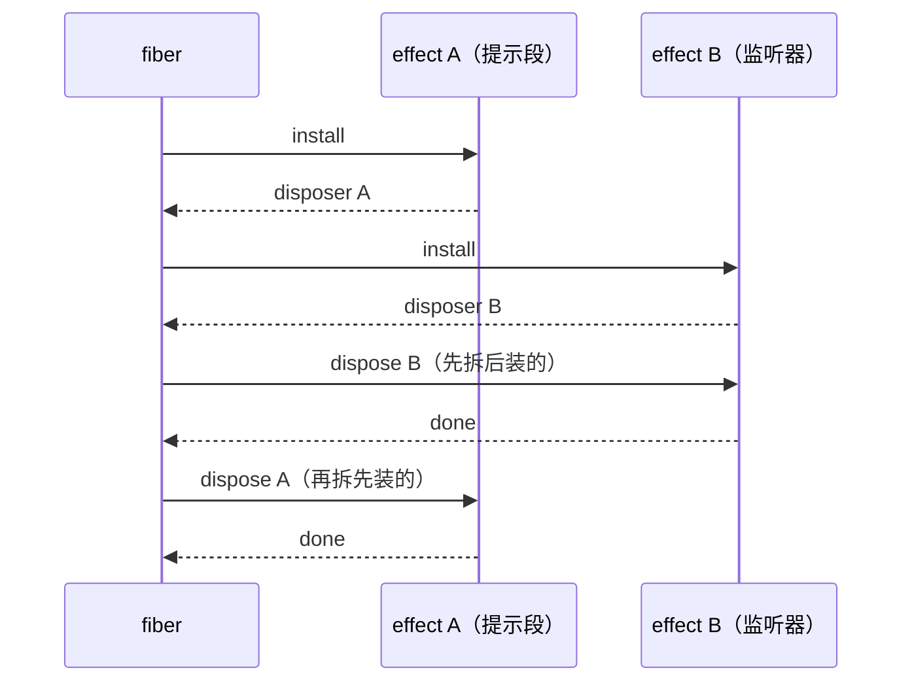

# 16 · 注册是可逆 effect：LIFO disposer 与 HMR-safety

> **一句话结论**：每次注册都返回一个只撤销本次安装的 disposer，fiber 卸载时按 LIFO 逆序执行；精确、逆序、幂等、可等待四条性质合起来，才让「热重载后世界还是原来那个世界」成为结构保证。
>
> **对照缺陷：P3（卸载后幽灵注册）**，附带回应 P2（模板字符串提示段无法卸载）。
>
> **本课修的是哪个 MVP 缺陷**：MVP 的 `uninstallNaive()` 什么都不做，`--stage 4` 显示卸载前提示段=2、卸载后仍是 2（期望回到 1），且仍含 `EXTRA` 段=true。
>
> **前置**：[15 · `inject` 依赖门控](/ai/harness/15-inject-dependency-gating)｜**总览**：[`/ai/harness/`](/ai/harness/)｜**下一课**：[17 · Typed Events 与 waterfall](/ai/harness/17-typed-events-waterfall)

## 本课要回答的问题

第 14 课解决了「服务怎么挂上去」，第 15 课解决了「什么时候挂」。本课问的是反方向：**怎么干净地拆下来？**

MVP 的答案是一个笑话：

```js
function uninstallNaive() {
  // TODO
}
```

它什么都不做，于是出现了 Part I 最典型的一类 bug：**卸载后提示段仍是 2**。表面上「插件已经卸载」，实际上系统里还留着它的痕迹。原文把这种现象叫**幽灵注册**（P3）。

幽灵注册的麻烦在于它不会立刻报错。系统继续跑，只是：

- 提示里多了一段不该存在的内容，token 变多、模型被无关指令干扰；
- 监听器还在，一次工具调用被处理两遍；
- 测试之间互相污染，第二个用例看到第一个用例留下的状态；
- 热重载一次多一份，十次之后没人说得清哪份是当前的。

所以本课的问题是：**一个「能精确撤销自己」的注册机制，最少需要哪些性质？** 答案不是「写一个 uninstall 函数」——MVP 已经证明那不够；我们要的是一组**性质**，让「忘记卸载」在结构上不可能发生。

## 核心原理

### 先看没有可逆注册的世界

不可逆的注册本质上是**单向写入**：`install()` 往全局数组 push 一段，却没有对应的 `uninstall()` 操作。它的失效模式随使用场景放大：

| 场景 | 不可逆注册的后果 |
|---|---|
| 热重载 | 每次 install 叠加一份，提示段 2→3→4 |
| 测试隔离 | 用例之间共享残留监听器，顺序一变结果就变 |
| subagent | 子代理卸载后，它的工具仍留在全局表里 |
| 权限临时提升 | 提权容易，降权时策略还挂着 |

四种场景共同说明：**卸载不是热重载的附属功能，而是作用域生命周期的一部分**。

### 注册 = 安装 + 精确 disposer

Cordis 的模型是：每次注册返回一个函数，调用它只撤销**本次安装**。插件卸载时，fiber 按 **LIFO 逆序**执行所有 disposer。



顺序反过来会怎样？如果 A 是「服务」，B 是「依赖该服务的监听器」，先拆 A 就会让 B 在拆除过程中访问一个已经不存在的服务。LIFO 的直觉就是：**先拆上层，再拆底座**。

### 四个必要性质

| 性质 | 为什么 |
|---|---|
| 精确 | 只删自己加的那一段/那一个监听，不误删别人的 |
| 逆序 | 后注册的可能依赖先注册的，逆序才不会在依赖还在时先拆底座 |
| 幂等 | 重复 dispose 不能抛错或二次删除 |
| 可等待 | 异步清理（关闭连接、flush）必须能被 await，否则卸载「完成」后资源还在 |

这四条不是「最佳实践清单」，而是**缺一条就有具体故障**：

- 缺精确 → 用 `splice(index, 1)` 时索引被别的插件增删挪动，删错对象；
- 缺逆序 → 拆到一半依赖消失，清理逻辑抛异常；
- 缺幂等 → 卸载被调用两次（热重载 + 显式卸载），第二次抛错或删掉新装的那份；
- 缺可等待 → `await unload()` 返回后，异步 flush 还在跑，下一次 install 与它竞态。

这四条性质合起来才是「可逆」：少一条，卸载就只是「看起来完成了」。

### HMR-safety：为什么只测「安装后有几个」不够

热重载会连续执行 **install → dispose → install**。如果注册不可逆，第二次 install 后系统里会有**两份**提示段、**两个**监听器——这正是 MVP `stage4()` 的 `EXTRA` 段阴魂不散。

很多人的测试是「安装插件 → 断言提示段数量 = 2 → 通过」。这个测试在不可逆的情况下**也会通过**，因为它只观察了安装后的状态。正确的测试策略是：

1. 装 → 断言基线；
2. 卸 → 断言回到安装前（数量与内容都要对上）；
3. 再装 → 断言与第一次完全一致。

而且断言的对象不能只是插件的自报告，必须是**世界状态**。这就是 `docs/testing.md` 里 `## Verify the world, not the self-report` 的含义：插件说「我卸载了」不算数，要去看提示段数组、监听器表、服务注册表里实际还剩什么。

`## Test the real entry path` 补上另一半：测试要走真实入口，而不是绕过装配直接调内部函数——否则你测的是「函数能跑」，不是「插件能被装卸」。`## Tiers` 则说明不同层级的测试各测什么，避免用 E2E 去覆盖本该单元测试的性质。

### 作用域：卸载即整体回滚

有了可逆注册，作用域就有了清晰的语义：子代理拥有自己的 Context/fiber，卸载即整体回滚；临时会话结束，它的注册随 fiber 一起消失；测试用例结束，不需要手动清理全局状态。

这意味着**隔离不靠「记得清理」，而靠「作用域销毁」**。这是插件市场与测试隔离的前提——你无法信任第三方插件都记得清理，但你可以信任作用域生命周期。

## dsh 源码精读

### `vendor/cordis/src/fiber.ts:440-468`：本课最重要的一段源码

```ts
effect(execute: () => Effect, label = 'anonymous'): any {
  this.assertActive()
  if (this.state === FiberState.UNLOADING) {
    throw new CordisError('INACTIVE_EFFECT')
  }
  const disposables: Disposable[] = []
  let disposing = false
  let disposalTask: void | Promise<void>
  const dispose = () => {
    if (disposing) return disposalTask              // ① 幂等
    disposing = true
    let task!: void | Promise<void>
    for (const disposable of disposables.splice(0).reverse()) {   // ② LIFO
      if (task) {
        task = task.then(() => runDisposable(disposable))          // ③ 可等待
      } else {
        const result = runDisposable(disposable)
        if (isObject(result) && 'then' in result) {
          task = result as any
        }
      }
    }
```

逐段解读：

- **开头的 `assertActive()` 与 `UNLOADING` 检查**：卸载过程中不再接受新注册，否则新装的会永远留在那儿（fiber 已经不会再执行第二轮清理）。`INACTIVE_EFFECT` 比静默接受更安全——它立刻告诉你「这个时机不能注册」。
- **`disposables` 数组**：每次 effect 内部可以产生多个 disposer（例如一个提示段加一个监听器），它们被收集在同一个数组里，共享同一次卸载。
- **`splice(0).reverse()`**：先清空原数组再逆序，三重作用——取出后数组为空（防重复执行）、逆序（LIFO）、不边遍历边修改。这一行同时服务「精确」与「逆序」。
- **`if (disposing) return disposalTask`**：已经进入清理流程就直接返回同一个 Promise。这是幂等的实现，也保证第二次调用能 await 到第一次的结果。
- **`task.then(() => runDisposable(...))`**：前一个 disposer 返回 Promise 时，把后续串成链。清理是**串行**的，不是并发 `Promise.all`——因为后注册的可能依赖先注册的，并发会破坏顺序。

原文用三行注释标出了三性质，并补了一句：`assertActive()` 与 `UNLOADING` 检查保证「卸载过程中不再接受新注册」。这句话对应第四条性质的边界情形。

### `packages/core/tools/src/index.ts:384`：effect 的真实消费者

```ts
guard(guard: ToolGuard): () => void {
  return this.guards.effect(this.ctx, layer => layer.guards.append(guard),
                            { label: 'tools.guard()' })
}
```

这段代码有三处值得看：

- **返回 `() => void`**：调用方拿到的是 disposer，不是一个「已注册」的布尔值。卸载能力被显式交到调用方手里。
- **`this.guards.effect(...)`**：guard 不是直接 `push` 进数组，而是包在 effect 里。于是它自动获得 LIFO、幂等、可等待，以及「fiber 卸载即回滚」。
- **`{ label: 'tools.guard()' }`**：effect 带标签，用于诊断（`getEffects()` 能告诉你每个注册是谁装的）。这是间接性的一点点补偿。

原文的判词是：**连安全策略的注册也是可逆的**，但它的效果单调（第 18 课）。这两句话不矛盾——「可逆」说的是注册动作能被撤销，「单调」说的是在生效期间多个 guard 只能让结果更严。第 18 课会展开。

### `docs/testing.md`：HMR-safety 的方法论锚点

| 章节 | 读什么 |
|---|---|
| `## Verify the world, not the self-report` | 断言世界状态，不信插件的自报告 |
| `## Test the real entry path` | 走真实装配入口，不绕过插件机制 |
| `## Tiers` | 分层测试：哪些性质该在哪一层验证 |

这三节合起来回答了「怎么写一个能抓住幽灵注册的测试」。注意它们都在讲**方法**，而不是某个具体断言——因为幽灵注册的形态会变（提示段、监听器、工具 schema），方法不会变。

## 权衡与失效模式

- **每个注册都要包一层 effect**：比起直接 `array.push` 有开销与写法约束，但它把「卸载正确性」从约定变成结构。这是用一点样板代码换一整类 bug 的消失。
- **忘记返回/保存 disposer**：等于退回 MVP 的 `uninstallNaive()`。静态门禁会检查导出契约（第 24 课）——也就是说这类错误最终会被 CI 抓住，而不是靠 review。
- **异步清理未 await**：disposer 返回 Promise，调用方不等就继续，会出现「卸载完成后连接还在写」的竞态。代码上 `await` 一下就解决，难的是意识到清理可能是异步的。
- **卸载中注册**：`INACTIVE_EFFECT` 直接抛错，比静默留下幽灵好。但它也意味着插件的卸载逻辑不能「顺手再注册一个清理回调」——清理必须在安装阶段就安排好。

## 四层定位

| 层 | 内容 |
|---|---|
| Prompt | 提示段的注册/卸载（第 20 课） |
| Context | 上下文来源的注册/卸载 |
| Loop | 事件监听器的注册/卸载（第 17 课） |
| Harness | 本课本体：fiber / effect / 作用域生命周期 |

四层里都有「注册」，而它们共享同一套 effect 机制。这正是第 13 课那条因果链的最后一环：**所有挂载都可撤销**，不只是工具。

## 动手实验

```bash
cd /Users/cheeka/code/deepseek-harness
sed -n '440,470p' vendor/cordis/src/fiber.ts
sed -n '380,392p' packages/core/tools/src/index.ts
sed -n '27,42p' docs/testing.md

# 回看反面证据
node /Users/cheeka/code/deepseek-harness/dsh-agent-course/mvp/harness-mvp.mjs --stage 4
```

**预期观察**：

1. `fiber.ts` 的 440–470 行应覆盖 `effect` 的开头、`assertActive`、`UNLOADING` 检查、`dispose` 闭包与 `splice(0).reverse()`。重点确认三个注释标记（① 幂等 / ② LIFO / ③ 可等待）都能对上代码行。
2. `index.ts` 的 380–392 行应输出 `guard()` 的 JSDoc 与实现，返回值类型是 `() => void`。把这段和第 18 课要讲的「单调」放在一起看，才能理解为什么「可逆」与「不可放宽」能共存。
3. `docs/testing.md` 的 27–42 行应能看到 `Verify the world`、`Test the real entry path`、`Tiers` 这几节的标题或正文。读的时候想一件事：如果只测「安装后数量」，哪个幽灵注册会漏过去？
4. `--stage 4` 的输出里找「卸载前提示段=2」「卸载后=2」「仍含 `EXTRA` 段=true」。这三句就是本课要消灭的现场；注意它同时是 P3 的验收证据。

**对照练习**：把 Part I 第 12 课练习 A 写的「精确 disposer」与 `fiber.ts` 的实现逐条对照，列出你的实现缺了哪几条性质。原文的判断是：多数人会缺「可等待」与「UNLOADING 拒绝新注册」——因为这两条只在异步或重入场景才暴露。

## 常见误区

- **误区：「disposer 就是 `splice(index, 1)`」**。索引会因其他插件增删而失效，必须持有精确句柄。用下标删除的本质是「记住位置」，而位置不是稳定的身份。
- **误区：「卸载只在热重载才需要」**。测试隔离、子代理作用域、权限临时提升都依赖它。热重载只是最容易观察到幽灵的场景。
- **误区：「只要写了 dispose 就安全」**。如果 dispose 不精确（删多了/删少了）、不幂等（第二次抛错）、不可等待（异步清理没等人），幽灵照样存在，只是换了个形态。

## 本课小结

1. 注册 = 安装 + 精确 disposer；卸载按 LIFO 逆序执行，先拆上层再拆底座。
2. 四条性质缺一不可：精确、逆序、幂等、可等待，每条都对应一种具体故障。
3. HMR-safety 的测试是「装 → 卸 → 再装」，断言世界状态而不是插件的自报告。
4. 作用域让「卸载即整体回滚」，隔离不靠记得清理，而靠生命周期。
5. `guard()` 也是 effect 的消费者：注册可逆，但效果单调——两件事不矛盾。

| 性质 | 代码位置（`fiber.ts`） | 防住的故障 |
|---|---|---|
| 精确 | 每次 effect 独立的 `disposables` 数组 | 删错别人的注册 |
| 逆序 | `splice(0).reverse()` | 先拆底座导致依赖缺失 |
| 幂等 | `if (disposing) return disposalTask` | 重复卸载抛错 |
| 可等待 | `task.then(...)` 串行链 | 异步清理未完成就返回 |
| 拒绝新注册 | `assertActive()` + `UNLOADING` | 卸载中注册留下永久幽灵 |

## 自测

**1. 能指出 `fiber.ts` 里 LIFO、幂等、可等待三处分别在哪几行吗？**

<details><summary>参考答案</summary>

在原文标注的 `fiber.ts:440-468` 段落内：LIFO 在 `for (const disposable of disposables.splice(0).reverse())`；幂等在 `if (disposing) return disposalTask`；可等待在 `task = task.then(() => runDisposable(disposable))` 以及 `return disposalTask = task`。

</details>

**2. 写出 HMR-safety 测试的三步，并说明为什么「只测安装后数量」不够。**

<details><summary>参考答案</summary>

三步：安装并断言基线；卸载并断言回到安装前（数量与内容）；再安装并断言与第一次一致。只测安装后数量时，不可逆的注册在第一次安装后也能通过，第二次安装才会暴露两份，而测试根本没跑到那一步。

</details>

**3. `INACTIVE_EFFECT` 为什么比静默接受更安全？**

<details><summary>参考答案</summary>

fiber 进入卸载流程后不会再执行第二轮清理，此时新注册的 effect 没有任何机会被撤销，会永久留在系统里。抛错让调用方立刻发现时机错误，而不是留下一个无法归因的幽灵。

</details>

**4. `guard()` 返回 disposer，与「guard 单调」矛盾吗？**

<details><summary>参考答案</summary>

不矛盾。「可逆」指注册动作可以被撤销——卸载插件时 guard 会消失；「单调」指它生效期间，多个 guard 的合并只会让结果更严，取第一个 denial。一个说的是生命周期，一个说的是求值语义。

</details>

## 缺陷闭环与下一课

- **P3 → `effect()`**。MVP 证据：`--stage 4`「卸载前提示段=2，卸载后=2（期望回到 1）」「仍含 `EXTRA` 段=true」。本课修法：每次注册自带精确 disposer，fiber 卸载时 LIFO 逆序回滚；再加 HMR-safety 回归测试，把「靠人记得」变成「结构与 CI 保证」。还留下：导出契约的静态检查，交给 [第 24 课](/ai/harness/24-invariants-and-regression)。
- **P2 → 可逆注册是前提**。提示段之所以能「覆盖/卸载」，前提就是注册可逆；具体的提示段装配与 `assemble()` 在 [第 20 课](/ai/harness/20-prompt-sections-and-adapter) 展开。
- **对第 15 课的呼应**：inject 让插件「等依赖齐了再装」，effect 让插件「装上去的都能拆」。两者合起来，插件生命周期才闭环。

下一课转向「可组合」：[17 · Typed Events 与 waterfall](/ai/harness/17-typed-events-waterfall)。它要解释为什么监听器也能享受本课的 effect 机制，以及为什么「可组合」不等于「安全」。
