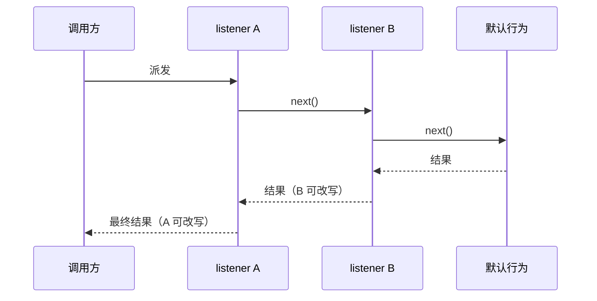

# 17 · Typed Events 与 waterfall：让策略可组合

> **一句话结论**：事件用 TypeScript 声明合并变成有类型的契约，五种派发模式让策略以监听器形式挂载；但 waterfall 的「后者可改写前者」只适合可协商策略，安全必须交给单调 guard。
>
> **对照缺陷：P1（控制流焊死主循环，加一条策略改多处）**，并留下 P8（deny 被覆盖）的伏笔。
>
> **本课修的是哪个 MVP 缺陷**：MVP `--stage 3` 里新增一条策略需要改动 3 处——主循环的 `if`、`handlers` 数组、策略快照。
>
> **前置**：[16 · 注册是可逆 effect](/ai/harness/16-reversible-effect)｜**总览**：[`/ai/harness/`](/ai/harness/)｜**下一课**：[18 · 工具执行四段管线与单调 guard](/ai/harness/18-tool-pipeline-guard)

## 本课要回答的问题

第 14–16 课把「服务」这一侧收拾干净了：有稳定 key、能等依赖、能干净卸载。但还有一半没解决——**行为挂在哪里？**

MVP 的答案是把策略直接写进主循环：

- 想加「只读保护」？在主循环里加一个 `if`；
- 想加「自动批准」？在 `handlers` 数组里加一项；
- 想让策略可观测？再更新一次策略快照。

于是「加一条策略」变成一次**三处联动修改**。更糟的是，这三处的正确性互相依赖：`handlers` 的顺序决定谁先看到调用，主循环的 `if` 可能在数组之前就短路，快照还得跟着维护。

这正是 P1 的具体形态：**控制流焊死，扩展点不存在**。

所以本课的问题是：**怎样让「加策略」变成「在旁边挂一个监听器」，而且挂上去的东西有类型、可卸载、不动机主循环？**

注意问题里有三个要求，缺一不可：

- **在旁边挂**：不改主循环；
- **有类型**：事件名、参数、返回值都能被编译器检查；
- **可卸载**：挂上去的监听器能随插件一起消失（第 16 课已经打好基础）。

## 核心原理

### 先看没有类型化事件的世界

没有事件机制时，扩展只能靠两种土办法：

1. **回调字段**：`options.onBeforeTool = fn`。只有一个消费者，第二个插件想挂就得覆盖第一个。
2. **字符串事件 + any**：`bus.on('tool:before', (x) => ...)`。能挂多个，但 `x` 是什么、返回什么、谁负责继续，全靠约定。

第二种看起来像本课要的东西，但它缺三样：

- 事件名拼错不报错，运行时静默不触发；
- payload 结构靠文档，改字段时编译器帮不上忙；
- 没有「派发语义」的概念——广播？串行？谁能让流程停下？全靠实现者猜。

Cordis 的 typed events 就是把这三点补上：**事件表是全局类型的一部分，派发模式是类型注解的一部分**。

### 声明合并：给全局事件表加一行

插件通过 TS 声明合并往事件表里加事件：

```ts
declare module '@deepseek-ai/cordis' {
  interface Events {
    'tools/pre-execute'(...): Promise<PreToolDecision>
  }
}
```

效果是：

- 事件名成为 `Events` 接口的 key，拼错直接编译失败；
- 参数与返回类型写在同一处，生产者和消费者共享；
- `@mode waterfall` 这类 JSDoc 标注把「派发语义」也写在事件定义旁边。

于是扩展点从「约定好的字符串」升级为**有类型的契约**。这个区别在多人协作时尤其明显：新同学不需要读主循环，读事件声明就知道能在哪个阶段介入、必须返回什么。

### 五种派发模式

原文的 `docs/cordis-primer.md` §Dispatch Modes 给了五种模式：

| 模式 | 语义 | 适用 |
|---|---|---|
| `emit` | 广播，无返回 | 遥测、UI 观察、审计 |
| `waterfall` | 链式委托，**必须 `next()` 才继续** | 策略叠加、改写、准入 |
| `parallel` | 并发收集结果 | 多提供者投票、批量检查 |
| `serial` | 顺序累积 | 有状态折叠 |
| `bail` | 首个非 undefined 结果短路 | 查找第一个能处理的 handler |

### waterfall：策略叠加的主力

waterfall 的语义是链式委托：



把它读成「洋葱」更直观：每个监听器包住后面的整条链，`next()` 是「进入内层」，返回之后还能改内层的结果。这就是 around 语义——A 既能在调用前决定是否放行，也能在调用后修饰结果。也正因如此，**不调 `next()` 就等于截断链**，这是最强大也最危险的能力：

- 强大：可以实现「拒绝进入 step」——后面的监听器和默认行为都不会执行；
- 危险：如果本意是「观察一下再继续」却忘了 `next()`，工具不执行也不报错，行为静默丢失。

`docs/cordis-primer.md` 专设 §Cordis Waterfall Semantics 讲这件事，原因就在这里：**它不是 API 细节，而是正确性边界**。

### 为什么这回答 P1

把 MVP 的策略翻译成监听器，差异立刻显现：

| 维度 | MVP | typed events + waterfall |
|---|---|---|
| 新增策略 | 改主循环 + 数组 + 快照 | 写一个插件，挂监听器 |
| 顺序 | 数组下标 | 注册顺序与作用域 |
| 卸载 | 手动从数组删 | effect 自动回滚（16 课） |
| 类型 | 无 | 事件声明合并 |
| 主循环 | 每加一条改一次 | 零改动 |

原文的判词是：**主循环本体不需要改一行**。这是 P1 的验收标准——如果加策略还要动主循环，就说明扩展点没做对。

### 三类事件域必须分清

原文特别提醒，事件不是只有一种：

| 事件域 | 例子 | 特征 |
|---|---|---|
| 持久 session 事件 | 会话日志里的事件 | 能从日志重建请求 |
| 运行时策略事件 | `tools/*`、`agent/*` | 影响单次执行，需可观测 |
| 瞬时 UI / 遥测事件 | 进度、渲染通知 | 不进模型历史 |

混用会破坏「模型可见即可重建」（第 21 课）。举个具体的错误：把 UI 的「正在输入」通知写进 session 事件流，日志里就会出现模型从未见过的内容，重建请求时无法判断它该不该进上下文。**事件的持久性是一个设计决定，不是实现细节**。

## dsh 源码精读

### `packages/core/tools/src/events.ts:1-40`：真实声明合并的范本

```ts
declare module '@deepseek-ai/cordis' {
  interface Events {
    /**
     * Allow, deny, cancel, or ask before dispatch. `next()` delegates to allow;
     * `cancel` selects the canonical pre-dispatch cancellation result, and missing
     * approval support turns `ask` into denial. Async gates must observe
     * `exec.signal`; ...
     * @mode waterfall
     */
    'tools/pre-execute'(this: Scoped<ToolsService>, exec: ToolExecution,
                        next: () => Promise<PreToolDecision>): Promise<PreToolDecision>
    /** Around-dispatch waterfall for timeout, retry, or metrics. ... @mode waterfall */
    'tools/execute'(...)
    /** Accept, replace, enrich, or block a normalized dispatch result. ... @mode waterfall */
```

这段代码的信息密度很高，按顺序拆：

- **`declare module` + `interface Events`**：这就是声明合并的语法形态。插件不需要改核心包，只要在自己的模块里声明，事件表就扩展了。
- **`this: Scoped<ToolsService>`**：监听器的 `this` 也被类型化，并且带作用域约束——不是随便什么 context 都能挂。
- **`next: () => Promise<PreToolDecision>`**：`next` 的签名直接告诉你「继续」会得到什么。这是 waterfall 可组合的类型基础。
- **`@mode waterfall`**：派发语义写在事件定义旁边，读声明就知道该怎么实现。

注释里还有三条纪律，原文要求逐字读：

1. **`next()` 委托给 allow**：不调 `next()` 不是「默认继续」，而是「不继续」。默认行为藏在链的末端，只有走到那里才会 allow。
2. **缺审批服务时 `ask → denial`**：这是 fail-closed。没有能力做审批时，不能假装批准。
3. **异步门必须观察 `exec.signal`**：取消要能传播（第 11 课的取消语义）。一个 await 很久的监听器如果不看 signal，会让取消失效。

### `docs/cordis-primer.md` 的两个章节

| 章节 | 行 | 读什么 |
|---|---|---|
| `## Dispatch Modes` | 15 | 五种模式的语义与适用场景 |
| `## Cordis Waterfall Semantics` | 29 | `next()` 的委托、截断、around 语义 |

第 29 行那节是本课的核心。读的时候带着一个问题：**如果两个监听器对同一件事给出相反意见，谁赢？** 答案取决于派发模式——waterfall 里是「后面的能看到前面的，并可能改写」；这正是它适合策略叠加、却不适合安全的原因。

### 三类事件域的落地位置

`events.ts` 里能看到 `tools/pre-execute`、`tools/execute`、`tools/post-execute`、`tools/result`、`tools/change` 等事件。它们都属于**运行时策略事件**：影响一次执行，需要可观测，但不直接写进模型历史。真正的 session 事件在 `packages/core/session` 一侧，UI 通知又在另一侧。读源码时先问「这个事件属于哪一类」，比记住名字更有用。

## 权衡与失效模式

- **忘记 `next()`**：链被静默截断，工具不执行也不报错。这是 waterfall 最典型的线上事故，需要回归用例专测。测试写法很直接：挂一个只观察的监听器，断言默认行为确实发生。
- **监听器顺序仍重要**：waterfall 能组合策略，但不能让**安全**依赖顺序。两个监听器一个 allow 一个 deny，谁在后面谁赢——所以硬策略走单调 guard（第 18 课），不走 waterfall。
- **类型声明合并的代价**：事件表是全局的，命名冲突与破坏性变更要更新所有 consumer。这是 pre-stable 阶段的现实成本，也是为什么事件名通常带命名空间前缀（`tools/`、`agent/`）。
- **过度事件化**：不是所有调用都该变成事件。事件适合「多个未知插件可能介入」的扩展点；一对一的内部调用用事件只会增加间接性。

## 四层定位

| 层 | 内容 |
|---|---|
| Loop | `agent/pre-step` waterfall 是跨层策略统一挂载点（第 22 课） |
| Prompt | `assemble()` 本身也是 waterfall，允许改写提示段（第 20 课） |
| Context | 压缩在 pre-step 判压，是 Loop × Context 的交界 |
| Harness | 本课本体：事件总线与生命周期 |

这张表说明事件机制不止服务工具：提示装配、主循环、压缩判断都通过同一套派发模式扩展。学会一种，四处通用。

## 动手实验

```bash
cd /Users/cheeka/code/deepseek-harness
sed -n '1,45p' packages/core/tools/src/events.ts
sed -n '15,45p' docs/cordis-primer.md
grep -rn "@mode waterfall" packages/core/ | head -20
```

**预期观察**：

1. `events.ts` 的 1–45 行应覆盖至少三个 `@mode waterfall` 事件（`tools/pre-execute`、`tools/execute`、`tools/post-execute`）和它们的 JSDoc。重点读 `tools/pre-execute` 那段注释，确认 `next()`、`ask → denial`、`exec.signal` 三处都能找到。
2. `docs/cordis-primer.md` 的 15–45 行应包含 `## Dispatch Modes` 与 `## Cordis Waterfall Semantics` 两节。如果只看到模式表就结束，说明没读到 29 行那节——而那节才是本课的重点。
3. `grep -rn "@mode waterfall" packages/core/` 会列出所有 waterfall 事件。数一数有多少，再想想：为什么它们大多集中在「准入门」「执行包裹」「结果修饰」这三类位置？

**思考实验**：把 MVP `stage3()` 的两个 handler 改写成两个 `tools/pre-execute` 监听器，且 `readOnlyGuard` 不调 `next()`。写出结果，再回答：如果后来又装了一个插件在它前面调了 `next()` 并给出 `allow`，安全会怎样？

提示：这正是第 18 课要解决的问题——**waterfall 不适合承载硬策略**。因为 waterfall 的语义是「链」，而链上任何一个环节都可能改写结果；安全需要的是「无论链上发生什么，deny 都不会被放宽」。

## 常见误区

- **误区：「事件总线就是解耦，越用越好」**。广播式事件无法表达「必须被处理的策略」，也没有类型化的结果。把关键控制流交给 `emit`，等于放弃了「谁负责」这个问题。
- **误区：「所有策略都能 waterfall」**。安全策略要单调（第 18 课）。waterfall 允许后者覆盖前者，这在策略叠加时是优点，在权限判断时是漏洞。
- **误区：「不调 `next()` 等于放行」**。恰恰相反，不调 `next()` 等于截断——默认行为在链的末端，不走过去就不会发生。这个反直觉点是许多事故的根源。

## 本课小结

1. typed events 通过声明合并把扩展点变成有类型的契约，事件名、参数、返回都可编译期检查。
2. 五种派发模式各有语义：`emit` 广播、`waterfall` 链式委托、`parallel` 并发收集、`serial` 顺序累积、`bail` 首个结果短路。
3. waterfall 是策略叠加的主力，`next()` 前后都能改写（around 语义）；不调 `next()` 即截断链。
4. 它解决了 P1：新增策略 = 挂一个监听器，主循环零改动；卸载由第 16 课的 effect 保证。
5. 但它留下了 P8：后者可以覆盖前者，所以安全策略必须走单调 guard。

| 派发模式 | 有无返回值 | 能否截断 | 典型用途 |
|---|---|---|---|
| `emit` | 无 | 不适用 | 遥测、UI、审计 |
| `waterfall` | 有 | 能（不调 `next()`） | 准入、改写、包裹 |
| `parallel` | 收集 | 不能 | 投票、批量检查 |
| `serial` | 累积 | 不能 | 有状态折叠 |
| `bail` | 单个 | 短路 | 查找首个处理者 |

## 自测

**1. 列出五种派发模式并各给一个适用场景。**

<details><summary>参考答案</summary>

`emit`：审计日志广播；`waterfall`：工具执行前的准入与结果改写；`parallel`：多个提供者对同一问题投票；`serial`：按顺序累积统计；`bail`：查找第一个能处理该请求的 handler。

</details>

**2. 解释「不调 `next()`」的两面性，并说出一条针对它的回归测试。**

<details><summary>参考答案</summary>

它既能实现「拒绝进入后续流程」（强大），也会因忘记调用而让默认行为静默丢失（危险）。回归测试：挂一个只调 `next()` 的观察者，断言默认行为确实发生；再挂一个不调 `next()` 的监听器，断言后续监听器与默认行为都未执行。

</details>

**3. 从 `events.ts` 注释里找出 `ask` 的 fail-closed 规则与异步门纪律。**

<details><summary>参考答案</summary>

缺审批支持时 `ask` 变成 denial（`missing approval support turns ask into denial`），而不是默认放行；异步门必须观察 `exec.signal`，让取消能传播，注册表在其 settle 后还会复查取消状态。

</details>

**4. 为什么 waterfall 解决了 P1 却不能单独解决 P8？**

<details><summary>参考答案</summary>

waterfall 让策略成为可挂载的监听器，新增策略不用改主循环（P1）。但它的语义允许后面的监听器看到并改写前面的结果，一个 allow 可以洗掉前面的 deny，于是安全取决于加载顺序（P8）。需要第 18 课的单调 guard 在语义上封死覆盖。

</details>

## 缺陷闭环与下一课

- **P1 → typed events + waterfall**。MVP 证据：`--stage 3`「新增一条策略需改动 3 处」。本课修法：策略变成独立监听器，新增一条 = 挂一个插件，主循环零改动；第 16 课的 effect 保证可卸载；第 22 课的 `agent/pre-step` 给出统一的跨层挂载点。还留下：谁来保证「策略必须被尊重」，交给第 18 课。
- **P8 的伏笔 → 单调 guard**。MVP 证据：`--stage 3` 中 `readOnlyGuard` 的 deny 被 `autoApprove` 的 allow 洗掉。本课的错误修法是「把安全也写成 waterfall 监听器」——那只会把顺序问题藏得更深。正确修法在 [第 18 课](/ai/harness/18-tool-pipeline-guard)。
- **留给第 20 课**：`assemble()` 本身也是 waterfall，提示段可以被改写；那节课会处理「可改写」与「可重建」的关系。
- **留给第 21 课**：三类事件域的边界，最终由「模型可见即可重建」这条不变量裁定。

下一课是 Part II-A 的收口：[18 · 工具执行四段管线与单调 guard](/ai/harness/18-tool-pipeline-guard)。它把本课的 waterfall 与一条不可协商的安全线放进同一个管线，回答「任何插件、任何顺序都无法放宽一个 deny」。
