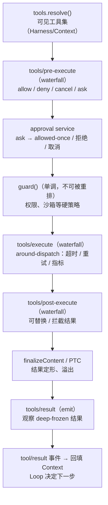

# 18 · 工具执行四段管线与单调 guard

> **一句话结论**：管线把「可协商策略」交给 waterfall、把「不可覆盖的硬策略」交给 guard；guard 取第一个 denial，且位于审批之后、dispatch 之前，所以任何插件、任何顺序都无法放宽一个 deny。
>
> **对照缺陷：P1（策略焊死）、P8（deny 被覆盖，越权写入成功）**。
>
> **本课修的是哪个 MVP 缺陷**：MVP `stage3()` 让 `readOnlyGuard → deny` 被 `autoApprove → allow` 洗掉，`report.txt` 被写成——安全取决于策略在数组里的先后。
>
> **前置**：[17 · Typed Events 与 waterfall](/ai/harness/17-typed-events-waterfall)｜**总览**：[`/ai/harness/`](/ai/harness/)｜**下一课**：[19 · 能力缝隙三角色](/ai/harness/19-capability-seams)

## 本课要回答的问题

第 17 课把策略变成了监听器，解决了 P1。但它顺手制造了一个更隐蔽的问题。

MVP `stage3()` 里有两个 handler：

- `readOnlyGuard`：看到写操作就 `deny`；
- `autoApprove`：看到任何调用就 `allow`。

数组顺序是 `[readOnlyGuard, autoApprove]` 时，第二个把第一个的结论洗掉了，最终决策是 `allow`，`report.txt` 被成功写入。第 10 课的练习用 10 种随机顺序验收过这件事：**只要有一种顺序能让 deny 失效，安全边界就不成立**。

有人会说「那把 `readOnlyGuard` 放最后不就行了」。这恰恰是最危险的修法——它把安全寄托在「没有人改动加载顺序」上。在多插件、插件市场的环境里，这个前提必然被打破。

所以本课的问题是：**工业管线怎样保证「任何插件、任何顺序都无法放宽一个 deny」？**

注意措辞：不是「默认顺序下安全」，也不是「经过评审后安全」，而是**任何顺序**。这是一个语义层面的要求，不是配置层面的约定。

## 核心原理

### 先看没有单调 guard 的世界

如果所有策略都是 waterfall，那么安全就等价于「最后一个说话的人」：`pre-execute` 链上 `guard(deny)` 之后来了个 `autoApprove(allow)`，结果就是 allow。

链本身没有错——它就是为「可协商」设计的。错的是把**不可协商的东西**放进了可协商的通道。后果是：

- 安全强度取决于插件加载顺序；
- 一个恶意或粗心的插件，只要挂在后面并返回 allow，就能解除前面的 deny；
- 审计时无法证明「没有任何路径能绕过」，因为路径数量随插件组合爆炸。

所以需要一条**不同语义**的通道：它不是「链上的一环」，而是「所有环之后的一道闸」。

### 四段管线

依据 `docs/tool-execution-pipeline.md`，一次工具调用要经过这些阶段：



把它读成「四段」：**准入**（`tools.resolve()` → `pre-execute`，可协商）、**审批**（一次性的外部确认）、**硬闸**（`guard()`，单调不可覆盖）、**执行与结算**（`execute` → `post-execute` → 定形 → `result`，可协商加观察）。

### 三类策略，语义不同

| 类型 | 派发 | 能否被覆盖 | 适合承载 |
|---|---|---|---|
| 可协商策略 | waterfall | 是（必须 `next()`） | 日志、指标、改写、缓存、教学 hook |
| **单调策略** | guard | **否** | 权限、沙箱、最小权限边界 |
| 观察 | emit | 不适用 | 遥测、UI、审计 |

这张表是本课的核心。它说的不是「guard 更强」，而是**两者回答不同的问题**：

- waterfall 回答「大家对这次调用有什么意见」；
- guard 回答「这次调用是否被允许」。

意见可以协商，许可不能。

### 为什么 guard 必须单调

如果权限检查能被后续插件「协商掉」，安全边界就取决于插件加载顺序——在多插件/插件市场环境里不可接受。

单调的具体含义是：多个 guard 各自独立判断，**只取第一个 denial**；没有任何机制能让一个 denial 变成 allow。于是：

- 加一个 guard，结果只可能更严，不会更松；
- guard 的加载顺序不影响最终结果（第一个 denial 是谁不重要，重要的是「存在 denial」）；
- 安全证明从「枚举所有插件组合」退化为「证明每个 guard 自身正确」。

原文第 10 课的验收方式很能说明问题：用 10 种随机顺序跑同一组 guard，结果必须完全一致。这就是「顺序无关性」的可执行定义。

### 位置：审批之后、dispatch 之前

guard 的位置不是随便挑的，它必须满足两个条件：

1. **在 `pre-execute` 与审批之后**：保证所有改写（参数规范化、审批附加的 allowed-once）都已发生，guard 看到的是最终要执行的东西；
2. **在 dispatch 之前**：保证副作用尚未产生。一旦工具真的跑了，再 deny 就只能事后补救。

用一句话概括：**在最了解意图、又还没动手的时刻检查**。这也解释了为什么「在 execute 里加个检查」不行：那时副作用已经发生，拒绝只是事后声明。

### `ask` 的 fail-closed 语义

`ask` 不是「问一下，默认同意」，而是：

- 经审批服务解析为 `allowed-once` / 拒绝 / 取消；
- **未安装审批服务时 `ask → denial`**（`APPROVAL_UNAVAILABLE`），而不是默认放行。

这是 fail-closed 的标准形态：能力缺失时选择安全的一侧。新手可能觉得「没装审批就拒绝」很困惑，但反过来（没装审批就放行）意味着任何忘记装审批的部署都自动失去保护。

### 错误也必须回填

工具抛异常、被拒绝、被取消，都要产生一条配对的 `tool/result`。原因有两个：

1. **协议合法性**：下一次请求的 messages 里如果有一个没有结果的 tool call，就是非法消息序列，模型 API 会拒绝；
2. **可重建**：日志里缺了结果，就无法回答「当时到底发生了什么」，破坏「模型可见即可重建」。

这条与第 11 课的 `TOOL_OUTCOME_UNKNOWN` 直接相关：当结果不确定时，也要有一个明确的状态，而不是「什么都没有」。**沉默不是结算**。

## dsh 源码精读

### `packages/core/tools/src/index.ts:380-392`：单调 denial 的定义

```ts
/**
 * Register a monotonic denial in the calling scope.
 * @param guard - evaluated after extensible pre-execute policy by the shared pipeline.
 * @returns the effect disposer that removes this guard.
 */
guard(guard: ToolGuard): () => void {
  return this.guards.effect(this.ctx, layer => layer.guards.append(guard),
                            { label: 'tools.guard()' })
}

/**
 * Check global and inherited guards after pre-execute policy and approval resolve.
 * @returns the first denial with its optional structured identity, or undefined when no guard denies.
 */
```

关键词逐字对应原理：

- **`monotonic denial`**：注册的不是「一个检查」，而是「一个拒绝」。语义上它只能让结果更严。
- **`after extensible pre-execute policy`**：位置在可扩展策略之后——所有改写已完成。
- **`first denial`**：取第一个拒绝就返回。这意味着多个 guard 的合并是「或」而不是「后者胜出」。
- **`effect disposer`**：连硬策略的注册也是可逆的（第 16 课），但可逆不影响单调——一个说的是生命周期，一个说的是求值。

第二段注释还补了「after pre-execute policy and approval resolve」，把位置说全了：审批也已完成，guard 看到的是最终形态。

### `packages/core/tools/src/pipeline.ts:1-35`：关注点被收进同一处

```ts
/** Shared tool invocation policy, cancellation, and result settlement. @module */
import { TOOL_ABORTED, TOOL_ABORTED_BEFORE_DISPATCH, ToolNotFoundError, ... } from './contracts.ts'
import { APPROVAL_CANCELLED, APPROVAL_REJECTED, APPROVAL_UNAVAILABLE, ... } from './error-codes.ts'
import { validateJsonSchemaValue } from './json-schema.ts'
```

这三行导入几乎是一份「Part I 遗漏清单」：`TOOL_ABORTED` / `TOOL_ABORTED_BEFORE_DISPATCH` 对应第 11 课的取消与一致性结算；`APPROVAL_CANCELLED` / `APPROVAL_REJECTED` / `APPROVAL_UNAVAILABLE` 对应第 10 课的审批与失败关闭；`validateJsonSchemaValue` 对应第 02 / 05 课的参数校验与结构化输出。

原文的判词是：取消状态、审批错误码、schema 校验、结果结算——正是第 02、05、10、11 课手写时各自漏掉的东西，在这里被收进**同一个共享管线**。

这句话值得多想一层：为什么是「同一个」管线？因为这些关注点互相影响。取消要能打断审批，审批失败要产生结算，schema 校验失败要走同一条错误回填路径。分开实现就会漏掉交叉情况。

### `docs/tool-execution-pipeline.md`

单 H1 的图文混合文档，按文件整体定位。读它的方式是**顺着管线走一遍**，每到一个阶段问三个问题：

1. 这个阶段能看到什么（哪些字段已定、哪些还没）？
2. 它能改变什么（结果、参数、还是只能观察）？
3. 它失败时，结算走哪条路径？

这三个问题比记住阶段名更有用，因为阶段名会随版本变，职责边界不会。

## 权衡与失效模式

- **单调的代价**：guard 一旦 deny 无法被任何插件豁免。临时提权必须走「换作用域/换 profile」，而不是「加个 allow 插件」——这是刻意的不便。可豁免的安全不是安全。
- **waterfall 仍在管线里**：超时、重试、指标、结果定形都是可协商的，别把所有策略都塞进 guard，否则失去组合性。判断标准很简单：**能不能接受「某个插件让它变松」**。
- **ask 与审批缺失**：没装审批服务时静默拒绝可能让新手困惑，但比静默放行正确。困惑可以用诊断信息解决，放行的后果无法撤销。
- **错误回填**：`post-execute` 里抛出的异常也要走结算，否则悬空调用照旧。管线末端必须有一个「无论如何都结算」的兜底。
- **guard 自身写错**：单调只保证「denial 不被放宽」，不保证「该 deny 的都 deny 了」。guard 的判断逻辑仍需测试，且要覆盖 scope 继承。

## 四层定位

| 层 | 内容 |
|---|---|
| Loop | 工具结果是下一步的输入；拒绝/取消也是结果，必须回填 |
| Context | `tool/result` 事件进日志，才能重建请求 |
| Prompt | 可见工具集由 `tools.resolve()` 决定，schema 进提示 |
| Harness | 本课本体：guard、审批、沙箱、结算 |

## 动手实验

```bash
cd /Users/cheeka/code/deepseek-harness
sed -n '378,396p' packages/core/tools/src/index.ts
sed -n '1,35p'    packages/core/tools/src/pipeline.ts
sed -n '1,60p'    docs/tool-execution-pipeline.md | head -60

# 回看反面证据：deny 被 allow 洗掉
node /Users/cheeka/code/deepseek-harness/dsh-agent-course/mvp/harness-mvp.mjs --stage 3
```

**预期观察**：

1. `index.ts` 的 378–396 行应包含 `guard()` 实现与 `checkGuards` 的 JSDoc。重点读 `monotonic denial`、`after extensible pre-execute policy`、`first denial`、`effect disposer` 四个短语——它们就是本课的四条原理在源码里的落点。
2. `pipeline.ts` 的 1–35 行应看到取消、审批错误码、schema 校验三组导入，以及 `ToolExecutionSource`、`ScheduledToolPreparation` 等类型。试着把每个导入映射回 Part I 的某一课。
3. `docs/tool-execution-pipeline.md` 的前 60 行应给出管线全貌。读的时候用「能看到什么 / 能改变什么 / 失败走哪条路」三问过一遍每个阶段。
4. `--stage 3` 的输出里找「最终决策=allow（期望 deny）」和「`report.txt` 存在=true（期望 false）」。这两句是本课的反面证据，也是 P8 的验收现场。

**对照练习**：把 Part I 第 10 课练习里的「单调合并」与 `guard()` 的实现对比。你的版本是「遍历时只收紧」，dsh 的版本是「注册成 monotonic denial + 取第一个 denial + 放在审批之后 dispatch 之前」。列出 dsh 多做的三件事，并说明各自防住了什么：

- **注册成 monotonic denial**：防住「guard 被当成普通策略改写」；
- **取第一个 denial**：防住「多个 guard 合并时后者胜出」；
- **放在审批之后、dispatch 之前**：防住「副作用已发生才拒绝」与「审批附加条件被绕过」。

## 常见误区

- **误区：「guard 是更强的 pre-execute」**。两者派发语义不同：一个可协商，一个单调；混用会把安全降级为顺序问题。强不强不是程度差异，是语义差异。
- **误区：「拒绝就不用回填」**。拒绝、取消、异常都要产生配对的 `tool/result`。缺失结果会制造非法消息序列，也让日志无法重建。
- **误区：「把安全策略写进 waterfall 更灵活」**。灵活正是问题所在——可协商意味着可被放宽。
- **误区：「guard 单调就等于安全证明完成」**。它只保证不被放宽，不保证策略本身覆盖完整；权限设计的正确性仍需单独验证。

## 本课小结

1. 管线分四段：准入（waterfall）→ 审批 → 硬闸（guard）→ 执行与结算。
2. 三类策略语义不同：可协商、单调、观察；关键判断是「能不能接受它被放宽」。
3. guard 取第一个 denial，因此多个 guard 只会更严，且结果与顺序无关。
4. guard 位于审批之后、dispatch 之前：改写已完成，副作用尚未发生。
5. `ask` 缺审批时 fail-closed；拒绝、取消、异常都必须回填配对结果。

| 机制 | 语义 | 顺序敏感 | 失败姿态 |
|---|---|---|---|
| `pre-execute` waterfall | 可协商准入 | 是（后者可改写） | 不调 `next()` 即截断 |
| approval | 一次性外部确认 | 否 | 缺服务 → denial |
| `guard()` | 单调拒绝 | **否** | 任一 denial 即拒绝 |
| `execute` waterfall | 包裹执行 | 是 | 超时/重试可组合 |
| `result` emit | 观察 | 不适用 | 监听器失败被隔离 |

## 自测

**1. 按顺序复述四段管线，并指出 guard 的位置为什么在审批之后、dispatch 之前。**

<details><summary>参考答案</summary>

准入（`tools.resolve` → `pre-execute` waterfall）→ 审批（approval service）→ 硬闸（`guard()`）→ 执行与结算（`execute` → `post-execute` → 定形 → `result` → 回填）。放在审批之后是因为此时参数改写与审批附加条件都已确定；放在 dispatch 之前是因为副作用尚未发生，拒绝才有意义。

</details>

**2. 引用 `index.ts` 注释里的 `monotonic denial` / `first denial` 解释「顺序无关性」。**

<details><summary>参考答案</summary>

每个 guard 注册的是一个「单调拒绝」，检查时取第一个 denial 就返回。多个 guard 的合并等价于逻辑或：只要存在一个 denial，结果就是拒绝，与谁先谁后无关；任何插件都不能把已有的 denial 改成 allow。

</details>

**3. `ask` 在缺审批服务时的结果是什么？为什么不能默认放行？**

<details><summary>参考答案</summary>

结果是 denial（`APPROVAL_UNAVAILABLE`）。默认放行意味着任何忘记安装审批服务的部署都会自动失去保护，而这类遗漏很难被发现；fail-closed 让缺失能力表现为「更严」而不是「更松」。

</details>

**4. 「错误也必须回填」与第 11 课的 `TOOL_OUTCOME_UNKNOWN` 是什么关系？**

<details><summary>参考答案</summary>

两者都在保证「每次 tool call 都有明确结算」。第 11 课处理结果不确定时的状态，本课处理异常、拒绝、取消时的回填；共同目标是避免悬空 tool call 造成非法消息序列，并让日志能重建请求。

</details>

## 缺陷闭环与下一课

- **P8 → 单调 guard**。MVP 证据：`--stage 3`「最终决策=allow（期望 deny）；`report.txt` 存在=true（期望 false）」。本课修法：把硬策略从「普通数组后者胜出」改成「单调 denial，取第一个拒绝」，并通过「审批之后、dispatch 之前」的位置保证副作用尚未发生。**安全边界不再依赖插件顺序**——这正是第 10 课练习用 10 种随机顺序验收的性质。还留下：权限预设与组合部署，交给 [第 23 课](/ai/harness/23-composition-and-trust)。
- **P1 → 三段 waterfall + result emit**。MVP 证据：`stage1()` 把校验、执行、回填、结算焊在一起。本课修法：拆成 `pre-execute` / `execute` / `post-execute` 三段可插拔阶段加一个观察事件，加策略不再改主循环。还留下：跨层统一挂载点，交给 [第 22 课](/ai/harness/22-agent-loop-and-token-meter)。
- **P10 伏笔**。`pipeline.ts` 里 `APPROVAL_UNAVAILABLE` 这类错误码是**类型化的**，不是字符串约定。这条线索在 [第 24 课](/ai/harness/24-invariants-and-regression) 讲「不变量前移」时回看：能靠类型表达的约束，就不要留给运行时断言。

Part II-A 到此收口。13–18 用 Cordis 的五个概念、事件与管线，回答了 P1–P5 与 P8。回头看，它们几乎都是「Part I 里某行手写代码做不到的事」：**拆不开、撤不掉、顺序靠人、策略能互相洗掉**。

下一批进入运行时与数据平面：[19 · 能力缝隙三角色](/ai/harness/19-capability-seams)。它要补上第 14 课留下的那个洞——只换 fs 不换 subprocess，执行世界仍会撕裂。
