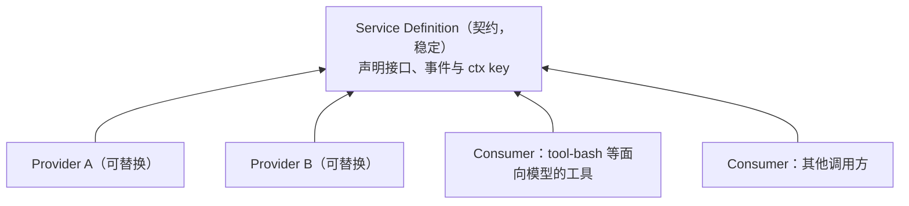
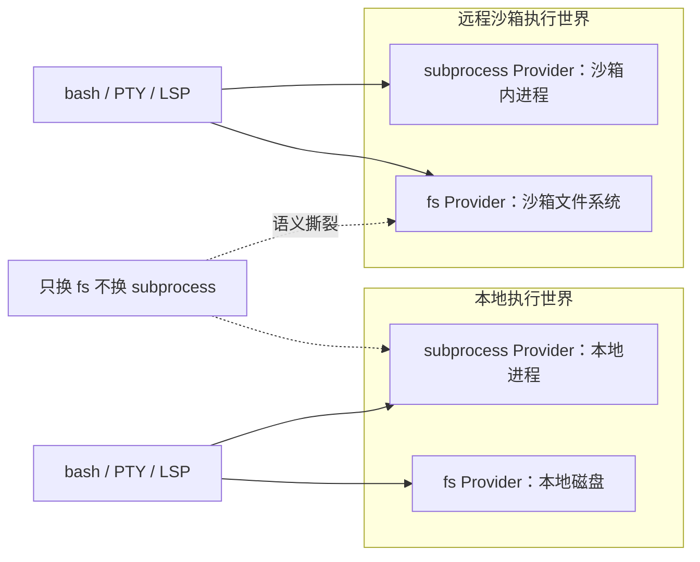

# 19 · 能力缝隙三角色与共享执行世界

> **一句话结论**：一个能力之所以"可替换"，不是因为代码拆到了不同文件，而是因为契约（Definition）、实现（Provider）、使用方（Consumer）三个角色同时到位，并且文件系统与子进程共享同一个执行世界。
>
> **对照缺陷：P5**（工具直接耦合本地执行世界，换 Provider 要 fork 所有工具）
>
> **本课修的是**：MVP `stage4()` 里 3/3 个真实工具把本地 `makeVfs()` 直接写进执行体，把执行世界换成远程沙箱时需要改动全部工具。
>
> 前置：[第 18 课 · 工具四段管线与单调 guard](/ai/harness/18-tool-pipeline-guard) ｜ 下一课：[第 20 课 · 提示段与模型适配层](/ai/harness/20-prompt-sections-and-adapter)

## 本课要回答的问题

先看 MVP 里的失败现象：`node mvp/harness-mvp.mjs --stage 4` 会打印「硬编码本地 vfs 的真实工具=3/3」。三个工具（读、写、列目录）各自 `import` 同一份本地实现，看起来"复用得很好"，但只要你想让它们跑在远程沙箱里，就必须逐个进去改实现——于是"换实现"变成了"fork 三个工具"。

由此引出本课三个问题：

1. 把 `vfs` 换成远程沙箱时，为什么正确的做法是换**一个 Provider**，而不是改三个工具？
2. 为什么文件系统（fs）与子进程（subprocess）必须**一起**换，不能只换一半？
3. 把代码拆成 `vfs.mjs` / `tools.mjs` 两个文件，为什么仍然不算一个"缝隙"？

第 3 问最容易被略过，但它决定了后面所有机制的地基：文件拆分是**代码组织**，三角色齐备才是**可替换性**。

## 核心原理

### 如果没有这个机制会怎样

设想一个没有缝隙的系统。工具函数长这样：

```js
// 反例：执行世界被写死在 Consumer 里
async function readFile(path) {
  return localVfs.read(path);   // 本地语义、本地路径、本地权限
}
```

此时"工具"同时承担了四种身份：面向模型的 schema、参数校验、业务逻辑、执行世界。任何一层要变（远程沙箱、不同编码、审计包装），都只能改函数本身。工具数量越多，改动面按工具数线性放大——这就是 P5 的"fork 所有工具"。

缝隙的做法是把这四种身份切开，只留一个稳定契约给上层。

### 三角色：少一个都不是缝隙



`docs/architecture.md` 的原话是：*A package may combine roles, but one role alone is not a seam; adding a capability means designing all three.* 这句话有两层含义：

| 说法 | 含义 | 反例 |
|---|---|---|
| 一个包可以兼任多个角色 | Definition 与默认 Provider 可以同包发布 | 常见且合法 |
| 单个角色不构成缝隙 | 只有 Consumer、没有契约，就只是"把代码拆到不同文件" | MVP `stage4()` |
| 加能力 = 设计三个角色 | 新增能力是一次三角色设计，不是加一个函数 | "顺手加个工具" |

三种角色各自的职责可以这样记：

| 角色 | 回答的问题 | 稳定性 | 变化频率 |
|---|---|---|---|
| Definition | "这个能力承诺什么？" | 稳定，是契约 | 极低 |
| Provider | "这次用哪种实现兑现承诺？" | 可替换，可有多个 | 中 |
| Consumer | "我怎么用它？"（通常是工具） | 不感知实现 | 低 |

关键点在于 Consumer **不知道** Provider 是谁。`tool-bash` 不 import 任何本地 fs 实现，它消费的是 shell 缝隙；换后端时它一行不改。

### 共享执行世界：fs 与 subprocess 必须一起迁移

这是本课最反直觉、也最实用的一条。文件系统 Provider 与子进程 Provider 共享**同一个执行世界**：



把二者一起指向远程沙箱，`bash`、PTY、LSP 会随着执行世界一并迁移，**无需任何 Provider 分叉**——因为工具消费的是"在这个世界里执行"这个契约，不是本地路径语义。

反过来，若只换 `fs` 不换 `subprocess`，就会出现"工具看到的文件"与"命令执行的文件"不是同一套的**语义撕裂**。典型症状是"刚写的文件读不到"：写操作落在沙箱 fs，`bash cat` 却在宿主进程里跑。这类错误极难归因，因为两侧单独看都"正常"。

### 常见缝隙一览

| 缝隙 | 定义 | Provider 举例 | 消费者 |
|---|---|---|---|
| `llm` | 消息/流词汇与适配器契约 | 各模型供应商适配器 | `agent-loop` |
| `tools` | 作用域工具注册表 | 执行管线、guard | 模型工具调用 |
| `session` | 会话日志与投影 | JSONL 持久化、投影缓存 | 装配、回放、遥测 |
| `compaction` | 压缩引擎契约 | `compaction-basic` | `agent/pre-step` |
| `spill` | 溢出存储 | `spill-local` | 工具结果定形 |
| `subagent` | 子代理生命周期 | fork / spawn | 编排者工具 |
| `approval` | 审批服务 | 交互 / 策略实现 | 工具管线 `ask` |

这张表值得反复看：它说明 harness 的每个大能力都被设计成了缝隙，而不是"某个模块里的一个函数"。看一个系统是否成熟，可以先数它有几条这样的缝隙。

### 「扩展不改核心」的落点

`docs/architecture.md` 的 `## Where new behavior goes` 表把"新增需求该动哪里"穷举了出来：

| 需求 | 落点 |
|---|---|
| 加模型供应商 | 注册 `ctx.llm` 适配器 |
| 加面向模型能力 | 注册 `ctx.tools`（schema 自动进提示） |
| 加 shell 执行 | 注册 `ctx.shell` 后端 |
| 拦截请求 / 工具 / turn | `agent/*`、`tools/*` 事件 |
| 在 turn 边界 fork 会话 | `ctx.agents.create({ sessionId, seed, ... })` |

这张表的存在本身就是对 P1 的回应：扩展点是**穷举且有文档的**，每个新需求都有指定挂载位置，而不是"在主循环里再加一个 `if`"。

### 相邻概念的边界

三个概念都挂在缝隙上，但改变的是不同层的对象，不能混为一谈：

| 概念 | 改变的对象 | 一句话 |
|---|---|---|
| MCP | 能力接入 | 把外部 server 暴露为原生工具 |
| PTC / Code-as-Action | 调用编排 | 让模型写一段代码编排多次工具调用，减少往返 |
| subagent | 委托结构 | 有独立 loop 与上下文的子代理 |

把它们当成同一类"扩展"，会导致把编排问题误诊成接入问题。

## dsh 源码精读

- **`docs/capability-seams.md`**：由 `scripts/gen-doc-graphs.ts` 生成的 Mermaid 关系图，**只有一个 H1、没有章节**。读它是为了看清"谁定义、谁实现、谁消费"的全景图；它是"缝隙地图"，不是文字规范，别指望在里面找规范条文。
- **`docs/architecture.md` 的 `## Capability seams` 段（约 144 行）**：三角色定义、共享执行世界、以及紧随其后的 `## Where new behavior goes` 扩展点表。这是本课的主教材；动手实验第一条 `sed -n '140,165p'` 就是读它。
- **`packages/fs/`、`packages/sandbox/`**：文件系统缝隙的 Definition 与沙箱 Provider。并排读可以体会接口层与实现层的分工：Definition 声明能力语义，具体落盘方式属于 Provider。
- **`packages/shell/tool-bash/src/index.ts`**：一个真实 Consumer。读它的头部 import：它不 import 任何本地 fs 实现，而是消费 shell 缝隙——这正是"Consumer 不感知实现"的物证。
- **`packages/spill/spill-policy/src/retention.ts`**：第 07 课"溢出外置"在工业实现里的落点（头尾保留策略）。它说明缝隙也有"策略层"：同一条缝隙可以挂不同策略 Provider。

> 原文引用（`docs/architecture.md`）：*A package may combine roles, but one role alone is not a seam; adding a capability means designing all three.*

这段话的分量在于"designing"：三角色不是自然长出来的，是设计出来的。加一个能力时如果只写了 Consumer，等于给自己埋了一个未来的 P5。

## 权衡与失效模式

- **三角色的设计成本**：加一个能力至少写三个包（或三个明确分工的模块），小项目里显得很重。收益只在"换实现"时才兑现——所以团队需要提前判断这个能力会不会被替换。
- **只换一半的撕裂**：fs 与 subprocess 不共享执行世界时，症状是"刚写的文件读不到""命令看不到环境变量"这类跨边界错误，日志里通常两边都正常。
- **Provider 语义漂移**：接口相同但行为不同（超时、编码、权限模型），会让上层的假设悄悄失效。因此契约必须写清**非功能语义**，而不只是方法签名。
- **把缝隙当配置项**：Provider 承载语义，不是布尔开关。用 `if (useRemote)` 切换实现，实际上是把缝隙退化成了 P9（配置散落）。

## 四层定位

| 层 | 本课的落点 |
|---|---|
| Harness | 本课本体：Definition / Provider / Consumer 三角色与执行世界 |
| Prompt | 工具 schema 由 Consumer 注册，跨 Provider 不变 |
| Context | 工具结果格式由 Provider 决定，影响溢出与压缩 |
| Loop | 执行时长与失败模式影响预算与重试 |

读法：换 Provider 时，Prompt 层应当**零改动**（schema 不变），Context 与 Loop 才会感受到差异（结果体积、延迟、失败率）。如果换 Provider 导致提示词要改，说明契约泄漏了。

## 动手实验

```bash
cd /Users/cheeka/code/deepseek-harness
sed -n '140,165p' docs/architecture.md
ls packages/fs/ packages/sandbox/ packages/shell/ | head -40
sed -n '1,30p' packages/shell/tool-bash/src/index.ts

# 回看反面证据：3/3 工具硬编码本地 vfs
node /Users/cheeka/code/deepseek-harness/dsh-agent-course/mvp/harness-mvp.mjs --stage 4
```

**预期观察**：

1. `sed` 那一段应当同时看到三角色定义句和 `## Where new behavior goes` 表头；如果只看到一半，把范围放大到 `140,175p`。
2. `ls` 的输出注意三件事：`fs/` 里有定义包，`sandbox/` 是 Provider 侧，`shell/` 里是工具侧——目录结构本身就是三角色的投影。
3. `tool-bash/src/index.ts` 头 30 行里**不应出现**本地 fs 模块的 import，这是"Consumer 不感知实现"的直接检查。
4. `--stage 4` 输出里的 `3/3` 是本课要消灭的数字；读它时问自己：这三个工具改的是实现，还是改的是契约？

**思考实验**：把 MVP 的 `makeVfs()` 换成"远程沙箱"的最小替身（同样 `list/read/write/has` 四个方法，但加 100ms 延迟）。先数你会改几个函数，再按三角色重画：

- Definition 该暴露哪四个方法？超时与错误码写在哪一层？
- Consumer 该在哪个文件？它还能不能直接 import 替身？
- 为什么 `tool-bash` 这类命令工具必须和它一起换？

如果你的第一版答案仍然是"改三个工具"，那正是 P5 在起作用。

## 常见误区

- **误区：Provider 就是配置项。** Provider 承载语义（超时、编码、权限、错误分类），不是布尔开关。配置项只能选一个已存在的 Provider，不能替代它。
- **误区：`docs/capability-seams.md` 是规范文档。** 它是生成的图。读文字规范要看 `docs/architecture.md`；读图用来建立全景认知。
- **误区：工具数量多就说明扩展性好。** 工具多只说明 Consumer 多。没有 Definition 与可换 Provider，工具越多，换执行世界的成本越高。

延伸阅读：`docs/capability-seams.md`、`docs/subsystems/subagent.md`、`docs/subsystems/ptc-runtime.md`、`docs/subsystems/mcp.md`。

## 本课小结

1. **seam 是三角色，不是文件拆分**：Definition 稳定、Provider 可换、Consumer 不感知。
2. **执行世界是一个整体**：fs 与 subprocess 共享同一世界，换就一起换，否则语义撕裂。
3. **扩展点是有表的**：`Where new behavior goes` 把常见需求映射到固定挂载点，这是对 P1 的结构性回答。
4. **MCP / PTC / subagent 不同层**：接入、编排、委托，别混为一类。


## 自测

**1. 为什么"把 vfs 拆成单独文件"仍然不算一个缝隙？**

<details><summary>参考答案</summary>

因为缝隙要求三个角色齐备：Definition（稳定契约）、Provider（可替换实现）、Consumer（不感知实现的使用方）。只把代码拆文件，通常只有"实现"和"使用方"，没有可替换的契约层；Consumer 仍然 import 具体实现，换世界时仍要改它。`docs/architecture.md` 的原话是"one role alone is not a seam"。

</details>

**2. 只换 fs 不换 subprocess，会出现什么症状？为什么难归因？**

<details><summary>参考答案</summary>

出现语义撕裂：工具（走新 fs）看到的文件与命令（走旧 subprocess）操作的文件不是同一套，典型症状是"刚写的文件读不到"。难归因是因为两侧单独运行时都正常，错误发生在两个执行世界的交界处，日志里没有单点异常。

</details>

**3. 为"加一个模型供应商""加一个工具""拦截一次工具调用"各找落点。**

<details><summary>参考答案</summary>

加模型供应商 → 注册 `ctx.llm` 适配器；加面向模型的能力 → 注册 `ctx.tools`（schema 自动进提示）；拦截工具调用 → 监听 `tools/*` 事件（硬策略用第 18 课的 `guard()`）。三者都出自 `docs/architecture.md` 的 `## Where new behavior goes` 表。

</details>

**4. MCP、PTC、subagent 分别改变哪一层对象？**

<details><summary>参考答案</summary>

MCP 改变"能力接入"：把外部 server 暴露为原生工具。PTC / Code-as-Action 改变"调用编排"：模型写一段代码编排多次工具调用，减少往返。subagent 改变"委托结构"：有独立 loop 与上下文的子代理。三者都挂在缝隙上，但不是同一类扩展。

</details>

## 缺陷闭环与下一课

- **P5 → MVP 证据 → 本课修法**：`--stage 4` 输出"硬编码本地 vfs 的真实工具=3/3，换执行世界需改动全部"。本课的三角色把"执行世界"从工具实现里抽出来：Definition 稳定、Provider 可换、Consumer 不变；共享执行世界保证 fs 与 subprocess 一起迁移。第 14 课的服务仓库是它的前提，第 17 课的事件让新能力无需改主循环。
- **附带回应 P1**：`Where new behavior goes` 表证明扩展点是穷举且有文档的，而不是每个需求都往主循环里加 `if`。

下一课把视角从"能力怎么接"转到"提示怎么拼"：[第 20 课 · 提示段作为可组合程序；模型适配层与推理模型](/ai/harness/20-prompt-sections-and-adapter)。那一课修的是 P2——提示词还是模板字符串时，注册、排序、卸载全都无从谈起。
