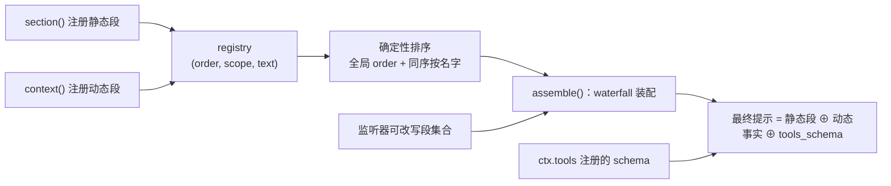
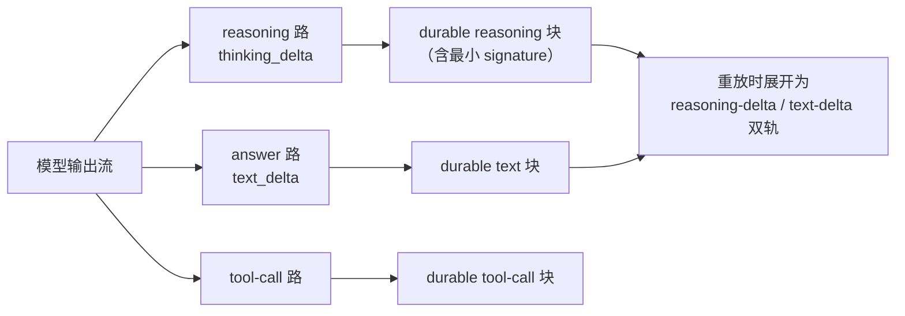

# 20 · 提示段作为可组合程序；模型适配层与推理模型

> **一句话结论**：提示词不是一段模板字符串，而是"由注册产生、按确定性顺序装配、可整体撤销"的有序段集合；推理模型的 reasoning 轨迹则由适配层翻译成双轨流，文本归 durable 块所有。
>
> **对照缺陷：P2**（提示词是模板字符串）｜**P0 落点：推理模型与测试时计算**
>
> **本课修的是**：MVP `--stage 4` 中提示段靠字符串拼接，卸载后幽灵段仍在——`卸载前提示段=2，卸载后=2`、`assemble() 仍含 EXTRA 段=true`；`renderSystem()` 无法按段注册、排序、覆盖、卸载。
>
> 前置：[第 19 课 · 能力缝隙三角色](/ai/harness/19-capability-seams) ｜ 下一课：[第 21 课 · 日志即真相](/ai/harness/21-log-as-truth)

## 本课要回答的问题

MVP 里的失败现象很具体：`renderSystem()` 把身份、约束、工具说明、运行时信息拼成一个大字符串。想加一段"临时规则"，只能在末尾 `+ EXTRA`；想撤掉它，就得记住当初拼在哪、拼了几次。于是出现"幽灵段"：逻辑上已经卸载，字符串里还留着。

由此有三个问题：

1. 提示词如何变成"由注册产生的有序段集合"，而不是拼接结果？
2. 为什么**确定性排序**是"可重建性"要求，而不只是排版美观？
3. 推理模型返回 reasoning 轨迹时，适配层要怎么处理，才既不污染上下文、也不污染日志？

第 3 问是上一轮评审的 4 项 P0 之一：第 01 课只讲了"模型观与 effort 概念"，本课要落到真实实现。

## 核心原理

### 如果没有这个机制会怎样

先做直觉对照。模板字符串的世界里，提示词只有"当前值"，没有"结构"：

```js
// 反例：结构信息全部丢失
function renderSystem(state) {
  return [
    'You are a coding agent.',
    state.mode === 'plan' ? PLAN_RULES : WRITE_RULES,
    toolDocs,
    `cwd=${state.cwd}`,
  ].join('\n');
}
```

它带来四个不可逆的后果：无法知道哪句话由谁注册；无法按语义顺序重排；无法单独卸载某一段（只能重算整串）；无法在日志回放时复现"模型当时到底看到了什么"。P2 的幽灵段就是最后一个症状。

### 提示词 = 注册表 + 确定性渲染

工业实现把它变成数据：

```text
registry = { section_i : (order, scope, text) }
prompt   = render(sort(registry)) ⊕ render(runtime_context) ⊕ tools_schema
```

`⊕` 是拼接，但拼接发生在**排序之后**，且三段来源不同：静态段、动态运行时事实、工具 schema。这个结构一旦成立，"卸载"就等价于"从 registry 删除一个条目并重渲染"。



### 四个机制，缺一不可

| 机制 | 作用 | 对应前序课 |
|---|---|---|
| 依赖门控 | `ToolsService` 声明 `inject = ['systemPrompt']`，服务齐备才加载 | 第 15 课 |
| 注册即可逆 | 每次注册返回精确 disposer，LIFO 逆序撤销 | 第 16 课 |
| 确定性排序 | 全局 order 常量 + 同序按名字排序，跨机器一致 | 本课新增 |
| waterfall 改写 | `assemble()` 本身是 waterfall，监听器可改写段集合 | 第 17 课 |

逐条解释：

- **依赖门控**解决"装配时服务还没就绪"。工具服务必须先有系统提示服务，否则它注册的 schema 无处安放。
- **注册即可逆**是幽灵段的正面解：注册返回精确 disposer，卸载时按 LIFO 逆序撤销。MVP 的 `EXTRA` 段之所以赖着不走，就是因为它没有 disposer，只存在于字符串里。
- **确定性排序**让装配结果跨机器一致。**否则日志回放无法复现模型所见**——同一次会话在两台机器上得到不同提示，就等于"模型可见即可重建"这条不变量失效。
- **waterfall 改写**让策略可以介入：监听器可以增删改段集合；`complete: true` 的段可以在 waterfall 之后恢复为唯一提示段（覆盖式接管，必须显式审计）。

四个机制的分工可以这样理解：门控管"能不能加载"，disposer 管"能不能撤销"，排序管"结果稳不稳"，waterfall 管"别人能不能改"。

### 严格插值与静态/动态分离

**严格插值**：`{{variable}}` 未定义即失败，而不是静默留下占位符。理由很现实——静默畸形提示在生产里极难定位：模型不会报错，它只会表现变差，你看到的是一堆"偶发"的坏回答。

**静态 / 动态分离**在这里落地：

| 注册方式 | 内容性质 | 位置 | 收益 |
|---|---|---|---|
| `section()` | 静态段，逐字稳定 | 前部 | 利于 KV cache 命中 |
| `context()` | 动态运行时事实 | 后置 | 不破坏前缀稳定性 |

第 04 课的 `renderSystem()` 把两者混在一个字符串里，结果每次 cwd 或时间变化都会击穿缓存前缀。分离之后，"什么会变"变成显式的类型决策，而不是拼接顺序的副作用。

### 推理模型的适配层（P0）

`reasoningEffort` 是模型侧的**测试时计算档位**，不是提示词技巧。轨道上要区分两件事：模型多想（effort），和 harness 怎么处理它想的内容（适配层）。工程上有三件事：

| 变化 | 适配层职责 |
|---|---|
| 输出分成 reasoning 与 answer 两路 | 流式要把 `thinking_delta` 翻译成 `reasoning-delta`，durable 块与 transient 帧分开 |
| effort 档位可配 | 序列化时校验档位合法性，把 `effort` 映射到供应商的 `thinking` / `output_config` |
| 推理轨迹带签名与重放元数据 | **durable Harness 块拥有全部响应文本**，供应商重放元数据只保留最小签名 |

第三条是架构立场，不是实现细节：供应商的签名/重放信息只是**元数据**，真相在 harness 自己的 durable 块里。这与第 08/09/11 课"日志即真相"完全一致。



注意右下那条：重放不是"把 reasoning 塞回 messages"，而是由持久块重新展开成流。**reasoning 不回灌进 messages**，这一点在源码里有明确注释。

## dsh 源码精读

`packages/core/system-prompt/src/index.ts` 三个锚点（行号已抽查）：

| 锚点 | 读什么 | 为什么关键 |
|---|---|---|
| `:136` `SECTION_ORDERS` | 确定性排序的中心常量 | 装配顺序的集中声明处；改它等于改所有回放结果 |
| `:485` `section()` | 段注册，返回精确 disposer | 幽灵段消失的机制本体 |
| `:621` `assemble()` | waterfall 装配 | 策略统一改写点，也是"顺序 + 覆盖"的汇合处 |

`packages/llm/llm-deepseek/src/serialize.ts:147-156`：

```ts
const effort = options.reasoningEffort ?? (connection.defaults.reasoningEffort ?? (...))
if (!['off', 'low', 'high', 'max'].includes(effort) || (...)) {
  throw new LlmError(`DeepSeek Messages does not support reasoning effort ${effort}`,
                     'UNSUPPORTED_REASONING_EFFORT')
}
// ...
thinking: { type: effort === 'off' ? 'disabled' : 'enabled' },
...effort === 'off' ? {} : { output_config: { effort: effort as 'low' | 'high' | 'max' } },
```

逐段解读：

- 第一行是**三层回退**：单次请求的 `options.reasoningEffort` → 连接默认值 → 再往下兜底。优先级从"这一次"到"这条连接"，保证显式选择总能覆盖默认。
- 第二到四行是**白名单校验**：四档 `off / low / high / max`，非法档位直接抛**类型化错误**（`UNSUPPORTED_REASONING_EFFORT`），而不是降级或忽略。这正是第 18 课 P10 伏笔的延续——错误是契约的一部分。
- 最后两行是**映射**：`off` 映射为 `thinking: disabled` 且不带 `output_config`；其余档位启用 thinking 并传 `output_config.effort`。适配层在这里把统一档位翻译成供应商私有字段。

补充锚点 `serialize.ts:67`：它明确 *User and tool-result content omits reasoning and tool-call blocks*——**reasoning 不回灌进 messages**。原因在权衡一节展开。

`packages/llm/llm-deepseek/src/translate.ts:52-54,74-79`：

```ts
case 'thinking':
  content = { type: 'reasoning', text: string(native.thinking) }
  replay  = { type: 'reasoning', ... }
// ...
if (delta.type === 'thinking_delta' && content.type === 'reasoning') { ... }
```

这两段分别处理"非流式落块"与"流式增量"：供应商的 `thinking` / `thinking_delta` 被翻译成 harness 的 `reasoning` 内容与 `reasoning-delta` 帧。`translate.ts:128-129` 进一步把持久块重新展开成 `text-delta` / `reasoning-delta` 双轨流——第 11 课手写的"双轨流式"在这里落地。

`packages/llm/llm-deepseek/src/replay.ts:1-10`：

```ts
type ReplayBlock = 'text' | 'reasoning' | 'tool-call'   // 可选 signature
```

文件头第一句是：*"Minimal native thinking metadata; durable Harness blocks own all response text."* 读这句话要读到三个点：元数据是"最小"的；文本所有权在 durable 块；供应商格式只是重放所需的附件。它解释了为什么 `ReplayBlock` 只有三种，且 `signature` 是可选的。

## 权衡与失效模式

- **段机制的代价**：提示文本散落在各注册点，`locale/en.json` 只有 meta、不是文本库；想找"这句话从哪来"要靠注册点搜索与 `--dump-config`。可组合性换来的是定位成本。
- **waterfall 改写的风险**：忘记 `next()` 会静默丢段；`complete: true` 的段会覆盖全部其他段。两者都不报错，只表现为"提示莫名其妙少了/多了"，必须靠测试与显式审计。
- **reasoning 与缓存**：把轨迹回灌进 messages 会破坏前缀稳定、增加成本；完全丢弃又会在压缩后丢掉模型自己推翻过的假设。正确做法是**持久块拥有文本，投影决定是否可见**——所有权与可见性分开。
- **跨供应商**：effort 档位与 thinking 字段不是标准。适配层要隔离差异，上层只看到统一的 `reasoning` 块；否则每换一家供应商，上层逻辑都要改。

## 四层定位

| 层 | 本课的落点 |
|---|---|
| Prompt | 本课本体：段、排序、装配、严格插值 |
| Context | reasoning 是否进模型历史是投影决策；压缩指令的前缀亲和 |
| Loop | effort 是预算维度（第 22 课计量） |
| Harness | 适配层隔离供应商差异，durable 块是真相 |

一个容易忽略的点：reasoning 的"存"属于 Harness，"是否可见"属于 Context，"花多少"属于 Loop。三件事被拆到三层，才不会互相绑架。

## 动手实验

```bash
cd /Users/cheeka/code/deepseek-harness
sed -n '130,145p' packages/core/system-prompt/src/index.ts
sed -n '480,495p' packages/core/system-prompt/src/index.ts
sed -n '617,630p' packages/core/system-prompt/src/index.ts
sed -n '145,160p' packages/llm/llm-deepseek/src/serialize.ts
sed -n '50,56p;72,80p;126,131p' packages/llm/llm-deepseek/src/translate.ts
sed -n '1,12p'   packages/llm/llm-deepseek/src/replay.ts

# 回看反面证据：模板字符串 + EXTRA 幽灵
node /Users/cheeka/code/deepseek-harness/dsh-agent-course/mvp/harness-mvp.mjs --stage 4
```

**预期观察**：

1. `130,145p` 应看到 `SECTION_ORDERS` 附近的常量定义，注意它是否按"语义阶段"分组；分组本身就是排序意图的文档。
2. `480,495p` 看 `section()` 的返回值形状——它必须是一个可调用的 disposer，而不是 id 或 void。
3. `617,630p` 看 `assemble()` 是否以 waterfall 形式串接监听器；关注"谁调用 `next()`"。
4. `serialize.ts` 一段应同时出现白名单校验与 `thinking` / `output_config` 映射；如果只看到一半，扩大范围。
5. `translate.ts` 三段对照看：非流式、增量、重放展开，是同一个翻译问题的三种时序形态。
6. `--stage 4` 输出中的 `卸载前提示段=2，卸载后=2` 与 `assemble() 仍含 EXTRA 段=true` 是本课要消灭的两个 true/相等。

## 常见误区

- **误区：推理模型 = 模型会自己 planning。** 它是**测试时计算预算 + 双路输出**；执行、状态、终止、校验仍由 harness 负责。effort 调高不等于任务会完成。
- **误区：把 reasoning 写进 messages 方便模型记住。** 它污染上下文、破坏缓存前缀，且可能包含模型自己已推翻的中间假设，形成噪声。
- **误区：排序只是美观。** 排序决定回放能否复现模型所见，是可重建性要求。
- **误区：适配层只是字段改名。** 它还负责档位校验、错误类型化、durable/transient 分离与重放元数据裁剪。

延伸阅读：`docs/subsystems/system-prompt.md`、`docs/deepseek-llm-api-wire-extensions.md`（`dsh_*` 带外字段）、`docs/cookbook/adding-an-llm-adapter.md`。

## 本课小结

1. 提示词是**注册表 + 确定性渲染**，不是模板字符串；卸载等于删条目再渲染。
2. 四机制协作：inject 门控、可逆 disposer、确定性排序、waterfall 改写；排序是**可重建性**而非美观。
3. 静态 `section()` 与动态 `context()` 分离，直接服务 KV cache 前缀稳定。
4. 推理模型三件事：双路翻译、档位校验与映射、durable 块拥有文本、只留最小签名。
5. 严格插值让"提示畸形"在装配期就失败，而不是在生产里表现为坏回答。

## 自测

**1. 说出提示段四个机制，并分别对应 15/16/17 课的哪个机制。**

<details><summary>参考答案</summary>

依赖门控 → 第 15 课 `inject`（`ToolsService` 声明 `inject = ['systemPrompt']`）；注册即可逆 → 第 16 课 effect 与 LIFO disposer；确定性排序 → 本课新增（全局 order + 同序按名字）；waterfall 改写 → 第 17 课 typed events 的 waterfall 语义（`assemble()` 本身即 waterfall）。

</details>

**2. 为什么"确定性排序"是可重建性要求，而不只是排版问题？**

<details><summary>参考答案</summary>

因为日志回放要能复现"模型当时看到的提示"。如果同一组段在不同机器上顺序不同，重建出的请求就不同，"模型可见即可重建"不变量失效。排序固定后，注册集合相同就必然渲染出相同提示。

</details>

**3. `reasoningEffort` 有哪四档？`serialize.ts:67` 为什么把 reasoning 从 user/tool-result 内容里排除？**

<details><summary>参考答案</summary>

四档是 `off / low / high / max`，非法档位抛 `UNSUPPORTED_REASONING_EFFORT` 类型化错误。排除 reasoning 是为了不污染上下文、不破坏前缀缓存，且避免把模型已推翻的中间假设当作事实回灌；reasoning 由 durable 块保存，重放时再展开成双轨流。

</details>

**4. 复述 `replay.ts` 的文件头原则，并说明它与"日志即真相"的关系。**

<details><summary>参考答案</summary>

原文是 "Minimal native thinking metadata; durable Harness blocks own all response text." 意思：供应商原生 thinking 元数据只保留最小签名，全部响应文本由 harness 的 durable 块拥有。这与第 08/09/11 课的"日志即真相"一致——供应商重放信息是元数据，不是真相来源；真相在 harness 自己的持久记录里。

</details>

## 缺陷闭环与下一课

- **P2 → MVP 证据 → 本课修法**：`--stage 4` 输出"卸载前提示段=2，卸载后=2""`assemble()` 仍含 EXTRA 段=true"，说明 `renderSystem()` 无法按段注册/排序/覆盖/卸载。本课的 `SECTION_ORDERS`（确定性排序）、`section()`（精确 disposer）、`assemble()`（waterfall）把提示词变成可组合程序；第 16 课的 effect 保证卸载干净，HMR-safety 测试防止回归。
- **P0 推理模型 → 本课修法**：第 01 课只讲模型观与 effort 概念，本课给出适配层真实实现——四档校验、`thinking_delta → reasoning-delta`、durable 块拥有文本、最小签名重放。

下一课把"提示"与"日志"接起来：[第 21 课 · 日志即真相：投影、`surfaceOp` 与格式迁移](/ai/harness/21-log-as-truth)。那一课回答一个更尖锐的问题——压缩之后，模型看到摘要，审计还能看到完整历史吗？
