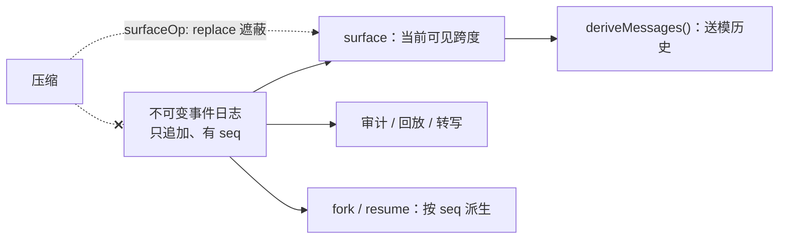

# 21 · 日志即真相：投影、`surfaceOp` 与格式迁移

> **一句话结论**：压缩的正确语义是"改 surface，不删日志"——日志只追加，任何视图（送模历史、UI、审计、fork）都是它的投影。
>
> **对照缺陷：P6（压缩即删除）、P7（消息数组即状态）**
>
> **本课修的是**：MVP `--stage 2` 输出"被丢弃的消息=N 条，无任何日志可查"；`session.json` 被覆盖写回、压缩前版本已丢失；fork 出来的分支"无共同祖先 seq"。
>
> 前置：[第 20 课 · 提示段与模型适配层](/ai/harness/20-prompt-sections-and-adapter) ｜ 下一课：[第 22 课 · 主循环与 Token 计量](/ai/harness/22-agent-loop-and-token-meter)

## 本课要回答的问题

Part I 第 08 课的压缩很朴素：把前 N 条消息换成一条摘要，然后 `messages = [summary, ...rest]`。跑起来没问题，但它一次丢掉了三样东西：被压掉的内容无法审计、旧版本无法回滚、fork 无法说清"我和父分支共享哪一段"。

于是本课的核心问题只有一个，但很尖锐：

1. 压缩之后，怎么同时做到"模型看到的是摘要"与"审计能看到完整历史"？
2. 为什么"消息数组即状态"（P7）会让 fork / resume / 遥测全部失去依据？
3. 日志格式升级时，怎么保证旧客户端不会给出**错误的**历史，而不是干脆读不了？

原文称这是"全课最漂亮的一次架构兑现"：它用一个叫 `surfaceOp` 的字段，同时解决了 P6 与 P7。

## 核心原理

### 如果没有这个机制会怎样

先看反例的因果链。假设状态就是一个数组：

```js
// 反例：数组既是状态，也是历史
state.messages.splice(0, 10, summary);   // 压缩 = 删除
```

由此连锁出三个问题：

| 动作 | 反例下的结果 | 后果 |
|---|---|---|
| 压缩 | 前 10 条被物理删除 | 无法审计、无法回滚 |
| 保存 | 整份数组覆盖 `session.json` | 压缩前版本丢失，无版本可迁移 |
| fork | 复制数组、截断到某下标 | 无 seq，无法表达共同祖先 |

这就是 P6 与 P7 的合流：**删除式压缩**让历史不可追，**数组即状态**让历史没有身份。

### 事件溯源：log → surface → messages

正确的结构是三层，且只有最底层是真相：

```text
log      = [e1, e2, e3, ...]        ← 唯一真相，只追加
surface  = fold(log, projection)    ← 当前可见 surface
messages = derive(log)              ← 送模历史（又一个投影）
```



图里那条被划掉的虚线是关键：压缩**不指向**日志，只指向 surface。一旦你想"压缩时删日志"，就已经偏离了这套架构。

`docs/architecture.md` 的不变量（约 130 行）写得极简：

> **Model-visible means logged.** Every model request must be reconstructable from the log. New model-visible inputs require session events.

三句话三个层次：模型能看到的东西必须进过日志；每一次模型请求都能从日志重建；新增的模型可见输入必须有对应事件类型。第三条最容易被违反——随手往请求里塞一段动态文本，就破坏了可重建性。

### 压缩 = 改 surface：四事件序列

一次成功压缩不改日志，只做一次 surface 变换：用**一个 summary 节点替换选中的 surface 跨度**。它由四个事件组成：

```text
compaction/start        （持久锁：阻止同 session 并发压缩）
compaction/summary      （摘要内容 + sourceEventSeqs 引用被遮蔽节点）
user/message            （surfaceOp: { op:'replace', startSeq, endSeq }）
compaction/end          （释放锁）
```

逐个读：

| 事件 | 作用 | 少了它会怎样 |
|---|---|---|
| `compaction/start` | 持久锁，声明"我在压缩" | 两个压缩并发改 surface，遮蔽区间互相踩踏 |
| `compaction/summary` | 摘要本体 + `sourceEventSeqs` 指向被遮蔽节点 | 摘要与原文失去关联，审计无法回溯 |
| `user/message` + `surfaceOp` | 声明用摘要替换 `[startSeq, endSeq]` | 模型看不到 checkpoint，或遮蔽范围不可解释 |
| `compaction/end` | 释放锁 | 后续压缩永久阻塞 |

于是同一个日志产生两种视图：日志完整保留（可审计、可回放、可撤销策略），而 `deriveMessages()` 投影时旧节点被遮蔽，模型看到 checkpoint。**遮蔽不是删除**，这是全部要点。

只有 **5 类 surface 事件**带 `surfaceOp`；`replace{startSeq, endSeq}` 是压缩用的那一种。范围化表达让"遮蔽"成为可计算、可验证的声明，而不是"哪几条被删了我也不记得"。

### 摘要本身是提示词工程

`COMPACTION_INSTRUCTION` 要求输出八节固定结构：

| 节 | 目的 |
|---|---|
| Primary Request | 用户真正要什么 |
| Key Technical Concepts | 不可重新推导的领域知识 |
| Files and Code | 精确路径与关键片段 |
| Errors and Fixes | 踩过的坑，避免重复 |
| Pending Jobs | 未完成事项 |
| Current Work | 当前进度 |
| Next Step | 下一步 |
| Critical Context | 其他不可丢的事实 |

配套三条元规则，全部服务于"下游能续接"：

1. 空节写 `(none)` **不许省略**——结构缺失会让后续读取方误判"这一节不重要"；
2. 保留精确路径、命令、错误串、用户纠正——这些是无法从摘要语境重新推导的事实；
3. **不得提及"本次压缩"**，遇到旧 checkpoint 要**合并**而非逐字复制——避免摘要层数越叠越像"会议纪要"，丢失原始语义。

整条指令作为**最后一条 user message** 追加，复用主请求前缀以命中 KV cache（第 06、08 课）。这是"提示词工程"与"缓存工程"的合流：指令放最后，前面全部不变，缓存才有意义。

### 投影与 surface 的四个细节

| 细节 | 内容 | 为什么重要 |
|---|---|---|
| `deriveMessages()` | 沿 surface 有序 seq 投影；返回 fresh array + 共享的 deep-frozen `Message` | 调用方无法篡改共享对象，投影不可变 |
| 增量缓存 | `derived/derivedNodes/derivedGeneration`；尾部增长只处理新节点 | 长会话不必每次全量重算 |
| 失败尝试 | `assistant/attempt` 留在日志供审计，但**不进入模型历史**；成功的 `assistant/message` 内嵌紧凑 timed stream | 审计要全量，送模要干净 |
| `ignorable` | 未知且必需的未知事件必须**拒读**，不能静默跳过 | 旧版本读新日志不会给出错误历史 |

第四条是**兼容性契约**，不是容错技巧。静默跳过未知事件看似"健壮"，实际是让旧客户端用残缺历史继续推理——错得无声无息。拒读是刻意 fail-closed。

### 持久化与迁移

- 一次完成的 flush 才算屏障；每 session 单写者；追加批次连续（`assertContiguous`）。
- 格式有 `SESSION_FORMAT_VERSION`；迁移只做**相邻单步** `vN → vN+1`，多个迁移包串成链。
- 已提交的 generation **永不改名、永不删除**。
- `session-projection` 给出"从已提交事件折叠出的当前值"，并标注"反映到的最后事件 seq"；**日志仍权威**，checkpoint 只会落后、不会超前。

相邻单步的好处是组合性：n 个版本只需要 n 个迁移包，而不是 n² 个"任意版本到任意版本"的转换器；每一步都可单独测试、单独回滚。

### 不变量的适用边界

上一轮评审指出过一个绝对化表述，本课要修正："模型可见即可重建"约束的是**送模内容**，不是所有元数据。两个已验证的合法例外：

1. `docs/subsystems/skills.md` 明确 *Skills are optional instructions, not session events*——渐进式披露加载的是可选指令，不作为会话事实入日志；
2. `docs/deepseek-llm-api-wire-extensions.md` 的 `dsh_*` 字段在 `messages` 之外传递，**不占 model-input tokens**。

把不变量说成"一切都必须进日志"会误伤这两类设计；说成"只有消息要进日志"又会让可重建性失去牙齿。准确表述是：**进入模型的输入必须可重建**。

## dsh 源码精读

| 锚点 | 读什么、为什么关键 |
|---|---|
| `packages/core/session/src/index.ts:1079` | `deriveMessages()` 投影入口。看它如何按 surface 有序 seq 遍历、如何处理增量缓存 |
| `packages/core/session/src/surface.ts` | surface 与 `surfaceOp` 语义。这是"改 surface 而非删日志"的类型定义处 |
| `packages/core/session/src/types.ts:90` | `SESSION_FORMAT_VERSION`。格式契约的单一来源 |
| `packages/compaction/compaction-basic/src/region.ts:507` | `surfaceOp: replace` 的写入点。压缩真正"落地"的那一行 |
| `packages/compaction/compaction-basic/src/summarizer.ts:35` | `COMPACTION_INSTRUCTION` 与前缀亲和设计。八节结构与"放最后"都在这里 |
| `packages/compaction/compaction-basic/src/index.ts:162` | 压缩服务与触发（pressure / context-overflow）。回答"什么时候压" |
| `packages/session/session-format-v0-to-v1/` | 相邻单步迁移链的第一环。看一个迁移包的最小形状 |
| `docs/session-format-status.md` | 当前写入格式与历史版本状态 |

`docs/architecture.md` 段落还写明：`assistant/message` 内嵌紧凑 timed stream，`assistant/attempt` 保留失败/重试/取消/流错尝试但不加模型历史，fork / resume / transcripts / telemetry / persistence 全部从这些 durable settlements 派生——第 09、11 课手写时漏掉的东西一次补齐。

读源码时的建议顺序：先 `surface.ts` 建立类型直觉，再 `region.ts:507` 看写入，最后 `index.ts:1079` 看读取。写入与读取分开读，才能体会"同一份日志、两种视图"。

## 权衡与失效模式

- **append-only 的代价**：日志会一直长；需要压缩、溢出、投影缓存来控制读放大，但**不能删原始事件**。存储成本换来可审计性，这是有意识的交换。
- **压缩并发**：`compaction/start` 是持久锁，两个压缩同时改 surface 会破坏遮蔽区间；必须等到 `compaction/end`。锁失效的后果是区间错乱，而不是简单报错。
- **摘要投毒**：摘要由模型生成，一次幻觉会被后续步骤反复引用（poisoning）。八节结构与"保留用户纠正"是对抗手段，不是根治；关键事实仍需可回溯到源事件。
- **拒读未知事件**：旧客户端读新日志会失败而不是给错答案——这是刻意的 fail-closed。代价是需要维护迁移链与版本治理。
- **投影缓存滞后**：checkpoint 只落后不超前，读取方必须能接受"我看到的不是最新"，否则会把缓存当真相。

## 四层定位

| 层 | 本课的落点 |
|---|---|
| Context | 本课本体：投影决定模型可见内容 |
| Prompt | 摘要指令措辞与位置决定保真度、缓存命中 |
| Loop | `agent/pre-step` 判压触发压缩；压缩重试预算 |
| Harness | JSONL 持久化、单写者、迁移链、拒读策略 |

**跨层责任登记**：compaction 横跨四层。遇到"长会话约束丢失"这类症状，先问"责任写在 Prompt（摘要指令）还是 Loop（触发阈值）"，再改，别在措辞上反复试（第 05 课诊断矩阵）。压得太早是 Loop 问题，摘要漏字段是 Prompt 问题，写不进去是 Harness 问题。

## 动手实验

```bash
cd /Users/cheeka/code/deepseek-harness
sed -n '1075,1090p' packages/core/session/src/index.ts
sed -n '500,515p'   packages/compaction/compaction-basic/src/region.ts
sed -n '30,55p'     packages/compaction/compaction-basic/src/summarizer.ts
sed -n '126,134p'   docs/architecture.md
ls packages/session/ | grep 'format' | tr '\n' ' '

# 与手写标本并排对照
node /Users/cheeka/code/deepseek-harness/dsh-agent-course/mvp/harness-mvp.mjs --stage 2
cat /Users/cheeka/code/deepseek-harness/dsh-agent-course/part-1b-context-to-harness.md | grep -A6 'append-only 日志'
```

**预期观察**：

1. `index.ts` 一段应看到投影沿 seq 推进，以及 `derived*` 缓存字段的使用痕迹；注意它返回的是新数组。
2. `region.ts:500-515` 应出现 `surfaceOp` 与 `replace`、`startSeq`、`endSeq`——确认"写的是 surface，不是删日志"。
3. `summarizer.ts` 一段应能数出八节结构名，并看到指令被放在最后的构造方式。
4. `architecture.md` 一段应含 "Model-visible means logged" 那句；这是不变量原文。
5. `ls | grep format` 应看到形如 `session-format-v0-to-v1` 的目录——每个目录就是一个相邻单步迁移包。
6. `--stage 2` 的输出是本课的反面证据：注意"被丢弃的消息"与"无日志可查"两处措辞。

**对照练习**：把 Part I 第 08 课 `scratch-08.mjs` 的 `covers: [1,2,3]` 与 `region.ts` 的 `replace{startSeq, endSeq}` 并排。两者都做了"遮蔽"，但工业版多了三件事：

1. **持久锁**（`compaction/start`）防止并发压缩互踩；
2. **摘要节点引用源事件**（`sourceEventSeqs`），让摘要可回溯；
3. **投影增量缓存**（`derived*`），让长会话不必全量重算。

## 常见误区

- **误区：压缩就是省 token。** 它是**有损的 surface 变换**，可审计性是设计要求。省 token 是结果，不是语义。
- **误区：快照等于真相。** checkpoint 只会落后，权威仍是日志；把投影当真相会在崩溃恢复时丢事件。
- **误区：未知事件跳过更健壮。** 拒读是契约；静默跳过会让旧版本产出错误历史。
- **误区：fork 就是复制消息数组。** fork 是"按 seq 派生新会话"，共同祖先由 seq 表达，不靠数组下标。

延伸阅读：`docs/subsystems/session.md`、`docs/session-format-status.md`、`docs/cookbook/adding-a-session-format-version.md`、Martin Fowler, *Event Sourcing*。

## 本课小结

1. 三层结构：`log`（真相）→ `surface`（可见跨度）→ `messages`（送模投影）。
2. 压缩 = `surfaceOp: replace` 的四事件序列；日志一条不删，审计与回放全部保留。
3. 摘要是指令工程：八节 + 空节 `(none)` + 保留精确事实 + 不提"本次压缩" + 放最后吃缓存。
4. 迁移只做相邻单步，committed generation 永不改名删除；checkpoint 只落后不超前。
5. 不变量边界：约束的是"送模输入可重建"，不是所有元数据（skills、`dsh_*` 是合法例外）。

## 自测

**1. 画出 `log → surface → messages` 三层，并说明压缩改的是哪一层。**

<details><summary>参考答案</summary>

`log` 是不可变事件序列（唯一真相）；`surface` 是从日志折叠出的当前可见跨度；`messages` 是沿 surface 有序 seq 投影出的送模历史。压缩改的是 **surface**：通过带 `surfaceOp: replace{startSeq, endSeq}` 的事件遮蔽旧节点，日志本身只追加。

</details>

**2. 复述 `surfaceOp: replace` 的四事件序列，并解释为什么日志不删。**

<details><summary>参考答案</summary>

`compaction/start`（持久锁）→ `compaction/summary`（摘要 + `sourceEventSeqs`）→ `user/message`（`surfaceOp: { op:'replace', startSeq, endSeq }`）→ `compaction/end`（释放锁）。日志不删是为了可审计、可回放、可撤销策略，并让 fork / 遥测 / 转写都能从 durable 事件派生；删除会同时破坏 P6 与 P7。

</details>

**3. 说出 `COMPACTION_INSTRUCTION` 至少三条"为了下游可续接"的元规则。**

<details><summary>参考答案</summary>

八节固定结构且空节写 `(none)` 不许省略；保留精确路径、命令、错误串、用户纠正；不得提及"本次压缩"；遇到旧 checkpoint 要合并而非逐字复制；整条指令作为最后一条 user message 追加以复用前缀缓存。（任答三条即可。）

</details>

**4. "模型可见即可重建"的两个合法例外是什么？为什么它们不破坏不变量？**

<details><summary>参考答案</summary>

一是 skills 的渐进式披露——`docs/subsystems/skills.md` 明确 "Skills are optional instructions, not session events"，它是可选指令而非会话事实；二是 `dsh_*` 带外字段，在 `messages` 之外传递且不占 model-input tokens。不变量约束的是送模输入，这两类不进入模型输入或不属于会话事实，因此不冲突。

</details>

**5. 为什么旧客户端遇到未知且必需的事件应当拒读，而不是跳过？**

<details><summary>参考答案</summary>

因为跳过会让旧客户端用残缺历史继续推理，产出"看起来正常但错误"的结果；拒读是 fail-closed，保证宁可不工作也不给错答案。代价是需要迁移链与版本治理，但错误历史在生产中几乎无法归因。

</details>

## 缺陷闭环与下一课

- **P6 → MVP 证据 → 本课修法**：`--stage 2` 输出"被丢弃的消息=N 条，无任何日志可查"。`surfaceOp: replace` 让压缩遮蔽旧节点而**不删除任何日志**，审计/回放/撤销全部保留；`COMPACTION_INSTRUCTION` 解决"摘要丢关键信息"，`compaction/start` 锁解决并发。
- **P7 → MVP 证据 → 本课修法**：`session.json` 长度=N 字节但压缩前版本已丢失；`forkA/forkB` 无共同祖先 seq。`SessionEvent` 单一真相 + 有序 seq，使 fork/resume/遥测/迁移/转写全是派生；相邻单步迁移链与"committed generation 永不改名删除"让格式演进可逆。
- **P10 伏笔**：`ignorable` 拒读与 `SESSION_FORMAT_VERSION` 是**类型/契约层面**的不变量，不只是运行时断言（第 24 课）。

下一课转到驱动这一切的引擎：[第 22 课 · 主循环 turn/step 状态机与 Token 计量](/ai/harness/22-agent-loop-and-token-meter)。那一课要回答"这个任务最多花多少钱"，以及为什么这个问题在当前架构里没有单一常量答案。
