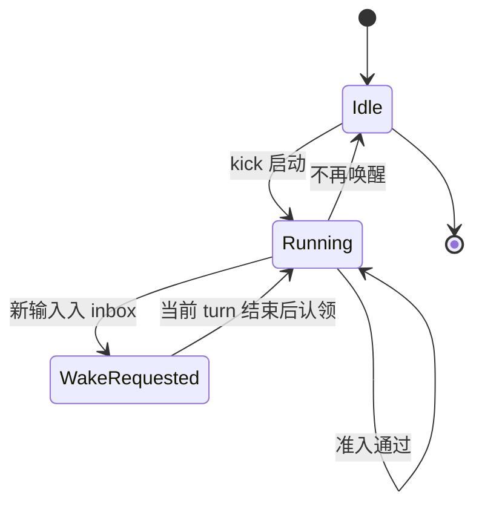

# 22 · 主循环 turn/step 状态机与 Token 计量

> **一句话结论**：主循环用 `kick / turn / preStep / step` 四层结构把"驱动、回合、准入、请求"分开，所有跨层策略集中挂在 `agent/pre-step` waterfall；而成本没有单一上限常量，由 TokenMeasurement 在某个 `logRevision` 上给出可复现的压力快照。
>
> **对照缺陷：P1（策略焊死主循环）、D5（无计量、全量入窗）**｜**P0 落点：Token 计量与成本/延迟**
>
> **本课修的是**：MVP `stage1()` 单函数五职责，没有宿主预算，runaway 只能靠测试代码 `< 12` 硬截断；第 06 课的 `len/4` 估算器只给一个数，既不区分基线，也不支持增量。
>
> 前置：[第 21 课 · 日志即真相](/ai/harness/21-log-as-truth) ｜ 下一课：[第 23 课 · 组合部署与信任边界](/ai/harness/23-composition-and-trust)

## 本课要回答的问题

打开 MVP `stage1()`，你会看到一个几百行的函数：装配提示、拼消息、调模型、执行工具、判断是否继续、记账——五件事挤在一起。想加一条"请求前判压"，只能在中间插一个 `if`；想知道"这次跑了多少"，只能看测试里那个 `< 12`。

本课要回答：

1. `agent.ts` 里的 `kick / preStep / turn / step` 各自负责什么？边界为什么这样划？
2. 外部新消息进来时，为什么不能直接打断正在执行的 step？
3. **这个任务最多花多少钱**——这个问题在这个架构里能不能被回答？

第 3 问的答案不是"能"或"不能"，而是"能被分段回答，但不能用一个常量回答"。这个反直觉的结论是本课的重点。

## 核心原理

### 如果没有这个机制会怎样

先看单函数循环的代价：

```js
// 反例：五职责焊死
while (steps < 12) {          // 预算就是测试代码里的魔法数
  const prompt = renderSystem() + renderHistory();   // 装配
  const res = await callModel(prompt);               // 请求
  runTools(res.toolCalls);                           // 执行
  history = compactIfNeeded(history);                // 压缩
  steps++;
}
```

四件事互相牵连：没有准入层，压缩只能塞在循环体里；没有 phase，唤醒语义不清；没有计量，预算只能拍一个数。

### 主循环结构

以下伪代码依据 `packages/core/agent-loop/src/agent.ts`：

```ts
kick():      while (await this.turn()) {}          // 驱动边界收口异常，finally 复位 phase
turn():      append('turn/start')
             while (true) {
               preStep() -> { enter | reject }     // admission
               append('step/start')
               step()                              // 一次模型请求 + 工具调用
               append('step/end')
               if (!shouldContinue) break
             }
             append('turn/end'); return shouldWakeAgain
step():      renderPrompt() → prepareRequest()/refreshContext() → 流式请求
             → assistant/message → tool/call* → 结算
```

四层的职责可以用一句话概括：`kick()` 驱动多个 turn 直到不再唤醒，并在外层收口异常、`finally` 复位 phase；`turn()` 是一个回合，内部多个 step，负责写 `turn/start` / `turn/end`；`preStep()` 是准入，决定 enter 还是 reject；`step()` 是一次模型请求加工具调用，负责写 `step/start` / `step/end`。



### admission：所有跨层策略的统一挂载点

`preStep()` 做五件事，然后跑 `agent/pre-step` **waterfall**，得到 `enter` 或 `reject`：

1. 认领 inbox；
2. 取 model selection；
3. `tools.resolve()`；
4. `systemPrompt.assemble()`；
5. 跑 `agent/pre-step` waterfall。

因此三种此前散落的策略有了同一个挂载点：

| 策略 | 在 admission 里的形态 |
|---|---|
| 压缩 | 请求前判压，必要时先压缩再进入 step |
| 改写 | 监听器改写本批消息 |
| 拒绝 | 在模型调用前一刻返回 reject |

这就是第 17 课 P1 的落点：**策略不再写进循环体，而是挂在 waterfall 上**。顺序与 `next()` 纪律成为新的关键（第 17 课）。

### inbox 与 phase

外部输入不打断正在执行的 step，而是排队认领；`phase` 状态机（`idle` / `running` / `wakeRequested`）保证唤醒不丢、不重复驱动。

代价是："新消息在哪一步对模型可见"必须被精确定义并写入日志，否则违反可重建不变量。这不是实现细节，而是语义承诺——用户按下回车的那一刻，消息并没有立刻进模型，它先进 inbox，在下一个 admission 才可能被认领。

### 事件序列与两类事件

持久日志骨架：

```text
turn/start → agent/pre-step → step/start → agent/request → llm/stream
→ assistant/message → tool/call* → tool/result* → step/end → turn/end
```

要严格区分两类事件：

| 类型 | 例子 | 是否进日志 | 作用 |
|---|---|---|---|
| 持久 session 事件 | `turn/start`、`assistant/message`、`tool/result` | 是 | 必须能重建请求 |
| 瞬时运行时事件 | dispatch / UI 观察帧 | 否 | 观察与渲染 |

混用会破坏"模型可见即可重建"：把 UI 的临时状态写进日志会污染真相，把持久事件只发给 UI 会让回放缺证据。

### 分散式预算：没有集中式 `maxSteps`

这是一个反直觉事实：dsh **没有集中式 `maxSteps` 硬上限**。约束分散在五个位置：

| 约束 | 位置 |
|---|---|
| `max-tokens` 粘滞结束 turn | `agent.ts` 约 590 |
| goal round budget | `packages/goal/goal/src/fold.ts`、`packages/goal/goal-round-driver/src/index.ts` |
| 单步工具并发上限 | `packages/core/agent-loop/src/index.ts:202` `DEFAULT_MAX_PARALLEL_TOOL_CALLS` |
| 压缩重试预算 | `packages/compaction/compaction-basic/src/index.ts` `compactionRetries` |
| 协作式工具超时 | `packages/guard/timeout-policy/` |

分散的好处是各能力域可插拔：加一个 goal 就自带它的预算，不必改主循环。代价是**很难回答"这个任务最多花多少钱"**——诊断成本异常必须逐个检查这些位置，而不是找一个全局常量。

所以在 MVP 里 `steps < 12` 那种"看起来有个上限"的写法，是一种假安全感：它既不是宿主预算，也无法覆盖 token、并发、重试。

### Token 计量（P0）

`docs/subsystems/token-meter.md` 定义 `TokenMeasurement`——一份"在某个 logRevision 上的 detached immutable 压力快照"：

```ts
interface TokenMeasurement {
  readonly logRevision: SessionLogOffset   // 已消费的 durable 事件数
  readonly baseline: TokenMeasurementBaseline
  readonly surfaceDeltaTokens: number     // 相对锚点的带符号重定价
  readonly totalTokens: number            // 请求 + 响应压力
  readonly surfaceTokens: number          // 仅 surface 的路由计价总量
  readonly nodes: readonly TokenSurfaceNode[]
}
```

逐字段读：

- `logRevision` 把计量与日志对齐——这份快照说的是"读到第几个事件时"的压力；
- `baseline` 说明"用哪种基准算的"，这是可复现性的前提；
- `surfaceDeltaTokens` 是**带符号**的增量，不是全量；
- `totalTokens` 含请求与响应两侧压力；
- `surfaceTokens` 只算 surface 的路由计价；
- `nodes` 保留每个表面节点的明细，让合计可验证。

三个把第 06 课手写估算器升级成工业实现的关键：

**1. 双基线。** `baseline.kind === 'usage'` 表示"最近一次成功调用具有相同 canonical request envelope"，且总量不低于该次完整锚点；`estimated` 表示没有可复用锚点，服务自行完整计价。压缩触发在请求**之前**，拿不到本次 usage，所以两条基线必须并存。

**2. 位置计价与视觉 token。** `TokenSurfaceNode.tokens` 按**路由声明的定价**计价；图片出现按该路由的 visual token 价格 + 实际送模文本计价；没有声明定价的路由退回固定启发式。

**3. 影子价格保 O(1) fold。** `heuristicTokens` 是"与路由无关的固定启发式价"，*shadow-price protocol 用它给替换定价，使 O(1) 投影 fold 与自身 append 保持一致*。这正是第 06 课"每步精确数 token 会变成 O(n) 扫描"的解法：增量用影子价，校准靠 usage。

## dsh 源码精读

| 锚点 | 读什么、为什么关键 |
|---|---|
| `packages/core/agent-loop/src/agent.ts:274 / 289 / 333 / 441` | `kick` / `preStep` / `turn` / `step` 四个函数。对照伪代码看真实分支与 `finally` |
| `packages/core/agent-loop/src/assistant-stream.ts` | 双轨流式与紧凑 timed stream。理解 `step()` 内部如何落块 |
| `packages/core/agent-loop/src/index.ts:202` | `DEFAULT_MAX_PARALLEL_TOOL_CALLS`。分散预算中最容易被忽略的一个 |
| `packages/llm/token-meter/src/types.ts` | `TokenMeasurement` / `TokenSurfaceNode` 类型。字段含义的权威定义 |
| `docs/subsystems/token-meter.md` | 计量语义与双基线说明。读它比读实现更快建立直觉 |
| `packages/telemetry/otel/src/event-log.ts` | 轨迹与遥测。观察"每一步发生了什么"的入口 |
| `docs/subsystems/otel.md`、`docs/subsystems/session-telemetry.md` | 可观测子系统的设计说明 |

## 权衡与失效模式

- **admission 的代价**：所有策略集中在一个 waterfall 点，监听器顺序与 `next()` 纪律变得关键（第 17 课）。一个忘记 `next()` 的监听器会静默截断整条准入链。
- **分散式预算的代价**：没有单点 CAP，成本异常归因要查多处；这是"可插拔"换来的可回答性损失。
- **usage 锚点的前提**：必须是"相同 canonical request envelope"；一旦请求结构变化（换了工具集、改了提示段），锚点失效，退回 `estimated`。
- **估算与真实账单的差距**：reasoning token、视觉 token、缓存读价都可能让 `estimated` 偏离；因此计量要能对照 usage 校准，而不是二选一。

## 四层定位

| 层 | 本课的落点 |
|---|---|
| Loop | 本课本体：turn/step、admission、终止与预算 |
| Context | `preStep` 判压触发压缩；`logRevision` 保证计量与日志对齐 |
| Prompt | `systemPrompt.assemble()` 在 preStep 完成；前缀稳定影响缓存计价 |
| Harness | 计量器、遥测、超时 guard 都是基础设施 |

## 动手实验

```bash
cd /Users/cheeka/code/deepseek-harness
sed -n '270,300p' packages/core/agent-loop/src/agent.ts
sed -n '330,345p' packages/core/agent-loop/src/agent.ts
sed -n '438,450p' packages/core/agent-loop/src/agent.ts
sed -n '1,55p'   docs/subsystems/token-meter.md
grep -rn 'DEFAULT_MAX_PARALLEL_TOOL_CALLS' packages/core/agent-loop/src/index.ts

# 对照第 06 课手写估算器
node /Users/cheeka/code/deepseek-harness/dsh-agent-course/mvp/harness-mvp.mjs --stage 1
```

**预期观察**：

1. `270,300p` 应看到 `kick` 与 `turn` 的交界，重点找 `finally` 里的 phase 复位。
2. `330,345p` 应看到 `preStep` 的准入逻辑与 waterfall 调用；数一数进入 step 前做了几件事。
3. `438,450p` 应看到 `step()` 内部从渲染到结算的顺序，确认工具调用在模型请求之后。
4. `token-meter.md` 前 55 行应出现双基线（`usage` / `estimated`）与影子价格的说法。
5. `grep` 应命中 `index.ts:202` 的 `DEFAULT_MAX_PARALLEL_TOOL_CALLS`，确认它是常量而非配置中心。
6. `--stage 1` 的输出是本课反面证据：留意"单函数五职责""无宿主预算""`< 12` 硬截断"。

**定量练习**：用第 06 课 `scratch-06.mjs` 的 `measure()` 造 10 步轨迹，回答：

- (a) 若每步 `input` 增长 15%，第几步超过 1000 单位预算？
- (b) 把系统提示改成每步带时间，缓存读比例如何变化？
- (c) 对照 `TokenMeasurement.surfaceDeltaTokens`，解释为什么"带符号"比"每步重算总量"更适合增量 fold。

提示：(a) 用等比数列推；(b) 关键在"前缀是否稳定"；(c) 增量只需对变化节点定价。

## 常见误区

- **误区：找个 `maxSteps` 常量就能封顶成本。** 该常量不存在，且成本还受 effort、缓存、视觉 token 影响。
- **误区：usage 权威就够了。** 请求前的决策拿不到本次 usage，必须保留 estimated。
- **误区：入站消息立刻进模型。** 它先进 inbox，在下一个 admission 才可能被认领；这个延迟是语义的一部分。

延伸阅读：`docs/subsystems/token-meter.md`、`docs/subsystems/otel.md`、`docs/subsystems/session-telemetry.md`、`docs/cookbook/extension-cookbook.md`。

## 本课小结

1. 四层结构 `kick / turn / preStep / step` 把驱动、回合、准入、请求分开；策略集中在 `agent/pre-step` waterfall。
2. inbox + phase（`idle` / `running` / `wakeRequested`）让外部输入不打断执行，且唤醒不丢不重。
3. 预算分散在五个位置，**没有集中式 `maxSteps`**；可插拔换来了可回答性的损失。
4. `TokenMeasurement` 是 `logRevision` 上的不可变快照：双基线、位置计价、视觉 token、影子价格 O(1) fold；持久事件与瞬时事件必须分开，否则破坏"模型可见即可重建"。

## 自测

**1. 画出 kick/turn/step/preStep 的调用关系，并说明 admission 为什么是统一挂载点。**

<details><summary>参考答案</summary>

`kick()` 循环调用 `turn()`；`turn()` 内部循环调用 `preStep()` 与 `step()`。`preStep()` 认领 inbox、取 model selection、`tools.resolve()`、`systemPrompt.assemble()`，再跑 `agent/pre-step` waterfall 得到 enter/reject。因为压缩、改写、拒绝都需要"在模型调用前"介入，集中在这一个 waterfall 上就避免了把策略写进循环体（P1）。

</details>

**2. 列出至少三个分散式预算位置，并解释"没有集中式 maxSteps"的利弊。**

<details><summary>参考答案</summary>

例如：`max-tokens` 粘滞结束 turn（`agent.ts` 约 590）、goal round budget（`packages/goal/`）、单步工具并发上限（`packages/core/agent-loop/src/index.ts:202`）、压缩重试预算（`compactionRetries`）、协作式工具超时（`packages/guard/timeout-policy/`）。利：各能力域自带边界、可插拔；弊：没有单点 CAP，"这个任务最多花多少钱"难以一句话回答，诊断要逐处检查。

</details>

**3. 说清 `usage` / `estimated` 两条基线的判定条件，以及为什么压缩触发只能用 estimated。**

<details><summary>参考答案</summary>

`usage` 表示最近一次成功调用具有相同 canonical request envelope，且总量不低于该次完整锚点；`estimated` 表示没有可复用锚点，由服务完整计价。压缩触发发生在请求**之前**，本次请求尚未发出，拿不到本次 usage，因此只能基于 estimated（或历史锚点失效后的估算）。

</details>

**4. 解释 `heuristicTokens` 影子价格如何保持 O(1) 投影 fold 一致。**

<details><summary>参考答案</summary>

`heuristicTokens` 是与路由无关的固定启发式价。每次 append/replace 时按它对新增或被替换节点定价，写入带符号的 `surfaceDeltaTokens`，因此增量更新只需处理变化节点，不必扫描全表；同时这份影子价与 append 自身使用同一套价格，保证 fold 结果与逐条追加一致。真实价格则通过 usage 锚点校准，避免估算漂移。

</details>

## 缺陷闭环与下一课

- **P1 / D2 / D3 → MVP 证据 → 本课修法**：`stage1()` 单函数五职责、无宿主预算、runaway 只能靠测试代码 `< 12` 硬截断。`preStep()` 的 `agent/pre-step` waterfall 把装配、判压、改写、拒绝拆成可插拔监听器；turn/step 状态机与 phase/inbox 让外部输入有明确语义；分散式预算让每个能力域自己承担边界。
- **D5 / P0 → 本课修法**：第 06 课手写 `len/4` 估算器只给了一个数。本课的 `TokenMeasurement` 给出双基线、位置计价、视觉 token、影子价格与 `logRevision` 对齐——**从"能算"升级到"算得可复现且 O(1)"**。
- **P10 伏笔**：`surfaceTokens === sum(node prices)` 这类恒等式写进了类型文档，可被测试与静态检查验证（第 24 课）。

下一课从"跑起来"转到"怎么交付"：[第 23 课 · 组合部署与信任边界](/ai/harness/23-composition-and-trust)。同一套运行时如何变成 web / headless / sdk / acp 多种形态，以及凭证、权限、沙箱如何组成边界。
