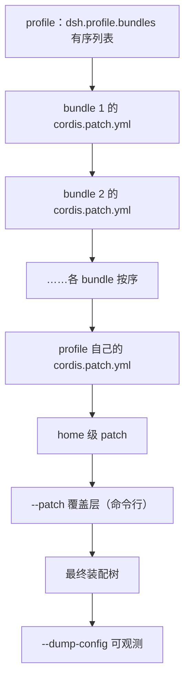
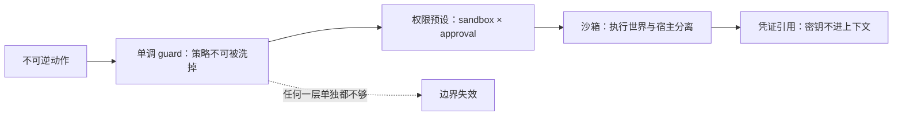

# 23 · 组合部署与信任边界

> **一句话结论**：同一套运行时的多种交付形态靠 profile / bundle / patch 三层叠出来，而不是靠 `if`；安全靠凭证引用、两个正交旋钮、沙箱隔离与单调 guard 四层共同构成，任何单独一层都不是防线。
>
> **对照缺陷：P9（配置散落、靠 if 分支）、D8/P8（策略可被洗掉）**｜**P0 落点：安全与信任边界**
>
> **本课修的是**：MVP `stage3()` 把运行形态硬编码在函数里，`deny` 规则在装配过程中被洗掉，越权写入成功。
>
> 前置：[第 22 课 · 主循环与 Token 计量](/ai/harness/22-agent-loop-and-token-meter) ｜ 下一课：[第 24 课 · 不变量与回归](/ai/harness/24-invariants-and-regression)

## 本课要回答的问题

MVP 里"只读模式"是这样实现的：

```js
// 反例：运行形态 = 参数 + if
if (readOnly) { /* 换一套工具 */ }
if (mode === 'web') { /* 换一套提示 */ }
```

两个问题随即出现：配置散落在函数各处，没人能回答"这次到底加载了什么"；而"只读"只是装配时的一句约定——一旦某条路径绕过了它，越权写入照样成功（D8/P8）。

本课要回答：

1. 同一套运行时怎么交付 web / headless / sdk / acp 多种形态？
2. 为什么 patch 是"整块替换"而不是 merge，这个语义带来了什么约束？
3. 凭证、权限、沙箱三者如何组成**可验证**的信任边界？

## 核心原理

### 如果没有这个机制会怎样

单函数配置的失效链条很直接：

| 需求 | `if` 分支的做法 | 后果 |
|---|---|---|
| 加一种交付形态 | 加参数、加分支 | 分支组合爆炸，P9 |
| 查"哪个配置生效" | 读函数、猜执行路径 | 不可观测 |
| 收紧权限 | 在装配时删工具 | 策略可被后续装配洗掉，P8 |
| 换密钥 | 把值写进配置 | 值进上下文与日志 |

安全的版本要同时解决"配置可组合"与"策略不可被洗掉"两件事，而且它们必须在同一套装配模型里成立。

### Profile / Bundle / Patch 三层组合

最终配置由五层按序叠加：

```text
profile ($DSH_HOME/profiles/<name>/package.json 中 dsh.profile.bundles 有序列表)
  → 各 bundle 自带 cordis.patch.yml（按序应用）
  → profile 自己的 cordis.patch.yml
  → home 级 patch
  → --patch 覆盖层
```



`packages/bundle/base/cordis.patch.yml` 前 14 行注释本身就是教材（已逐字核对）：

- patch 按 **row id 整块替换 `config`**，**不是 merge**；末次写入胜出；
- 因此"随模式变化的行"不放在 base，而由各模式 bundle **重述完整配置**；
- **行顺序不承载加载语义**——激活由服务可用性（`inject`）驱动，分组只为方便人读。

这三条要连起来读：

| 语义 | 直接推论 | 容易犯的错 |
|---|---|---|
| 整块替换 `config` | 想改一个字段，也要重述整块 | 以为写一行就能局部覆盖 |
| 末次写入胜出 | 越靠后的层优先级越高 | 在 base 里放模式相关配置 |
| 行序无语义 | 激活靠 `inject`，不靠排列 | 靠调整行顺序"控制加载" |

第三条是第 15 课 inject 门控的直接推论：既然激活由依赖是否齐备驱动，行序自然不承载语义。把行序当加载顺序，是 Cordis 体系里最常见的误解。

### 五种出厂模板与 `--dump-config`

`packages/util/official-bundles/src/bundles.ts` 的 `PROFILE_TEMPLATES` 提供五种模板：

| 模板 | 说明 |
|---|---|
| `web` | Web 形态 |
| `headless` | 无 UI 形态 |
| `sdk` | SDK 集成形态 |
| `sdk-minimal` | 例外：单 bundle 拥有完整显式树，**不应用 `dsh-base`** |
| `acp` | ACP 形态 |

`sdk-minimal` 值得单独记：它不叠 base，而是把整棵树显式写出来。这是"最小可复现装配"的样本——当你想知道"到底哪些行是必需的"，读它比读 web 模板更快。

`pnpm dsh --profile web --dump-config` 能看到最终装配树，是排查"到底哪个配置生效"的第一手段。**配置分层越强，dump 越重要**：五层叠加之后，读单个文件已经无法推断结果。

### 这是配置层面的组合，不是 if 分支

MVP 的 `stage3()` 把策略硬编码在函数里，想换运行形态只能加参数 + `if`；bundle/profile 让"换形态"= 换一层 patch。两种做法的差异不只是整洁：

| 维度 | `if` 分支 | patch 分层 |
|---|---|---|
| 换形态 | 改代码 | 换 patch 文件 |
| 可观测 | 靠读代码 | `--dump-config` |
| 可验证 | 需要跑遍分支 | 每个 profile 独立启动 |
| 回滚 | 回滚代码 | 换回旧 patch |

### 信任边界三件套（P0）

**1. 凭证用引用不用值**（`docs/subsystems/credentials.md`）。

- settings 与 `cordis.yml` 只带 `CredentialRef`（POSIX 环境变量名风格的 branded string）；
- Provider 持有值，消费者**每次操作重新 resolve**——"rotated credential reaches the very next request without any restart"；
- `describe(ref)` 回答"能否解析、来自哪层、set 是否会成功"，**永不暴露值**；
- 一条贯穿全缝隙的规则：**空值即 absent**。

"每次操作重新 resolve"是个反直觉的选择：它放弃了跨操作缓存，换来热更新零重启。对凭证这种低频率、高敏感的东西，这个交换是划算的。

**2. 权限预设是两个正交旋钮**（`docs/subsystems/permission-presets.md`）。

| 旋钮 | 取值示例 | 控制什么 |
|---|---|---|
| `sandbox/mode` | `workspace-write`、`danger-full-access` | 能碰哪里 |
| `approval/policy` | `ask`、`never` | 要不要人批 |

默认表把两者配成两套常见组合：`workspace-write` + `ask`，`danger-full-access` + `never`。`custom` / `auto` 保留不可配置；`registerAuto(admit)` 用**一个 effect 生命周期**发布"仅当前 session"的选项——回扣第 16 课的可逆注册。

关键一句：该层 **"owns no execution policy"**——它只组合两个旋钮，真正的执行策略仍在单调 guard（第 18 课）。预设不是防线，是策略选择的入口。

**3. 沙箱隔离**（`docs/subsystems/sandbox.md`、`packages/sandbox/`）。

把执行世界与宿主分离。`docs/postmortem/0004-landlock-partial-notice-misclassified-child-failures.md` 是一份真实事故复盘，讲"部分通知被误分类为子进程失败"这类边界错误——比构造案例更适合做归因练习，因为它的错误分类发生在"沙箱报告"与"进程结果"的交界处。

### 分层信任模型

回扣第 10 课：只读 / 写 / 不可逆三级 gate；不可逆动作要人工批准或延迟执行 + 取消窗口。四者合起来才构成边界：



**任何单独一层都不是防线**：只有 guard 没有沙箱，策略对了但执行世界仍可能越界；只有沙箱没有 guard，被洗掉的策略会让沙箱收到错误指令；凭证进上下文，前三层做得再好也会从日志泄漏。

## dsh 源码精读

| 锚点 | 读什么、为什么关键 |
|---|---|
| `packages/bundle/base/cordis.patch.yml` | 前 14 行注释：整块替换、末次胜出、行序无语义。这是配置语义的权威说明 |
| `packages/util/official-bundles/src/bundles.ts` | `PROFILE_TEMPLATES` 五种出厂模板。对照 `sdk-minimal` 的例外 |
| `docs/subsystems/credentials.md` | `CredentialRef` / `ResolvedCredential` / `describe`。三条纪律的出处 |
| `docs/subsystems/permission-presets.md` | preset 表、两正交旋钮、`registerAuto(admit)` |
| `docs/subsystems/sandbox.md` | 沙箱模式与执行世界 |
| `docs/postmortem/0004-landlock-partial-notice-misclassified-child-failures.md` | 真实事故复盘，练归因 |
| `packages/boot/app-boot/src/startup-diagnostics.ts` | 启动失败 / 插件 dispose 前的配置快照 |

读 `cordis.patch.yml` 时建议先只看注释，再看行；注释里那三句会决定你后面所有配置实践。读 `startup-diagnostics.ts` 时关注"快照发生在失败之前"——启动失败现场如果拿不到当时的配置，排查只能靠猜。

## 权衡与失效模式

- **整块替换的代价**：想在某个 bundle 里"只改一个字段"会覆盖整块 config，必须重述完整配置。这是最容易想当然的地方——**patch 不是 merge**。
- **配置分层的诊断成本**：最终生效值来自五层叠加，必须靠 `--dump-config` 与启动诊断快照，不能靠读单个文件。
- **凭证热更新**：每次操作重 resolve 是对的，但意味着无法跨操作缓存；日志与 `describe` 必须严格不打印值。
- **误配 fail-closed**：`ask` 在审批服务缺失时变 denial（第 18 课）；预设表保留字不可配置。宁可拒绝启动，不可静默放宽。
- **预设被误当执行层**：改 `sandbox/mode` 不等于改完策略；真正的执行仍在 guard 里。

## 四层定位

| 层 | 本课的落点 |
|---|---|
| Harness | 本课本体：profile 组合、凭证、权限、沙箱 |
| Loop | 审批与 HITL 是 Loop × Harness 交界 |
| Context | 权限状态是动态上下文，应后置以免破坏前缀 |
| Prompt | 可见工具集随权限变化，schema 随之改变 |

注意最后一行：权限变化会改变工具 schema，进而改变提示。所以权限状态不能随意塞进静态提示段，否则每次权限变化都击穿缓存（第 20 课）。

## 动手实验

```bash
cd /Users/cheeka/code/deepseek-harness
sed -n '1,16p'  packages/bundle/base/cordis.patch.yml
sed -n '1,30p'  docs/subsystems/credentials.md
sed -n '1,32p'  docs/subsystems/permission-presets.md
sed -n '1,25p'  docs/postmortem/0004-landlock-partial-notice-misclassified-child-failures.md
grep -n 'PROFILE_TEMPLATES' packages/util/official-bundles/src/bundles.ts

# 需完整环境（本机 Node 版本不足，见 README §6）
pnpm dsh --profile web --dump-config
```

**预期观察**：

1. `cordis.patch.yml` 前 16 行应看到关于 row id、末次胜出、行序的三条注释；把每条抄成一句自己的话。
2. `credentials.md` 前 30 行应出现 `CredentialRef`、`ResolvedCredential`、`describe` 三类词，并确认没有任何示例打印真实值。
3. `permission-presets.md` 前 32 行应看到两个旋钮的默认表；数一数哪些取值是保留不可配置的。
4. `postmortem` 前 25 行读事故背景即可：重点是"部分通知"与"子进程失败"怎么被混淆。
5. `grep` 应命中 `PROFILE_TEMPLATES` 的定义行；沿它找到五种模板名。
6. `--dump-config` 若因环境跑不起来，不要伪造输出——按原文说明记为"需完整环境"，改用读 patch 文件推断。

**对照练习**：把 MVP `stage3()` 的"只读模式"写成 profile 层的差异（一个只读 patch、一个可写 patch），说明为什么"换形态 = 换 patch"比在函数里加 `if (readOnly)` 更容易验证；并列出 `--dump-config` 里应该出现的差异字段（提示：工具行、沙箱模式、审批策略这三类）。

## 常见误区

- **误区：patch 会 merge 到已有 config。** 它按 row id 整块替换，末次写入胜出。局部修改必须重述整块。
- **误区：预设表就是权限执行。** 它只组合两个旋钮，执行仍在 guard；该层"owns no execution policy"。
- **误区：行顺序决定加载顺序。** 激活由 `inject` 服务可用性驱动，行序只为人类阅读。
- **误区：把凭证值写进配置最省事。** 值会进上下文与日志；引用 + 每次 resolve + `describe` 不暴露值才是边界的一部分。

延伸阅读：`docs/subsystems/credentials.md`、`docs/subsystems/permission-presets.md`、`docs/subsystems/sandbox.md`、`docs/postmortem/`、`docs/defensive-patterns/`。

## 本课小结

1. 五层叠加：profile 的 bundle 列表 → 各 bundle patch → profile patch → home patch → `--patch`。
2. patch 是**整块替换**、末次胜出；随模式变化的行必须由模式 bundle 重述。
3. 五种模板中 `sdk-minimal` 是例外（单 bundle 完整显式树，不叠 base）；`--dump-config` 是排查第一手段。
4. 信任边界四件套：凭证引用、两正交旋钮、沙箱隔离、单调 guard；单独任何一层都不够。
5. 配置越分层，越要依赖 dump 与启动诊断，而不是读单个文件。

## 自测

**1. 说出 patch 的整块替换语义，并解释"随模式变化的行不放 base"的理由。**

<details><summary>参考答案</summary>

patch 按 row id 整块替换该行的 `config`，不做 merge，末次写入胜出。因此若把随模式变化的行放在 base，某个模式 bundle 想改其中一个字段就会连整块一起覆盖；正确的做法是让 base 只保留各模式共通的行，模式相关行由对应 bundle 重述完整配置。

</details>

**2. 复述 `CredentialRef` 的三条纪律。**

<details><summary>参考答案</summary>

一是用引用不用值（settings 与 `cordis.yml` 只带 branded string 形式的 `CredentialRef`）；二是消费者每次操作重新 resolve，使轮换后的凭证下一次请求即生效、无需重启；三是 `describe(ref)` 只回答能否解析、来自哪层、set 是否成功，永不暴露值。另有一条贯穿规则：空值即 absent。

</details>

**3. 为什么 sandbox 与 approval 是两个正交旋钮？"owns no execution policy"是什么意思？**

<details><summary>参考答案</summary>

`sandbox/mode` 控制能碰哪里（如 `workspace-write` / `danger-full-access`），`approval/policy` 控制要不要人批（如 `ask` / `never`），两者可以独立组合，所以正交。该预设层只负责选这两个旋钮，"owns no execution policy" 指真正的执行策略仍由第 18 课的单调 guard 决定；预设不是防线本身。

</details>

**4. 把第 10 课 D8 的越权写入映射到四层各自的防线。**

<details><summary>参考答案</summary>

单调 guard 保证策略不可被洗掉（第 18 课）；权限预设保证配置不能被误配放宽（本课）；沙箱保证执行世界与宿主分离（本课）；凭证引用保证密钥不进上下文与日志（本课）。四层合起来才构成边界，任何单独一层都无法独立拦住越权写入。

</details>

## 缺陷闭环与下一课

- **P9 → MVP 证据 → 本课修法**：`stage3()` 的运行形态靠函数参数与 `if`，配置散落。bundle/profile/patch 五层叠加 + `--dump-config` 让"哪个配置生效"可观测；行序不承载语义（第 15 课 inject 门控的直接推论）。
- **D8 / P8 / P0 安全 → MVP 证据 → 本课修法**：`--stage 3` 中 `deny` 被洗掉、越权写入成功。本课的凭证引用、两正交旋钮、沙箱隔离与第 18 课的单调 `guard()` 共同构成边界：**策略不可被洗掉（18）+ 配置不能被误配放宽（23）+ 执行世界与宿主分离（23）+ 密钥不进上下文（23）**。

下一课收束全书：[第 24 课 · 不变量前移、评测与回归](/ai/harness/24-invariants-and-regression)。三条不变量由谁保证、改完怎么证明没改坏东西，以及结业项目怎么交付。
