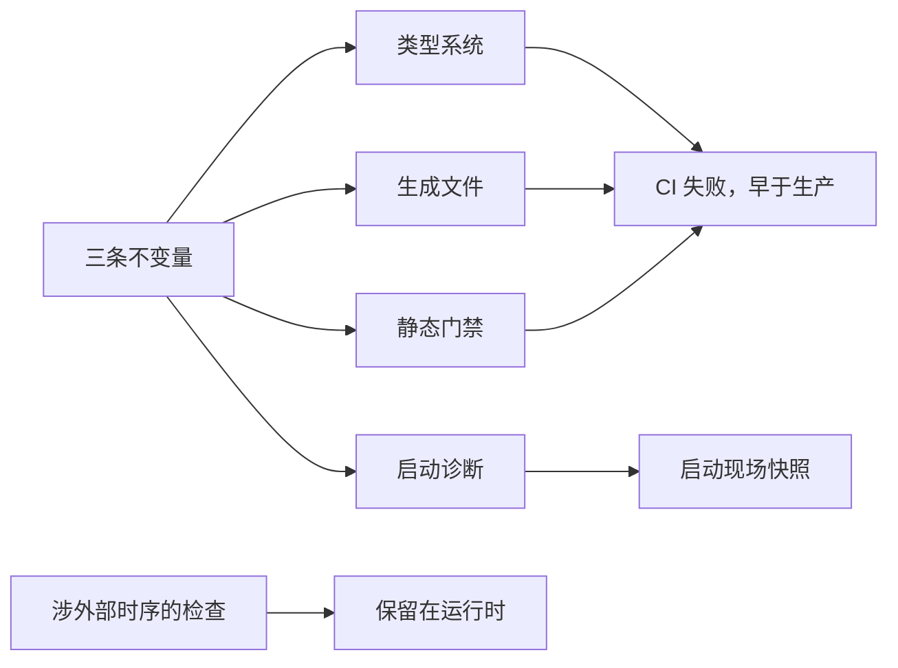

# 24 · 不变量前移、评测与回归：端到端对照与结业项目

> **一句话结论**：能静态判定的不变量交给类型、生成文件、静态门禁与启动诊断，只有涉外部时序的才留在运行时；"改完没改坏"必须靠真实入口、世界验证与回归测试证明，而不是问模型"你做完了吗"。
>
> **对照缺陷：P10（不变量只靠运行时约定）**｜**P0 落点：非确定性系统的评测方法**
>
> **本课修的是**：MVP 全阶段的不变量都靠约定——第 12 课的 `eval-mvp.mjs` 甚至是一个外挂脚本，删掉它，没有任何机制会变红。
>
> 前置：[第 23 课 · 组合部署与信任边界](/ai/harness/23-composition-and-trust) ｜ 回链：[第 13 课 · 从问题清单到 Cordis](/ai/harness/13-from-problems-to-cordis) ｜ [课程总览](/ai/harness/)

## 本课要回答的问题

三条不变量贯穿 Part II：

1. **模型可见即可重建**（第 21 课）；
2. **注册即可逆**（第 16 课）；
3. **扩展不改核心**（第 19 课）。

它们究竟由**谁**保证？MVP 的答案是"大家记得"：脚本检查、代码评审、口头约定。于是出现 P10 的典型症状——约定写在文档里，违反时没有任何东西变红。

第二个问题更实际：改完之后，怎么证明没把别的东西改坏？在一个非确定性系统里，"我跑了一次，看起来正常"几乎不构成证据。本课要给出可操作的判据与工具链。

## 核心原理

### 如果没有这个机制会怎样

先看运行时注册表的世界。v0.2.0-rc.2 之前存在运行时不变量注册表：`ctx.invariants` / `InvariantRegistry` / 各包 `./invariant` 子路径，`sdk-minimal` 挂了五行。它看起来很像"有保证"，实际有三个结构性弱点：只在被跑到时生效（路径没走到，断言就不执行）；失败发生在生产（用户已经在受影响）；扩展税（每加一个能力都要"记得注册检查"）。这正是 P10 的本质：不变量被写成了**运行时约定**，而约定无法覆盖没被执行的路径。

### 不变量前移：一次值得精读的架构决策

`docs/upgrade-guide/v0.2.0-rc.2/remove-runtime-invariants/guide.md` 记录：该版本**整体移除**运行时注册表，四个 emitter 改为"包含并记录 listener 失败"而非重抛 `INVARIANT`。保证手段变成四件套：



为什么前移更好？

1. 运行时断言只在**那条代码路径被跑到时**生效，静态检查覆盖全仓；
2. 运行时失败发生在生产路径，静态失败发生在 CI；
3. 每次新增能力都要"注册检查"是扩展税，类型与生成文件把它自动化。

**但不是所有不变量都能前移**：涉及外部世界时序的（追加批次连续性、副作用前 checkpoint、取消时的结果补齐）必须留在运行时。判据是"**能否在不执行系统的情况下判定**"——如果答案依赖"跑起来之后才知道"，它就该留在运行时，并配启动诊断兜底。

### 门禁体系

`scripts/run-gates.ts` 是聚合真源：

| 命令 | 作用 |
|---|---|
| `pnpm run typecheck` | 类型检查（`tsx scripts/build.ts --scope typecheck`） |
| `pnpm run test:coverage` | 覆盖率门禁，`packages/*/*/src` 每文件 100% |
| `pnpm run doc-sync` | 生成物/文档一致性（含事件词汇表新鲜度） |
| `pnpm run hygiene` | 结构与写法约束（运行时闭包、cordis 配置、插件导出契约等） |
| `pnpm run check:all` | 聚合 |

四项各管一段：类型管"形状对不对"，覆盖管"每一行都被跑过"，doc-sync 管"文档与生成物没漂移"，hygiene 管"结构与写法符合契约"。它们共同的优点是**不执行产品就能失败**。

### 评测：两套"七层"不要混淆

| | 来源 | 分类依据 | 七层 |
|---|---|---|---|
| 教学抽象 | Part I 第 12 课 | 按"测什么" | 纯函数 / mock 边界 / 真实入口 / 世界验证 / 回归 / 轨迹 / 统计 |
| CI 梯队 | `docs/testing.md` 的 `## Tiers` | 按"怎么跑" | Unit / Coverage gate / Real-API e2e / Owner-local expected / Performance benchmarks / Snapshot / Web browser snapshot |

两者互补：前者帮你设计用例，后者帮你把它们放进流水线。混为一谈会导致"以为写了单测就覆盖了真实入口"。

### `docs/testing.md` 四条方法论纪律

**1. `## Prefer the real implementation over a mock`**：*Mock only the expensive or non-deterministic boundary (LLM adapter, network, clock); keep everything downstream real.* 仓库用 `makeBridgeHarness()` 挂载真实 loop/session/tool registry/JSONL，只把 `MockAdapter` 当唯一 mock——mock 掉 session 或 tool registry，测试就只验证了你的想象。

**2. `## Verify the world, not the self-report`**：e2e 断言要**外部重跑命令或重读文件**；对 agent 自己输出做关键词探测会让作弊的 agent 通过。还要断言"未触碰文件字节相同"。

这条直接否定了"问模型你做完了吗"：世界验证的最小形态是读文件、查日志、跑一次命令看退出码。

**3. `## Test the real entry path`**：产品可见插件必须有非单测的 REAL-composition 测试；手工 `ctx.plugin(...)` 不够，要从 `cordis.yml` 经 Loader 启动真实进程；"real entry path"还意味着**发布产物**（`lib/bin.js` 在 plain node 下跑），因为 tsx 会掩盖 settle race 与模块解析失败。

**4. `A guard only guards if the regression fails it`**：先故意引入回归、看测试变红、再回滚。这是第 18 课单调 guard 与第 16 课 HMR-safety 的验收方法——不会红的测试不是门禁，是装饰。

### 可靠性定量与评测诚信

`pass@k` 是 k 次至少一次成功（能力上限），`pass^k` 是 k 次全成功（可靠性）；Agent 产品看后者。非确定性下 A/B 要报样本量与置信区间，不能只看一次运行。LLM-as-a-judge 要配独立检查器、blinded 样本与人类抽检，避免评判者与被评者共享偏见。统计与轨迹先于优化：`packages/telemetry/otel/src/event-log.ts`、`packages/session/session-telemetry/src/coordinator.ts`、`packages/client/ui-trajectory/` 让"症状 → 层 → 第一证据"可操作。

## dsh 源码精读

| 锚点 | 读什么、为什么关键 |
|---|---|
| `docs/upgrade-guide/v0.2.0-rc.2/remove-runtime-invariants/guide.md` | 移除决策与四条迁移步骤。理解"为什么删掉反而是加强" |
| `docs/testing.md` | Tiers + 四条方法论 + HMR-safety / contract regressions |
| `scripts/run-gates.ts` | 门禁聚合真源（含 `hygiene` / `doc-sync` / `check-all` 模式） |
| `packages/boot/app-boot/src/startup-diagnostics.ts` | 运行时侧诊断快照（`StartupPluginState` / `StartupServiceState`） |
| `packages/core/agent-loop/tests/contract-regressions.spec.ts` | 契约回归的实测位置 |
| `docs/development.md` | 开发约定与推送前检查 |
| `docs/subsystems/otel.md` | 轨迹与遥测 |

## 权衡与失效模式

- **前移的边界判错**：把"副作用前 checkpoint"误判成可静态检查，生产崩溃后就会留下无法解释的副作用。
- **100% 覆盖率的误读**：`docs/testing.md` 自己写明 *Line coverage is necessary, never sufficient*；它证明行跑过，不证明功能如发布般工作。
- **mock 了整个世界**：单测全绿但产品入口没跑过，是 `postmortem/0001` 那类事故的根因。
- **关键词探测自报告**：让模型说"已写入"就算通过，等于允许作弊。

## 四层定位

| 层 | 不变量 / 门禁 |
|---|---|
| Prompt | 严格插值未定义即失败；段排序确定性 |
| Context | `ignorable` 拒读、格式版本、追加连续性（运行时） |
| Loop | 取消结算、悬空调用补齐（运行时） |
| Harness | 类型、生成文件、静态门禁、启动诊断（前移） |

## 动手实验

```bash
cd /Users/cheeka/code/deepseek-harness
sed -n '1,30p'  docs/upgrade-guide/v0.2.0-rc.2/remove-runtime-invariants/guide.md
sed -n '7,18p'  docs/testing.md
sed -n '27,42p' docs/testing.md
grep -nE "'hygiene'|'doc-sync'|check-all" scripts/run-gates.ts | head -10

# 全课闭环：P1–P10 在 Part II 是否都有归属
cd /Users/cheeka/code/deepseek-harness/dsh-agent-course
grep -hoE 'P(10|[1-9])' part-2*.md | sort -u -V | tr '\n' ' '; echo
node mvp/harness-mvp.mjs --json | python3 -c \
  "import json,sys; d=json.load(sys.stdin); print('MVP 证据总数', sum(len(x['evidence']) for x in d))"
```

**预期观察**：

1. `guide.md` 前 30 行应看到"整体移除"的表述与四条迁移步骤；注意迁移步骤是给调用方的，不是给运行时的。
2. `testing.md` 两段分别应对四条方法论中的不同条目；把引号里的英文原句抄下来。
3. `grep` 应命中 `run-gates.ts` 里 `hygiene`、`doc-sync`、`check-all` 三个模式名，确认它们是聚合入口而不是散落脚本。
4. 倒数第二条命令应输出 `P1 … P10` 的并集——这是"每课都指名缺陷"的机器检查。
5. 最后一条输出 MVP 证据总数；再运行 `--json` 应看到 5 个 stage。

## 常见误区

- **误区：移除运行时 invariants = 放宽质量。** 保证手段换成了类型 + 静态门禁，覆盖面更大、失败更早。
- **误区：100% 覆盖率意味着没 bug。** 它只证明行跑过；真实入口、世界验证、回归用例缺一不可。
- **误区：单测通过就等于插件能用。** 真实入口要从 `cordis.yml` 经 Loader 启动，发布产物要在 plain node 下跑。

延伸阅读：`docs/testing.md`、`docs/development.md`、`docs/postmortem/0001-acp-default-export-drops-inject.md`、`docs/defensive-patterns/`、`docs/cookbook/extension-cookbook.md`。

## 本课小结

1. 不变量前移的四件套：类型、生成文件、静态门禁、启动诊断；判据是"能否在不执行系统的情况下判定"。
2. 门禁四项各管一段，共同点是**不执行产品就能失败**。
3. 教学七层与 CI 七层是两套坐标：一个设计用例，一个安排流水线。
4. 世界验证 > 自报告；真实入口 > 手工装配；先让回归变红，才证明 guard 有效；可靠性看 `pass^k`，评测要看样本量与置信区间。

## 自测

**1. 说出"不变量前移"的三条理由与判据，并举一个必须留在运行时的不变量。**

<details><summary>参考答案</summary>

理由：运行时断言只在被执行的路径上生效而静态检查覆盖全仓；运行时失败发生在生产而静态失败发生在 CI；逐能力注册检查是扩展税，类型与生成文件可自动化。判据：能否在不执行系统的情况下判定。必须留在运行时的例子：追加批次连续性、副作用前 checkpoint、取消时的结果补齐（任举一个）。

</details>

**2. 区分 Part I 第 12 课的教学七层与 `docs/testing.md` 的 CI 梯队。**

<details><summary>参考答案</summary>

教学七层按"测什么"分类：纯函数 / mock 边界 / 真实入口 / 世界验证 / 回归 / 轨迹 / 统计。CI 梯队按"怎么跑"分类：Unit / Coverage gate / Real-API e2e / Owner-local expected / Performance benchmarks / Snapshot / Web browser snapshot。前者设计用例，后者放进流水线，互补而非替代。

</details>

**3. 解释 "A guard only guards if the regression fails it" 的操作步骤。**

<details><summary>参考答案</summary>

先故意引入一个会被 guard 拦住的回归，运行测试确认它变红（说明 guard 真的在检查）；再回滚该回归，确认测试变绿。若引入回归后测试仍是绿的，说明 guard 没有覆盖这条路径，只是装饰。

</details>

## 缺陷闭环与下一课

- **P10 → MVP 证据 → 本课修法**：MVP 全阶段的不变量都靠约定（第 12 课的 `eval-mvp.mjs` 甚至是一个外挂脚本）。本课的**类型 + 生成文件 + 静态门禁 + 回归测试**把可静态判定的部分前移到 CI；`docs/testing.md` 的 HMR-safety、contract regressions、real entry path 让"注册即可逆""扩展不改核心"可被机器验证；运行时只保留涉外部时序的检查，并有 `startup-diagnostics.ts` 兜底。

### 结业项目：把一条能力迁成 dsh 插件

要求：四层各留一处可验证改动；三条不变量各有证据；eval 报告含回归用例与层归因。

**(1) 加载本地插件**（骨架来自 `docs/user/develop/basic/index.md`，路径必须绝对）：

```sh
mkdir -p scratch-plugin/src
# scratch-plugin/cordis.yml
# - insert:
#     - id: course-research
#       name: '/absolute/path/to/deepseek-harness/scratch-plugin/src/course-tool.ts'
pnpm dsh web --patch ./scratch-plugin/cordis.yml     # 需 Node >=24.9.0 + pnpm install
```

**(2) 一个工具插件**（骨架来自 `docs/user/develop/basic/tool.md`）：

```ts
import type { Context } from '@deepseek-ai/cordis'
import { defineTool } from '@deepseek-ai/dsh-tools'

export const name = 'course-research-tool'
export const inject = ['tools']

export function apply(ctx: Context) {
  ctx.tools.register(defineTool({
    name: 'course_summarize',
    description: 'Summarize a short research note. Use when asked to condense; not for writing files.',
    parameters: { text: { type: 'string', required: true, description: 'Note to summarize' } },
    output: { schema: { type: 'string' },
              render: (_args, value) => [{ type: 'text', text: value }] },
    async execute(args) { return args.text.slice(0, 120) },
  }))
}
```

**(3) 一个策略 hook**（骨架来自 `docs/cookbook/extension-cookbook.md:21-30`）：

```ts
import type { Context } from '@deepseek-ai/cordis'
import type { PreToolDecision, ToolExecution } from '@deepseek-ai/dsh-tools'

// 学员自行实现：例如按 exec.name 与当前作用域判定是否允许
declare function isAllowed(exec: ToolExecution): boolean

export const name = 'course-loop-policy'
export function apply(ctx: Context) {
  ctx.on('tools/pre-execute', async (exec: ToolExecution, next): Promise<PreToolDecision> => {
    if (exec.name === 'course_summarize' && !isAllowed(exec)) {
      return { kind: 'deny', reason: 'Denied by course policy.' }
    }
    return next()                       // 忘掉这行会静默截断整条链
  })
}
// 硬策略请改用 ctx.tools.guard()：单调、不可被重排（第 18 课）
```

**(4) 四层各一处改动**：Prompt 注册一个 `systemPrompt.section()`；Context 注册一个 `systemPrompt.context()` 动态段（后置）；Loop 用 `agent/pre-step` 监听器或 `tools/pre-execute` hook；Harness 用 `--patch` 的 bundle 行或 `ctx.tools.guard()`。

**(5) 验证**（改动型实验在 fork 里跑，只报实际跑过的命令）：

```sh
pnpm dsh --profile web --dump-config | grep -A3 'course-'   # 装配树含新行
pnpm run typecheck && pnpm run doc-sync && pnpm run hygiene
pnpm run test:coverage                                     # 每文件 100%
```

**三条不变量的证明**：① 用 `deriveMessages()` 结果重建一次模型请求；② 装→卸→再装，断言工具与提示段数量不变（HMR-safety）；③ `git diff --stat` 证明未改任何 `packages/core/` 文件。

**eval 报告**：基线 vs 改动后，指标覆盖四层（schema 合法率 / 长会话约束保持率 / 平均步数与总 token / 越权用例拦截率），附失败案例的层归因与回归用例；**验证世界**（读文件/查日志/跑命令），不要问模型"你做完了吗"。

### 全书闭环表

| P | MVP 证据 | 机制 | 课 |
|---|---|---|---|
| P1 | 五职责 / 改 3 处 | typed events + waterfall + pre-step | 17、18、22 |
| P2 | EXTRA 幽灵段 | 提示段可逆注册与确定性排序 | 20 |
| P3 | 卸载后仍为 2 | `effect()` LIFO disposer + HMR-safety | 16、24 |
| P4 | 数组下标即语义 | `inject` 依赖门控 | 15 |
| P5 | 3/3 硬编码 vfs | 服务仓库 + 能力缝隙三角色 | 14、19 |
| P6 | 丢弃消息无日志 | `surfaceOp: replace` 遮蔽不删除 | 21 |
| P7 | 覆盖写回 / 无 seq | 事件溯源 + 相邻单步迁移 | 21 |
| P8 | deny 被洗掉、越权成功 | 单调 `guard()` + 权限预设 + 沙箱 | 18、23 |
| P9 | 配置硬编码 | bundle/profile/patch 分层 | 23 |
| P10 | 不变量靠约定 | 类型 + 静态门禁 + 回归 | 24 |

> **最后一句话**：Part I 里每个"我这么写有什么问题"，在 Part II 都找到了一个有文件路径的答案；反过来，Part II 里每个看似精妙的机制，都能在 `mvp/harness-mvp.mjs` 的一行输出里找到它存在的理由。这就是两段式要交付的东西——**不是记住 Cordis 五概念，而是知道它们各自修好了自己代码里的哪一个坑**。

全包自检：`grep -hoE '^## [0-9]{2} ·' part-*.md | wc -l` 应为 24；P1–P10 在 Part II 全部出现；MVP `--json` 返回 5 个 stage。

课程收束，可回看总览与起点：[课程总览](/ai/harness/) ｜ [第 13 课 · 从问题清单到 Cordis](/ai/harness/13-from-problems-to-cordis)。
