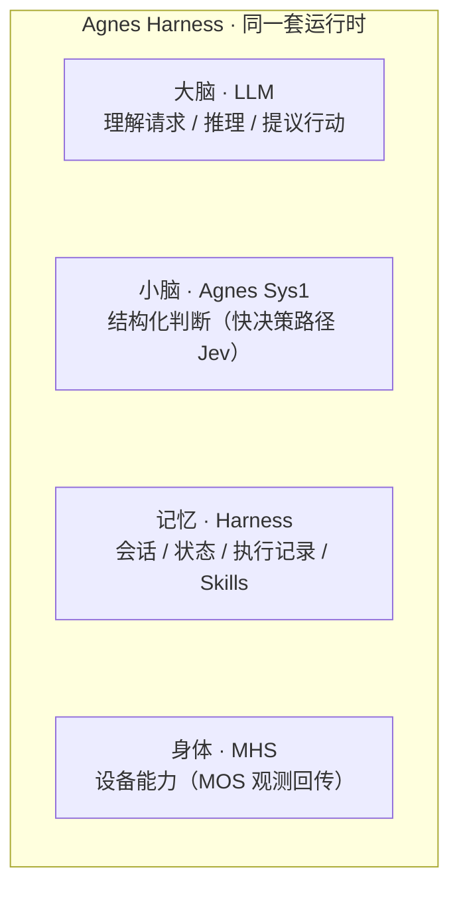
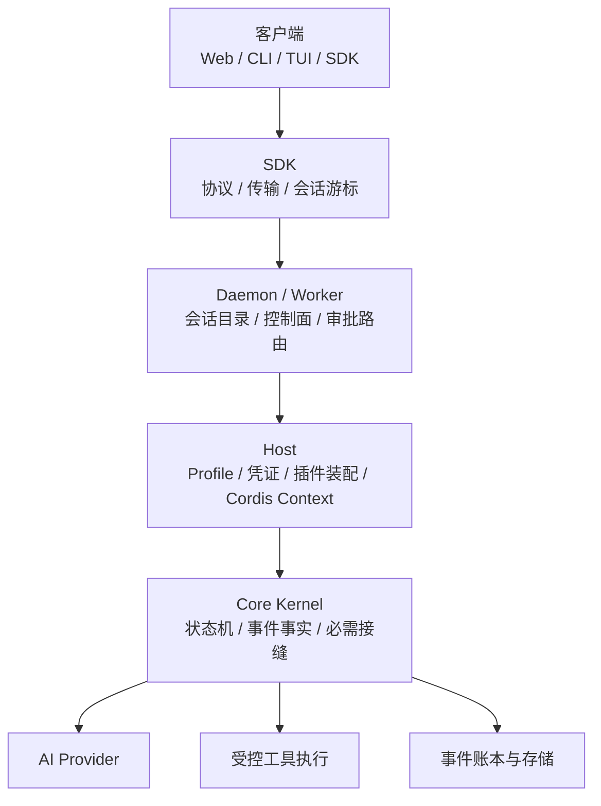
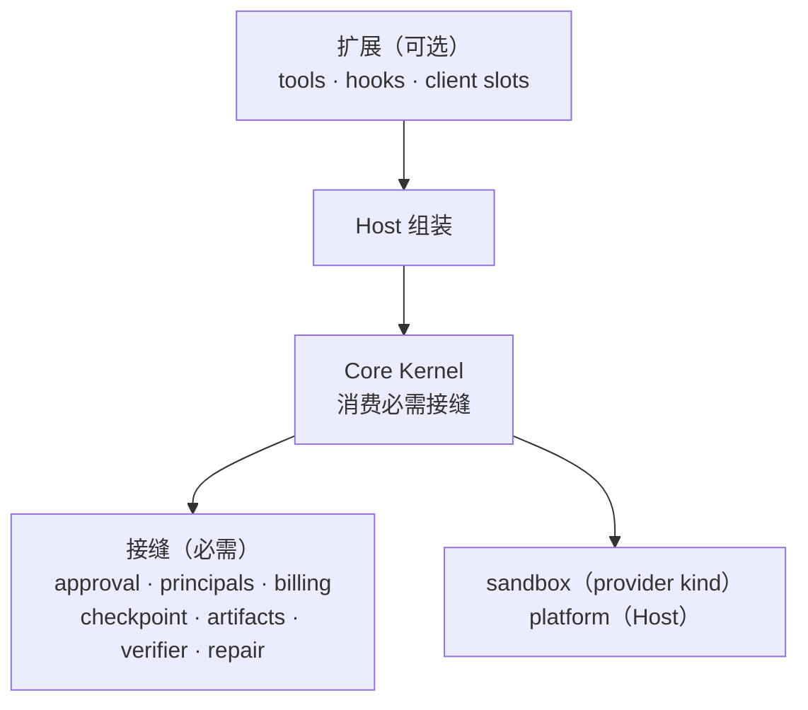
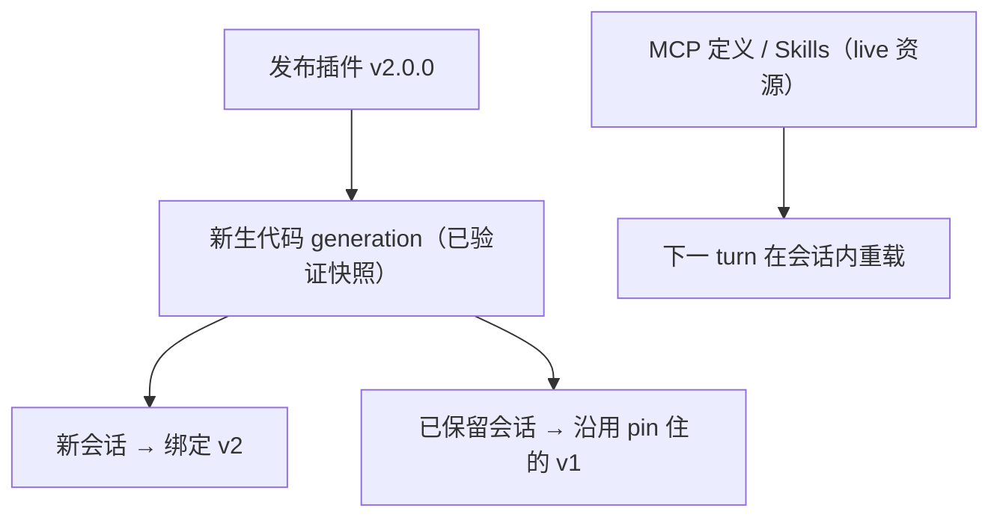

# 附 · Agnes Harness 速读：为 FDE 而生的插件化 Agent 运行时

> **一句话结论**：Agnes Harness（AGH）把「每个现场都不一样的那部分差异」收敛成**可安装、可版本化、可审阅的插件**，用一套共享运行时（App Server + Cordis 插件树 + 单写事件账本）同时承载业务智能体、企业交付与物理设备。
>
> **性质声明**：AGH 是 Agnes AI 团队开源的**另一套** harness，与前 24 课的 DeepSeek Harness（dsh）**不是同一个项目**。本文是「Agent 工程原理」系列的外部参照篇，只做**项目综述与架构导读**，不逐行精读源码；所有数字与结论以官方仓库、官方文档与公开榜单的最新数据为准。
>
> **版本坐标**：pre-alpha 开发者预览 · Apache-2.0 · 运行时 Node.js ≥ 24.10 / pnpm 10.34.5 · **须从源码构建**。API、配置与插件接口仍在演进，可能出现破坏兼容性的变更。
>
> **总览**：[`/ai/harness/`](/ai/harness/)｜**对照系列**：[13 · 从问题清单到 Cordis](/ai/harness/13-from-problems-to-cordis)

## 本笔记要回答的问题

市面上并不缺「Agent 框架」。AGH 宣称要解决的是一个更窄、也更难的问题：**把一个 Agent 真的部署进企业现场之后，那部分「每家客户都不一样」的适配工作，怎么不再是一次性的手工活？**

本笔记回答三件事：

1. AGH 的**架构本体**是什么（四角色、请求路径、三种可安装单元）；
2. 它的**扩展与可信机制**怎么设计（接缝 seams、固化的代码 + 活的资源、证据链）；
3. 官方数字与**它的边界**——哪些是被文档明确标注为「未验证/不主张」的。

## 一、它要解决什么：FDE 与「最后 10 块」

**FDE（Forward Deployed Engineering，前线部署工程）** 指深入业务现场，把系统集成、可用界面与持续迭代做成可交付软件的工程角色。业内流传一个成本比喻（独立 FDE、斯坦福在读博士 Zaniel 的算法）：

> 旧世界做一套企业软件，开发要花 **90 块**，给每家客户适配要花 **10 块**。AI 把「开发」从 90 压到 1，但**那 10 块的适配成本纹丝不动**。AGH 冲的就是这 10 块。

这解释了 AGH 的设计重心：它不在「模型更强」，而在**把差异组织成插件、把交付沉淀为可复用底座**。

官方 README 先划清了它**不是**什么（很重要，决定你怎么试用它）：

| 不是 | 含义 |
|---|---|
| 不是托管服务 | 开发者预览版，须从源码构建、在你自己的环境里跑 |
| 不是任意插件代码的沙箱 | 普通后端插件作为**受信代码在进程内运行**；审批与命令沙箱只作用于**受支持的执行路径** |
| 不是经过认证的设备驱动 | MHS 是 AGH 自有设备协议，独立于 MCP；实时控制与物理安全仍归设备控制器 |
| 还没有定型 | API、配置、插件接口仍在演进，可能出现破坏性变更 |

## 二、四角色架构：大脑 / 小脑 / 记忆 / 身体

AGH 最有辨识度的是它把「同一个运行时」拆成四个仿生角色：



| 角色 | 在 AGH 中意味着什么 | 当前范围 |
|---|---|---|
| **LLM / 大脑** | 理解请求、推理任务、提出行动建议 | 模型账户与模型适配器插件 |
| **Agnes Sys1 / 小脑** | 根据任务上下文回答结构化问题，服务各项判断功能 | 默认判断模型；同时也提供「国内测试 / 国际网关」预设 |
| **Harness / 记忆** | 会话历史、任务状态、执行记录，以及沉淀在 Skills 里的可复用方法 | **运行时本身**：负责执行、记录、恢复与治理 |
| **MHS / 身体** | 连接设备能力，让任务读取物理状态、请求设备动作 | 官方插件，接入中 |

**关键点（也是它和「单模型 Agent」的分野）**：AGH 不是「一个 LLM + 工具循环」，而是**双系统决策**——慢的 LLM 主循环负责推理与规划，快的**决策模型**（README 称默认判断模型为 **Agnes Sys1**；技术报告与开发文档另以 **Jev** 指代这条快决策路径，如 TypeSafe Jev 适配器、Jev agent loop）负责高频的结构化判断。第三方报道把它概括为「双系统决策 + 双层自进化（TTT × Harness 双 RSI）」。

> 名词提示：**MHS = Model Hardware Standard**（AGH 自有开放设备协议，独立于 MCP）；**MOS = Model Observation Standard**（把设备观测到的内容实时推给运行时）。

## 三、运行时分层：一次请求怎么走

官方把状态归属拆得很清楚。**客户端只负责呈现，daemon 管会话与控制面，Host 组装运行时，Core 推进模型/工具循环；模型的文本不决定工具授权、执行与持久状态。**



几个值得记住的分层事实：

- **一个 home，一个 App Server**：每个 `AGH_HOME` 对应一个已认证的 daemon 端点；CLI / Web / SDK 共享同一份会话状态，所以「任务在 Web 上开始、在终端 `/resume` 继续」得以成立。
- **Worker 承载插件「代（generation）」**：连**默认运行方式本身也是插件**——`@agnes/loop-default`。
- **Core 拥有「durable facts」、授权与恢复**：这是「日志即真相」的落点（见第六节）。
- **插件代码按会话固定（pinned）；MCP 定义与 Skills 是按会话组合过滤的动态资源**：这组「固化 vs 活」的区分，是第六节热升级的地基。

## 四、三种可安装单元：Plugin / Agent / Application

AGH 把「装什么」拆成三个不同职责的层级，互不越权：

| 单元 | 是什么 | 谁选择、何时生效 |
|---|---|---|
| **Plugin** | 唯一的**安装 / 升级 / 信任 / 移除**单位；一个包可含多种类型（`tool` / `skills` / `mcp` / `loop` / `model-adapter` / `ui` / `bundle` …） | 安装 + 信任 + 启用后，能力成为「候选」 |
| **Agent** | 一个带自己 `launch` 的 **Bundle**，引用形式为 `package#bundle`；选定 Loop 与预设后开跑 | 启动审阅绑定最终运行模式、模型、权限与来源 |
| **Application** | 声明**品牌、呈现默认值、默认/可见 agent**；安装在插件里 | 管理员在 Settings → Application **预览并显式采纳**；安装**绝不**自动切换应用 |

**一句话记忆**：*插件是「能力和信任」的单位，Agent 是「可启动的运行形态」，Application 是「呈现与身份」。* 三者可以独立演进：换品牌不重配会话，装插件不切应用。

## 五、接缝（seams）vs 扩展（extensions）：两种权限面

这是 AGH 里最容易被忽略、却最影响可信设计的一组区分。

- **接缝（seam）**：kernel **必需**的运行时能力，以「一个带类型的对象」被消费。每个接缝是一种 provider kind，注册方式唯一、选择方式唯一。
- **扩展（extension）**：**可选**特性，例如工具、观测 hook、客户端槽位。



官方文档把 **7 类列为 provider kind**（`approval`、`principals`、`billing`、`checkpoint`、`artifacts`、`verifier`、`repair`），另有 `sandbox` 与 `platform`，技术报告口径为**9 个必需接缝**。要点是：

- **缺接缝不是「降级」，而是拒绝**：选择了一个没有包注册的接缝，装配失败并报 `E_SEAM_MISSING`（工厂抛错或挂起则 `E_SEAM_INIT`）——接缝**永远不会被静默跳过或取默认值**。
- **影响安全的接缝被 pin 到会话**：`approval`、`principals`、`billing`、`checkpoint`、`artifacts` 在会话首次绑定时记录下 provider id、版本、来源包与包完整性；**改配置只对新会话生效，进行中的会话重启后仍用它当时绑定的实现**。`verifier` / `repair` 跟随 generation。
- **注册与选择分离**：包只注册「候选」，profile 用统一语法 `providers.<kind>: { provider }` 选择；「声明」与「运行期注册」是两份不同的证据，**标签从不授予权限**。

一个最小注册例子（来自官方文档）：

```ts
import { checkpointKind, type ProviderPluginContext } from '@agnes/extension-api'

export const main = {
  apply(ctx: ProviderPluginContext) {
    ctx.providers.register(checkpointKind, checkpoint)
  },
}
```

> 对齐到 dsh 系列的第 13–19 课：这一套就是同一支 **Cordis** 血脉的「服务仓库 + provider kind + 可逆 effect」的工程化形态，只是把「必需接缝」和「可选扩展」的**权限面**显式分开了。

## 六、固化的代码 + 活的资源：升级不打断进行中的工作

这是 AGH 主打的一条产品能力：**插件升级时，正在跑的任务保留原来的代码。**



- **代码固化**：发布产生一个 generation，新会话绑定当前代码；**已保留的会话继续跑它 pin 住的那一版**（工具、hook、运行方式、seam），**重启后仍是 v1**。
- **资源是活的**：MCP 定义与 Skills 走同一套 apply 路径，在启动与 turn 边界重载，**下一 turn 生效**。
- **外部副作用不回滚**：外部操作结果**不确定时，必须先核对再决定是否重发**——这不是「至少一次」或「恰好一次」的承诺，而是「未知就先停下来」。
- **会话拒绝有三个方向**（都不会改动账本与 pin）：

| 错误码 | 含义 | 你能做什么 |
|---|---|---|
| `E_SESSION_VERSION_NEWER` | 由更新版 AGH 写入 | 升级 AGH |
| `E_SESSION_VERSION_OLDER` | 由旧版创建，或其 pin 的实现/快照已消失 | 开新会话；管理员可显式迁移 |
| `E_SESSION_CORRUPT` | 完整性校验失败 | 开新会话，保留原始账本 |

- **换 pin 是显式的审计动作**：`agh sessions migrate ...`（或管理调用的 `repin`）；没有它，会覆盖 pinned 实现的迁移会以 `E_SEAM_PIN_CHANGE` 失败并列出差异。

## 七、以可信为根基：审批、证据链与「日志即真相」

AGH 把「执行可被检查、可被控制」当作工程优先项，落点有三处：

1. **包信任绑定到具体内容**：安装前展示**版本、来源、完整性摘要、能力与许可证**；信任绑定的是**内容哈希 + 声明能力**，不是包名。业务事件可通过显式启用的 **Webhook 触发器**在正常策略下开普通会话。
2. **审批与执行约束**：默认**运行命令要先经批准**（仅本次 / 本会话允许 / 拒绝）；轨迹视图按时序记录模型调用、工具与审批。沙箱与执行约束**取决于平台**（如 Windows 暂无 L1 命令沙箱）。
3. **证据链（fact chain）**：**按记录的事实核对，而不是听 Agent 自述**。面板只读，可展开「完整来源与技术细节」，看记录到的请求、工具结果、artifact 引用或候选记录，以及**标识符与缺口（gap）**。

官方对「证据能证明什么」的边界写得很克制：

| 证据 | 它能证明 | 它不能证明 |
|---|---|---|
| 记录的请求 | 保留的逻辑请求 / 受支持的最终传输体 | 一次缺失的传输采样 |
| 工具结果 | 返回内容、拒绝/恢复记录，或接受了一个后台任务 | 这些是**不同的**结果，不能混为一谈 |
| artifact 引用 | 某次调用返回了该引用 | **谁**创建了某个可变工作区文件 |
| 候选来源 | 记录的起草会话、被测试/审阅的哈希与发布状态 | —— |
| 外部完成 | **没有真实外部回执时，一律是未知**；模型的说法不算数 | —— |

> **诚实边界**：普通后端插件**是受信进程内代码，不被沙箱隔离**——只装你信任的插件包。审批与命令沙箱只作用于受支持的执行路径；**不隔离任意插件代码**。恢复**不承诺**外部副作用恰好执行一次，外部副作用崩后可能停在「未知」，需要人工核对。

**概念对齐 dsh 系列**：AGH 用**单写者、JCS-SHA256 的事件账本（ledger）**作为唯一事实来源——这就是第 21 课「日志即真相」在产品级运行时上的对应物；「one-shot effect permits」对应第 16 课的「可逆 effect」；而「pinned code / live resources」则是第 23 课「组合部署与信任边界」的另一种切法。

## 八、自进化 RSI：候选审阅 + 版本化 Playbook（有边界）

「双系统决策 + 双层自进化」里的第二层，是**受治理的递归自我改进（RSI）**。要点是它**改进的是数据，不是权重，也不是可执行的安全代码**：

- **沉淀物是「版本化 Playbook」**：验证有效的方法被整理成带版本的 Playbook 数据，供后续任务复用——不是改模型权重，也不是自动改安全代码。
- **流程是人机协同的**：请 Agent 起草 Skill 或插件 → **运行测试** → **人审阅文件与权限** → 发布。来源记录保留**起草会话与人工审阅信息**。
- **记忆有开关**：文件记忆可保存工作区偏好，**Agent 的记忆访问默认关闭**。

> 对照第三方报道的表述：TTT（test-time training）× Harness 构成「双层 RSI」；落到产品里，可复用资产以**插件 + Skills + 版本化 Playbook** 的形态被安全地固化与复用。

## 九、评测与数据（连同它的边界）

官方与第三方公开了若干数字，整理如下（**均为官方/榜单口径**）：

| 指标 | 数字 | 说明 |
|---|---|---|
| ALE（Agents' Last Exam，完整 Agent 系统） | 总通过率 **21.7%**，总得分 **42.7** | 搭配 Agnes 2.5 Pro Beta；榜单条目模型与设置各不相同 |
| MHS-BENCHMARK（软硬结合的 100 条任务） | 成功率 **41%** | 报道称高于 DeepSeek Harness（40%）与 Codex（36%） |
| BigCodeBench-Hard V1 | 通过率 **40.69%** | 严苛的代码生成 + 多步工具调用 |
| DeepPlanning（复杂任务规划） | **87.07** | 长程、多分支任务的状态连续性 |
| 决策步耗时 | 约 **0.53s**（决策模型）对 **7.6s**（LLM 步） | 来自封闭 home 泄漏模拟 |
| 单位决策成本 | 约 **1/27** | 来自另一项 100 次调用的对照 |

**必须一起读的边界**（官方 `limitations` 与技术报告都写明了）：

- 官方在「性能/评测」一栏明确写：**在固定模型、预算、任务与可复现测量之前，不主张任何领先或提升数字**。
- 技术报告自陈：九套系统评测比较的是**「harness + 模型」的配对**，**不应被读作对 harness 单独的因果测量**；四项闭环 RSI 结果来自**孪生世界模拟**，**不是真实现场落地**。
- AGH 仍是 **pre-alpha**：没有公开 npm 发布、安装器或升级承诺；Windows 端到端验收未完成；实际结果以 [verification](https://github.com/AgnesAI-Labs/agnes-harness/blob/main/docs/maintainers/verification.md) 与榜单最新数据为准。

## 常见误区

- **误区：「AGH 就是 DeepSeek Harness 的新版」**。不是同一个项目。两者都建立在 Cordis 之上，但 AGH 的差异在**产品外壳**（共享 App Server、可安装业务组合、候选审阅、UI 证据）与**双系统决策 / MHS 设备协议**。选型时按需求选更小的那个。
- **误区：「插件跑在沙箱里」**。普通后端插件是**受信进程内代码**；审批与命令沙箱只作用于受支持的执行路径，**不隔离任意插件代码**。
- **误区：「装一个插件就等于切了一套应用」**。安装只让能力成为候选；**应用须由管理员显式预览并采纳**，安装本身从不切换应用。
- **误区：「热升级能保证外部操作恰好执行一次」**。不能。外部副作用可能停在「未知」，须核对后再决定是否重发。
- **误区：「RSI 会让 Agent 自己改模型/安全策略」**。受治理的 RSI **只沉淀版本化的 Playbook 数据**，改进动作要经人审阅；它不改权重、不自动改安全代码。

## 本课小结（速查表）

1. **定位**：AGH 是面向 FDE 的开源 Agent 运行时，目标是「把现场差异变成可复用插件」，而非更强的模型。
2. **四角色**：LLM 是大脑、Agnes Sys1 是小脑（双系统决策）、Harness 是记忆、MHS 是身体（配 MOS 观测）。
3. **三种可安装单元**：Plugin（安装/信任单位）→ Agent=Bundle（可启动运行形态）→ Application（品牌与呈现，需管理员显式采纳）。
4. **两种权限面**：接缝（必需、缺失即拒绝、安全相关者被 pin）vs 扩展（可选）。
5. **升级模型**：代码按 generation 固化、会话 pin 住版本；MCP/Skills 是活资源，下一 turn 生效；外部副作用不回滚。
6. **可信三件套**：内容绑定的包信任 + 审批/约束 + 只读证据链（缺口如实标注）；账本是单写的 JCS-SHA256 事件流。
7. **所有数字都要连同边界读**：pre-alpha、评测是「harness+模型」配对、RSI 结果是模拟。

## 自测

**1. 用一句话说清 Plugin / Agent / Application 三者的职责边界。**

<details><summary>参考答案</summary>

Plugin 是安装、升级、信任与移除的**唯一单位**（能力与信任的单位）；Agent 是一个带显式 `launch` 的 Bundle，是可启动的**运行形态**；Application 声明品牌、呈现默认值与默认/可见 agent，须由管理员显式采纳，安装本身不切换应用。

</details>

**2. 「接缝（seam）」和「扩展（extension）」最关键的区别是什么？为什么它关系到可信？**

<details><summary>参考答案</summary>

接缝是 kernel **必需**的能力（如 approval、billing、sandbox），只注册为候选、由部署 profile 选择，**缺失即 `E_SEAM_MISSING` 拒绝而非静默降级**；影响安全的接缝还会被 **pin 到会话**，中途换不了。扩展是**可选**特性（工具、hook、槽位）。两者权限面不同，所以「声明了某个能力标签」绝不等于获得权限。

</details>

**3. 为什么说「热升级」不是「恰好一次」？**

<details><summary>参考答案</summary>

热升级保证的是**代码版本隔离**（新会话用新代码、保留会话沿用 pin 的旧代码）与**资源下 turn 重载**；但**外部副作用不参与事务、不回滚**。外部操作结果不确定时一律停在「未知」，必须人工核对后再决定是否重发。

</details>

## 延伸阅读

**官方仓库与文档**

- 主仓库：[AgnesAI-Labs/agnes-harness](https://github.com/AgnesAI-Labs/agnes-harness)（`README.zh-CN.md` 是最权威的入口）
- 架构：[从请求到可恢复执行](https://github.com/AgnesAI-Labs/agnes-harness/blob/main/docs/develop/architecture.zh-CN.md) · [插件合同](https://github.com/AgnesAI-Labs/agnes-harness/blob/main/docs/develop/architecture-plugins.zh-CN.md) · [源码地图](https://github.com/AgnesAI-Labs/agnes-harness/blob/main/docs/develop/source-map.zh-CN.md)
- 扩展：[接缝 seams](https://github.com/AgnesAI-Labs/agnes-harness/blob/main/docs/extend/seams.zh-CN.md) · [Bundles 与 profiles](https://github.com/AgnesAI-Labs/agnes-harness/blob/main/docs/extend/bundles-and-profiles.zh-CN.md) · [Applications](https://github.com/AgnesAI-Labs/agnes-harness/blob/main/docs/extend/applications.zh-CN.md) · [按角色选择插件类型](https://github.com/AgnesAI-Labs/agnes-harness/blob/main/docs/extend/choose-a-plugin-type.zh-CN.md)
- 可信与边界：[安全与信任](https://github.com/AgnesAI-Labs/agnes-harness/blob/main/docs/guide/security.zh-CN.md) · [执行证据](https://github.com/AgnesAI-Labs/agnes-harness/blob/main/docs/guide/fact-chain.zh-CN.md) · [支持范围与已知限制](https://github.com/AgnesAI-Labs/agnes-harness/blob/main/docs/reference/limitations.zh-CN.md)
- 场景与方法：[为什么选择 AGH](https://github.com/AgnesAI-Labs/agnes-harness/blob/main/docs/guide/why-agh.zh-CN.md)

**技术报告与判断模型**

- [Agnes Harness 技术报告（2026-11）](https://github.com/AgnesAI-Labs/Agnes-Harness-Technical-Report-Nov-2026)：A Ledger-Authoritative, Dual-System & Self-Improving Runtime for Production Agents
- [Agnes Sys1 1.0 决策模型技术报告](https://github.com/AgnesAI-Labs/Agnes-Sys1-1.0-Technical-Report)
- [Agents' Last Exam 榜单](https://agents-last-exam.org/leaderboard)

**第三方解读**

- [双系统决策 + 双层自进化，Agnes 让 Agent 效率最高提速 14 倍、成本骤降至 1/27](https://hub.baai.ac.cn/view/59888)
- [支撑 Anthropic 市值的 RSI！Agnes 亮出 TTT×Harness 双 RSI 进化架构](https://hub.baai.ac.cn/view/59889)
- [我实测开源 Agnes：决策快 14 倍，但踩了 4 个坑才跑通](https://m.toutiao.com/article/7710451007565742607/)

**本系列相关课**

- [13 · 从问题清单到 Cordis](/ai/harness/13-from-problems-to-cordis)（Cordis 五概念总图，AGH 的插件树同源）
- [16 · 注册是可逆 effect](/ai/harness/16-reversible-effect)（对应 one-shot effect permits）
- [21 · 日志即真相](/ai/harness/21-log-as-truth)（对应单写 JCS-SHA256 事件账本）
- [23 · 组合部署与信任边界](/ai/harness/23-composition-and-trust)（对应 pinned code / live resources）

> **一句话收束**：dsh 系列讲的是「harness 的机制为什么成立」，AGH 讲的是「把这些机制做成一个能对客户交付、能被审计、能跨现场复用的产品」——前者是原理，后者是工程化的落点。
