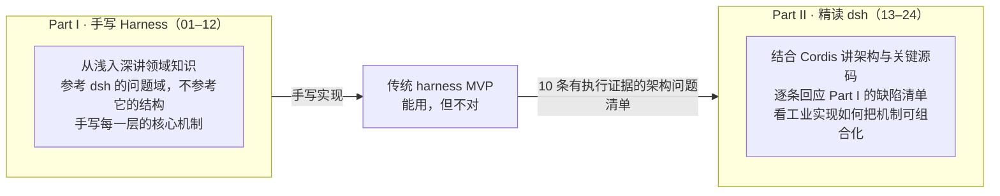
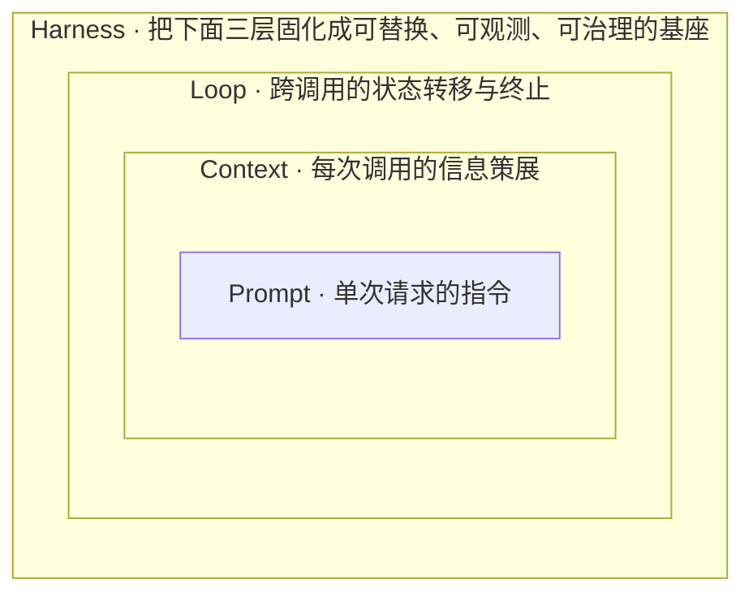
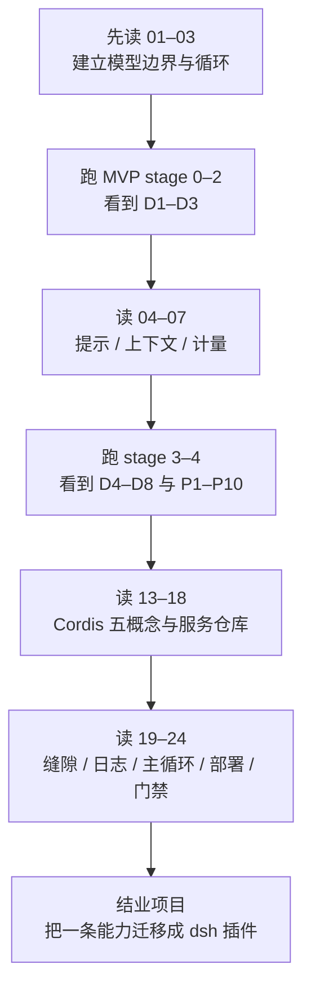

# Agent 工程原理：先手写 Harness，再读懂 DeepSeek Harness

> 一句话问题：**一个只会预测下一个 token 的模型，怎样被组织成「能可靠完成工作」的系统？**
>
> 本笔记系列基于 DeepSeek Harness（dsh）配套课程扩写：Part I 脱离框架手写一个 315 行的传统 harness MVP，Part II 带着自测出的问题清单精读 dsh 的架构与源码。
>
> 规模：2 部分 · 24 课 · 1 个可运行 MVP · 1 个结业项目。

## 0. 为什么要「写两遍」

只讲原理，容易停在「Prompt / Context / Loop / Harness」这组名词上；直接读工业级源码，又会把 Cordis 的五个概念当成需要背诵的 API。这门课用 **build-it-twice（写两遍）** 把两者扣在一起：



**核心承诺**：Part II 讲的每一个 Cordis 机制，都必须指名道姓回答 Part I 里某一条**你自己跑出来过**的缺陷。Cordis 不是要背的五个概念，而是 10 个具体问题的答案。

**受众**：有工程基础、准备转向 Agent 系统开发的工程师。不预设 AI 背景；要求能读写 JavaScript / TypeScript、能跑命令行、理解「不变量」与「可观测性」。

> 注意：`mvp/harness-mvp.mjs` 是**反面教材**。它刻意保留结构性缺陷用于教学，不是最佳实践，不要抄进生产。

## 1. 核心框架：四层是承载关系，不是并列知识点

把 agent 轨迹中的**单个 step** 拆开，四层同时在工作：

| 层 | 这一步回答的问题 | 输入 | 输出 |
|---|---|---|---|
| **Harness** | 这一步**能做什么、多安全**？ | 任务、策略、权限、运行环境 | 可用工具集、沙箱、审计与恢复机制 |
| **Loop** | **要不要再走一步**？ | 上一步结果、停止条件、预算 | continue / retry / escalate / stop |
| **Context** | 这一步**看到什么**？ | 日志、检索、记忆、环境状态 | 本次请求的最小高信号 token 集 |
| **Prompt** | 这一步**问什么、要什么格式**？ | 指令、示例、schema | system + tools + messages 的装配结果 |

**一句话记忆**：*Loop 决定走不走，Context 决定看什么，Prompt 决定问什么，Harness 决定能做什么。*



四层是**同心环而非流水线**：压缩策略（Context）会改变提示前缀稳定性与 KV cache 命中（Prompt），也会改变循环里「还剩多少预算」（Loop）；把工具执行换成远程沙箱（Harness）会连带改变工具描述与结果格式。因此每课都设「四层定位」栏，追踪这种传导；也都有「权衡与失效」栏，因为四层各有自己的失效模式。

### 四层工程的工作定义

| 层 | 优化对象 | 主要手段 | 典型失效症状 |
|---|---|---|---|
| **Prompt Engineering** | 一次请求中的指令 | 角色与消息分层、指令高度、少样本、CoT/ReAct、结构化输出、tool description | 语气/格式不稳定、指令冲突、工具选错 |
| **Context Engineering** | 每次推理时进入窗口的 token 集 | 上下文分层、JIT 检索、压缩、结构化笔记、子代理隔离、溢出外置 | 忘记约束、幻觉、context rot、成本失控 |
| **Loop Engineering** | 跨多步的控制流 | 终止判据、预算与步数上限、重试/回退、循环检测、HITL、检查器与生成器分离 | 停不下来、静默失败、重试风暴、烧钱 |
| **Harness Engineering** | 模型周围的控制基础设施 | 执行环境与沙箱、提示/上下文生命周期、可观测与追踪、策略执行、故障恢复、多 agent 协调 | 越权副作用、不可复现、无法审计、扩不动 |

> 术语诚实声明：Prompt / Context Engineering 有较公认定义；Loop / Harness Engineering 是 2025–2026 年兴起的从业者术语、尚无标准规范。本笔记给的是可操作的工作定义。工具链语法会变，四层的责任边界不会。

### 三条贯穿全课的不变量

Part I 逐条违反，Part II 逐条兑现：

1. **模型可见即可重建** —— 每次请求必须能从日志重建；新输入必须先成为事件。
2. **注册即可逆** —— 任何注册都能精确撤销，卸载后不留幽灵。
3. **扩展不改核心** —— 新行为挂在缝隙上，靠组合而不是 patch 主循环。

## 2. 铰链：10 条架构问题（P1–P10）

Part I 第 12 课交付「传统 harness MVP + 架构问题清单」。每条问题都有 `--stage N` 的可复现证据，不是空泛吐槽。

| 编号 | 问题 | 可观测证据（MVP stage） | Part II 解法所在课 |
|---|---|---|---|
| **P1** | 控制流焊死在主循环，策略不可组合 | S1 / S3 | 17–18 |
| **P2** | 提示词是模板字符串，不能按段注册 / 排序 / 卸载 | S1 / S4 | 20 |
| **P3** | 注册不可逆，热重载与作用域留下幽灵注册 | S4 | 16 |
| **P4** | 加载顺序靠手写数组，无依赖门控 | S4 | 15 |
| **P5** | 工具直接耦合本地执行世界，换 Provider 要 fork 所有工具 | S4 | 19 |
| **P6** | 压缩即删除 → 请求不可重建、不可审计、不可回放 | S2 | 21 |
| **P7** | 消息数组即状态 → fork/resume/迁移/遥测各存各的，必然漂移 | S2 / S4 | 21 |
| **P8** | 策略无单调性保证，deny 可被后续 handler 洗掉 | S3 | 18 |
| **P9** | 配置散落，多运行形态靠 if 分支而非组合 | S3 / S4 | 23 |
| **P10** | 不变量只靠运行时约定，没有类型 / 静态门禁 / 回归测试 | 全阶段 | 24 |

**怎么用这张表**：先跑 Part I 的实验，在 `--stage N` 的输出里亲眼看到失败证据；再读 Part II 对应课，检查「机制是否真的回应了这条问题」。不是记住机制名，而是能回答「哪个机制、在哪个文件、怎么保证」。

## 3. 课程地图（24 课）

### Part I · 手写 Harness（01–12，零依赖）

| 课 | 主题 | 手写什么 | 刻意保留的缺陷 |
|---|---|---|---|
| [01](/ai/harness/01-from-model-to-actor) | 自回归、采样、ICL、推理模型与测试时计算 | `ScriptedModel.complete()`、Stage 0 | D1 意图 ≠ 动作 |
| [02](/ai/harness/02-tool-calling) | Tool calling 三阶段、schema 双向契约 | `TOOLS` schema + `validate()` + `runTool()` | 校验边界只到类型 |
| [03](/ai/harness/03-react-and-termination) | ReAct、turn/step、四类终止判据、复合误差 | `stage1()` 的 while + 回填 + CAP 对照 | D2 无宿主预算、D3 单函数五职责 |
| [04](/ai/harness/04-prompt-architecture) | 消息角色、指令层级、指令高度、顺序效应 | `renderSystem()`、静态/动态分段实验 | D4 提示词是模板字符串 |
| [05](/ai/harness/05-reasoning-and-structured-output) | CoT、软约束 vs grammar 硬约束、tool description | schema 失败重试 + 模拟 token 屏蔽 | 结构化输出的可校验域 |
| [06](/ai/harness/06-context-economics) | attention budget / context rot、Token 计量与成本模型 | 手写 token 估算、预算触发、cache 前缀亲和 | D5 无计量、全量入窗 |
| [07](/ai/harness/07-context-assembly) | 上下文六来源、静态/动态分离、溢出外置 | 手写装配函数 + 工具结果截断 | 最小高信号集 |
| [08](/ai/harness/08-compaction-and-isolation) | 压缩三法（compaction / 笔记 / 子代理） | 朴素压缩 + fork | D6 压缩即删除，请求不可重建 |
| [09](/ai/harness/09-persistence-and-checkpoint) | 持久化、checkpoint、fork/resume、格式演进 | JSONL 追加 vs 整体覆盖写回对照 | D7 消息数组即状态、无 seq |
| [10](/ai/harness/10-reliability-and-trust) | 预算 / 重试 / 取消 / HITL、最小权限与信任边界 | handler 数组 + 审批 + 只读 guard | D8 deny 被覆盖，越权写入成功 |
| [11](/ai/harness/11-streaming-and-cancellation) | 双轨流式、取消传播、一致性结算 | settle 骨架 + 悬空 tool call 补齐 | `TOOL_OUTCOME_UNKNOWN` 语义 |
| [12](/ai/harness/12-extensibility-and-eval) | 可替换性、插件化、非确定性系统的评测方法 | 插件 install/uninstall、换执行世界尝试 | MVP 终版 + P1–P10 清单 |

### Part II · DeepSeek Harness（13–24，Cordis → 关键源码）

| 课 | 主题 | 对照缺陷 |
|---|---|---|
| [13](/ai/harness/13-from-problems-to-cordis) | 从问题清单到 Cordis 五概念总图；`Agent = Model + Harness` | P1–P10 全景 |
| [14](/ai/harness/14-plugin-as-service) | Plugin = Service / Context = 服务仓库 | P1、P5 |
| [15](/ai/harness/15-inject-dependency-gating) | `inject` 依赖门控与加载顺序推导 | P4 |
| [16](/ai/harness/16-reversible-effect) | 注册是可逆 effect；HMR-safety 怎么测 | P3 |
| [17](/ai/harness/17-typed-events-waterfall) | Typed Events 五种派发；waterfall 策略叠加 | P1 |
| [18](/ai/harness/18-tool-pipeline-guard) | 工具执行四段管线与单调 guard | P1、P8 |
| [19](/ai/harness/19-capability-seams) | 能力缝隙三角色与共享执行世界 | P5 |
| [20](/ai/harness/20-prompt-sections-and-adapter) | 提示段作为可组合程序；模型适配层与推理模型 | P2 |
| [21](/ai/harness/21-log-as-truth) | 日志即真相：投影、`surfaceOp`、格式迁移 | P6、P7 |
| [22](/ai/harness/22-agent-loop-and-token-meter) | 主循环 turn/step 状态机；Token 计量 | P1、D5 |
| [23](/ai/harness/23-composition-and-trust) | 组合部署；信任边界：凭证 / 权限预设 / 沙箱 | P9、D8 |
| [24](/ai/harness/24-invariants-and-regression) | 不变量前移；评测与回归；端到端对照 | P10 |

**四层在两段的分布**：Prompt（04–05、20）、Context（06–09、21）、Loop（03、10–11、17–18、22）、Harness（12–16、19、23–24）。Context 与 Loop 课时最多，因为**绝大多数生产事故落在这两层，而绝大多数教程只讲 Prompt**。

## 4. 每篇笔记的固定结构

| 栏目 | 作用 |
|---|---|
| 本课要回答的问题 | 这一层要解决的工程问题，可判定表述 |
| 核心原理 | 机制、公式、状态图、对照表；先讲「为什么成立」 |
| 代码与实现 / dsh 源码精读 | MVP 行段或真实文件路径 + 函数/行号 + 短代码 |
| 权衡与失效模式 | 代价、症状、什么条件下会坏 |
| 四层定位 | 从哪层拿输入、向哪层交输出、改动如何传导 |
| 动手实验 | 可执行命令；Part II 以只读观察为主 |
| 常见误区 | 反直觉点 |
| 本课小结 | 可背诵的 3–5 条结论 |
| 自测 | 带参考答案的检查题 |
| 缺陷闭环 | 「刻意保留的 D?」或「对照缺陷 P?」→ 后面哪课怎么解 |

### 缺陷编号速查

- **D1–D8**（Part I 的教学缺陷）：D1 意图无执行 / D2 无宿主预算 / D3 单函数五职责 / D4 模板字符串提示 / D5 无计量全量入窗 / D6 压缩即删除 / D7 消息数组即状态 / D8 deny 被覆盖。
- **P1–P10**（第 12 课交付的架构问题清单）：D 是「代码里留的坑」，P 是从坑里抽象出的架构问题，两者不是一一对应。

## 5. 诊断矩阵：出问题先归因到层

| 症状 | 优先归因层 | 第一证据（Part I） | 第一证据（Part II） |
|---|---|---|---|
| 输出语气/格式漂移、工具选错 | **Prompt** | `renderSystem()` 拼出的文本 | `systemPrompt.assemble()` 段顺序、tool description |
| 忘记用户约束、重复提问、后期越答越差 | **Context** | `messages` 数组压缩后内容 | `deriveMessages()` 投影结果、压缩阈值 |
| 停不下来、重试风暴、成本异常、静默失败 | **Loop** | `while(true)` 的步数与截断 | `agent.ts` stop reason、goal round budget |
| 越权副作用、不可复现、无法审计、换环境就崩 | **Harness** | handler 决策日志、`session.json` | guard/审批、profile 组合、`scripts/run-gates.ts` |
| 「换个更强的模型就好了」 | **归因错误** | 用本表重新定位 | 换模型通常掩盖而非修复层缺陷 |

**工程含义**：*修错层比不修更贵*——它会引入新机制去补偿一个本不该存在的缺陷，然后这套补偿本身成为下一个故障源。

**成熟度自评**：L0 调提示词 → L1 模板 + 检索 → L2 动态上下文与压缩 → L3 工具/沙箱/追踪 → L4 停止条件、恢复、HITL、eval 门禁。本课目标是把读者从 L1/L2 带到 L4。

## 6. 实验环境

### Part I：零依赖，本机即可跑

```bash
cd /Users/cheeka/code/deepseek-harness/dsh-agent-course/mvp
node -v                                  # >=18 即可
node harness-mvp.mjs                     # 依次跑 stage 0..4，看 15 条缺陷证据
node harness-mvp.mjs --stage 3           # 只看 guard 被覆盖
node harness-mvp.mjs --json | python3 -c \
  "import json,sys; d=json.load(sys.stdin); assert [x['stage'] for x in d]==[0,1,2,3,4]; \
   print('5 stages OK,', sum(len(x['evidence']) for x in d), 'evidences')"
```

**唯一硬规矩**：手写版只借 dsh 的**问题域与不变量**，禁止借**结构**（Context / Service / effect / inject、append-only 数据模型、包划分）。下面的 grep 就是自动检测线，结果应为空：

```bash
grep -nE 'ctx\.|effect\(|inject|surfaceOp|Service' harness-mvp.mjs | grep -v '\*'
```

### Part II：源码精读不依赖运行环境

```bash
cd /Users/cheeka/code/deepseek-harness

# 环境预检
node -p "require('./package.json').engines.node"     # >=24.9.0
node -p "require('./package.json').packageManager"  # pnpm@11.28.5

# 只读观察型（Part II 主力实验）
ls packages/core/agent-loop/src/
sed -n '274,310p' packages/core/agent-loop/src/agent.ts
sed -n '443,465p' vendor/cordis/src/fiber.ts
sed -n '1,14p'   packages/bundle/base/cordis.patch.yml
```

> 本机已知限制：Node v22 低于 dsh 要求的 >=24.9.0，`pnpm install` 与 `--dump-config` 类启动命令可能失败。这不影响 Part I 的实验，也不影响 Part II 的 `sed` / `grep` / `ls` 源码精读；讲义中的运行命令以仓库官方文档为准。

**纪律**：改动型实验一律在 fork / 独立分支做，先记录基线输出。仓库处于 developer preview，包族归属会变，上课前先执行 `ls packages/` 校准锚点。

## 7. 怎么学：一条可执行的路径



1. **先跑再读**：Part I 每课先执行实验，记录输出，再读「核心原理」，带着失败现象找解释。
2. **每课只回答一个问题**：读完能用自己的话回答「这层缺了会怎样、这个机制怎么补」。
3. **用 P1–P10 做索引**：Part II 读完后，为每条 P 写一句「哪个机制、在哪个文件、怎么保证」，不许只写机制名。
4. **结业项目**：把 MVP 里的一条能力迁移成 dsh 插件，要求四层各留一处可验证改动、证明三条不变量未破坏、提交基线 vs 改动后的 eval 报告。

## 8. 延伸阅读

**经典论文**（按课程出现顺序）

| 文献 | 对应课 |
|---|---|
| Wei et al., *Chain-of-Thought Prompting*, 2022, arXiv:2201.11903 | 05 |
| Yao et al., *ReAct*, ICLR 2023, arXiv:2210.03629 | 03 / 22 |
| Schick et al., *Toolformer*, 2023, arXiv:2302.04761 | 02 |
| Liu et al., *Lost in the Middle*, TACL 2024, arXiv:2307.03172 | 06 |
| Shinn et al., *Reflexion*, 2023, arXiv:2303.11366 | 10 / 18 |
| Packer et al., *MemGPT*, 2023, arXiv:2310.08560 | 08 |
| Yang et al., *SWE-agent*, 2024, arXiv:2405.15793 | 19 |

**工程文献**

- Anthropic, *Building effective agents*（2024-12）：workflow vs agent、五种组合模式
- Anthropic, *Effective context engineering for AI agents*（2025-09）：attention budget、context rot、长任务三法
- 12-Factor Agents（humanlayer）：*own your control flow*
- Chroma, *Context Rot* report（2025-07）：输入变长后的性能退化实测

> **模型提供能力，四层工程把能力组织成可执行、可验收、可演进的工作。** 先有失败证据，再有架构答案——这是本系列与「框架源码导读」的根本区别。
