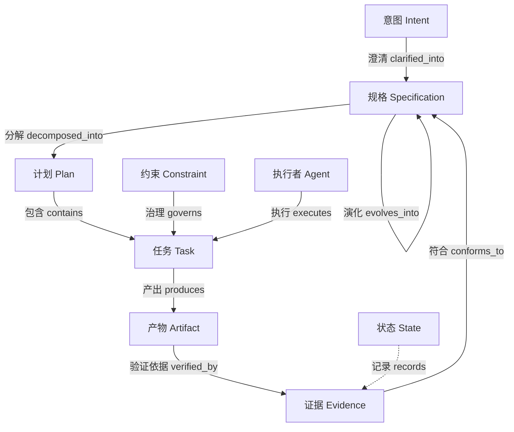
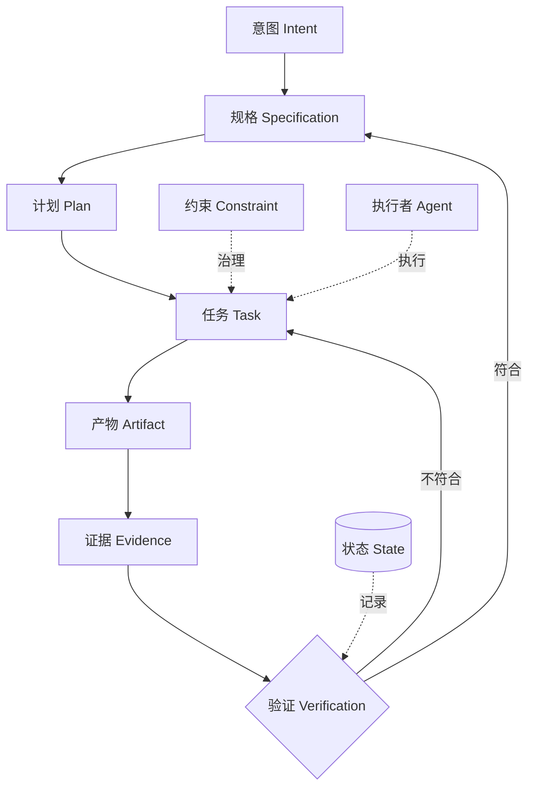
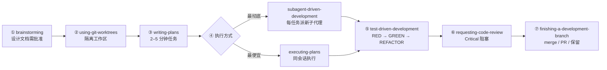

# AI编码工具

## 0. 导读与速览

三者都旨在「让 AI 编码更可控」，但**控制的环节、规格的形态、约束的强度、执行权的归属**完全不同。用本体视角看，它们是同一条「意图→规范→产物→证据」链路上的不同实现（详见第 1 章）。

| 维度 | OpenSpec | Superpowers | Ouroboros |
| --- | --- | --- | --- |
| 一句话定位 | 给 AI 编码助手加一层**规格层**：先写清楚"要做什么"再动手 | 给 AI 编码 Agent 套一套**软件开发方法论**：TDD + 子代理 + 不可跳过的流程 | **Spec-first 的 Agent OS**：访谈澄清 → 冻结规范 → 派给现有 agent 执行 → 自动验收 → 进化 |
| 核心关注 | 需求/变更的**规格与审计**（why & what） | 代码的**质量与纪律**（how well） | 从模糊想法到验收通过的**全自动闭环** |
| 规格形态 | 可变增量 spec（Git Markdown，source of truth） | 一次性设计/计划文档（commit 入库，非规范性 spec） | 不可变 Seed（冻结 Pydantic model）+ EventStore |
| 谁写代码 | 你的 AI 工具（Claude/Cursor…）按 tasks 实现 | agent 自己（TDD + 子代理） | 你的现有 agent（14 种 runtime）按 AC 执行 |
| 约束强度 | 轻（无固定阶段门，可随时改产物） | 强（HARD-GATE + hook；但提示层、用户指令可覆盖） | 强（ambiguity gate + 三阶段评估；含可选执行沙箱） |
| 典型命令/触发 | `/openspec-propose`、`/openspec-apply-change` | 自然语言触发（如 "Let's build a ..."） | `ooo interview`、`ooo auto`、`ouroboros run` |
| 跨工具支持 | 30+ 种 AI 工具 | 10+ 种 harness | 14 种 runtime 后端 |
| 主语言/形态 | TypeScript 单 CLI（无需 Node 的独立二进制） | Markdown skills + hooks（插件） | Python CLI / MCP Server / TUI |
| 适合谁 | 存量项目改造、需要变更审计的团队 | 在意 TDD 与代码审查质量的开发者 | 想要"一句话到可验收交付"的自动化玩家 |

**选型直觉**：
- 想解决"AI 老做偏、需求活在聊天记录里" → **OpenSpec**
- 想解决"AI 写的代码质量差、不写测试" → **Superpowers**
- 想要"给个模糊需求，它自己问清楚、做完、验收" → **Ouroboros**
- 可组合，但**需明确主流程归属**——见第 5.2 节（苏格拉底 review 修正后补充）。

## 1. 领域本体：统一解释三者的底层模型

### 1.1 为什么用本体视角

本体（Ontology）在知识工程里指：对某一领域**概念体系的显式、形式化说明**，包含类（实体）、属性、关系、公理（不变量）与实例。用在这里的价值：

1. **去营销噪声**：三个工具各自宣称"规格层 / 方法论 / Agent OS"，本体提供统一标尺，让它们可比。
2. **暴露真正的分歧点**：例如"规格是否不可变""谁持有执行权"——这些才是选型关键，而不是 star 数。
3. **指导组合**：知道各工具覆盖了链路的哪些环节，才知道它们能否拼起来、接缝在哪。

### 1.2 核心实体（类）

| 实体 | 符号 | 定义 | 关键属性 |
| --- | --- | --- | --- |
| 意图 | Intent | 用户原始的、模糊的、未结构化的需求 | 清晰度 clarity、歧义度 ambiguity |
| 规格 | Specification | 对意图的明确化、可验证的陈述（what/why） | 可变性 mutability、粒度、是否 source of truth |
| 计划 | Plan | 从规格到执行步骤的分解（how） | 任务粒度、依赖顺序 |
| 任务 | Task | 计划的最小可执行单元 | 可勾选、可验证、上下文隔离 |
| 产物 | Artifact | 执行产生的东西：代码、文档、提交 | 可追溯、可回滚 |
| 证据 | Evidence | 证明产物满足规格的凭据：测试、审查、评估结果 | 可信度、成本、是否可被授予接受 |
| 验证 | Verification | 对照规格检查产物的过程 | 阶段（机械/语义/共识）、门槛 |
| 约束 | Constraint | 强制的流程规则：gate、hook、threshold | 作用域、强制层级（提示层/环境层） |
| 执行者 | Agent | 干活的主体：人或 AI、主 agent 或子代理 | context 新鲜度、权限、自主度 |
| 状态 | State | 持久化的进度/历史：规格库、事件日志、ledger | 可重放、可续跑、跨会话 |

### 1.3 核心关系（谓词）

用 mermaid 图表示实体间的语义关系（箭头标注谓词）：



主链（简化正向流程）与三者覆盖位置：



### 1.4 公理（不变量）

这五条是从三者设计中抽出的"应当成立的规律"，也是 review 的判据：

- **A1 规格优先**：任一被接受的产物必须存在对应规格，使 `验证(产物, 规格)` 可判定。违反即"做偏了"。
- **A2 证据必要**：产物的接受必须以证据为前提；没有证据的"完成"只是声称。（Superpowers 的 "Evidence over claims"、Ouroboros 的 Mechanical 阶段均体现此条。）
- **A3 约束传导**：约束的强制层级决定流程可被跳过的程度——提示层约束可被用户指令覆盖，环境层（沙箱/worktree）约束不可。
- **A4 状态连续**：闭环的连续性由持久化状态保证；无状态则"中断即失忆"（故 OpenSpec 依赖 Git、Ouroboros 依赖 EventStore、Superpowers 依赖 ledger）。
- **A5 可变性守恒**：规格的"不可变"需区分**实例级**与**类型级**——冻结单个实例并生成新实例（Ouroboros 进化）、原地增量修改（OpenSpec delta spec）、一次性文档不回写（Superpowers）是三种不同选择。

### 1.5 本体映射：三工具如何实例化

| 实体 | OpenSpec | Superpowers | Ouroboros |
| --- | --- | --- | --- |
| Intent | 用户口头描述 → Explore 梳理想法 | brainstorming 苏格拉底式追问 | Socratic interview + ambiguity 评分 |
| Specification | `specs/` + `changes/` 的 delta spec（可变、增量、SoT） | 设计文档 `specs/*-design.md`（一次性，非规范性 SoT） | 不可变 Seed（goal/AC/ontology/constraints） |
| Plan | design.md | writing-plans 的 plan.md（2–5 分钟粒度） | AC 直接 fan-out，无独立 plan 文档 |
| Task | tasks.md 勾选清单 | 计划中的每个 2–5 分钟任务 | 各 acceptance criterion |
| Artifact | 你的 AI 工具写的代码 | agent 自己写的代码 + commit | 你的现有 runtime 写的代码 |
| Evidence | `openspec validate` + 人工 review | RED/GREEN 测试 + 两阶段审查 | 三阶段评估（机械/语义/共识） |
| Verification | 结构校验（弱） | TDD + 审查（强） | 三阶段 + 收敛检测（最强、成本最高） |
| Constraint | config.yaml rules（追加式、轻） | HARD-GATE + SessionStart hook（强、提示层） | ambiguity gate ≤0.2 + 执行沙箱（强、含环境层） |
| Agent | 外部 AI 工具按 tasks 执行 | 主 agent + implementer/reviewer 子代理 | 外部 runtime（14 种）按 AC 执行 |
| State | Git 跟踪的 specs/changes | git worktree + ledger/progress.md | SQLite EventStore + checkpoint |

### 1.6 本体视角下的本质差异

把上表浓缩成一句话：

- **OpenSpec 是"规格与状态"专家**：强化 Specification（可变增量）+ State（Git 审计），把执行权留给外部工具，验证较弱。
- **Superpowers 是"执行与证据"专家**：强化 Task（上下文隔离的子代理）+ Verification（TDD + 审查），规格只是一次性设计文档。
- **Ouroboros 是"全链路闭环"实现**：从 Intent 澄清到 Specification 冻结、执行委托、三阶段 Verification、再到 State 重放与进化，覆盖所有实体。

由此得出一个功能性结论（也是第 5 章组合建议的依据）：**三者覆盖的环节互补但不完全正交**——OpenSpec 与 Superpowers 在"谁主导 Specification/Plan"上会重叠，故组合时必须划清主流程归属。

## 2. OpenSpec —— 规格驱动开发（SDD）的轻量规格层

### 2.1 定位与理念

OpenSpec 在写代码之前，先让人类与 AI 就"要构建什么"达成一致（**agree before you build**），把规格和代码放进同一个 Git 仓库一起演进。官方理念原文：

```
→ fluid not rigid                      流动而非僵化
→ iterative not waterfall              迭代而非瀑布
→ easy not complex                     简单而非复杂
→ built for brownfield not just greenfield   面向存量项目，不只是全新项目
→ scalable from personal projects to enterprises   从个人项目扩展到企业级
```

它把"系统当前真实规格"（`openspec/specs/`）与"提议中的变更"（`openspec/changes/`）分开，因此特别适合存量项目改造与变更审计。

### 2.2 安装与初始化

```bash
# 方式 A：官方一键脚本（独立二进制，无需 Node.js）——推荐
curl -fsSL https://openspec.dev/cli/install.sh | sh
# Windows PowerShell:  irm https://openspec.dev/cli/install.ps1 | iex

# 方式 B：npm（需 Node.js ≥ 22.20.0）
npm install -g @fission-ai/openspec@latest
# 其他：brew install openspec / nix run github:Fission-AI/OpenSpec -- --version

# 验证
openspec --version

# 进入项目并初始化（交互式选 AI 工具）
cd your-project
openspec init
# 或指定工具、指定项目级安装
openspec init --tools claude,cursor --scope project
```

让 AI 替你安装：把这句粘进 AI 对话 —— `Fetch https://raw.githubusercontent.com/Fission-AI/OpenSpec/main/install.md and follow it.`

`init` 会创建 `openspec/` 目录、把 skills 装到 `.agents/skills/`（并按需链接到 `.claude/skills/` 等）、生成 `openspec/config.yaml`。**IDE 工具需重启以加载 skills。**

### 2.3 核心工作流：五步闭环


| 步骤 | 调用 | 做什么 | 产出 |
| --- | --- | --- | --- |
| Explore | `/openspec-explore` 或自然语言 | 读代码、提问、权衡方案，**不写代码** | 对话中的结论 |
| Propose | `/openspec-propose add-dark-mode` | AI 起草变更计划，**停在计划** | `changes/<name>/` 下 4 类产物 |
| Review | 人工读 | 按 `proposal.md` → `specs/`（最有价值）→ `tasks.md` 顺序审，直接改 Markdown | 修订后的计划 |
| Apply | `/openspec-apply-change`（建议新会话） | AI 逐条勾选 `tasks.md` 实现；中断后重开会从第一个未勾选项续 | 代码 + 勾选完的 tasks |
| Archive | `/openspec-archive-change` | 把 delta spec 合并进 `specs/`，变更目录移入 `changes/archive/<日期>-<name>/` | 更新后的主规格 |

### 2.4 目录结构与产物格式

```text
openspec/
├── config.yaml          # 项目设置与 AI 上下文/规则
├── specs/               # 系统当前真实规格（source of truth）
└── changes/             # 进行中的变更
    └── archive/         # 已完成的变更，如 2026-11-19-add-dark-mode/
        ├── proposal.md
        ├── design.md
        ├── tasks.md            # 所有 checkbox 已勾选
        ├── .openspec.yaml      # 变更元数据（goal / skip_specs 等）
        └── specs/rate-limiting/spec.md   # delta spec
```

**四类产物要点**（spec-driven schema）：

- `proposal.md`：1–2 页，聚焦 why 而非 how。含 `## Why` / `## What Changes` / `## Capabilities` / `## Impact`。纯重构/文档类无 capability 时需在 `.openspec.yaml` 设 `skip_specs: true`。
- `specs/<capability>/spec.md`（delta spec）：用 `## ADDED / MODIFIED / REMOVED / RENAMED Requirements` 表达增量。
  - 场景标题**必须正好 4 个 `#`**：`#### Scenario: xxx`（3 个会静默失败！）
  - 每个 requirement ≥ 1 个 scenario，场景须含 WHEN/GIVEN + THEN；规范性需求用 `SHALL/MUST`。
  - `MODIFIED` 必须写完整更新后内容（不能只写片段）；`REMOVED` 须含 `**Reason**` 与 `**Migration**`。
- `design.md`：`## Context` / `## Goals / Non-Goals` / `## Decisions` / `## Risks / Trade-offs` / `## Migration Plan` / `## Open Questions`。
- `tasks.md`：`- [ ] 1.1 ...` 勾选格式；每个任务写明"如何验证完成"；归档等后续动作用普通 bullet（不参与勾选）。

**delta spec 示例**（README 原文）：

```markdown
## ADDED Requirements
### Requirement: Theme selection
The app SHALL let users switch between light and dark themes,
defaulting to the system preference.

#### Scenario: User toggles dark mode
- **WHEN** the user clicks the theme toggle
- **THEN** the app switches to dark mode and persists the choice
```

### 2.5 完整示例：从零到归档（dark mode）

```text
① You: /openspec-propose add-dark-mode
   AI:  Created openspec/changes/add-dark-mode/
        ✓ proposal.md  ✓ specs/  ✓ design.md  ✓ tasks.md

② 人工审查 4 个文件（重点看 specs/），必要时直接改 Markdown

③ You: /openspec-apply-change        # 建议新开会话
   AI:  ✓ 1.1 Add theme context provider ...  All tasks complete!

④ You: /openspec-archive-change
   AI:  Archived to openspec/changes/archive/2026-11-19-add-dark-mode/
```

等价 CLI（不经 AI）：

```bash
openspec validate add-dark-mode --strict
openspec archive add-dark-mode -y
```

常用 CLI：`openspec list` / `show <name>` / `view` / `validate --all` / `status --change <id>` / `instructions proposal --change <id>` / `doctor`。

### 2.6 配置与自定义

`openspec/config.yaml`（字段 `schema` 必填；`context`/`rules`/`operations` 追加指令，不改产物结构）：

```yaml
schema: spec-driven
context: |
  Designs and tasks must cover Windows, macOS, and Linux
  Write all artifacts in Chinese
rules:
  proposal:
    - Keep proposals under 500 words
    - Always state what is out of scope
  tasks:
    - Break tasks into chunks of max 2 hours
operations:
  apply:
    guidance:
      - Keep test summaries concise
```

- 语言适配：在 `context` 写 `Write all artifacts in Chinese.` 即可让所有产物用中文。
- 不要改内置 skill 目录（`openspec update` 会整目录覆盖）；定制放 `context`/`rules`，或自建同名之外的 skill（如 `.agents/skills/team-propose/`）。
- 工作流 profile：`openspec config profile`（12 种，core 默认 6 个）→ `openspec update` 生效。

**验证安装**：`openspec --version`；`openspec view` 看 dashboard；`openspec doctor` 体检。

## 3. Superpowers —— 给 AI 编码 Agent 的「软件开发方法论」

### 3.1 定位与哲学

官方定义：*"a complete software development methodology for your coding agents, built on top of a set of composable skills and some initial instructions that make sure your agent uses them."*

它不是 CLI，也不是"更聪明的提示词"，而是**一组可组合的 Markdown skills + 一段启动引导（bootstrap）**，安装后强制 agent 按工程纪律工作。核心是把 agent 当作"已批准计划的执行者"：你说"做个东西"，它不会直接写代码，而是先退一步问你到底想解决什么问题。

四条哲学：

- **Test-Driven Development** —— 永远先写测试
- **Systematic over ad-hoc** —— 流程胜过猜测
- **Complexity reduction** —— 简单是首要目标
- **Evidence over claims** —— 宣称完成前先取证

TDD 铁律：`NO PRODUCTION CODE WITHOUT A FAILING TEST FIRST`（先写实现？删掉重来）。

### 3.2 安装（每个 agent 需分别安装）

```bash
# Claude Code —— 官方市场（推荐）
/plugin install superpowers@claude-plugins-official

# 或用 Superpowers 自有市场
/plugin marketplace add obra/superpowers-marketplace
/plugin install superpowers@superpowers-marketplace
# 安装后 quit & restart（需 Claude Code 2.0.13 左右）
```

其他 harness 安装命令（README 原文）：

| Agent | 命令 |
| --- | --- |
| Cursor | `/add-plugin superpowers` |
| Gemini CLI | `gemini extensions install https://github.com/obra/superpowers` |
| Codex CLI | `/plugins` → 搜 `superpowers` → Install |
| OpenCode | 告诉它：`Fetch and follow instructions from https://raw.githubusercontent.com/obra/superpowers/refs/heads/main/.opencode/INSTALL.md` |
| Devin CLI | `devin plugins install obra/superpowers` |
| Copilot CLI | `copilot plugin marketplace add obra/superpowers-marketplace` → `copilot plugin install superpowers@superpowers-marketplace` |
| Qwen Code | `qwen extensions install obra/superpowers` |
| Pi | `pi install git:github.com/obra/superpowers` |

> 更新多由各 harness 自动完成（如 `gemini extensions update superpowers`）；README 未给出统一卸载命令，Claude Code 的 `/plugin update` / 旧斜杠命令 `/superpowers:brainstorm` 等均标为**未确认**（当前 main 无 `commands/` 目录，靠自动触发）。

### 3.3 核心工作流（7 步强 gate 链）



| 步骤 | Skill | 门槛 / 产出 |
| --- | --- | --- |
| brainstorming | 头脑风暴 | **HARD-GATE**：设计文档被用户批准前，什么都不许建（含写产品代码、脚手架、装依赖）。苏格拉底式提问 + 2–3 方案 + 分块复述，产出 `docs/superpowers/specs/YYYY-MM-DD-<topic>-design.md` |
| using-git-worktrees | 隔离工作区 | 新建隔离 worktree，跑 setup，确认"干净的测试基线"；禁止直接在 main/master 上实现 |
| writing-plans | 写实施计划 | 为"品味可疑、厌恶测试的初级工程师"写计划，任务粒度 **2–5 分钟/任务**，含精确路径、接口签名、完整测试代码、验证命令、commit 步骤；产出 `docs/superpowers/plans/YYYY-MM-DD-<feature>.md` |
| ④ 执行计划 | subagent-driven-development（最彻底）/ executing-plans（最便宜） | 前者每任务派全新 implementer + reviewer 子代理（spec compliance + code quality 双 verdict）；后者同会话内实现、最后一次全分支审查 |
| ⑤ test-driven-development | TDD | RED → **Verify RED** → GREEN → **Verify GREEN（跑项目完整测试套件）** → REFACTOR |
| ⑥ requesting-code-review | 请求审查 | 派专门 reviewer 子代理，对照 plan 按严重程度报告；Critical 阻塞。配套 `receiving-code-review` 规定如何验证式响应 |
| ⑦ finishing-a-development-branch | 收尾 | 跑完整测试 → 检测环境 → 三选一菜单（本地 merge / push+PR / 保留分支）→ 清理 worktree |

`subagent-driven-development` 的关键机制：每个子代理都是**全新 context**（"第 50 个任务与第 1 个任务得到同样多的关注"，避免 context rot）；用 `scripts/task-brief` 生成唯一任务简报，**永远不让子代理读整个 plan**；用 ledger（`progress.md`）对抗上下文压缩后的重复派发。

### 3.4 技能目录（15 个 skills）

| 类别 | Skills |
| --- | --- |
| 测试 | `test-driven-development` |
| 调试 | `systematic-debugging`、`verification-before-completion`、`diagnosing-superpowers` |
| 协作 | `brainstorming`、`writing-plans`、`executing-plans`、`dispatching-parallel-agents`、`requesting-code-review`、`receiving-code-review`、`using-git-worktrees`、`finishing-a-development-branch`、`subagent-driven-development` |
| 元技能 | `writing-skills`、`using-superpowers` |

> `root-cause-tracing`、`defense-in-depth`、`condition-based-waiting`、`testing-anti-patterns` 是内嵌 technique/reference，**不是独立 skill**。

### 3.5 具体怎么用：从一句话到合并分支

当前版本**靠自动触发，无需记斜杠命令**。官方认可的完整触发句：

```
Let's build a todo list app with React.
```

典型交互链：

1. **自动进入 brainstorming**：agent announce "I'm using the brainstorming skill to..."，问你用户是谁/为什么做，提 2–3 方案并推荐，分块（约 200–300 词/块）复述设计请你纠正，最后生成设计文档请你批准 → 你答 "Approved."
2. **自动进入 using-git-worktrees**：建隔离 worktree、跑 setup、确认测试基线。
3. **自动进入 writing-plans**：生成 plan 后问你选执行方式：
   - `Subagent-driven` —— 最彻底、最贵
   - `Native`（executing-plans）—— 最便宜最快
4. **subagent-driven 循环**：对每个任务 生成 task brief → implementer（先写失败测试→看它失败→最小实现→看它通过→commit→自审→报告）→ 生成 review package → reviewer（spec + quality 双 verdict）→ 有 Critical 进 fix loop → 写 ledger → 下一任务。可能自主跑一两个小时。
5. **任务间 code review**：按严重程度回报，Critical 必修。
6. **finishing-a-development-branch**：完整测试绿 → 菜单：

```text
Implementation complete. What would you like to do?
1. Merge back to main locally
2. Push and create a Pull Request
3. Keep the branch as-is (I'll handle it later)
Which option?
```

### 3.6 底层机制（为何"不可跳过"）

- **Lazy loading**：只有 bootstrap 在会话开始时注入（约 2K tokens），其余 skills 按需用 `Skill` 工具读取，保持初始上下文轻量。
- **SessionStart hook**：插件注册 hook（matcher `startup|clear|compact`），把 `using-superpowers/SKILL.md` 全文包进 `<EXTREMELY_IMPORTANT>` 注入；因为含 `compact`，**上下文压缩后也会重新注入**。hook 本身不发网络请求。
- **优先级**：`用户显式指令 / CLAUDE.md > skills > 默认行为`。所以"不可跳过"并非绝对——你直接明说就能覆盖（见第 6 章 Q3 修订）。
- **三重强制**：hook 注入极端措辞（"if a skill applies, you MUST use it, not negotiable"）+ skill 内 `<HARD-GATE>` 与"常见借口表" + 作者用子代理压力测试持续加固（借鉴 Cialdini《影响力》的说服原则）。
- **限制**：这是**提示层强制，不是沙箱/形式化保证**；第三方评价为 "Compliance is tested, not guaranteed"。遥测默认开启，可用 `export SUPERPOWERS_DISABLE_TELEMETRY=1` 关闭。

## 4. Ouroboros —— Spec-first 的 Agent OS（Q00/ouroboros）

### 4.1 定位与核心概念

一句话：**它不直接写代码**，先通过苏格拉底式提问把模糊需求澄清成一份不可变规范（Seed），把规范交给用户已有的编码 agent 执行，再按验收标准自动核验。口号：*"Ask first, build second, check always."* / *"It gets smarter on its own. We just hold the line."*

核心循环（衔尾蛇结构）：


关键概念：

| 概念 | 说明 |
| --- | --- |
| **Seed** | 访谈答案结晶出的**不可变规范**（frozen Pydantic model）：goal / ontology / acceptance criteria (AC) / constraints |
| **Ambiguity gate** | `Ambiguity = 1 - Σ(clarity_i × weight_i)`，阈值 **≤ 0.2** 才准生成 Seed（可 `force` 越过） |
| **三阶段评估** | Mechanical（lint/build/test，$0，唯一能授予 acceptance）→ Semantic（$$）→ Multi-Model Consensus（$$$） |
| **PAL Router** | 模型分级 `frugal(1x) → standard(10x) → frontier(30x)`，失败升级、不自动降级 |
| **Event Sourcing** | 所有状态变更 append-only 写入 SQLite，支持 replay / checkpoint / session 恢复 |
| **收敛** | ontology similarity ≥ 0.95 或 30 代上限时停止 |

> 本体澄清（见 A5）：Seed 的"不可变"是**实例级**的——单次执行中冻结，进化时生成新 Seed 实例，原实例不回写。

**Agent OS 三层架构**（跨 3 仓库）：Shell = `Ouro-labs/ourocode`（跨宿主 TUI）；Apps = `Ouro-labs/ouroboros-plugins`（插件契约）；OS = `Q00/ouroboros`（核心：Seed/Ledger/Runtime/MCP/安全边界）。内置 9 个重点 agent：Socratic Interviewer、Ontologist、Seed Architect、Evaluator、Contrarian、Hacker、Simplifier、Researcher、Architect。

> ⚠️ 与任何加密货币无关；另有一个不相关同名项目 `razzant/ouroboros`（自修改记忆 agent），别混淆。

### 4.2 安装（环境：Python ≥ 3.12；建议 Linux/macOS/WSL2）

```bash
# 方式 A：一键脚本（装完自动打开 console）——推荐
curl -fsSL https://raw.githubusercontent.com/Q00/ouroboros/main/scripts/install.sh | OUROBOROS_INSTALL_REF=readme bash
# Windows: irm https://raw.githubusercontent.com/Q00/ouroboros/main/scripts/install.ps1 | iex

# 方式 B：Claude Code 插件（然后在会话内跑 /ouroboros:setup）
claude plugin marketplace add Q00/ouroboros && claude plugin install ouroboros@ouroboros

# 方式 C：pip / uv（可选 profile: claude / claude-cli / litellm / mcp / tui / all）
pip install 'ouroboros-ai[mcp,tui]' && ouroboros setup --runtime claude-cli
# Homebrew: brew tap q00/tap && brew install ouroboros-ai && ouroboros setup

# 验证
ouroboros --version
ouroboros doctor          # 体检（runtime/依赖/配置）
```

注意：SDK profile 与 `[mcp]` 不要混用（依赖冲突）；作为 MCP server 用 ≥ 0.51.1。原生 Windows 实验性，Codex CLI 需 WSL 2。

### 4.3 源码结构（关键路径）

| 路径 | 作用 |
| --- | --- |
| `core/` | 不可变数据模型：Result / Seed / error / context / AC tree / ontology |
| `bigbang/` | Phase 0：Socratic interview、ambiguity 评分、brownfield 探索与 Seed 生成 |
| `orchestrator/` | Runtime 抽象层（`adapter.py` 的 `AgentRuntime` 协议 + `RuntimeFactory`）、并行执行 |
| `evaluation/` | Phase 4 三阶段评估（mechanical → semantic → consensus） |
| `evolution/` | Wonder / Reflect 循环、收敛检测 |
| `resilience/` | 4 类停滞检测 + 5 个 lateral personas |
| `observability/` | drift 测量、auto-retrospective、日志 |
| `persistence/` | Event sourcing（SQLAlchemy + aiosqlite）、checkpoint |
| `providers/` | LiteLLM 适配器（100+ 模型） |
| `mcp/` `router/` `plugin/` | MCP client/server/tools；`ooo <skill>` 分发；用户级插件发现 |
| `config/` `cli/` `tui/` `gui/` | 配置加载 / Typer CLI / Textual TUI / 浏览器 console |
| `pyproject.toml` | 包名 `ouroboros-ai`，入口 `ooo` / `ouroboros` / `ozo` |

### 4.4 具体用法

**① Claude Code 内用（推荐 `ooo` 流程）**：

```text
/ouroboros:setup                              # 一次性配置
ooo interview "Build a task management CLI"   # 苏格拉底访谈 → 产出 Seed
ooo seed                                      # 检查生成的 YAML
ooo run                                       # 按 AC 执行并核验
# 或一条命令全自动：
ooo auto "Build a task management CLI"
ooo auto --resume auto_abc123                 # 中断续跑
```

`ooo` 命令是 Claude Code skills，**只能在活跃的会话内使用**；`ooo auto` 在 A-grade Seed 通过后才启动执行。

**② 独立 CLI（无需 agent 宿主）**：

```bash
ouroboros setup                                      # 检测并配置 runtime
ouroboros init start "Build a task management CLI"   # 访谈（interview 是 init 别名）
ouroboros run ~/.ouroboros/seeds/seed_abc123.yaml    # 执行指定 Seed（位置参数必填）
ouroboros auto "Build a local-first habit tracker CLI" --show-ledger
ouroboros job status JOB_ID && ouroboros job result JOB_ID
```

**③ 作为 MCP Server**（repo 自带 `.mcp.json` 原文）：

```json
{
  "mcpServers": {
    "ouroboros": {
      "command": "uvx",
      "args": [
        "--isolated", "--python", ">=3.12", "--from", "ouroboros-ai[mcp]",
        "ouroboros", "mcp", "serve",
        "--runtime", "claude-cli", "--llm-backend", "claude_code"
      ]
    }
  }
}
```

启动后暴露工具如 `ouroboros_execute_seed`、`ouroboros_session_status`、`ouroboros_query_events`。

**④ 配置**（`~/.ouroboros/config.yaml`，密钥放 `credentials.yaml` 并 `chmod 600`；**环境变量优先级更高**）：

```yaml
orchestrator:
  runtime_backend: claude     # 支持 codex / opencode / gemini / copilot / kiro 等 14 种
llm:
  backend: claude_code
logging:
  level: info
```

关键可调项：`orchestrator.permission_mode`（默认 `acceptEdits`）、`clarification.ambiguity_threshold`（0.2）、`models.pin`、`evaluation`、`execution.exec_sandbox`（默认 true）、`boundary.check_package`。

**⑤ 手写 Seed（高级）**：`goal` / `ontology_schema` / `metadata` 必填，`acceptance_criteria` 可选但强烈建议填；agent 启动前由 Pydantic 校验，文件上限 1 MB。

### 4.5 典型场景与注意点

- **绿地项目全自动交付**：`ooo auto "..."` —— 自动访谈、写 A 级 Seed、执行、验证。
- **多 runtime 统一编排**：同一份 Seed 切换 `runtime_backend` 在 14 种后端执行，核心引擎不变。
- **防"看起来对"的评估**：Mechanical 检查 lint/build/test → Semantic 查 drift → 必要时多模型共识；`ooo qa <artifact>` 按自然语言质量门槛评估任意产物。

注意：会驱动 agent 改文件/执行命令，不信任项目先读 permission scope；`exec_sandbox=false` 官方标 unsafe；`--dry-run` 当前无效；部分配置字段为"schema 校验但生产代码不读取"的占位项（以源码为准）；遥测默认开，`DO_NOT_TRACK=1` 或 `OUROBOROS_TELEMETRY=0` 关闭；`ooo plugin add <url>` 是否在 main 落地标为**未确认**。

## 5. 横向对比与组合建议

### 5.1 本体覆盖率对比

| 本体环节 | OpenSpec | Superpowers | Ouroboros |
| --- | --- | --- | --- |
| Intent 澄清 | Explore（轻） | brainstorming（强） | Socratic interview + gate（最强） |
| Specification | delta spec，可变增量、SoT | 设计文档，一次性、非 SoT | Seed，实例级不可变、冻结 |
| Plan / Task | tasks.md 勾选 | 2–5 分钟任务、上下文隔离 | AC fan-out |
| 执行权 | 外部工具 | agent 自己 + 子代理 | 外部 runtime |
| Evidence / 验证 | validate + 人工（弱） | TDD + 两阶段审查（强） | 三阶段 + 收敛（最强、最贵） |
| State / 连续性 | Git 规格库 | worktree + ledger | EventStore + checkpoint |
| 约束层级 | 追加式 rules（提示层） | HARD-GATE + hook（提示层） | gate + 执行沙箱（提示层 + 环境层） |

一句话：**覆盖越全，自动化程度越高，但体系越重、配置项越多、越难驾驭。**

### 5.2 组合建议（经苏格拉底 review 修订）

- **规格 + 质量组合可落地，但必须划清主流程归属**：OpenSpec 与 Superpowers 都想在同一个 agent 上定义"先做什么、按什么步骤做"——若同时启用两套 skill/workflow，会出现**工作流竞争**（两者都试图主导 Plan/阶段门）。可行分工是：
  - 用 **OpenSpec** 作为唯一 Spec/审计层（管 what & why，specs/changes 为 SoT）；
  - 用 **Superpowers** 仅在其 Apply 阶段接管**执行纪律**（TDD、子代理审查），并关闭/绕过 Superpowers 的 brainstorming 与 writing-plans，避免重复立项。
  - 这是社区常见搭配思路，但**非官方组合**，需自行验证兼容（第三方观点）。
- **全自动交付**：**Ouroboros** 自成闭环，适合"脑子里有个模糊想法、想让它自己问清楚做完并验收"的场景；代价是体系最重、配置项多、部分字段仍是占位。
- **轻量起步**：只想要"先写规格再写代码"这一个习惯，从 **OpenSpec** 的五步闭环入手成本最低；不要一上来三套全装。
- **不要为了用工具而用工具**：一次性脚本、探索性原型、明确的小修小补，直接写即可——公理 A1/A2 的价值随任务规模与协作人数递增。

### 5.3 共同风险提示

1. 核心约束大多在**提示/流程层**而非沙箱（Ouroboros 提供可选 `exec_sandbox`，Superpowers 用 worktree 做物理隔离，但都不是形式化验证的沙箱）；最终质量仍取决于模型能力与人的审查。
2. 版本迭代快（尤其 OpenSpec v1→v2 命令大改），老教程容易过时，**以实际安装版本的输出为准**。
3. 涉及"自动改代码、执行命令"的工具，在存量/生产项目上先读权限与沙箱配置，必要时开隔离 worktree。

## 6. 苏格拉底式 Review：对本笔记自身的诘问

> 方法：用苏格拉底诘问法（elenchus）逐条检验笔记中的论断——先**澄清概念**，再追问**隐含假设**，再找**反例**，再推**后果**，最后检查**证据来源**。每轮给出「裁定」与「已落地的修订」，避免把 review 写成自说自话。

### Q1｜澄清："三者都让 AI 编码'更可控'"——"可控"指什么？

**诘问**：如果说 OpenSpec 控制的是"做对的事"，Superpowers 控制的是"把事做对"，Ouroboros 控制的是"从头到尾自动做对"——那"可控"是同一个概念吗？
**辨析**：不是。按本体，OpenSpec 控制 Specification 的**保真度**，Superpowers 控制 Verification 的**严格度**，Ouroboros 控制整条链路的**自动化程度**。
**裁定 + 修订**：原表述过于笼统。已在第 0 章改为"控制的环节、规格的形态、约束的强度、执行权的归属完全不同"，并新增第 1 章本体来承载这一区分。✅

### Q2｜假设："三者可组合：OpenSpec + Superpowers"——组合真的无摩擦吗？

**诘问**：OpenSpec 的 Apply 用"你的 AI 工具按 tasks 实现"，Superpowers 则会强制同一 agent 先 brainstorming、再 writing-plans。两者同时启用，谁来定义 plan？会不会出现两套阶段门互相打架？
**辨析**：会。两者在 Specification/Plan 环节**重叠而非正交**——这是原笔记忽略的隐含假设。
**裁定 + 修订**：原"二者关注点互补"的说法过于乐观。已在 5.2 改为"可落地但必须划清主流程归属"，并给出具体操作（OpenSpec 作唯一 SoT，Superpowers 仅在 Apply 阶段接管执行纪律，关闭其 brainstorming/writing-plans）。✅

### Q3｜反例："Superpowers 强制程度极强、不可跳过"——找得到反例吗？

**诘问**：笔记自己在 3.6 写了"用户显式指令可覆盖 skills"、"compliance is tested, not guaranteed"。那"不可跳过"还成立吗？
**辨析**：不成立（作为绝对命题）。它只是**很强的提示层约束**，用户一句话就能覆盖，且压缩/长会话会削弱。
**裁定 + 修订**：已在第 0 章表格把"极强（不可跳过）"改为"强（HARD-GATE + hook；但提示层、用户指令可覆盖）"，3.6 加交叉引用。✅

### Q4｜定义一致性：Superpowers"无独立规格层"——但 design.md 不就是规格吗？

**诘问**：它明明把 `docs/superpowers/specs/*-design.md` commit 进仓库了，凭什么说"无规格层"？是不是自相矛盾？
**辨析**：取决于"规格"的定义。按本体 A1，规范性规格须使"验证(产物, 规格)"可判定；Superpowers 的 design.md 是描述性设计文档，不含 delta spec 那种带 WHEN/THEN 场景的可执行需求，也不被 archive 回写为 SoT。
**裁定 + 修订**：不是矛盾，是定义粒度问题。已在第 0 章把该行明确为"一次性设计/计划文档（commit 入库，非规范性 spec）"，并在 1.5 映射表中统一措辞。✅

### Q5｜后果："三者都停留在流程/提示层而非沙箱"——这个结论能推出什么？

**诘问**：若真如此，Ouroboros 的 `exec_sandbox`（默认 true）、Superpowers 的 git worktree 又算什么？
**辨析**：原结论把"逻辑约束"与"执行隔离"混为一谈。Ouroboros 确有可选执行沙箱、Superpowers 有 worktree 物理隔离，但它们都不是形式化验证的沙箱，本质仍是"提示/流程驱动 + 可选环境层隔离"。
**裁定 + 修订**：已在 5.3 风险 1 改为精确表述。✅

### Q6｜元问题："评估输出成为下一代 Seed 输入"与"Seed 不可变"矛盾吗？

**诘问**：既然 Seed 不可变，又怎么被下一代评估输出更新？
**辨析**：不矛盾，但要区分**实例级/类型级不可变**（公理 A5）：单次执行冻结 Seed 实例，进化时生成新实例、旧实例留在 EventStore 里。
**裁定 + 修订**：已在 4.1 加"本体澄清"注释，并新增公理 A5。✅

### Q7｜证据来源："轻量"与"30+ 工具、12 workflow、stores beta"——名实相符吗？

**诘问**：称 OpenSpec"轻量"，却又列了大量工具/workflow/store，到底轻在哪？
**辨析**："轻量"是相对 Spec Kit（Python、严格阶段门）而言的**方法论轻**（无固定门、可自由迭代、单 CLI），不是功能少。
**裁定 + 修订**：已在 1.6 与 5.2 把"轻量"限定在"接入成本/流程约束"维度，并保留"体系可大"的事实。✅

### Review 修订清单（已全部落回正文）

| # | 问题类型 | 原文风险 | 修订位置 |
| --- | --- | --- | --- |
| Q1 | 概念笼统 | "可控"无定义 | 第 0 章 + 新增第 1 章 |
| Q2 | 隐含假设 | 组合必然互补 | 5.2 重写，加工作流竞争警告与分工方案 |
| Q3 | 绝对化 | "不可跳过" | 第 0 章表格 + 3.6 交叉引用 |
| Q4 | 定义不一致 | "无规格层" | 第 0 章表格 + 1.5 映射表 |
| Q5 | 结论过度推广 | "都是提示层非沙箱" | 5.3 风险 1 |
| Q6 | 表面矛盾 | Seed 不可变 vs 进化 | 4.1 注释 + 公理 A5 |
| Q7 | 名实之辨 | "轻量"歧义 | 1.6 + 5.2 |

> 结论：本体化让"分歧点"从功能清单上升到**规格可变性、执行权归属、约束层级**三个轴；苏格拉底 review 又揪出 7 处表述风险并全部修正。笔记的可信度来自"可被诘问且经得起诘问"，而非堆砌资料。

## 7. 官方参考链接汇总

**OpenSpec**
- GitHub：https://github.com/Fission-AI/OpenSpec
- 文档站：https://openspec.dev/ ｜ Quickstart：https://openspec.dev/docs/quickstart
- 安装：https://openspec.dev/docs/installation ｜ CLI：https://openspec.dev/docs/cli
- 产物格式：https://openspec.dev/docs/schemas/spec-driven ｜ v1→v2：https://openspec.dev/docs/upgrade-to-2
- 项目配置：https://openspec.dev/docs/project-config ｜ 支持工具：https://openspec.dev/docs/supported-tools

**Superpowers**
- GitHub：https://github.com/obra/superpowers ｜ README：https://github.com/obra/superpowers/blob/main/README.md
- 作者发布博客：https://blog.fsck.com/2025/10/09/superpowers/
- Claude 插件页：https://claude.com/plugins/superpowers ｜ marketplace：https://github.com/obra/superpowers-marketplace
- 官方 demo transcript：https://blog.fsck.com/blog/2025/superpowers/superpowers-demo.txt
- 行为测试 harness：https://github.com/prime-radiant-inc/superpowers-evals

**Ouroboros**
- GitHub：https://github.com/Q00/ouroboros ｜ 官网：https://ouroboros.page/
- 中文 README：https://github.com/Q00/ouroboros/blob/main/README.zh-CN.md
- 文档索引：https://github.com/Q00/ouroboros/blob/main/docs/README.md
- Getting Started：https://github.com/Q00/ouroboros/blob/main/docs/getting-started.md
- 工作原理：https://github.com/Q00/ouroboros/blob/main/docs/how-ouroboros-works.md
- 架构：https://github.com/Q00/ouroboros/blob/main/docs/architecture.md ｜ CLI：https://github.com/Q00/ouroboros/blob/main/docs/cli-reference.md
- 作者博客：https://wpti.dev

## 8. 小结（takeaway）

- **本体视角**：三者是"意图→规格→任务→产物→证据→状态"这条链上的不同实现——OpenSpec 强在规格与状态，Superpowers 强在执行与证据，Ouroboros 覆盖全链路。
- **OpenSpec = 规格层**：可变增量 spec + Git 审计，五步闭环，最适合存量项目与团队协作。
- **Superpowers = 方法论**：15 个 skills + hooks 驱动 TDD 与子代理审查，代码质量纪律最强，但属提示层、可被用户覆盖。
- **Ouroboros = Agent OS**：访谈冻结 Seed，委托外部 runtime 执行，三阶段评估 + 进化收敛，自动化最高也最重。
- **组合需谨慎**：OpenSpec + Superpowers 在 Spec/Plan 环节重叠，须划清主流程归属（见 5.2）；不要三套全装。
- 三者核心都是**流程/提示层约束**（Ouroboros 另有可选执行沙箱），质量仍取决于模型能力与人的审查；选型看痛点是"规格不清"、"代码质量差"还是"想全自动交付"。
