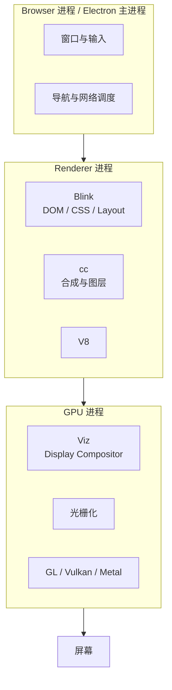
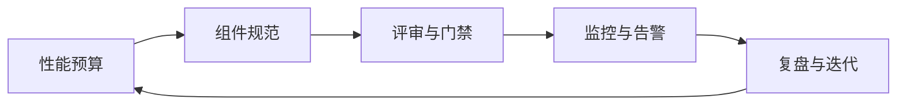

# 进阶：Chromium、V8 与 WASM

## 本章目标

- 从 Chromium 进程与合成架构理解 GPU 内存、光栅化与掉帧的根因。
- 了解 V8 堆参数、GC 策略与 code cache 的作用边界。
- 知道 Electron 源码定制与开源贡献的路径（JD 加分项）。
- 理解 WebAssembly 的适用场景与性能边界。
- 借鉴游戏引擎的帧预算与渲染管线思路做 60fps 治理。

## Chromium 架构再深入

Electron 的运行时来自 Chromium，理解 Chromium 的内部分层，才能解释很多「玄学」性能现象。



关键概念：

| 概念 | 作用 | 性能影响 |
| --- | --- | --- |
| Blink | DOM、CSS、Layout、Paint | JS 与样式、布局耗时 |
| cc（Chromium Compositor） | 图层树、合成 | 合成层过多会增加 GPU 内存 |
| Viz | Display Compositor，统一合成 | 多窗口/多视图共享 |
| Raster | 把绘制指令变成像素 | 大图、复杂绘制会变慢 |
| GPU 进程 | 统一访问 GPU | 驱动问题会导致整机掉帧 |

### 为什么 `--disable-gpu` 会更慢

关闭硬件加速后，光栅化与合成回退到 CPU（软件渲染）：

- CPU 占用显著上升。
- 大窗口、动画、视频场景掉帧明显。
- 内存占用可能上升（软件位图）。

因此 `--disable-gpu` 只应作为诊断手段，用来判断是否是 GPU 驱动/合成问题，不应作为生产默认配置。

### 合成层与 GPU 内存

以下属性会创建合成层：

- `transform: translateZ(0)`、`will-change: transform`。
- `position: fixed`。
- `filter`、`backdrop-filter`、`opacity` 动画。
- `<video>`、`<canvas>`、`iframe`。

每个合成层都可能占用一张或多张纹理。层越多，GPU 内存越高，合成成本也越高。

优化原则：

1. 只为真正需要独立动画的元素创建层。
2. 动画结束后移除 `will-change`。
3. 避免大面积的 `filter`/`blur`。
4. 用 DevTools 的 Layers 面板检查层数量与纹理大小。

## V8 调优

### 堆与 GC 基础

V8 堆分为新生代与老生代：

| 区域 | 特点 | GC |
| --- | --- | --- |
| 新生代（Young） | 对象生命周期短，分配快 | Scavenge（Minor GC），频繁但快 |
| 老生代（Old） | 长期存活对象 | Mark-Sweep / Mark-Compact（Major GC），较慢 |

常见调优参数：

```bash
# 通过 Chromium 开关传给 V8
app.commandLine.appendSwitch('js-flags', '--max-old-space-size=4096');
app.commandLine.appendSwitch('js-flags', '--max-semi-space-size=64');
```

| 参数 | 作用 | 风险 |
| --- | --- | --- |
| `--max-old-space-size` | 提高老生代上限 | 内存占用上升，OOM 风险转移 |
| `--max-semi-space-size` | 调整新生代大小 | 过大增加内存，过小增加 Minor GC 频率 |
| `--expose-gc` | 暴露 `global.gc()` | 仅开发调试，生产禁用 |
| `--trace-gc` | 输出 GC 日志 | 日志开销，仅诊断 |

原则：**没有测量数据不要调参**。默认参数对大多数应用已经足够，盲目加大堆只会把问题推迟到更严重的 OOM。

### 读取堆统计

```ts
import v8 from 'node:v8';

export function heapStats(): Record<string, number> {
  const stats = v8.getHeapStatistics();
  const spaces = v8.getHeapSpaceStatistics();

  return {
    heapSizeLimitMB: Math.round(stats.heap_size_limit / 1024 / 1024),
    totalHeapSizeMB: Math.round(stats.total_heap_size / 1024 / 1024),
    usedHeapSizeMB: Math.round(stats.used_heap_size / 1024 / 1024),
    mallocedMemoryMB: Math.round(stats.malloced_memory / 1024 / 1024),
    ...Object.fromEntries(
      spaces.map((s) => [`space:${s.space_name}MB`, Math.round(s.space_size / 1024 / 1024)]),
    ),
  };
}
```

这能帮助判断是新生代频繁 GC，还是老生代持续增长。

### Code cache

JS 代码每次启动都要解析与编译。Chromium 会为 HTTP 资源缓存编译结果，Electron 主进程可以使用 Node 的编译缓存（见[启动性能优化](/electron/performance-startup)）。

对于自研的脚本引擎或动态代码，可以使用 `vm.Script` 的 `cachedData`：

```ts
import vm from 'node:vm';
import fs from 'node:fs';

const source = fs.readFileSync('script.js', 'utf-8');
const cacheFile = 'script.cache';

let cachedData: Buffer | undefined;
try {
  cachedData = fs.readFileSync(cacheFile);
} catch {
  cachedData = undefined;
}

const script = new vm.Script(source, { filename: 'script.js', cachedData });
if (!cachedData || script.cachedDataRejected) {
  fs.writeFileSync(cacheFile, script.createCachedData());
}
```

注意：缓存与 V8 版本绑定，Electron 升级后必须失效重建。

## Electron 源码与定制

### 构建流程概览

Electron 的构建大致包括：

1. 使用 `depot_tools` 拉取 Chromium 源码。
2. 应用 Electron 的 `patches/`。
3. 用 GN 生成构建文件。
4. 用 Ninja 编译。
5. 产出 Electron 二进制与符号。

```bash
# 简化示意，实际步骤以官方构建文档为准
gclient sync
gn gen out/Release --args="..."
ninja -C out/Release electron
```

构建一次通常需要大量磁盘与内存，团队一般只在必要时维护私有构建。

### 什么时候需要定制

| 需求 | 是否值得定制 |
| --- | --- |
| 修复上游 Electron bug | 优先提 PR 或等待版本更新 |
| 深度修改窗口/合成行为 | 评估维护成本后定制 |
| 集成私有编解码器/硬件能力 | 可能需要定制 |
| 仅业务层优化 | 不需要定制 |

定制的代价：

- 每次 Chromium/Electron 升级都要重新 rebase patch。
- 需要维护 CI 构建与符号。
- 安全更新滞后风险。

### `electron-rebuild` 与 `@electron/remote`

这两个项目是 JD 中提到的开源生态：

- **`@electron/rebuild`**：按 Electron ABI 重建原生模块，是原生模块工程化的基础设施。
- **`@electron/remote`**：把主进程对象暴露给渲染进程。它方便但危险，容易扩大攻击面，新项目不建议使用。

参与贡献的方式：

1. 从 `good first issue` 入手，复现问题并补测试。
2. 阅读 `CONTRIBUTING.md` 与 RFC 流程。
3. 性能类 PR 必须提供可复现的 benchmark 与前后对比。
4. 保持 patch 小而聚焦，便于 review。

## WebAssembly

### 适用场景

| 场景 | 适合 WASM | 说明 |
| --- | --- | --- |
| 音视频编解码 | 是 | FFmpeg.wasm 等成熟方案 |
| 图像处理 | 是 | 像素级运算，SIMD 友好 |
| 加密/哈希 | 是 | 计算密集、逻辑稳定 |
| 大型规则引擎 | 视情况 | 需要评估编译与加载成本 |
| 普通业务逻辑 | 否 | JS 足够，WASM 增加复杂度 |

### 与 JS / Native 的对比

| 维度 | JS | WASM | Native Addon |
| --- | --- | --- | --- |
| 启动加载 | 快 | 需要编译/实例化 | 需要动态库加载 |
| 计算性能 | 中 | 高 | 最高 |
| 内存控制 | GC | 线性内存，手动管理 | 完全手动 |
| 跨平台 | 天生 | 天生 | 需要逐平台编译 |
| 安全边界 | 浏览器沙箱 | 沙箱内 | 与进程同权限 |
| 调试 | 成熟 | 较弱 | 需要原生调试器 |

### 在 Electron 中加载

```ts
async function loadWasm(url: string): Promise<WebAssembly.Instance> {
  const response = await fetch(url);
  const { instance } = await WebAssembly.instantiateStreaming(response, {
    env: {
      log: (ptr: number, len: number) => {
        // 读取线性内存并打印
      },
    },
  });
  return instance;
}
```

注意：

- `instantiateStreaming` 需要正确的 `application/wasm` MIME。
- 自定义协议加载 wasm 时要设置响应头。
- 大模块的编译会阻塞主线程，建议放到 Worker。
- 线性内存需要手动增长，注意上限。

### 线程与 SharedArrayBuffer

WASM 多线程依赖 `SharedArrayBuffer`，而它要求跨源隔离：

```ts
session.defaultSession.webRequest.onHeadersReceived((details, callback) => {
  callback({
    responseHeaders: {
      ...details.responseHeaders,
      'Cross-Origin-Opener-Policy': ['same-origin'],
      'Cross-Origin-Embedder-Policy': ['require-corp'],
    },
  });
});
```

开启后会影响跨源资源加载，需要全面回归。

## 借鉴游戏引擎的渲染管线

Unity 等引擎的 60fps 治理思路，对 Electron 同样适用。

### 帧循环

游戏引擎通常有明确的帧循环：

```text
输入 → 逻辑更新 → 物理 → 动画 → 渲染提交 → 合成 → 上屏
```

对应到 Web：

```text
输入事件 → JS 更新状态 → 样式计算 → 布局 → 绘制 → 合成 → 上屏
```

治理方法：

1. 给每一段设定预算（例如 JS 6ms、布局 3ms、绘制 4ms）。
2. 用 Performance 面板逐段对照。
3. 超预算的段落优先优化。

### 批处理与对象池

| 引擎技术 | Web 对应 |
| --- | --- |
| Draw call batching | 合并 DOM 更新、减少图层 |
| Object pool | 复用 DOM 节点/对象，减少 GC |
| Instancing | 虚拟列表、Canvas/WebGL 批量绘制 |
| LOD | 缩略图、按需加载高清资源 |
| Frame budget | `requestAnimationFrame` + 时间片 |

对象池示例：

```ts
class Pool<T> {
  private free: T[] = [];

  constructor(private readonly create: () => T) {}

  acquire(): T {
    return this.free.pop() ?? this.create();
  }

  release(item: T): void {
    this.free.push(item);
  }
}
```

### 60fps 预算管理

- 每帧只做必要工作，非关键任务用 `requestIdleCallback` 或时间切片。
- 动画与数据更新分离，避免一帧内同时做大量计算与布局。
- 对低端设备降级：减少动画、降低阴影/模糊、缩小图片。
- 用真实设备测试，不要只看开发机。

## 架构级性能治理

单点优化会反弹，架构层面的治理才能持续：



### 1. 性能预算

- 启动：冷启动 < 1s、二次唤起 < 200ms。
- 内存：常驻 < 300MB、单窗口增量 < 80MB。
- 渲染：滚动 ≥ 55fps、关键路径无 > 100ms 长任务。
- 体积：安装包 < 预算、增量更新 < 预算。

预算要按产品形态调整，并写进技术方案模板。

### 2. 平台化组件

把优化沉淀为团队可复用的能力：

- 虚拟列表组件。
- 图片加载与缓存组件。
- IPC 类型安全工具库。
- 启动埋点与性能上报 SDK。
- 崩溃捕获与诊断包工具。

### 3. 评审与门禁

- 新依赖必须说明体积与运行时成本。
- 新页面必须提供首屏性能数据。
- 大列表必须使用虚拟滚动。
- CI 性能门禁失败阻断合并。

### 4. 监控与复盘

- 版本发布后对比 P50/P95 指标。
- 崩溃率、启动失败率、卡顿率异常自动告警。
- 每次性能事故输出复盘：现象、根因、修复、预防。

## 本章小结

- Chromium 的 Blink、cc、Viz、GPU 进程共同决定渲染性能，合成层与纹理是 GPU 内存的关键。
- V8 调参必须基于测量，默认参数通常已经足够。
- Electron 源码定制成本高，优先通过上游修复与插件解决。
- WASM 适合计算密集、跨平台、逻辑稳定的场景，不适合替代普通业务 JS。
- 游戏引擎的帧预算、批处理、对象池、LOD 思路可以直接迁移到 Web 渲染治理。
- 架构级治理 = 预算 + 规范 + 门禁 + 监控 + 复盘。

## 参考资料

- [Chromium 多进程架构](https://www.chromium.org/developers/design-documents/multi-process-architecture/)
- [Chromium：How cc Works](https://chromium.googlesource.com/chromium/src/+/HEAD/cc/README.md)
- [V8 文档](https://v8.dev/docs)
- [Electron 构建说明](https://www.electronjs.org/zh/docs/latest/development/build-instructions-gn)
- [WebAssembly 文档](https://webassembly.org/docs/)
- [Unity 渲染管线概述](https://docs.unity3d.com/Manual/RenderPipeline.html)
