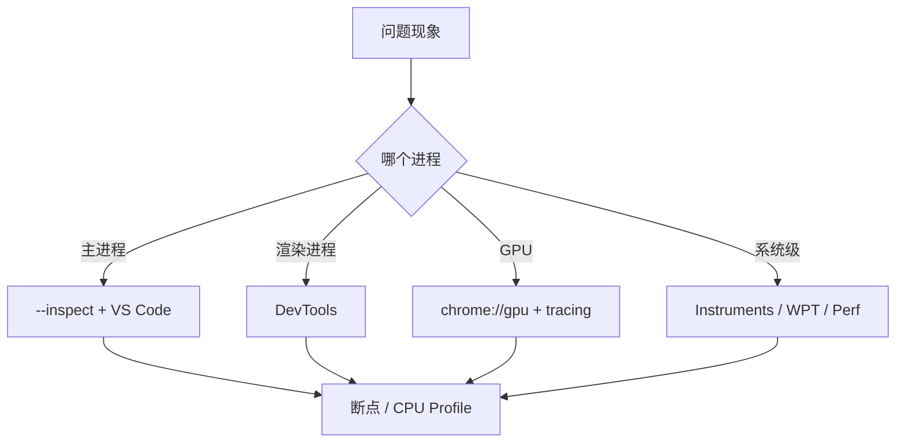
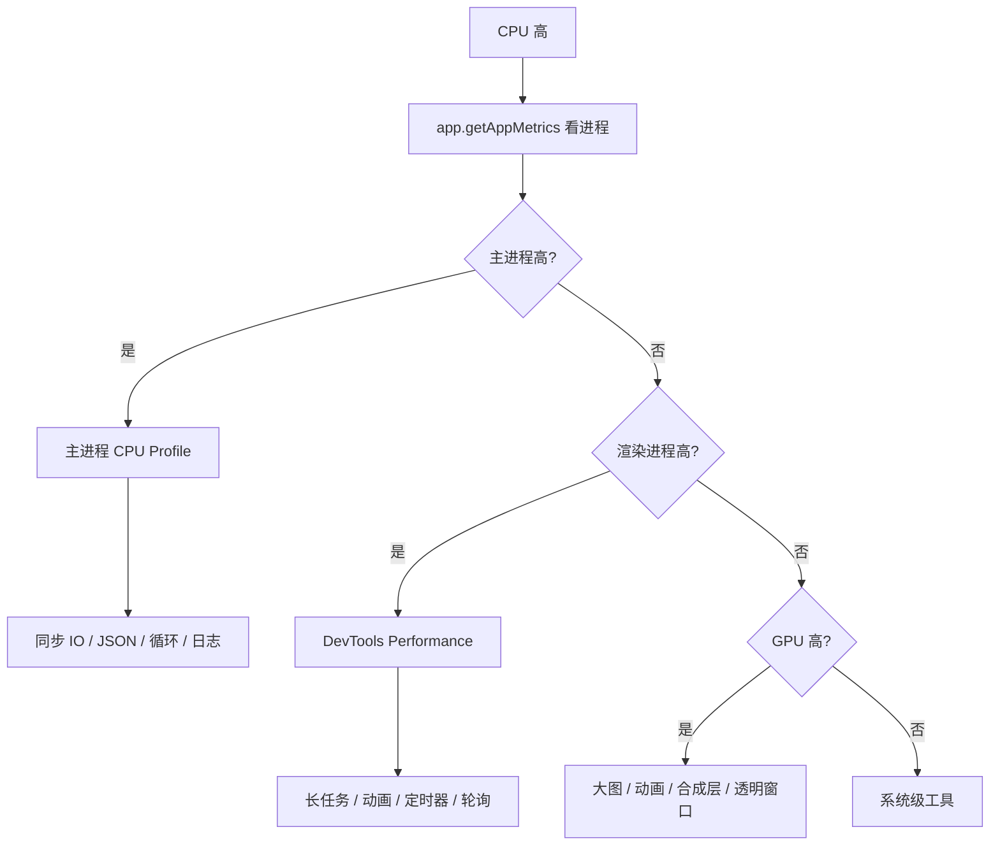

# 调试与 Profiling 工具链

## 本章目标

- 掌握主进程、渲染进程、GPU 进程的调试入口。
- 会用 DevTools Performance/Memory、Chromium tracing、Instruments、WPT 定位性能问题。
- 能通过 CDP 自动化采集性能数据，接入 CI。
- 建立「高 CPU / 高内存 / 磁盘 IO / 网络异常」的排查决策树。

## 调试地图



## 主进程调试

### 启动调试端口

```bash
npx electron --inspect=9229 .
npx electron --inspect-brk=9229 .   # 在第一行暂停，适合调试启动流程
```

### VS Code 配置

```json
{
  "version": "0.2.0",
  "configurations": [
    {
      "name": "Electron: Main",
      "type": "node",
      "request": "launch",
      "cwd": "${workspaceFolder}",
      "runtimeExecutable": "${workspaceFolder}/node_modules/.bin/electron",
      "windows": {
        "runtimeExecutable": "${workspaceFolder}/node_modules/.bin/electron.cmd"
      },
      "args": [".", "--inspect=9229"],
      "sourceMaps": true,
      "outFiles": ["${workspaceFolder}/dist/**/*.js"]
    }
  ]
}
```

如果主进程由 Vite/esbuild 构建，需要确保生成 source map，并在 `outFiles` 中覆盖产物目录。

### 调试启动阶段

`--inspect-brk` 会在入口第一行暂停，适合排查：

- 启动即崩溃。
- 某个模块加载时报错。
- 窗口创建顺序问题。

注意：生产包应通过 Fuses 关闭 `EnableNodeCliInspectArguments`，防止被附加调试器。

## 渲染进程调试

### DevTools

```ts
win.webContents.openDevTools({ mode: 'detach' });
```

也可以用快捷键：

```ts
win.webContents.on('before-input-event', (event, input) => {
  if (input.control && input.shift && input.key.toLowerCase() === 'i') {
    win.webContents.toggleDevTools();
    event.preventDefault();
  }
});
```

### 远程调试

```bash
npx electron --remote-debugging-port=9222 .
```

在 Chrome 打开 `chrome://inspect`，可以：

- 检查页面、Console、Network。
- 采集 Performance trace。
- 附加到渲染进程的 Node inspector（如果开启了 `--inspect`）。

生产环境可通过 `app.commandLine.appendSwitch` 或 Fuses 控制是否允许。

## DevTools 实战

### Performance 面板

关注：

| 区域 | 内容 |
| --- | --- |
| Frames | 每帧耗时、掉帧标记 |
| Main | 主线程火焰图：JS、Style、Layout、Paint |
| Compositor | 合成线程 |
| GPU | GPU 进程任务 |
| Network | 资源加载 |
| Memory | 堆与 GC |

常用操作：

1. 勾选 Screenshots，回看每一帧画面。
2. 用 `Cmd/Ctrl + F` 搜索长任务或具体函数。
3. 选中一段区间，看 Bottom-Up 排序。
4. 保存 profile，便于对比优化前后。

### Memory 面板

- **Heap snapshot**：对象级分析，适合泄漏。
- **Allocation instrumentation on timeline**：看分配热点。
- **Allocation sampling**：低开销采样，适合长时间录制。

### Rendering 面板

- Paint flashing：定位不必要的重绘。
- Layout Shift Regions：定位布局偏移。
- Frame rendering stats：实时 FPS。
- Layer borders：合成层数量与边界。

## Chromium tracing

### 代码采集

```ts
import { app, contentTracing } from 'electron';
import path from 'node:path';

export async function startTrace(): Promise<void> {
  await contentTracing.startRecording({
    included_categories: [
      'toplevel',
      'v8',
      'v8.execute',
      'blink',
      'blink.user_timing',
      'renderer',
      'gpu',
      'disabled-by-default-devtools.timeline',
    ],
  });
}

export async function stopTrace(name: string): Promise<string> {
  const file = path.join(app.getPath('temp'), `${name}.json`);
  await contentTracing.stopRecording(file);
  return file;
}
```

### 命令行采集

```bash
npx electron --trace-startup=./trace.json .
```

### 分析

把 trace 拖进：

- `chrome://tracing`
- [Perfetto UI](https://ui.perfetto.dev/)

重点看：

- 主进程主线程的长任务。
- 渲染进程的 `RunTask`、`FunctionCall`、`Layout`、`Paint`。
- GPU 进程的 `Composite`、`Raster`。
- 进程间 IPC 的等待时间。

## 系统级工具

### macOS：Instruments

| 模板 | 用途 |
| --- | --- |
| Time Profiler | CPU 热点，按调用栈聚合 |
| Allocations | 对象分配与存活 |
| Leaks | 泄漏检测 |
| Core Animation | 帧率、合成、离屏渲染 |
| File Activity | 磁盘 IO |

使用步骤：

1. 选择目标进程（Electron 主进程或渲染进程）。
2. 录制复现场景。
3. 在 Call Tree 中勾选 Invert Call Tree、Hide System Libraries。
4. 定位热点函数。

### Windows：Windows Performance Toolkit

```bash
# 采集
wpr -start CPU -start GPU -start FileIO -filemode

# 复现问题后停止
wpr -stop trace.etl
```

用 WPA 打开 `.etl`，重点看：

- CPU Usage (Sampled)：CPU 热点。
- GPU Usage：GPU 占用。
- Disk Usage：磁盘 IO。
- Generic Events：ETW 事件。

### Linux：Perf / Massif

```bash
perf record -g -p <pid>
perf report

valgrind --tool=massif ./my-electron-app
ms_print massif.out.<pid>
```

Linux 桌面场景较少，但服务器端 Electron 或 CI 环境可以用这些工具。

## 高 CPU 排查



### 主进程 CPU Profile

```bash
npx electron --inspect=9229 .
```

在 Chrome `chrome://inspect` 中：

1. 选择主进程目标。
2. 打开 Profiler。
3. Start → 复现 → Stop。
4. 看火焰图中占比最高的函数。

也可以用 CDP 脚本采集，见下一节。

### 渲染进程高 CPU 的常见原因

- `setInterval` 轮询过密。
- 动画使用 `setTimeout` 而非 `requestAnimationFrame`。
- 大列表全量重渲染。
- 频繁布局读取导致强制同步布局。
- 大量网络请求或 WebSocket 消息处理。

## 磁盘 IO 与网络

### 磁盘 IO

- 用 Instruments File Activity / WPA Disk Usage 看读写热点。
- 检查主进程是否有同步读写。
- 大文件使用流式处理。
- 日志写入使用缓冲与批量落盘。

```ts
import { createWriteStream } from 'node:fs';

const stream = createWriteStream(logPath, { flags: 'a' });
stream.write(line);
```

### 网络

- DevTools Network 面板看请求瀑布。
- 主进程的 `net` 请求不会出现在渲染进程 Network 面板，需要单独打点。
- 使用 `session.defaultSession.webRequest` 记录请求耗时。
- 检查代理、DNS、证书、CSP 导致的失败。

```ts
session.defaultSession.webRequest.onCompleted((details) => {
  if (details.statusCode >= 400) {
    console.warn('request failed', details.url, details.statusCode);
  }
});
```

### 请求劫持排查

如果请求被篡改或阻塞：

1. 检查是否注册了 `webRequest.onBeforeRequest` 并返回了 `cancel`。
2. 检查代理配置与系统代理。
3. 检查 CSP 与 CORS。
4. 检查是否有第三方安全软件注入。

## 自动化 Profiling 工具链

目标：把「打开 DevTools 手动点」变成「一条命令产出报告」。

### 通过 CDP 采集渲染进程指标

```ts
// scripts/profile-renderer.ts
import { app, BrowserWindow } from 'electron';

export async function collectRendererMetrics(win: BrowserWindow): Promise<Record<string, number>> {
  const debuggerApi = win.webContents.debugger;
  debuggerApi.attach('1.3');

  await debuggerApi.sendCommand('Performance.enable');
  const { metrics } = (await debuggerApi.sendCommand('Performance.getMetrics')) as {
    metrics: Array<{ name: string; value: number }>;
  };

  debuggerApi.detach();

  return Object.fromEntries(metrics.map((m) => [m.name, m.value]));
}
```

可以采集的指标包括 `ScriptDuration`、`LayoutDuration`、`RecalcStyleDuration`、`TaskDuration`、`JSHeapUsedSize` 等。

### 采集主进程 CPU Profile

```ts
// scripts/profile-main.ts
import { app } from 'electron';

export async function profileMain(durationMs = 5000): Promise<unknown> {
  const inspector = await import('node:inspector');
  const session = new inspector.Session();
  session.connect();

  const post = (method: string, params?: object): Promise<unknown> =>
    new Promise((resolve, reject) => {
      session.post(method, params ?? {}, (err, result) => {
        if (err) reject(err);
        else resolve(result);
      });
    });

  await post('Profiler.enable');
  await post('Profiler.start');
  await new Promise((resolve) => setTimeout(resolve, durationMs));
  const { profile } = (await post('Profiler.stop')) as { profile: unknown };

  session.disconnect();
  return profile;
}
```

把 `profile` 写入 `.cpuprofile` 文件，可直接拖进 DevTools Performance 或 Chrome Profiler 查看。

### 统一采集脚本

```ts
// scripts/collect.ts
import { app } from 'electron';
import fs from 'node:fs/promises';
import path from 'node:path';
import { sampleProcessMemory } from '../src/main/perf/memory';

export async function collectReport(outDir: string): Promise<void> {
  const samples: unknown[] = [];

  for (let i = 0; i < 20; i += 1) {
    samples.push({
      t: Date.now(),
      processes: sampleProcessMemory(),
    });
    await new Promise((resolve) => setTimeout(resolve, 500));
  }

  await fs.mkdir(outDir, { recursive: true });
  await fs.writeFile(
    path.join(outDir, `memory-${app.getVersion()}.json`),
    JSON.stringify(samples, null, 2),
  );
}
```

### 接入 CI

```yaml
- name: Performance smoke
  run: |
    npm run build
    xvfb-run -a npx electron scripts/perf-main.js
    node scripts/check-perf.js
```

CI 环境需要注意：

- 使用固定机型/固定镜像，减少噪声。
- 每次至少采集 3 次，取中位数。
- 只对「相对基线」做门禁，不要用绝对值卡死。
- 失败时上传 trace 与内存报告作为 artifact。

## 线上问题诊断

### 必要信息采集

```ts
export function collectSystemInfo(): Record<string, string> {
  return {
    appVersion: app.getVersion(),
    electron: process.versions.electron,
    chrome: process.versions.chrome,
    node: process.versions.node,
    platform: process.platform,
    arch: process.arch,
    osVersion: process.getSystemVersion(),
    locale: app.getLocale(),
  };
}
```

### 诊断包

建议支持「一键导出诊断包」：

- 应用日志（脱敏）。
- 最近崩溃报告。
- 系统信息。
- 当前进程内存指标。
- 关键配置（脱敏）。
- 可选：trace 文件。

## 常见问题定位表

| 现象 | 首选工具 | 重点看 |
| --- | --- | --- |
| 启动慢 | `--trace-startup` | 主进程初始化、渲染加载 |
| 越用越卡 | DevTools Memory | 堆增长、Detached DOM |
| 滚动掉帧 | Performance | Layout、Paint、长任务 |
| 点击无响应 | Performance | 长任务、INP |
| CPU 持续高 | CPU Profile | 轮询、动画、重计算 |
| 内存高 | `app.getAppMetrics` | 哪个进程增长 |
| 崩溃 | minidump + 符号 | 崩溃线程与模块 |
| 白屏 | DevTools Console/Network | 资源失败、CSP、路径 |

## 本章小结

- 主进程用 `--inspect`，渲染进程用 DevTools，GPU/系统问题用 tracing 与系统工具。
- Performance 面板是渲染问题的第一入口，先看长任务与流水线阶段。
- Chromium tracing 能同时看到主进程、渲染进程、GPU 的时间线。
- CDP 可以把性能采集自动化，接入 CI 做回归门禁。
- 排查顺序应该是「进程 → 线程 → 阶段 → 函数」，不要一上来就猜代码。

## 参考资料

- [Electron 调试文档](https://www.electronjs.org/zh/docs/latest/tutorial/debugging-main-process)
- [Electron API：contentTracing](https://www.electronjs.org/zh/docs/latest/api/content-tracing)
- [Electron API：debugger](https://www.electronjs.org/zh/docs/latest/api/debugger)
- [Chrome DevTools 文档](https://developer.chrome.com/docs/devtools/)
- [Perfetto UI](https://ui.perfetto.dev/)
- [Apple Instruments](https://developer.apple.com/documentation/instruments)
