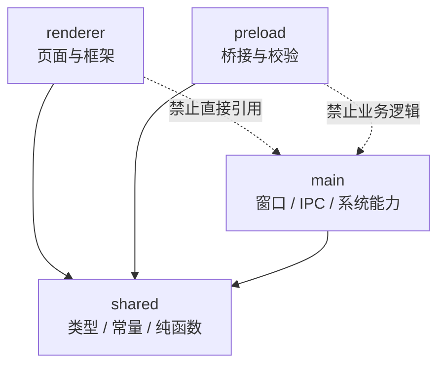
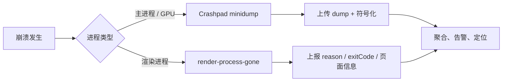

# 工程化、CI 与稳定性

## 本章目标

- 建立 main / preload / renderer / shared 四层结构，阻止跨层引用。
- 把类型检查、Lint、单元测试、E2E 接入 CI。
- 设计包体积、启动时间、内存增量的性能门禁。
- 建立崩溃监控与 JS 异常上报体系，能定位到具体堆栈。
- 制定异步编程规范，消除主进程阻塞与死锁隐患。

## 工程分层



推荐目录：

```text
src/
├── main/
│   ├── index.ts
│   ├── windows/
│   ├── ipc/
│   ├── services/
│   └── system/
├── preload/
│   └── index.ts
├── renderer/
│   ├── index.html
│   ├── main.tsx
│   └── pages/
└── shared/
    ├── ipc.ts
    ├── constants.ts
    └── types.ts
```

规则：

1. `renderer` 不能 import `main` 或 Node 内置模块。
2. `preload` 只做桥接、参数校验、错误转换，不写业务。
3. `main` 不 import `renderer` 的 UI 代码。
4. `shared` 只放类型、常量、纯函数，不能有副作用。
5. 用 ESLint 的 `no-restricted-imports` 强制边界。

```json
{
  "overrides": [
    {
      "files": ["src/renderer/**/*"],
      "rules": {
        "no-restricted-imports": [
          "error",
          {
            "patterns": [
              { "group": ["electron", "node:*", "../main/*"], "message": "renderer 只能通过 preload API 访问主进程" }
            ]
          }
        ]
      }
    }
  ]
}
```

## TypeScript 与构建

三个进程的运行时环境不同，建议分别构建：

| 目标 | 模块格式 | 目标环境 | 构建工具 |
| --- | --- | --- | --- |
| main | CJS/ESM | Node（Electron 内置） | tsc / esbuild / Vite |
| preload | CJS | 沙箱 preload | esbuild / Vite |
| renderer | ESM | Chromium | Vite / Webpack |

```json
// tsconfig.json
{
  "compilerOptions": {
    "target": "ES2022",
    "module": "ESNext",
    "moduleResolution": "Bundler",
    "strict": true,
    "noUncheckedIndexedAccess": true,
    "noImplicitOverride": true,
    "exactOptionalPropertyTypes": true,
    "skipLibCheck": true,
    "baseUrl": ".",
    "paths": {
      "@shared/*": ["src/shared/*"]
    }
  }
}
```

CI 中至少执行：

```bash
npx tsc --noEmit
npx eslint . --max-warnings=0
```

## 测试策略

| 层级 | 工具 | 覆盖内容 |
| --- | --- | --- |
| 单元测试 | Vitest | `shared` 纯函数、数据转换、校验逻辑 |
| 主进程集成 | Vitest + mock electron | IPC handler、服务层 |
| E2E | Playwright `_electron` | 启动、窗口、关键用户路径 |
| 冒烟测试 | 打包产物启动 | 安装包能否启动、版本号、基础页面 |

### Playwright Electron 示例

```ts
// e2e/smoke.spec.ts
import { test, expect, _electron as electron } from '@playwright/test';

test('应用可以启动并显示主窗口', async () => {
  const app = await electron.launch({ args: ['.'] });
  const window = await app.firstWindow();

  await expect(window).toHaveTitle(/MyApp/);
  await expect(window.getByRole('heading', { level: 1 })).toBeVisible();

  await app.close();
});
```

```ts
// playwright.config.ts
import { defineConfig } from '@playwright/test';

export default defineConfig({
  testDir: './e2e',
  timeout: 30_000,
  retries: process.env.CI ? 1 : 0,
  use: {
    trace: 'retain-on-failure',
  },
});
```

E2E 要跑在打包后的产物上，而不是开发服务器，才能覆盖 asar、路径、原生模块等真实差异。

## CI/CD 流水线


关键原则：

- 缓存 `node_modules` 与构建产物，但避免缓存签名材料。
- 签名密钥放在 Secret Manager，按环境隔离。
- 构建产物可复现：锁定依赖版本、固定 Node/Electron 版本。
- 性能门禁失败要阻断发布，而不是只发告警。

## 性能门禁

### 指标与阈值

| 指标 | 采集方式 | 门禁示例 |
| --- | --- | --- |
| 安装包体积 | 构建产物 `stat` | 超过基线 5% 失败 |
| `app.asar` 体积 | `du`/`asar list` | 超过基线 3% 失败 |
| 冷启动到首屏 | 自动化脚本埋点 | P95 超过 1.2s 失败 |
| 内存峰值 | 启动后固定操作序列采样 | 超过基线 10% 失败 |
| 首屏 JS 体积 | bundle 分析 | 超过预算失败 |

### 体积门禁脚本

```ts
// scripts/check-size.ts
import fs from 'node:fs';
import path from 'node:path';

type SizeReport = {
  installerBytes: number;
  asarBytes: number;
};

const baselinePath = path.join(process.cwd(), 'perf/size-baseline.json');
const baseline: SizeReport = JSON.parse(fs.readFileSync(baselinePath, 'utf-8'));

const current: SizeReport = {
  installerBytes: fs.statSync(process.env.INSTALLER_PATH!).size,
  asarBytes: fs.statSync(process.env.ASAR_PATH!).size,
};

const LIMITS = {
  installerBytes: 1.05,
  asarBytes: 1.03,
};

let failed = false;

for (const key of Object.keys(LIMITS) as Array<keyof SizeReport>) {
  const ratio = current[key] / baseline[key];
  const limit = LIMITS[key];
  console.log(`${key}: ${baseline[key]} -> ${current[key]} (${(ratio * 100).toFixed(1)}%)`);
  if (ratio > limit) {
    console.error(`${key} 超过门禁 ${(limit * 100).toFixed(0)}%`);
    failed = true;
  }
}

process.exit(failed ? 1 : 0);
```

### 启动耗时采集

开发阶段可以在主进程与渲染进程打点：

```ts
// main
const t0 = performance.now();
app.whenReady().then(() => {
  const t1 = performance.now();
  console.log('main ready', t1 - t0);
});
```

生产环境应使用 `app.getAppMetrics()`、`performance` API 与自定义上报组合，并把结果按版本、平台、设备分桶。具体方案见[启动性能优化](/electron/performance-startup)。

## 崩溃监控

### 主进程崩溃与渲染进程崩溃



### 启用 crashReporter

```ts
// src/main/index.ts
import { app, crashReporter } from 'electron';

app.whenReady().then(() => {
  crashReporter.start({
    productName: 'MyApp',
    companyName: 'Example',
    submitURL: 'https://crash.example.com/submit',
    uploadToServer: true,
    compress: true,
    extra: {
      version: app.getVersion(),
    },
  });
});
```

如果使用自建上报，可以关闭自动上传，手动收集：

```ts
crashReporter.start({
  productName: 'MyApp',
  companyName: 'Example',
  submitURL: '',
  uploadToServer: false,
});

const lastCrash = crashReporter.getLastCrashReport();
console.log(lastCrash?.date, lastCrash?.id);
console.log(app.getPath('crashDumps'));
```

### 符号化

崩溃堆栈只有配合符号表才能读：

| 平台 | 符号 | 来源 |
| --- | --- | --- |
| macOS | dSYM | 原生模块与自建 Electron 构建 |
| Windows | PDB | 原生模块与自建 Electron 构建 |
| Electron 自身 | 官方 symbols | [Electron 发布页](https://github.com/electron/electron/releases) 的 `symbols` 包 |

流程：

1. CI 构建时归档 dSYM/PDB。
2. 上传到符号服务器（Sentry、Crashpad symbol server、自建对象存储）。
3. 收到 minidump 后按模块版本匹配符号。
4. 聚合相同堆栈，按版本/平台统计崩溃率。

### 渲染进程崩溃上报

```ts
win.webContents.on('render-process-gone', (_event, details) => {
  reportCrash({
    type: 'renderer-gone',
    reason: details.reason,
    exitCode: details.exitCode,
    url: win.webContents.getURL(),
    version: app.getVersion(),
  });
});
```

### JS 异常

```ts
// 主进程
process.on('uncaughtException', (error) => {
  reportError({ type: 'main-uncaught', error: serializeError(error) });
});

process.on('unhandledRejection', (reason) => {
  reportError({ type: 'main-unhandled-rejection', reason: String(reason) });
});
```

```ts
// 渲染进程（在入口最早注册）
window.addEventListener('error', (event) => {
  window.api.reportError({
    type: 'renderer-error',
    message: event.message,
    stack: event.error?.stack,
  });
});

window.addEventListener('unhandledrejection', (event) => {
  window.api.reportError({
    type: 'renderer-rejection',
    message: String(event.reason),
  });
});
```

注意：`uncaughtException` 之后进程状态可能已损坏，不要继续执行关键逻辑，应尽快上报并退出。

## 异步编程规范

主进程的异步问题通常来自三类：

### 1. 同步 I/O

```ts
// 禁止
const raw = fs.readFileSync(file, 'utf-8');

// 推荐
const raw = await fs.readFile(file, 'utf-8');
```

例外：启动阶段读取极小配置文件可以接受，但要测量耗时。

### 2. 无上限并发

```ts
// 1000 个任务同时发起，可能打满文件句柄
await Promise.all(files.map((f) => process(f)));

// 限制并发
import pLimit from 'p-limit';
const limit = pLimit(8);
await Promise.all(files.map((f) => limit(() => process(f))));
```

### 3. 没有超时与取消

```ts
async function withTimeout<T>(task: Promise<T>, ms: number): Promise<T> {
  const controller = new AbortController();
  const timer = setTimeout(() => controller.abort(), ms);
  try {
    return await Promise.race([
      task,
      new Promise<never>((_, reject) => {
        controller.signal.addEventListener('abort', () => reject(new Error('timeout')));
      }),
    ]);
  } finally {
    clearTimeout(timer);
  }
}
```

### 死锁与相互等待

典型死锁：

```ts
// 渲染进程同步等待主进程
const result = ipcRenderer.sendSync('data:get');

// 主进程在处理 data:get 时又同步等待渲染进程返回
ipcMain.on('data:get', (event) => {
  event.returnValue = rendererMustRespond(); // 永远等不到
});
```

避免方式：

1. 禁用 `sendSync`。
2. 主进程的 handler 不要依赖调用方同步返回。
3. 任何跨进程调用都设置超时。
4. 异步任务使用请求 ID 关联，避免全局「等待中」状态。

## 日志体系

```ts
// src/main/logger.ts
import log from 'electron-log/main';

log.initialize();
log.transports.file.level = 'info';
log.transports.console.level = process.env.NODE_ENV === 'development' ? 'debug' : 'warn';

export const logger = log.scope('main');
```

规范：

- 分级：`error` / `warn` / `info` / `debug`。
- 结构化字段：模块、用户 ID（脱敏）、版本、平台。
- 敏感信息脱敏：路径、Token、手机号、邮箱。
- 日志轮转与体积上限。
- 用户可一键导出日志包，便于支持排障。

## 发布与回滚

- 版本号遵循 SemVer，构建号独立。
- 灰度发布：按用户分桶，先 1% → 10% → 50% → 100%。
- 崩溃率、启动失败率超过阈值自动停止放量。
- 保留上一个稳定版本，服务端可回退更新元数据。
- 协议、数据格式变更要向前兼容，避免旧版本无法启动。

## 本章小结

- 四层结构 + ESLint 边界规则，是控制 Electron 工程复杂度的基础。
- CI 应覆盖类型、Lint、单测、E2E、性能门禁、签名与发布。
- 性能门禁要把体积、启动、内存变成可比较的数字，而不是主观感觉。
- 崩溃监控需要 minidump + 符号表 + 聚合分析，缺一不可。
- 异步规范的核心是：不阻塞主进程、限制并发、设置超时、避免同步 IPC。

## 参考资料

- [Electron API：crashReporter](https://www.electronjs.org/zh/docs/latest/api/crash-reporter)
- [Electron 教程：性能](https://www.electronjs.org/zh/docs/latest/tutorial/performance)
- [Playwright Electron](https://playwright.dev/docs/api/class-electron)
- [electron-log](https://github.com/megahertz/electron-log)
- [Sentry for Electron](https://docs.sentry.io/platforms/javascript/guides/electron/)
