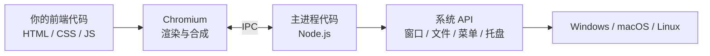
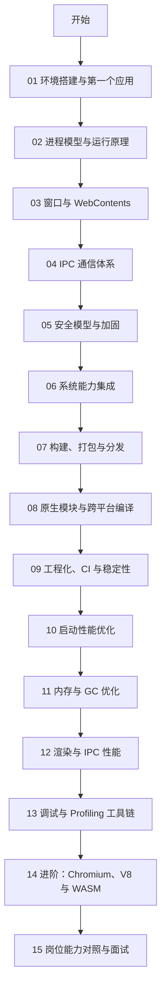

# Electron 应用开发教程：专栏导读

## 这个专栏解决什么问题

Electron 的入门门槛很低：会写 HTML/CSS/JavaScript，几行代码就能跑起一个桌面窗口。但从「能跑」到「能支撑千万级用户、启动一秒内、内存三百兆内、崩溃率极低」之间，隔着完整的客户端工程体系。

本专栏按这个能力梯度组织内容：

- **第一层：会用** —— 环境搭建、进程模型、窗口、IPC、系统能力。
- **第二层：用对** —— 安全加固、类型安全通信、构建打包、原生模块、工程化与 CI。
- **第三层：用快** —— 启动、内存、渲染与 IPC 的性能优化，以及可观测性建设。
- **第四层：用深** —— Profiling 工具链、Chromium/V8 调优、WASM、渲染管线与架构级治理。

所有章节以 [Electron 官方文档](https://www.electronjs.org/zh/docs/latest/) 为事实基准，并补充官方文档较少展开的工程实践与性能章节。示例统一使用 TypeScript。

## Electron 是什么

Electron = **Chromium 渲染引擎** + **Node.js 运行时** + **原生系统 API**。

它把浏览器内核和 Node.js 组合进一个桌面应用外壳，让 Web 技术可以直接创建窗口、访问文件系统、调用系统能力。你写的界面运行在 Chromium 的渲染进程里，而应用生命周期、窗口管理、原生调用运行在 Node.js 的主进程里。

这也解释了 Electron 应用的能力边界：

- 界面层拥有现代浏览器的全部能力，同时受 Chromium 的沙箱与安全模型约束。
- 主进程拥有完整 Node.js 能力，也因此**主进程的任何阻塞都会影响整个应用**。
- 安装包需要携带 Chromium 与 Node.js，体积与内存天然高于系统原生应用。

## 技术选型：什么时候选 Electron

| 方案 | 渲染层 | 包体积 | 内存占用 | 生态与人才 | 适用场景 |
| --- | --- | --- | --- | --- | --- |
| **Electron** | Chromium | 较大（通常 80–200MB） | 较高 | 最成熟，Web 团队可直接上手 | 跨平台、迭代快、复杂 Web 界面、插件生态 |
| Tauri | 系统 WebView | 小（几 MB 起） | 较低 | Rust 生态，前端可用 | 轻量工具、对体积敏感、能接受 WebView 差异 |
| NW.js | Chromium | 较大 | 较高 | 较早，社区活跃度下降 | 历史项目、需要 Node 与 DOM 同上下文 |
| CEF | Chromium | 大 | 高 | C++ 团队 | 需要深度定制浏览器、非 Node 技术栈 |
| 原生客户端 | 系统原生 | 中 | 低 | 平台人才稀缺 | 极致性能、系统级体验、强依赖平台能力 |

选 Electron 的典型理由：

1. 团队已有 Web 技术积累，产品需要同时覆盖 Windows/macOS/Linux。
2. 业务界面复杂、迭代频繁，需要成熟的组件生态与调试工具。
3. 需要同时使用 Web 能力与 Node.js/原生模块能力。

需要提前接受的代价：安装包体积、内存基线、启动链路都比原生应用长，**性能治理必须从第一天就纳入架构**，而不是上线后补救。

## 学习路径

建议节奏：

- **第一周**：01–06，跑通一个具备主进程、preload、渲染层、IPC、安全配置的最小应用。
- **第二周**：07–09，把应用打包成可安装产物，接入签名、CI 与崩溃上报。
- **第三周**：10–12，建立启动/内存/渲染三套指标体系，完成一轮真实优化。
- **第四周**：13–15，补齐工具链与进阶知识，整理成可讲述的项目案例。

## 性能优化思路

启动时间的粗粒度拆解：

| 阶段 | 典型工作 | 优化手段 |
| --- | --- | --- |
| 进程创建 | 加载 Electron 二进制、Chromium 初始化 | 精简启动参数、减少同步插件 |
| 主进程初始化 | `require` 模块、创建菜单/托盘、读配置 | 延迟加载、code cache、异步 IO |
| 创建窗口 | `BrowserWindow`、GPU 初始化 | 窗口复用、`show: false` + `ready-to-show` |
| 页面加载 | HTML/JS/CSS、首屏数据 | 骨架屏、路由懒加载、预加载 |
| 首屏绘制 | Layout/Paint/Composite | 减少首屏 DOM、背景色防白屏 |
| 可交互 | 首屏 JS 执行完成 | 拆包、延后非关键任务 |

内存的粗粒度拆解：

| 组成 | 观察方式 | 常见问题 |
| --- | --- | --- |
| 主进程 Node 堆 | `process.memoryUsage()` | 全局缓存、日志堆积、未释放的 Buffer |
| 渲染进程 V8 堆 | DevTools Memory | 闭包、事件监听、大对象缓存 |
| GPU/纹理内存 | `app.getAppMetrics()`、系统监视器 | 大图、动画层、透明窗口 |
| Native 内存 | 系统工具、Native 模块统计 | 未释放的 C++ 对象、句柄泄漏 |
| 共享内存 | 系统监视器 | 大量 IPC 大对象、共享纹理 |

具体测量方法与优化步骤见第 10、11 章。

## 专栏约定

- **版本基准**：以官方最新稳定文档为准（当前文档对应 Electron v45 系列）。示例避免使用已废弃 API，例如用 `WebContentsView` 而不是 `BrowserView`，用 `protocol.handle` 而不是 `registerFileProtocol`。
- **代码风格**：TypeScript + ESM 语法描述，路径以 `src/main`、`src/preload`、`src/renderer` 分层。
- **安全默认值**：除非章节明确讨论，所有示例默认 `contextIsolation: true`、`sandbox: true`、`nodeIntegration: false`。
- **数字约定**：文中出现的耗时、内存、包体积均为「目标值」或「示例值」，用于说明方法与量级，不代表任何具体产品的实测数据。

## 前置知识

- 熟悉 JavaScript/TypeScript，理解模块、异步、事件循环。
- 了解浏览器渲染基本流程（DOM、Layout、Paint、Composite）。
- 了解 Node.js 基础（`fs`、`path`、`child_process`、CommonJS/ESM）。
- 有任意前端框架（React/Vue）使用经验更佳，但不是必需。

## 参考资料

- [Electron 官方文档（中文）](https://www.electronjs.org/zh/docs/latest/)
- [Electron 教程：进程模型](https://www.electronjs.org/zh/docs/latest/tutorial/process-model)
- [Electron 最佳实践：性能](https://www.electronjs.org/zh/docs/latest/tutorial/performance)
- [Electron 最佳实践：安全](https://www.electronjs.org/zh/docs/latest/tutorial/security)
- [Chromium 多进程架构](https://www.chromium.org/developers/design-documents/multi-process-architecture/)
