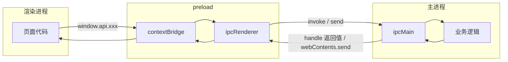
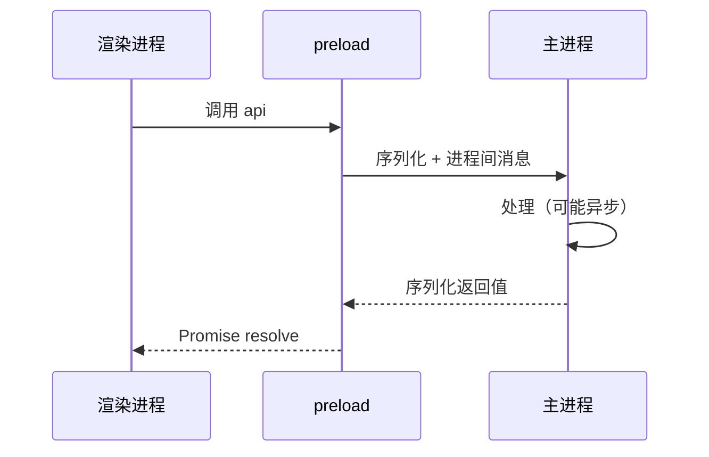

# IPC 通信体系

## 本章目标

- 掌握 Electron 的三种 IPC 模式：单向消息、请求响应、双向流。
- 设计类型安全、权限可控的 IPC 接口，而不是到处裸写通道字符串。
- 理解 IPC 的性能成本，避免同步通信、高频小消息与大对象复制。
- 能定位「通道没反应」「preload 没生效」「主进程卡住」等常见问题。

## IPC 全景



三个角色：

| 角色 | 可用模块 | 职责 |
| --- | --- | --- |
| 渲染进程 | 无 Node、无 `ipcRenderer` | 只调用 preload 暴露的白名单 API |
| preload | `ipcRenderer`、`contextBridge` | 定义通道、参数校验、暴露 API |
| 主进程 | `ipcMain`、完整 Node | 处理请求、访问系统能力、返回结果 |

## 三种通信模式

### 1. 请求响应：`invoke` / `handle`

最常用，语义接近函数调用。

```ts
// preload.ts
import { contextBridge, ipcRenderer } from 'electron';

contextBridge.exposeInMainWorld('api', {
  readConfig: () => ipcRenderer.invoke('config:read'),
});
```

```ts
// main.ts
import { ipcMain } from 'electron';

ipcMain.handle('config:read', async () => {
  return { theme: 'dark', language: 'zh-CN' };
});
```

```js
// renderer.js
const config = await window.api.readConfig();
```

特点：

- 返回 `Promise`，主进程抛出的错误会以 reject 形式传回。
- 每个通道只能注册一个 `handle`，重复注册会抛错。
- 返回值必须可结构化克隆（不能传函数、Symbol、DOM 节点）。

### 2. 单向消息：`send` / `on`

只通知，不等待结果。

```ts
// preload.ts
contextBridge.exposeInMainWorld('api', {
  track: (event: string, payload: Record<string, unknown>) => {
    ipcRenderer.send('telemetry:track', { event, payload });
  },
});
```

```ts
// main.ts
ipcMain.on('telemetry:track', (_event, data) => {
  logger.info('telemetry', data);
});
```

适合埋点、日志、状态同步。缺点是失败无反馈，重要操作不要只用单向消息。

### 3. 双向流：`MessageChannelMain`

适合持续、高频、大流量的数据通道，例如实时日志、音视频帧、协作编辑。

```ts
// main.ts
import { BrowserWindow, MessageChannelMain } from 'electron';

function connectStream(win: BrowserWindow): void {
  const { port1, port2 } = new MessageChannelMain();

  port1.on('message', (event) => {
    console.log('main received', event.data);
  });
  port1.start();

  win.webContents.postMessage('stream:port', null, [port2]);
}
```

```ts
// preload.ts
import { contextBridge, ipcRenderer } from 'electron';

ipcRenderer.on('stream:port', (event) => {
  const [port] = event.ports;
  port.onmessage = (e) => {
    // 处理流数据
    window.dispatchEvent(new CustomEvent('stream-data', { detail: e.data }));
  };
  port.start();
});
```

和 `invoke` 相比，`MessagePort` 的优势：

- 建立一次，后续消息不再经过主进程的 `ipcMain` 路由。
- 可以传递 `ArrayBuffer` 等可转移对象，减少复制。
- 适合双向、持续通信。

代价是生命周期要自己管理，端口忘记关闭会造成泄漏。

## 类型安全 IPC 设计

裸写通道字符串的问题：拼写错误、参数类型不一致、重构后遗漏。用一个共享类型文件约束两端。

```ts
// src/shared/ipc.ts
export interface IpcApi {
  'app:ping': {
    request: void;
    response: string;
  };
  'file:readText': {
    request: { path: string };
    response: { content: string };
  };
  'window:minimize': {
    request: void;
    response: void;
  };
}

export type IpcChannel = keyof IpcApi;
export type IpcRequest<C extends IpcChannel> = IpcApi[C]['request'];
export type IpcResponse<C extends IpcChannel> = IpcApi[C]['response'];
```

主进程统一注册：

```ts
// src/main/ipc/registry.ts
import { ipcMain, IpcMainInvokeEvent } from 'electron';
import type { IpcChannel, IpcRequest, IpcResponse } from '../../shared/ipc';

type Handler<C extends IpcChannel> = (
  event: IpcMainInvokeEvent,
  payload: IpcRequest<C>,
) => IpcResponse<C> | Promise<IpcResponse<C>>;

export function handle<C extends IpcChannel>(channel: C, handler: Handler<C>): void {
  ipcMain.handle(channel, (event, payload) => handler(event, payload));
}
```

```ts
// src/main/ipc/file.ts
import { handle } from './registry';
import fs from 'node:fs/promises';

handle('file:readText', async (_event, { path }) => {
  const content = await fs.readFile(path, 'utf-8');
  return { content };
});
```

preload 统一暴露：

```ts
// src/preload/index.ts
import { contextBridge, ipcRenderer } from 'electron';
import type { IpcChannel, IpcRequest, IpcResponse } from '../shared/ipc';

const api = {
  invoke<C extends IpcChannel>(
    channel: C,
    payload: IpcRequest<C>,
  ): Promise<IpcResponse<C>> {
    return ipcRenderer.invoke(channel, payload);
  },
};

contextBridge.exposeInMainWorld('api', api);
```

渲染进程类型声明：

```ts
// src/renderer/global.d.ts
import type { IpcChannel, IpcRequest, IpcResponse } from '../shared/ipc';

declare global {
  interface Window {
    api: {
      invoke<C extends IpcChannel>(
        channel: C,
        payload: IpcRequest<C>,
      ): Promise<IpcResponse<C>>;
    };
  }
}

export {};
```

这里有一个安全权衡：直接把 `invoke` 暴露给页面，页面可以调用任意已注册通道。更严格的做法是按业务暴露具名方法：

```ts
contextBridge.exposeInMainWorld('api', {
  ping: () => ipcRenderer.invoke('app:ping'),
  readText: (path: string) => ipcRenderer.invoke('file:readText', { path }),
});
```

具名方法更安全，也更容易做参数校验。类型安全与最小暴露面可以结合：共享类型约束内部实现，preload 只暴露业务需要的方法。

## 参数校验与权限

渲染进程传来的任何参数都不可信，尤其是文件路径、URL、命令。

```ts
import path from 'node:path';
import fs from 'node:fs/promises';
import { app, ipcMain } from 'electron';

const workspaceRoot = path.join(app.getPath('documents'), 'MyApp');

ipcMain.handle('file:readText', async (_event, payload: { path: string }) => {
  const target = path.resolve(workspaceRoot, payload.path);
  const relative = path.relative(workspaceRoot, target);

  // 防止 ../ 路径穿越
  if (relative.startsWith('..') || path.isAbsolute(relative)) {
    throw new Error('forbidden path');
  }

  return { content: await fs.readFile(target, 'utf-8') };
});
```

更严格的做法是只接受「资源 ID」，由主进程映射到真实路径，页面永远拿不到任意文件访问能力。

同时应校验消息来源：

```ts
ipcMain.handle('app:ping', (event) => {
  const url = event.senderFrame?.url ?? '';
  if (!url.startsWith('file://') && !url.startsWith('https://app.example.com')) {
    throw new Error('untrusted sender');
  }
  return 'pong';
});
```

`event.senderFrame` 在 Electron 新版本中可能为 `null`（frame 已销毁），需要判空。

## IPC 的性能成本

一次 `invoke` 的链路大致是：



成本来源：

| 成本 | 说明 | 优化 |
| --- | --- | --- |
| 序列化/反序列化 | 结构化克隆，大对象成本高 | 传路径/ID，分批，`ArrayBuffer` |
| 进程切换 | 跨进程调度 | 合并请求，减少往返次数 |
| 主进程排队 | 主进程单线程 | 不在主进程做重活 |
| 同步等待 | `sendSync` 阻塞渲染 | 禁止使用 |

### 避免同步 IPC

```ts
// 不要这样做：同步等待主进程，界面直接冻结
const result = ipcRenderer.sendSync('config:read');
```

`sendSync` 会阻塞渲染进程，直到主进程返回。主进程一旦忙，界面就卡死。新代码中应完全避免。

### 高频消息合并

鼠标移动、滚动、窗口 resize 这类高频事件，不要每次都发 IPC。

```ts
// renderer.ts
let pending: Array<{ x: number; y: number }> = [];
let scheduled = false;

window.addEventListener('pointermove', (e) => {
  pending.push({ x: e.clientX, y: e.clientY });

  if (!scheduled) {
    scheduled = true;
    requestAnimationFrame(() => {
      window.api.invoke('pointer:batch', pending);
      pending = [];
      scheduled = false;
    });
  }
});
```

按帧合并后，每秒最多 60 次，而不是数百次。

### 大对象传输

```ts
// 不推荐：每次都传完整大数组
await window.api.invoke('table:update', rows);

// 推荐：分页或只传变更
await window.api.invoke('table:patch', { start, changes });
```

如果要传二进制数据，使用 `ArrayBuffer` 或 `MessagePort`，避免 JSON 化。

## 主进程阻塞的连锁反应

主进程是 IPC 的中心。一旦主进程执行同步耗时任务，所有渲染进程的 `invoke` 都会排队：

```ts
// 错误示例：主进程同步读大文件
ipcMain.handle('report:load', () => {
  const raw = fs.readFileSync('/data/huge-report.json', 'utf-8');
  return JSON.parse(raw);
});
```

用户感知是「点了按钮没反应，窗口也拖不动」。正确做法：

```ts
ipcMain.handle('report:load', async () => {
  const raw = await fs.readFile('/data/huge-report.json', 'utf-8');
  return JSON.parse(raw);
});
```

如果解析本身就很重，应放到 `utilityProcess`：

```ts
ipcMain.handle('report:load', async () => {
  return parseInUtilityProcess('/data/huge-report.json');
});
```

## 常见问题排查

### `window.api is undefined`

1. `preload` 路径是否指向编译后的 `.js`。
2. `contextIsolation` 是否为 `true`（推荐）且使用了 `contextBridge`。
3. preload 是否抛错，查看主进程终端输出。
4. 页面是否在 DOM 加载前就访问了 API。

### `No handler registered for 'xxx'`

通道名拼写不一致，或 `ipcMain.handle` 在窗口加载后才注册。建议在 `app.whenReady()` 中统一注册，再创建窗口。

### `An object could not be cloned`

返回值包含函数、Promise、DOM 节点、类实例。只返回纯数据，错误用 `throw new Error()`。

### 错误信息被包装

`invoke` 抛出的错误在渲染进程看到的是 `Error invoking remote method 'xxx': ...`，原始错误在 message 中。可以在 preload 统一转换：

```ts
async function safeInvoke<T>(channel: string, payload?: unknown): Promise<T> {
  try {
    return await ipcRenderer.invoke(channel, payload);
  } catch (err) {
    const message = err instanceof Error ? err.message : String(err);
    throw new Error(message.replace(/^Error invoking remote method '[^']+':\s*/, ''));
  }
}
```

### 通道泄露与重复注册

热重载或多次初始化时，`ipcMain.handle` 重复注册会抛错。把注册逻辑放在模块顶层并保证只执行一次，或在注册前 `ipcMain.removeHandler(channel)`。

## IPC 设计规范

一份可以直接落到团队规范里的清单：

1. 通道命名采用 `domain:action`，例如 `file:readText`、`window:minimize`。
2. 所有通道在 `shared/ipc.ts` 中声明请求/响应类型。
3. 渲染进程只能通过 preload 暴露的方法访问 IPC，禁止暴露 `ipcRenderer` 本身。
4. 主进程对参数做校验，文件路径必须限制在工作目录内。
5. 禁止 `sendSync`；高频事件按帧或按时间窗口合并。
6. 大对象传 ID/路径，二进制走 `MessagePort`/`ArrayBuffer`。
7. 每个 `handle` 都要有错误处理与超时策略。
8. 不在主进程做超过几十毫秒的同步计算。

## 本章小结

- 三种 IPC 模式分别对应通知、请求响应、持续流，按场景选择。
- `contextBridge` 是唯一推荐的桥接方式，暴露面越小越安全。
- 类型安全的 IPC 需要共享类型、统一注册、统一错误转换。
- IPC 的性能瓶颈主要来自序列化、进程切换与主进程阻塞。
- 参数校验与来源校验是 IPC 的安全底线。

## 参考资料

- [Electron 教程：进程间通信](https://www.electronjs.org/zh/docs/latest/tutorial/ipc)
- [Electron API：ipcMain](https://www.electronjs.org/zh/docs/latest/api/ipc-main)
- [Electron API：ipcRenderer](https://www.electronjs.org/zh/docs/latest/api/ipc-renderer)
- [Electron API：contextBridge](https://www.electronjs.org/zh/docs/latest/api/context-bridge)
- [Electron API：MessageChannelMain](https://www.electronjs.org/zh/docs/latest/api/message-channel-main)
