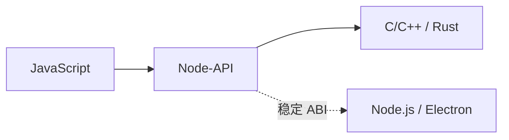

# 原生模块与跨平台编译

## 本章目标

- 理解 Node-API（N-API）与 ABI 的关系，知道什么时候必须重新编译。
- 能在 Electron 工程中正确接入 C++ 原生模块，并保证 Windows/macOS 可用。
- 了解 Rust + napi-rs 的实践路径，作为高性能场景的加分能力。
- 能排查 `NODE_MODULE_VERSION` 不匹配、`dlopen` 失败、打包后加载失败等问题。

## 什么时候需要原生模块

| 场景 | 是否适合原生模块 |
| --- | --- |
| 加解密、签名、哈希 | 适合，C/C++/Rust 库成熟 |
| 音视频编解码 | 适合，通常直接集成 FFmpeg |
| 图像处理、压缩 | 适合，性能收益明显 |
| 系统底层 API（注册表、IOKit、Win32） | 适合，Node 无直接能力 |
| 普通业务逻辑 | 不适合，JS 足够 |
| 高频小调用 | 谨慎，跨语言调用有固定开销 |

原则：**先测量，再决定是否引入原生模块**。一次跨语言调用通常在微秒级，但频繁调用会累积成毫秒级卡顿。

## Node-API 与 ABI

Node.js 的 C++ 插件曾经直接依赖 V8 内部 API，Node 版本升级就要重编译。Node-API（N-API）提供了一层稳定的 C ABI：



这带来两个结论：

1. 使用 Node-API 编写的模块，理论上不需要为每个 Node 版本重编译。
2. 但 Electron 的进程模型、头文件、链接库与 Node 官方发行版不同，**实践中仍然建议针对 Electron 重新构建**，尤其是使用 `node-addon-api`、NAN 或直接调用 V8 API 的模块。

### 什么时候必须 rebuild

| 模块类型 | 是否需要 rebuild |
| --- | --- |
| 纯 Node-API（无 V8 直接调用） | 通常可直接用，但建议验证 |
| `node-addon-api` | 建议 rebuild，避免头文件/STL 差异 |
| NAN / 直接 V8 API | 必须 rebuild |
| 带预编译二进制的模块 | 优先使用 Electron 对应 ABI 的 prebuild |

## 工具链

### 编译依赖

| 平台 | 依赖 |
| --- | --- |
| macOS | Xcode Command Line Tools |
| Windows | Visual Studio Build Tools（C++ 桌面开发）、Python 3 |
| Linux | `build-essential`、`python3`、`make`、`g++` |

```bash
# macOS
xcode-select --install

# Windows（管理员 PowerShell，示例）
winget install Microsoft.VisualStudio.2022.BuildTools
```

### 关键工具

| 工具 | 作用 |
| --- | --- |
| `node-gyp` | 根据 `binding.gyp` 调用平台编译器 |
| `@electron/rebuild` | 按 Electron 的 ABI 与头文件重新编译 |
| `electron-builder install-app-deps` | 打包前自动重建原生依赖 |
| `prebuild-install` | 下载预编译二进制，失败时回退编译 |
| `node-gyp-build` | 运行时选择匹配的 prebuild |

## 一个最小 C++ 插件

### 目录结构

```text
native/
├── binding.gyp
├── package.json
├── src/
│   └── addon.cc
└── index.js
```

### `binding.gyp`

```python
{
  "targets": [
    {
      "target_name": "addon",
      "sources": ["src/addon.cc"],
      "include_dirs": [
        "<!@(node -p \"require('node-addon-api').include\")"
      ],
      "defines": ["NAPI_DISABLE_CPP_EXCEPTIONS"]
    }
  ]
}
```

### `src/addon.cc`

```cpp
#include <napi.h>

static Napi::Value Add(const Napi::CallbackInfo& info) {
  Napi::Env env = info.Env();
  if (info.Length() < 2 || !info[0].IsNumber() || !info[1].IsNumber()) {
    Napi::TypeError::New(env, "two numbers required").ThrowAsJavaScriptException();
    return env.Undefined();
  }
  double a = info[0].As<Napi::Number>().DoubleValue();
  double b = info[1].As<Napi::Number>().DoubleValue();
  return Napi::Number::New(env, a + b);
}

static Napi::Object Init(Napi::Env env, Napi::Object exports) {
  exports.Set("add", Napi::Function::New(env, Add));
  return exports;
}

NODE_API_MODULE(addon, Init)
```

### `index.js`

```js
const path = require('node:path');

const addon = require(path.join(__dirname, 'build/Release/addon.node'));

module.exports = {
  add: addon.add,
};
```

### 编译与使用

```bash
npm install --save-dev node-addon-api node-gyp
npx node-gyp rebuild
```

在 Electron 中必须用 Electron 的头文件重编译：

```bash
npm install --save-dev @electron/rebuild
npx electron-rebuild -f -w native
```

`-w native` 指定要重建的模块名，`-f` 强制重建。

## 在 Electron 工程中接入

### 方式一：作为本地依赖

```json
{
  "dependencies": {
    "my-native": "file:./native"
  }
}
```

```bash
npm install
npx electron-rebuild
```

### 方式二：electron-builder 自动重建

```yaml
npmRebuild: true
asarUnpack:
  - "**/*.node"
```

安装依赖后执行：

```bash
npx electron-builder install-app-deps
```

它等价于针对 Electron 版本与架构执行 rebuild，适合 CI。

### 方式三：预编译二进制

如果模块提供 prebuild，优先使用：

```bash
npm install my-native --build-from-source=false
```

需要确认 prebuild 覆盖了目标平台与 Electron ABI。缺失时回退源码编译。

## Rust + napi-rs

Rust 在内存安全与性能之间取得较好平衡，`napi-rs` 让 Rust 直接编译成 Node-API 模块。

```bash
npm install --save-dev @napi-rs/cli
npx napi new my-native
```

```rust
// src/lib.rs
use napi_derive::napi;

#[napi]
pub fn fibonacci(n: u32) -> u32 {
    match n {
        0 => 0,
        1 => 1,
        _ => {
            let mut a = 0u32;
            let mut b = 1u32;
            for _ in 2..=n {
                let next = a + b;
                a = b;
                b = next;
            }
            b
        }
    }
}
```

```bash
npx napi build --platform --release
```

产物是 `my-native.darwin-arm64.node` 这类按平台命名的文件，配合 `napi build --platform` 生成 JS 加载器。

Rust 方案的注意点：

- 首次编译较慢，CI 需要缓存 `target/`。
- 跨平台需要各自的构建机（macOS、Windows）。
- panic 不能穿透到 Node，需要在边界处捕获并转成错误。
- 与 C++ 一样，避免在主进程执行长任务。

## 多平台兼容

### 构建矩阵

| 平台 | 架构 | 构建机 |
| --- | --- | --- |
| macOS | x64 / arm64 | macOS |
| Windows | x64 / arm64 | Windows |
| Linux | x64 / arm64 | Linux |

原生模块**不能可靠交叉编译**。最稳妥的方式是每个平台用对应构建机，CI 矩阵构建。

### macOS Universal

如果要发布 universal 包，所有 `.node` 都必须是 universal 二进制：

```bash
lipo -create addon-x64.node addon-arm64.node -output addon.node
lipo -info addon.node
```

只提供单架构时，universal 打包会失败或运行时崩溃。

### Windows 依赖

- 确认 MSVC 运行时（`vcruntime140.dll` 等）随应用分发，或使用静态链接。
- 依赖第三方 DLL 时，把 DLL 放在可执行文件同目录或 `asarUnpack` 的资源目录。
- 签名时 `.node` 与 `.dll` 也需要签名。

## 打包与加载

`.node` 文件不能被放进 asar 内部，因为 `dlopen` 需要真实文件路径。

```yaml
asarUnpack:
  - "**/*.node"
```

加载路径会变成：

```text
app.asar.unpacked/node_modules/my-native/build/Release/addon.node
```

运行时解析：

```js
const addonPath = require.resolve('my-native/build/Release/addon.node');
// Electron 会自动把 asar 路径映射到 app.asar.unpacked
const addon = require(addonPath);
```

最佳实践：

1. 原生模块内部用 `__dirname` 相对定位 `.node` 与 DLL。
2. 不要硬编码 `app.asar` 路径。
3. 打包后用 `asar list` 与 `find` 确认 `.node` 在 `app.asar.unpacked` 中。

## 常见错误与排查

### `NODE_MODULE_VERSION` 不匹配

```text
Error: The module '...' was compiled against a different Node.js version using
NODE_MODULE_VERSION 127. This version of Node.js requires NODE_MODULE_VERSION 137.
```

说明模块是按本地 Node 编译的，不是按 Electron。解决：

```bash
npx electron-rebuild -f -w my-native
```

### `MODULE_NOT_FOUND`

- 模块没有安装到生产依赖。
- `files` 白名单把它排除了。
- 路径拼写错误。
- `asarUnpack` 没生效。

### `dlopen ... no suitable image found`

常见于 macOS：

- 架构不匹配（x64 模块跑在 arm64 应用里）。
- 签名失效或被修改。
- 依赖的动态库找不到。

```bash
file addon.node
lipo -info addon.node
codesign -dv --verbose=4 addon.node
otool -L addon.node
```

### Windows `找不到指定的模块`

通常是缺少依赖 DLL。用 [Dependencies](https://github.com/lucasg/Dependencies) 或 `dumpbin /dependents` 检查。

### 应用启动即崩溃

原生模块在 `require` 阶段崩溃会直接杀死进程。排查步骤：

1. 在主进程最早的位置单独 `require`，确认是否模块本身的问题。
2. 检查 Electron 版本与模块支持矩阵。
3. 用 Debug 构建获取更多日志。
4. 在 CI 中用干净机器复现，排除本地环境差异。

## 性能与安全原则

### 性能

- **减少跨语言调用次数**：批量传数组，而不是循环调用。
- **避免同步阻塞**：耗时操作使用 Node-API 的 async work 或 Rust 的异步任务。
- **减少数据复制**：使用 `Buffer`/`ArrayBuffer`，必要时用外部内存。
- **在主进程之外执行**：重计算放 `utilityProcess`，避免阻塞 IPC。

### 安全

- 原生模块拥有完整进程权限，等同于信任边界内的代码。
- 只使用可信来源的模块，审查 `binding.gyp` 与安装脚本。
- 处理所有输入边界，防止缓冲区溢出。
- C++ 异常不要穿透 Node-API 边界；Rust 用 `catch_unwind` 或 napi-rs 的错误机制。

## 本章小结

- Node-API 提供稳定 ABI，但 Electron 场景仍建议用 `@electron/rebuild` 重建。
- 原生模块的编译链路由 `node-gyp`、Electron 头文件与平台工具链组成。
- Rust + napi-rs 是高性能场景的可行选择，但跨平台构建成本更高。
- `.node` 必须 `asarUnpack`，并确保架构与签名匹配。
- 原生模块的性能收益来自减少调用次数与避免数据复制，而不是单纯「用 C++ 重写」。

## 参考资料

- [Electron 教程：使用原生 Node 模块](https://www.electronjs.org/zh/docs/latest/tutorial/using-native-node-modules)
- [Node-API 文档](https://nodejs.org/api/n-api.html)
- [node-addon-api](https://github.com/nodejs/node-addon-api)
- [@electron/rebuild](https://github.com/electron/rebuild)
- [napi-rs 文档](https://napi.rs/)
