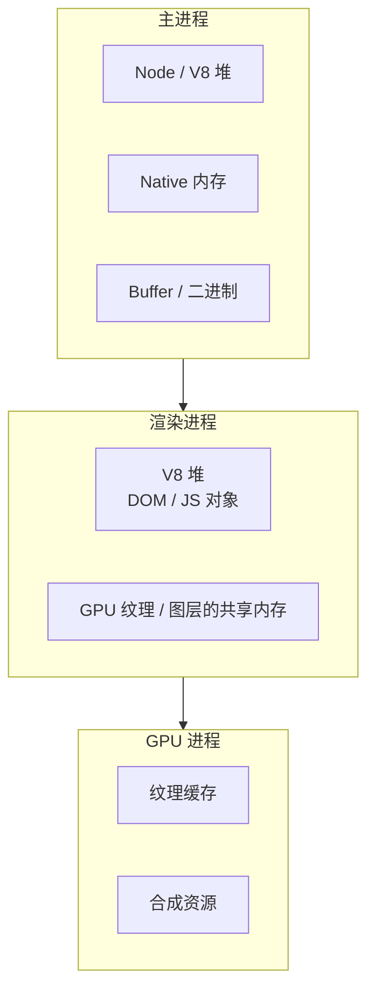
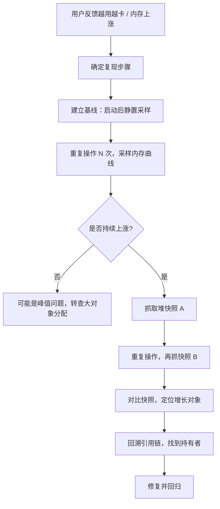

# 内存与 GC 优化

## 本章目标

- 分清 Electron 应用的内存组成：Node 堆、V8 堆、GPU 内存、Native 内存。
- 会用 `app.getAppMetrics()`、堆快照、DevTools Memory 定位泄漏。
- 掌握常见泄漏模式与修复方式。
- 把「内存 < 300MB」拆成进程级预算，并建立回归门禁。

## 内存都去哪了



| 组成 | 观察方式 | 典型问题 |
| --- | --- | --- |
| 主进程 V8 堆 | `process.memoryUsage()` | 全局缓存、日志、未释放对象 |
| 主进程 Native 内存 | 系统监视器 | 原生模块泄漏、Buffer 未释放 |
| 渲染进程 V8 堆 | DevTools Memory | 闭包、事件监听、DOM 引用 |
| GPU/纹理 | `app.getAppMetrics()`、GPU 面板 | 大图、动画层、透明窗口 |
| 共享内存 | 系统监视器 | 大量 IPC 大对象、视频帧 |

Electron 的「内存占用」通常指所有相关进程的 **Working Set / 常驻内存之和**。任务管理器里看到的每个进程都要算进去。

## 指标采集

### 应用级进程指标

```ts
// src/main/perf/memory.ts
import { app } from 'electron';

export type ProcessMemorySample = {
  type: string;
  pid: number;
  workingSetMB: number;
  peakWorkingSetMB: number;
  cpuPercent: number;
};

export function sampleProcessMemory(): ProcessMemorySample[] {
  return app.getAppMetrics().map((metric) => ({
    type: metric.type,
    pid: metric.pid,
    workingSetMB: Math.round(metric.memory.workingSetSize / 1024),
    peakWorkingSetMB: Math.round(metric.memory.peakWorkingSetSize / 1024),
    cpuPercent: Number(metric.cpu.percentCPUUsage.toFixed(1)),
  }));
}
```

`workingSetSize` 的单位是 KB。`type` 常见为 `Browser`、`Tab`、`GPU`、`Utility`，可以按类型聚合出「主进程 / 渲染进程 / GPU / 工具进程」四类。

### 主进程堆

```ts
export function sampleMainHeap(): Record<string, number> {
  const usage = process.memoryUsage();
  const mb = (v: number): number => Math.round((v / 1024 / 1024) * 10) / 10;
  return {
    rssMB: mb(usage.rss),
    heapTotalMB: mb(usage.heapTotal),
    heapUsedMB: mb(usage.heapUsed),
    externalMB: mb(usage.external),
    arrayBuffersMB: mb(usage.arrayBuffers),
  };
}
```

### 渲染进程内存

```ts
export async function sampleRendererMemory(win: BrowserWindow): Promise<{
  privateMB: number;
  residentMB: number;
}> {
  const info = await win.webContents.getProcessMemoryInfo();
  return {
    privateMB: Math.round(info.private / 1024),
    residentMB: Math.round(info.residentSet / 1024),
  };
}
```

不同平台返回字段略有差异，使用前先看日志确认。

### GPU 信息

```ts
const status = app.getGPUFeatureStatus();
const info = await app.getGPUInfo('basic');
console.log(status, info);
```

GPU 内存没有跨平台统一的精确 API，通常结合系统监视器、`chrome://gpu` 与 DevTools 的 Layers/Rendering 面板判断。

## 泄漏排查流程



关键原则：

1. **先证明是泄漏**：执行 GC 后内存仍持续上涨，才算泄漏。
2. **区分常驻与峰值**：缓存预热后的稳定值不是泄漏。
3. **一次只改一个变量**：否则无法归因。

## 堆快照

### 渲染进程

DevTools → Memory → Heap snapshot：

1. 打开页面，等待稳定。
2. 点击「Collect garbage」。
3. 记录快照 A。
4. 执行可疑操作 10–50 次。
5. 再次 GC，记录快照 B。
6. 选择 Comparison，按 `# Delta` 排序。

也可以在主进程主动抓取：

```ts
import path from 'node:path';
import { app, BrowserWindow } from 'electron';

export async function captureRendererHeap(win: BrowserWindow, name: string): Promise<void> {
  const file = path.join(app.getPath('temp'), `${name}.heapsnapshot`);
  await win.webContents.takeHeapSnapshot(file);
  console.log('heap snapshot saved', file);
}
```

### 主进程

```ts
import v8 from 'node:v8';
import path from 'node:path';
import { app } from 'electron';

export function captureMainHeap(name: string): void {
  const file = path.join(app.getPath('temp'), `${name}.heapsnapshot`);
  v8.writeHeapSnapshot(file);
  console.log('main heap snapshot saved', file);
}
```

把 `.heapsnapshot` 拖进 DevTools Memory 面板即可分析。

### 怎么读快照

重点关注：

| 列 | 含义 |
| --- | --- |
| `Shallow Size` | 对象自身占用 |
| `Retained Size` | 该对象被回收后能释放的总内存 |
| `# New` / `# Deleted` / `# Delta` | 两次快照间的对象数量变化 |
| `Distance` | 到 GC Roots 的距离 |

常见增长对象：

- `Detached HTMLElement`：DOM 已移除但 JS 仍持有引用。
- `EventListener` / `Closure`：监听器未移除，闭包持有大对象。
- `Array` / `Object`：无上限缓存。
- `MessagePort` / `WebContents`：未关闭的通信对象。
- `Buffer` / `ArrayBuffer`：二进制数据未释放。

## 常见泄漏模式

### 1. 事件监听未移除

```ts
// 泄漏：窗口关闭后监听器仍持有引用
app.on('browser-window-focus', () => {
  win.webContents.send('focus-changed');
});
```

修复：

```ts
const onFocus = (): void => {
  if (!win.isDestroyed()) win.webContents.send('focus-changed');
};

app.on('browser-window-focus', onFocus);

win.on('closed', () => {
  app.off('browser-window-focus', onFocus);
});
```

### 2. 窗口/WebContents 引用未清理

```ts
// 全局数组持续 push，closed 后不移除
const windows: BrowserWindow[] = [];
windows.push(win);
```

修复：在 `closed` 中移除，并在使用前检查 `isDestroyed()`。

### 3. 无上限缓存

```ts
// 泄漏：缓存永不清理
const cache = new Map<string, string>();
cache.set(key, value);
```

修复：使用 LRU 或设置容量上限：

```ts
class LruCache<K, V> {
  private readonly map = new Map<K, V>();
  constructor(private readonly max: number) {}

  get(key: K): V | undefined {
    const value = this.map.get(key);
    if (value !== undefined) {
      this.map.delete(key);
      this.map.set(key, value);
    }
    return value;
  }

  set(key: K, value: V): void {
    if (this.map.has(key)) this.map.delete(key);
    this.map.set(key, value);
    if (this.map.size > this.max) {
      const oldest = this.map.keys().next().value;
      if (oldest !== undefined) this.map.delete(oldest);
    }
  }
}
```

### 4. 定时器与轮询

```ts
// 页面卸载后仍然执行
setInterval(() => fetchData(), 1000);
```

修复：

```ts
const timer = setInterval(() => fetchData(), 1000);

window.addEventListener('beforeunload', () => {
  clearInterval(timer);
});
```

### 5. 闭包持有大对象

```ts
function createHandler(bigData: BigData) {
  return () => {
    // 即使只用到一个字段，也保留了整个 bigData
    console.log(bigData.id);
  };
}
```

修复：只捕获需要的字段，或在处理完成后置空引用。

### 6. `MessagePort` 未关闭

```ts
const { port1, port2 } = new MessageChannelMain();
// 通信结束后没有 close
```

修复：

```ts
port1.close();
port2.close();
```

### 7. Detached DOM

```ts
let detached: HTMLElement | null = null;

function removePanel(): void {
  const el = document.getElementById('panel');
  detached = el; // 持有已移除 DOM
  el?.remove();
}
```

修复：移除后不要保留引用；若需要缓存，缓存数据而不是 DOM。

## GC 与卡顿

频繁 GC 的典型信号：

- 内存曲线呈锯齿状且频繁下跌。
- DevTools Performance 中出现密集的 `Minor GC` / `Major GC`。
- 主进程或渲染进程出现周期性卡顿。

常见原因：

| 原因 | 表现 | 优化 |
| --- | --- | --- |
| 大量短生命周期对象 | Minor GC 频繁 | 复用对象、对象池、减少临时数组 |
| 大对象分配 | Major GC 停顿 | 分块处理、流式解析 |
| 字符串不断拼接 | 内存与 GC 压力 | 使用数组 `join` 或 `StringBuilder` 思路 |
| `JSON.parse` 超大字符串 | 峰值内存翻倍 | 流式解析、分页 |
| 缓存无上限 | 老生代持续增长 | LRU + TTL |

可以在开发环境暴露 GC 验证：

```bash
npx electron --js-flags="--expose-gc" .
```

```ts
// 仅开发环境
(globalThis as { gc?: () => void }).gc?.();
```

生产环境不要依赖手动 GC。

## 目标拆解：「内存 < 300MB」

以「单窗口 + 托盘常驻」的桌面应用为例，给出示例预算：

| 进程 | 常驻预算 | 峰值预算 | 说明 |
| --- | --- | --- | --- |
| 主进程 | 80MB | 120MB | Node 堆 + 业务模块 + 原生库 |
| 渲染进程（主窗口） | 120MB | 180MB | 首屏 DOM + 框架运行时 |
| GPU 进程 | 60MB | 120MB | 纹理与合成缓存 |
| Utility 进程 | 20MB | 40MB | 后台任务 |
| 其他 | 20MB | 30MB | 网络服务、崩溃处理等 |
| **合计** | **300MB** | **490MB** | 峰值按场景单独约束 |

注意：

- 「300MB」通常指常驻内存，不是峰值。打开大图、大表格时峰值必然更高。
- 多窗口应用要按窗口数线性预算。
- macOS 与 Windows 的内存统计口径不同，不能直接横向比较绝对值。
- Apple Silicon 与 Intel 的 GPU 内存统计方式不同，需要分平台建基线。

## 大图与缓存治理

### 图片

- 按显示尺寸加载，不要用 4K 原图渲染 200px 缩略图。
- 使用 WebP/AVIF，减少解码后内存。
- 列表中的图片离开视口后释放引用。
- 大图查看器使用分块加载或降采样。

```ts
// 生成缩略图时限制最大边长
function fitWithin(width: number, height: number, max: number) {
  const scale = Math.min(1, max / Math.max(width, height));
  return { width: Math.round(width * scale), height: Math.round(height * scale) };
}
```

### 缓存

| 缓存 | 建议 |
| --- | --- |
| 内存缓存 | LRU + 容量上限 + TTL |
| 磁盘缓存 | 设置总大小上限，定期清理 |
| 图片缓存 | 区分缩略图与原图，原图按需加载 |
| 网络响应 | 使用 HTTP 缓存，不要全部堆在内存 |

Electron 的 session 缓存可以查询与清理：

```ts
const size = await session.defaultSession.getCacheSize();
console.log('cache size', size);

await session.defaultSession.clearCache();
```

## 防劣化：内存门禁

CI 中可以执行固定的自动化场景：

1. 启动应用，等待首屏稳定。
2. 执行脚本化操作（打开列表、滚动、切换页面）20 次。
3. 每次操作后采样 `app.getAppMetrics()`。
4. 对比基线：
   - 常驻内存不得超过基线 10%。
   - 操作前后内存增量不得超过基线增量 20%。
   - 连续操作后内存曲线不得呈单调上升。

```ts
type MemoryGate = {
  baselineMB: number;
  tolerance: number;
};

export function checkMemoryGate(samples: number[], gate: MemoryGate): boolean {
  const stable = samples.slice(-3);
  const avg = stable.reduce((a, b) => a + b, 0) / stable.length;
  return avg <= gate.baselineMB * (1 + gate.tolerance);
}
```

门禁失败时输出每个进程的明细，便于定位是主进程、渲染进程还是 GPU 增长。

## 本章小结

- Electron 内存由多个进程组成，必须分进程观察与预算。
- 泄漏排查的核心是「GC 后仍上涨」与「快照对比」，不是看单次数值。
- 最常见泄漏来自事件监听、全局引用、无上限缓存、定时器与 Detached DOM。
- 频繁 GC 往往由大量短生命周期对象或大对象分配引起，优化方向是复用与分块。
- 「< 300MB」要拆成常驻/峰值、分进程预算，并用自动化门禁防止劣化。

## 参考资料

- [Electron 最佳实践：性能](https://www.electronjs.org/zh/docs/latest/tutorial/performance)
- [Electron API：app.getAppMetrics](https://www.electronjs.org/zh/docs/latest/api/app#appgetappmetrics)
- [Electron API：webContents](https://www.electronjs.org/zh/docs/latest/api/web-contents)
- [Chrome DevTools：Memory](https://developer.chrome.com/docs/devtools/memory/)
- [Node.js：Memory Diagnostics](https://nodejs.org/en/learn/diagnostics/memory)
