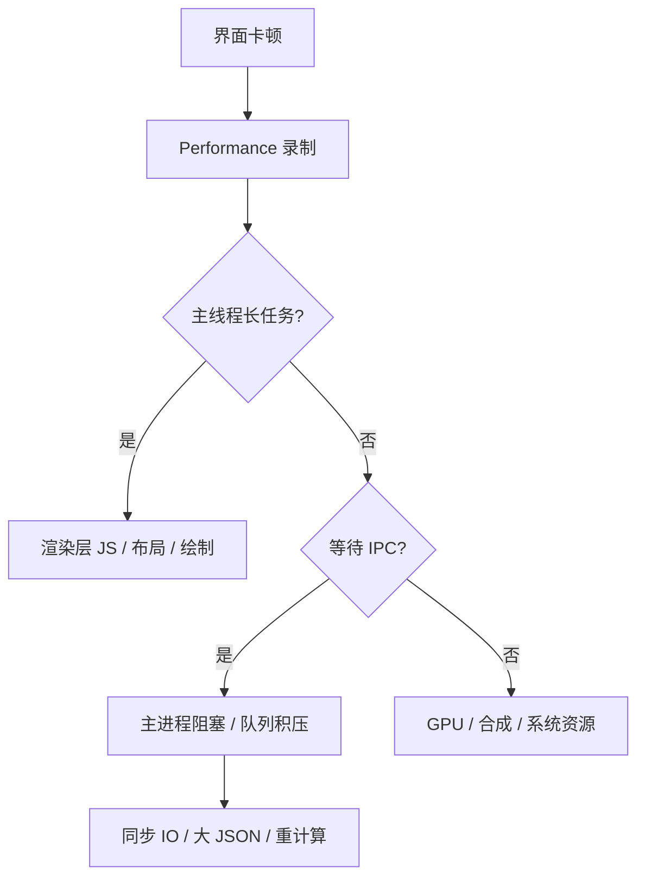

# 渲染与 IPC 性能

## 本章目标

- 理解 Chromium 渲染流水线与帧预算，能判断「掉帧」发生在哪一段。
- 掌握长列表、大图、动画、重排重绘的优化手段。
- 能治理主进程阻塞与高频 IPC 带来的界面卡顿。
- 制定团队可执行的渲染性能标准。

## 帧预算

人眼感知流畅的最低标准通常是 60fps，即每帧 16.67ms。高刷新率屏幕（90/120Hz）对应 11.1ms / 8.3ms。

一帧内要完成：


任何一段超预算，就会出现掉帧。主线程被长任务占用时，输入事件也无法及时处理，表现为「点了没反应」。

| 帧率 | 单帧预算 | 常见场景 |
| --- | --- | --- |
| 60fps | 16.67ms | 普通桌面 |
| 90fps | 11.11ms | 高刷屏 |
| 120fps | 8.33ms | 高刷屏、动画密集 |

## 渲染指标

| 指标 | 含义 | 采集 |
| --- | --- | --- |
| FPS | 每秒绘制帧数 | `requestAnimationFrame` 统计 |
| 长任务数 | 超过 50ms 的主线程任务 | `PerformanceObserver('longtask')` |
| 掉帧率 | 超出帧预算的帧占比 | 帧间隔统计 |
| INP | 交互到下一次绘制 | `PerformanceObserver('event')` |
| 首屏 LCP | 最大内容绘制 | `PerformanceObserver('largest-contentful-paint')` |

### 采集 FPS 与掉帧

```ts
// src/renderer/perf/fps.ts
export function observeFps(durationMs = 5000): Promise<{
  fps: number;
  droppedRatio: number;
}> {
  return new Promise((resolve) => {
    const frameBudget = 1000 / 60;
    let frames = 0;
    let dropped = 0;
    let last = performance.now();
    const start = last;

    const tick = (now: number): void => {
      const delta = now - last;
      last = now;
      frames += 1;

      if (delta > frameBudget * 1.5) {
        dropped += 1;
      }

      if (now - start < durationMs) {
        requestAnimationFrame(tick);
      } else {
        const elapsed = now - start;
        resolve({
          fps: Math.round((frames / elapsed) * 1000),
          droppedRatio: Number((dropped / frames).toFixed(3)),
        });
      }
    };

    requestAnimationFrame(tick);
  });
}
```

### 长任务

```ts
new PerformanceObserver((list) => {
  for (const entry of list.getEntries()) {
    console.warn('long task', entry.startTime, entry.duration);
  }
}).observe({ type: 'longtask', buffered: true });
```

长任务超过 50ms 就会明显影响交互。优化目标不是「消灭所有长任务」，而是把关键路径上的长任务拆到 50ms 以下。

## DevTools 定位掉帧

1. 打开 Performance 面板，勾选 Screenshots。
2. 录制一段卡顿操作。
3. 看 Main 线程的火焰图：
   - 黄色：JS 执行。
   - 紫色：样式与布局。
   - 绿色：绘制与合成。
4. 看 Frames 轨道是否有红色三角（掉帧）。
5. 看 Bottom-Up / Call Tree，定位最耗时的函数。

Rendering 面板可以开启：

- `Paint flashing`：哪些区域在重绘。
- `Layout Shift Regions`：布局偏移。
- `Frame rendering stats`：FPS 与 GPU 信息。
- `Layer borders`：合成层边界。

## 长列表

一次性渲染上万行 DOM 是典型卡顿源。解决方案是虚拟列表：只渲染可视区域。

```tsx
// src/renderer/components/VirtualList.tsx
import { useMemo, useRef, useState } from 'react';

type VirtualListProps<T> = {
  items: T[];
  itemHeight: number;
  height: number;
  renderItem: (item: T, index: number) => React.ReactNode;
};

export function VirtualList<T>({ items, itemHeight, height, renderItem }: VirtualListProps<T>) {
  const [scrollTop, setScrollTop] = useState(0);
  const ref = useRef<HTMLDivElement>(null);

  const visibleCount = Math.ceil(height / itemHeight);
  const start = Math.max(0, Math.floor(scrollTop / itemHeight) - 3);
  const end = Math.min(items.length, start + visibleCount + 6);

  const visible = useMemo(() => items.slice(start, end), [items, start, end]);

  return (
    <div
      ref={ref}
      style={{ height, overflowY: 'auto' }}
      onScroll={(e) => setScrollTop(e.currentTarget.scrollTop)}
    >
      <div style={{ height: items.length * itemHeight, position: 'relative' }}>
        {visible.map((item, i) => (
          <div
            key={start + i}
            style={{
              position: 'absolute',
              top: (start + i) * itemHeight,
              height: itemHeight,
              left: 0,
              right: 0,
            }}
          >
            {renderItem(item, start + i)}
          </div>
        ))}
      </div>
    </div>
  );
}
```

优化点：

- 只渲染可视区 + 少量缓冲。
- 固定行高时用绝对定位，避免布局抖动。
- 滚动事件只更新 `scrollTop`，不要触发数据请求。
- 图片懒加载，离开视口释放。
- 复杂单元格使用 `React.memo` 或缓存。

CSS 辅助：

```css
.list-row {
  content-visibility: auto;
  contain-intrinsic-size: 48px;
}
```

`content-visibility: auto` 让浏览器跳过屏幕外内容的渲染，适合中等规模列表；超大规模仍应使用虚拟列表。

## 大图与动画

### 图片

- 使用正确尺寸，不要在 100×100 的容器里渲染 4000×4000。
- 优先 WebP/AVIF，减少解码内存与时间。
- 大图使用 `loading="lazy"` 或 IntersectionObserver。
- 避免在滚动中同步解码大图。

```ts
const observer = new IntersectionObserver((entries) => {
  for (const entry of entries) {
    if (entry.isIntersecting) {
      const img = entry.target as HTMLImageElement;
      img.src = img.dataset.src ?? '';
      observer.unobserve(img);
    }
  }
});

document.querySelectorAll('img[data-src]').forEach((img) => observer.observe(img));
```

### 动画

优先使用合成层动画：

```css
.panel {
  transition: transform 200ms ease, opacity 200ms ease;
  will-change: transform;
}
```

- `transform` / `opacity` 通常只触发合成，不触发布局与绘制。
- 避免动画 `width`、`height`、`top`、`left`、`margin`。
- `will-change` 要慎用，滥用会创建过多合成层，增加 GPU 内存。
- 动画结束后移除 `will-change`。

```ts
element.addEventListener('transitionend', () => {
  element.style.willChange = 'auto';
}, { once: true });
```

### 使用 `requestAnimationFrame` 驱动

```ts
let rafId = 0;
let value = 0;

function animate(): void {
  value = Math.min(1, value + 0.02);
  element.style.transform = `translateX(${value * 200}px)`;
  if (value < 1) {
    rafId = requestAnimationFrame(animate);
  }
}

rafId = requestAnimationFrame(animate);

// 取消
cancelAnimationFrame(rafId);
```

不要在动画循环里做布局读取（`offsetHeight`、`getBoundingClientRect`），否则会强制同步布局。

## 重排与重绘

### 布局抖动

```ts
// 错误：读-写-读-写交替，强制多次同步布局
for (const el of elements) {
  el.style.width = `${el.offsetWidth + 10}px`;
}
```

修复：先读后写。

```ts
const widths = elements.map((el) => el.offsetWidth);
elements.forEach((el, i) => {
  el.style.width = `${widths[i] + 10}px`;
});
```

### 批量 DOM 操作

```ts
const fragment = document.createDocumentFragment();
for (const item of items) {
  const li = document.createElement('li');
  li.textContent = item;
  fragment.appendChild(li);
}
list.appendChild(fragment);
```

### 减少选择器与层级

- 避免深层嵌套与复杂选择器。
- 使用 `contain: layout paint` 隔离局部布局影响。
- 固定尺寸元素显式设置宽高，减少布局计算。

## 主进程阻塞治理

渲染进程卡顿不一定是渲染层的问题。主进程被阻塞时，IPC 返回变慢，页面等待数据，表现同样是卡顿。



### 把重任务移出主进程

```ts
// 主进程只做转发
ipcMain.handle('report:parse', async (_event, filePath: string) => {
  return parseInUtility(filePath);
});
```

```ts
// utility 进程执行解析
process.parentPort.on('message', async (event) => {
  const { filePath } = event.data;
  const result = await parseLargeFile(filePath);
  process.parentPort.postMessage({ ok: true, result });
});
```

### 避免同步 I/O

```ts
// 禁止
const content = fs.readFileSync(path, 'utf-8');

// 推荐
const content = await fs.readFile(path, 'utf-8');
```

### 控制日志与序列化

主进程里对大对象做 `JSON.stringify` 也会阻塞。日志要采样、截断，避免在热路径上输出完整对象。

## IPC 性能

### 减少往返次数

```ts
// 不推荐：循环调用
for (const id of ids) {
  await window.api.invoke('item:get', { id });
}

// 推荐：批量
await window.api.invoke('item:getMany', { ids });
```

### 按帧合并高频事件

```ts
let pending: Array<{ x: number; y: number }> = [];
let scheduled = false;

window.addEventListener('pointermove', (e) => {
  pending.push({ x: e.clientX, y: e.clientY });
  if (scheduled) return;
  scheduled = true;
  requestAnimationFrame(() => {
    void window.api.invoke('pointer:batch', { points: pending });
    pending = [];
    scheduled = false;
  });
});
```

### 大对象与二进制

- 传路径/ID，不传完整内容。
- 二进制使用 `ArrayBuffer` 或 `MessagePort`。
- 大列表分页，避免一次序列化几十 MB。

### 避免同步 IPC

`sendSync` 会让渲染进程等待主进程，主进程一忙就掉帧。新代码中禁止使用。

## 多窗口与 GPU 压力

- 每个窗口都是独立渲染进程，内存与 CPU 成本叠加。
- 多个窗口同时播放动画会争抢 GPU 与合成资源。
- 后台窗口应降低渲染频率：

```ts
win.webContents.setBackgroundThrottling(true);
```

- 隐藏窗口暂停非必要动画与轮询。
- 透明窗口、复杂阴影、模糊效果会增加合成成本。

## 渲染性能标准

一套可落地的团队标准：

| 指标 | 目标 | 测量方式 |
| --- | --- | --- |
| 常规滚动 FPS | ≥ 55 | `requestAnimationFrame` 采样 |
| 动画 FPS | ≥ 58 | Performance 面板 |
| 长任务 | 关键路径无 > 100ms 任务 | `longtask` |
| INP | < 200ms | `PerformanceObserver('event')` |
| 首屏 LCP | 符合产品预算 | `largest-contentful-paint` |
| 内存增量 | 操作 20 次后 < 基线 10% | `app.getAppMetrics()` |

标准要写进：

1. 组件库的性能约定（例如列表必须使用虚拟滚动）。
2. Code Review 检查项。
3. CI 自动化场景。
4. 版本发布前的性能验收。

## 案例：从 30fps 到 60fps 的排查路径

以下为方法示例，数据为示意：

1. **复现**：打开含 5000 行数据的表格，滚动时明显卡顿。
2. **录制**：Performance 面板显示每帧 JS 执行 20–30ms，Layout 8ms。
3. **定位**：滚动事件里每次都 `setState` 全量数据，触发整表重渲染。
4. **修复**：
   - 改为虚拟列表，只渲染可视行。
   - 滚动状态与数据状态分离。
   - 单元格使用 `React.memo`。
   - 图片懒加载。
5. **验证**：FPS 从约 30 提升到 55–60，长任务从每帧 1 个降为偶发。
6. **防回归**：把「5000 行滚动 10 秒」加入自动化性能场景。

这个路径适用于大多数渲染性能问题：**先测量，再定位到具体阶段，最后用最小改动验证收益**。

## 本章小结

- 60fps 的预算是 16.67ms，任何一段流水线超时都会掉帧。
- 长列表用虚拟滚动，大图按尺寸加载，动画优先使用 `transform`/`opacity`。
- 避免布局抖动与频繁 DOM 重建，读写分离、批量更新。
- 主进程阻塞会通过 IPC 传导为界面卡顿，重任务要移到 utility 进程。
- 渲染性能标准要数字化，并进入评审与 CI。

## 参考资料

- [Electron 最佳实践：性能](https://www.electronjs.org/zh/docs/latest/tutorial/performance)
- [Chrome DevTools：Performance](https://developer.chrome.com/docs/devtools/performance/)
- [Chrome DevTools：Rendering](https://developer.chrome.com/docs/devtools/rendering/)
- [web.dev：Optimize long tasks](https://web.dev/articles/optimize-long-tasks)
- [web.dev：content-visibility](https://web.dev/articles/content-visibility)
