# 启动性能优化

## 本章目标

- 把「启动慢」拆成可测量的阶段，而不是凭感觉优化。
- 建立冷启动、热启动、首屏白屏、可交互四类指标与埋点。
- 掌握主进程、渲染进程、窗口三个层面的启动优化手段。
- 把「启动 < 1s」拆成可执行的预算表，并接入监控与回归防护。

## 启动性能的定义

启动不是一个点，而是一条链路：

```mermaid
gantt
    title Electron 启动链路（示例）
    dateFormat X
    axisFormat %L
    section 进程
    进程创建与 Chromium 初始化 :a1, 0, 180
    section 主进程
    Node 模块加载与业务初始化 :a2, after a1, 120
    创建 BrowserWindow :a3, after a2, 80
    section 渲染进程
    加载 HTML/CSS/JS :a4, after a3, 260
    首屏绘制 :a5, after a4, 120
    首屏 JS 执行完成 :a6, after a5, 160
```



不同指标的口径：

| 指标 | 起点 | 终点 | 说明 |
| --- | --- | --- | --- |
| 冷启动 | 进程创建 | 首屏可见 | 无任何缓存，最接近用户首次安装 |
| 热启动 | 进程创建 | 首屏可见 | 系统缓存已预热，窗口可能复用 |
| 首屏白屏时间 | 窗口显示 | 首次内容绘制 | 用户看到空白窗口的时长 |
| 可交互时间（TTI） | 进程创建 | 首屏长任务结束、可稳定响应 | 比首屏更接近真实体验 |
| 二次唤起 | 点击托盘/Dock | 窗口可见且可交互 | 常驻型应用的关键指标 |

岗位 JD 中的「启动 < 1s」通常指**冷启动到可交互**，但实际项目要按产品形态定义。常驻型应用更关注二次唤起，安装型工具更关注冷启动。

## 建立埋点

### 主进程计时

```ts
// src/main/perf/startup-timer.ts
import { app } from 'electron';

class StartupTimer {
  private readonly t0 = performance.now();
  private marks = new Map<string, number>();

  mark(name: string): void {
    this.marks.set(name, performance.now() - this.t0);
  }

  snapshot(): Record<string, number> {
    return Object.fromEntries(this.marks);
  }
}

export const startupTimer = new StartupTimer();

// 最早记录一个基线
startupTimer.mark('main:module-loaded');

app.on('ready', () => {
  startupTimer.mark('app:ready');
});
```

`performance.now()` 在主进程可用，精度足够。`t0` 应放在入口模块最顶部，越早越好。

### 窗口阶段

```ts
// src/main/windows/main-window.ts
import { BrowserWindow } from 'electron';
import path from 'node:path';
import { startupTimer } from '../perf/startup-timer';

export function createMainWindow(): BrowserWindow {
  const win = new BrowserWindow({
    width: 1280,
    height: 800,
    show: false,
    backgroundColor: '#ffffff',
  });

  startupTimer.mark('window:created');

  win.once('ready-to-show', () => {
    startupTimer.mark('window:ready-to-show');
    win.show();
    startupTimer.mark('window:shown');
  });

  win.webContents.once('did-finish-load', () => {
    startupTimer.mark('window:did-finish-load');
  });

  win.loadFile(path.join(__dirname, '../../renderer/index.html'));
  return win;
}
```

### 渲染进程计时

```ts
// src/renderer/perf/startup.ts
const nav = performance.getEntriesByType('navigation')[0] as PerformanceNavigationTiming | undefined;

const metrics: Record<string, number> = {
  'renderer:dom-interactive': nav?.domInteractive ?? 0,
  'renderer:dom-content-loaded': nav?.domContentLoadedEventEnd ?? 0,
  'renderer:load': nav?.loadEventEnd ?? 0,
};

const paintEntries = performance.getEntriesByType('paint');
for (const entry of paintEntries) {
  metrics[`renderer:${entry.name}`] = entry.startTime;
}

new PerformanceObserver((list) => {
  for (const entry of list.getEntries()) {
    if (entry.name === 'first-contentful-paint') {
      metrics['renderer:fcp'] = entry.startTime;
    }
  }
}).observe({ type: 'paint', buffered: true });

new PerformanceObserver((list) => {
  const entries = list.getEntries();
  const last = entries[entries.length - 1];
  if (last) metrics['renderer:lcp'] = last.startTime;
}).observe({ type: 'largest-contentful-paint', buffered: true });
```

### 首屏可交互的近似判断

浏览器没有原生 TTI API，常用「首次内容绘制后，连续一段时间没有长任务」近似：

```ts
let lastLongTaskEnd = 0;

new PerformanceObserver((list) => {
  for (const entry of list.getEntries()) {
    lastLongTaskEnd = entry.startTime + entry.duration;
  }
}).observe({ type: 'longtask', buffered: true });

requestIdleCallback(() => {
  const tti = Math.max(lastLongTaskEnd, performance.now());
  window.api.reportStartup({ tti });
}, { timeout: 3000 });
```

### 上报

启动上报本身不能拖慢启动。建议在首屏稳定后延迟发送，并批量合并：

```ts
window.addEventListener('load', () => {
  setTimeout(() => {
    window.api.reportStartup(metrics);
  }, 1000);
});
```

主进程汇总后异步写入本地队列，由后台任务批量上传。不要在启动关键路径上同步写文件或发网络请求。

## 启动监控看板

推荐的字段：

| 字段 | 示例 | 用途 |
| --- | --- | --- |
| `version` | `1.8.2` | 版本对比 |
| `platform` | `darwin` / `win32` | 平台差异 |
| `arch` | `arm64` | Apple Silicon 与 Intel 差异 |
| `coldStart` | `true` | 区分冷/热启动 |
| `duration` | `912` | 总耗时（ms） |
| `marks` | `{ appReady: 210, fcp: 640 }` | 阶段拆解 |
| `device` | 机型/CPU 核数 | 低端设备归因 |
| `installAge` | 天数 | 首次启动与长期使用差异 |

看板至少提供：

- P50 / P90 / P95 分位数，而不是只看平均值。
- 按版本、平台、冷热启动分组。
- 阶段瀑布图，能定位是主进程慢还是渲染慢。
- 异常样本下钻：具体设备、版本、阶段耗时。

## 目标拆解：「启动 < 1s」

把 1000ms 拆成预算（示例，需按项目实测调整）：

| 阶段 | 预算 | 关键动作 |
| --- | --- | --- |
| 进程创建与 Chromium 初始化 | 180ms | 减少启动参数、避免同步扩展初始化 |
| 主进程模块加载 | 100ms | 延迟加载、code cache、减少顶层副作用 |
| 业务初始化 | 120ms | 拆分初始化、并行化、懒加载 |
| 创建窗口 | 80ms | 复用窗口、减少 WebContentsView |
| 页面资源加载 | 220ms | 首屏 JS/CSS 体积、预加载、缓存 |
| 首屏绘制 | 120ms | 减少首屏 DOM、避免大图阻塞 |
| 首屏 JS 执行 | 180ms | 代码分割、延后非关键逻辑 |
| **合计** | **1000ms** | 留出波动余量 |

预算的作用不是精确预测，而是让团队在每次迭代中知道「哪一段超了」。

## 主进程优化

### 1. 减少顶层副作用

```ts
// 不推荐：模块加载即初始化重型服务
import { initDatabase } from './db';
initDatabase();

// 推荐：按需初始化
let dbReady: Promise<void> | null = null;
export function ensureDb(): Promise<void> {
  dbReady ??= initDatabase();
  return dbReady;
}
```

启动阶段只做「必须立刻做」的事：注册协议、创建窗口、恢复必要状态。其余延迟到首屏之后。

### 2. 延迟加载与代码分割

```ts
// 不在顶层 import 大体量模块
app.whenReady().then(async () => {
  createMainWindow();

  const { setupUpdater } = await import('./system/updater');
  setupUpdater(getMainWindow);

  const { initAnalytics } = await import('./services/analytics');
  initAnalytics();
});
```

动态 `import()` 把模块解析与执行推迟到首屏之后。注意不要让延迟加载的任务反过来阻塞首屏。

### 3. 启用编译缓存

Node.js 22 提供 `module.enableCompileCache()`，可以缓存 CommonJS 模块的编译结果，减少重复解析与编译。

```ts
import module from 'node:module';
import path from 'node:path';
import { app } from 'electron';

const cacheDir = path.join(app.getPath('userData'), 'compile-cache');
if (typeof (module as { enableCompileCache?: (dir: string) => unknown }).enableCompileCache === 'function') {
  (module as { enableCompileCache: (dir: string) => unknown }).enableCompileCache(cacheDir);
}
```

需要在实际版本上验证命中率与收益。缓存目录应可清理，升级 Electron 或 Node 后旧缓存会失效。

### 4. 避免同步 I/O

启动阶段的同步读文件会直接叠加到启动耗时：

```ts
// 不推荐
const config = JSON.parse(fs.readFileSync(configPath, 'utf-8'));

// 推荐
const config = JSON.parse(await fs.readFile(configPath, 'utf-8'));
```

如果配置很小且必须同步，至少测量耗时并设定上限（例如 < 5ms）。

### 5. 减少原生模块与插件初始化

原生模块的 `require` 可能触发动态库加载与初始化。把非首屏必需的原生模块延迟到使用时加载。

## 渲染进程优化

### 1. 首屏骨架

在业务 JS 执行前先渲染静态骨架，减少白屏感知：

```html
<div id="app">
  <div class="skeleton-header"></div>
  <div class="skeleton-list">
    <div class="skeleton-row"></div>
    <div class="skeleton-row"></div>
  </div>
</div>
```

骨架屏不减少真实耗时，但显著降低「白屏焦虑」。同时它能让 `first-contentful-paint` 更早发生。

### 2. 代码分割与路由懒加载

```tsx
import { lazy, Suspense } from 'react';

const Settings = lazy(() => import('./pages/Settings'));

export function App() {
  return (
    <Suspense fallback={<Skeleton />}>
      <Settings />
    </Suspense>
  );
}
```

原则：

- 首屏只加载首屏需要的代码。
- 大型编辑器、图表库、富文本按路由或交互懒加载。
- 第三方 SDK 延后初始化。

### 3. 资源预加载

```html
<link rel="preload" href="/fonts/main.woff2" as="font" type="font/woff2" crossorigin />
<link rel="modulepreload" href="/assets/main.js" />
```

不要预加载首屏不需要的资源，会与关键资源抢带宽。

### 4. 减少首屏 DOM 与样式计算

- 首屏列表只渲染可视区域，避免一次性渲染上千行。
- 避免复杂的选择器与深层嵌套。
- 首屏不使用大面积滤镜、阴影、模糊。
- 大图使用合适尺寸与格式，避免解码阻塞。

## 窗口与 GPU 优化

| 手段 | 收益 | 注意 |
| --- | --- | --- |
| `show: false` + `ready-to-show` | 避免白屏闪烁 | 需要兜底超时 |
| `backgroundColor` | 减少首帧白闪 | 与页面背景一致 |
| `paintWhenInitiallyHidden: false` | 节省隐藏窗口资源 | 可能延后 `ready-to-show` |
| 复用窗口 | 减少创建开销 | 注意状态重置 |
| 减少 `WebContentsView` | 减少渲染进程 | 多视图是内存大户 |
| 避免透明窗口 | 降低合成成本 | 视觉需求优先时再评估 |

## 常驻型应用的快速唤起

托盘常驻应用的目标不是冷启动，而是「点击后立刻出现」。

策略：

1. 应用启动后保持主窗口隐藏但不销毁，或使用轻量窗口预热。
2. 监听全局快捷键/托盘点击，直接 `show()` + `focus()`。
3. 隐藏时暂停动画与轮询，降低后台 CPU。
4. 定期检查内存，避免长期驻留导致膨胀。

```ts
tray.on('click', () => {
  const win = getMainWindow();
  if (!win) {
    createMainWindow();
    return;
  }
  if (win.isMinimized()) win.restore();
  win.show();
  win.focus();
});
```

## 用 tracing 定位启动瓶颈

Chromium tracing 能看到主进程、渲染进程、GPU 的完整时间线：

```ts
import { contentTracing } from 'electron';
import path from 'node:path';
import { app } from 'electron';

export async function traceStartup(): Promise<void> {
  await contentTracing.startRecording({
    included_categories: ['toplevel', 'v8', 'blink', 'renderer', 'gpu'],
  });

  // 这里执行启动流程或等待一段时间
  await new Promise((resolve) => setTimeout(resolve, 3000));

  const filePath = path.join(app.getPath('temp'), 'startup-trace.json');
  await contentTracing.stopRecording(filePath);
  console.log('trace saved', filePath);
}
```

也可以在命令行使用：

```bash
npx electron --trace-startup=./trace.json .
```

把 trace 拖进 `chrome://tracing` 或 Perfetto，重点看：

- 主进程主线程上的长任务。
- 渲染进程的脚本执行、样式、布局、绘制。
- GPU 进程的合成与光栅化。
- 进程间 IPC 的等待时间。

## 常见误区

| 误区 | 问题 |
| --- | --- |
| 只在开发模式测启动 | 开发模式有 HMR、source map、未压缩资源，数据不可用 |
| 只看平均值 | 长尾用户（低端机、杀毒软件）被平均掉 |
| 只优化首屏绘制 | 首屏可见但不可交互，体验仍然差 |
| 忽略首次启动 | 首次启动要创建缓存、解压资源，通常最慢 |
| 把所有初始化都延迟 | 关键状态没恢复就展示界面，出现闪烁或错误 |
| 用 `setTimeout` 假装优化 | 只是把耗时挪走，总量没变 |

## 优化落地清单

1. 定义指标口径：冷启动、热启动、首屏、TTI。
2. 在主进程、窗口、渲染进程三处埋点，统一上报。
3. 建立按版本/平台/冷热分组的 P50/P95 看板。
4. 画出当前启动瀑布图，找出最大的一段。
5. 按「主进程 → 窗口 → 渲染进程」顺序逐项优化。
6. 把启动预算写进 CI 门禁，超过阈值阻断发布。
7. 每季度复测一次低端设备与首次安装场景。

## 本章小结

- 启动性能必须先定义口径，再埋点、拆解、优化、监控。
- 主进程优化的核心是减少顶层副作用与延迟加载；渲染进程的核心是减少首屏资源与 JS 执行。
- 窗口层面的 `show: false`、`backgroundColor`、窗口复用能显著改善感知。
- tracing 是定位启动瓶颈的可靠工具，不要只靠猜。
- 「< 1s」需要预算表、门禁与持续回归，而不是一次性优化。

## 参考资料

- [Electron 最佳实践：性能](https://www.electronjs.org/zh/docs/latest/tutorial/performance)
- [Electron API：contentTracing](https://www.electronjs.org/zh/docs/latest/api/content-tracing)
- [Electron API：app](https://www.electronjs.org/zh/docs/latest/api/app)
- [web.dev：Web Vitals](https://web.dev/articles/vitals)
- [Chrome DevTools：Performance](https://developer.chrome.com/docs/devtools/performance/)
