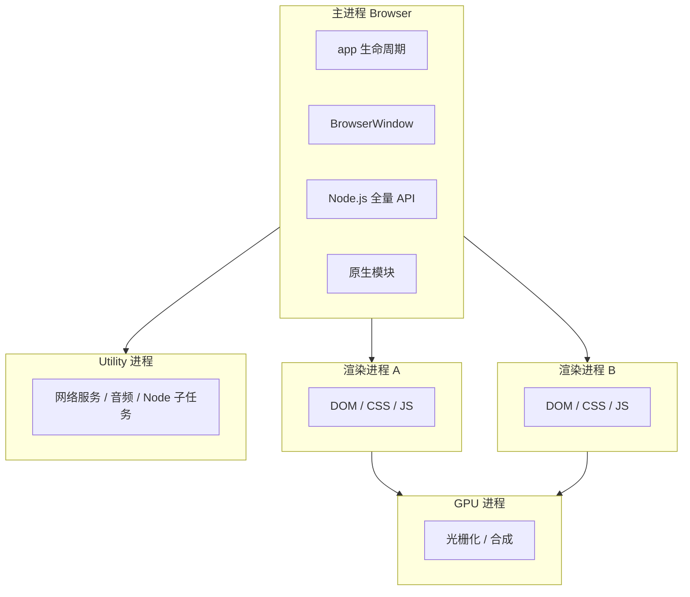
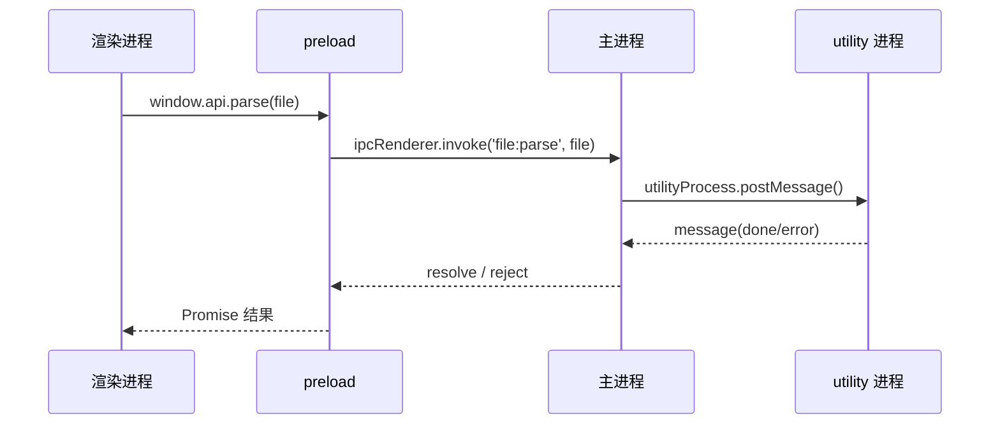
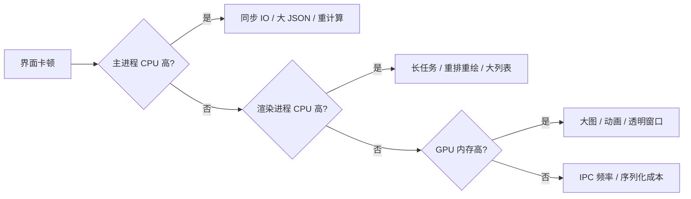

# 进程模型与运行原理

## 本章目标

- 理解 Electron 为什么采用多进程架构，以及它与 Chrome 的对应关系。
- 分清主进程、渲染进程、GPU 进程、Utility 进程的职责与能力边界。
- 会用 `utilityProcess` 把重任务移出主进程，会用单实例锁管理应用生命周期。
- 理解「主进程阻塞为什么会冻结所有窗口」这一性能问题的根源。

## 为什么不是单进程

浏览器早期是单进程模型：所有标签页共享一个进程。好处是内存开销小，坏处是一个页面崩溃或无响应会拖垮整个浏览器。Chrome 改为多进程后，每个页面在独立渲染进程中运行，由浏览器主进程统一调度。

Electron 继承了这个模型：



多进程带来的收益：

1. **稳定性隔离**：单个渲染进程崩溃，主进程可以捕获 `render-process-gone` 并重建窗口。
2. **安全隔离**：渲染进程运行在沙箱中，无法直接访问文件系统与系统 API。
3. **并行能力**：多个窗口可以并行渲染，CPU 密集任务可以放到独立进程。

代价是内存基线更高、进程间通信有序列化成本、调试链路更长。这些正是后续性能章节要解决的问题。

## 主进程

主进程是应用的入口，运行在 Node.js 环境中，拥有完整能力：

- 管理应用生命周期（`app`）。
- 创建与管理窗口（`BrowserWindow`、`WebContentsView`）。
- 访问文件系统、子进程、原生模块。
- 注册全局菜单、托盘、快捷键、协议。
- 作为 IPC 的中心节点。

```ts
// src/main/index.ts
import { app, BrowserWindow } from 'electron';
import path from 'node:path';

app.whenReady().then(() => {
  const win = new BrowserWindow({
    width: 1200,
    height: 800,
    webPreferences: {
      preload: path.join(__dirname, 'preload.js'),
      contextIsolation: true,
      sandbox: true,
    },
  });
  win.loadURL('https://example.com');
});
```

主进程只有一个，它是所有窗口的「父进程」。因此：

> **主进程的事件循环被阻塞，所有窗口的 IPC 响应、窗口操作、菜单交互都会卡住。**

常见的阻塞源：

| 阻塞源 | 表现 | 处理方式 |
| --- | --- | --- |
| `fs.readFileSync` 大文件 | 启动或打开文件时全局卡顿 | 改用 `fs/promises` |
| `JSON.parse` 超大字符串 | IPC 响应变慢、界面冻结 | 流式解析、拆分数据 |
| 同步加密/压缩 | CPU 飙高、所有窗口无响应 | 移到 `utilityProcess` 或 Worker |
| 大量同步 `require` | 启动慢 | 延迟加载、代码分割 |
| 死循环/递归 | 整个应用无响应 | 超时、任务拆分 |

## 渲染进程

每个 `BrowserWindow` 或 `WebContentsView` 对应一个渲染进程（Chromium 可能复用进程，但逻辑上相互独立）。渲染进程负责：

- 解析 HTML/CSS，执行页面 JavaScript。
- 布局、绘制、合成。
- 通过 preload 暴露的桥接 API 与主进程通信。

默认配置下，渲染进程没有 Node.js 能力：

```ts
// 页面里直接访问 Node 会失败
require('fs'); // ReferenceError: require is not defined
```

这是刻意设计。渲染进程可能加载远程内容、第三方脚本，一旦拥有 Node 能力，任何 XSS 都会变成任意代码执行。

### 沙箱

自 Electron 20 起，渲染进程默认启用沙箱（`sandbox: true`）。沙箱模式下：

- 渲染进程运行在操作系统级沙箱中，只能通过 Chromium 的 IPC 访问系统资源。
- preload 脚本只能使用有限的 Node.js polyfill（如 `events`、`timers`、`url`）以及 `electron` 的渲染进程模块。
- 不能使用 `fs`、`child_process` 等完整 Node API。

需要完整 Node 能力的 preload 必须显式关闭沙箱，但这会降低安全性。更推荐的做法是：**preload 只做桥接，真正的 Node 操作放在主进程或 utility 进程**。

```ts
// 不推荐：为了在 preload 里读文件而关闭沙箱
new BrowserWindow({
  webPreferences: {
    sandbox: false, // 扩大攻击面
    preload: './preload.js',
  },
});
```

## GPU 进程

GPU 进程负责光栅化与合成，是 Chromium 多进程架构的一部分。它不直接暴露给开发者，但会出现在内存与 CPU 统计中。

```ts
// 查看所有进程的 CPU / 内存指标
setInterval(() => {
  const metrics = app.getAppMetrics();
  for (const m of metrics) {
    console.log(m.type, m.pid, m.cpu.percentCPUUsage, m.memory.workingSetSize);
  }
}, 5000);
```

`m.type` 常见取值包括 `Browser`、`Tab`、`GPU`、`Utility` 等。性能排查时，先分清问题出在哪个进程，再决定优化方向。

调试阶段可以临时关闭硬件加速，验证是否是 GPU 驱动或合成问题：

```ts
app.disableHardwareAcceleration();
```

生产环境不建议默认关闭，软件渲染会显著增加 CPU 占用。

## Utility 进程

`utilityProcess` 用于运行 Node.js 子任务，适合 CPU 密集或可能崩溃的工作，避免阻塞主进程。

```ts
// src/main/index.ts
import { app, utilityProcess } from 'electron';
import path from 'node:path';

let worker: Electron.UtilityProcess | null = null;

function startWorker(): void {
  worker = utilityProcess.fork(path.join(__dirname, 'worker.js'), [], {
    serviceName: 'heavy-worker',
  });

  worker.on('message', (msg) => {
    console.log('worker -> main', msg);
  });

  worker.on('exit', (code) => {
    console.log('worker exit', code);
    worker = null;
  });

  worker.postMessage({ type: 'start', payload: { file: '/data/report.csv' } });
}

app.whenReady().then(startWorker);
```

```js
// src/main/worker.js（运行在 utility 进程）

// utilityProcess 中通过 process.parentPort 通信
process.parentPort.on('message', (event) => {
  const data = event.data;
  if (data.type === 'start') {
    const result = doHeavyWork(data.payload);
    process.parentPort.postMessage({ type: 'done', result });
  }
});

function doHeavyWork(payload) {
  // 解析大文件、加密、压缩等
  return payload.file.length;
}
```

使用场景：

- 解析大型日志/CSV/Excel。
- 图片转码、压缩、加密。
- 需要隔离崩溃风险的第三方逻辑。
- 任何执行时间超过几十毫秒、又必须放在主进程侧的任务。

不适合的场景：需要直接操作窗口或 UI 的逻辑，这些仍应留在主进程。

## 进程间关系与错误边界



关键原则：

1. **每个边界都要有错误处理**。utility 进程崩溃不应该拖垮主进程；渲染进程崩溃不应该导致应用退出。
2. **不要在主进程做重活**。主进程是单点，任何阻塞都会全局放大。
3. **进程边界意味着数据复制**。IPC 传递大对象有序列化成本，能传路径就不传内容，能分批就不要一次性传。

## 单实例锁

桌面应用通常只允许运行一个实例。第二个实例启动时，应把参数转交给已存在的实例，然后退出。

```ts
// src/main/index.ts
import { app, BrowserWindow } from 'electron';

const gotLock = app.requestSingleInstanceLock();

if (!gotLock) {
  app.quit();
} else {
  let mainWindow: BrowserWindow | null = null;

  app.on('second-instance', (_event, argv) => {
    // 处理通过协议/文件关联带来的参数
    console.log('second instance argv', argv);
    if (mainWindow) {
      if (mainWindow.isMinimized()) mainWindow.restore();
      mainWindow.focus();
    }
  });

  app.whenReady().then(() => {
    mainWindow = new BrowserWindow({ width: 1200, height: 800 });
    mainWindow.loadURL('https://example.com');

    mainWindow.on('closed', () => {
      mainWindow = null;
    });
  });
}
```

注意：

- `requestSingleInstanceLock()` 必须在 `app.whenReady()` 之前调用。
- 第二个实例的参数通过 `second-instance` 事件传递，可用于处理「用我的应用打开这个文件」。
- macOS 上还可以监听 `open-file` 与 `open-url` 事件。

## Windows 与 macOS 的差异

| 维度 | Windows | macOS |
| --- | --- | --- |
| 应用菜单 | 每个窗口顶部菜单栏 | 全局菜单栏，首位是应用菜单 |
| 关闭窗口 | 通常退出应用 | 通常保留应用，`activate` 重建窗口 |
| 进程创建 | `CreateProcess` | `posix_spawn`/`fork` 语义 |
| 文件路径 | 盘符 + 反斜杠 | `/` 开头，大小写敏感度因文件系统而异 |
| 安装 | NSIS/MSI/Squirrel | DMG/ZIP，需签名与公证 |
| 权限 | UAC、防火墙 | TCC（摄像头、麦克风、屏幕录制等） |
| 深链接 | 注册表协议 | `Info.plist` URL Scheme |
| 后台行为 | 托盘常驻常见 | Dock 图标、后台唤醒策略更严格 |

这些差异会直接影响窗口生命周期、自动更新、文件关联与性能表现。第 6 章会逐项展开系统能力集成。

## 进程模型与性能的关系

理解进程模型后，很多性能问题就有了统一的解释框架：

- **启动慢**：主进程初始化、Chromium 进程创建、渲染进程加载，三段串行。
- **内存高**：每个渲染进程都有独立的 V8 堆与 DOM 树；GPU 进程持有纹理缓存。
- **界面卡顿**：可能是渲染进程主线程忙，也可能是主进程被阻塞导致 IPC 排队，还可能是 GPU 合成压力过大。
- **崩溃**：渲染进程崩溃可恢复，主进程崩溃则整个应用退出，因此主进程必须保持精简与健壮。



这张决策树会在第 12、13 章反复使用。

## 本章小结

- Electron 继承 Chromium 多进程架构：主进程 + 渲染进程 + GPU 进程 + Utility 进程。
- 主进程是单点，任何阻塞都会影响所有窗口，重任务应移到 `utilityProcess` 或 Worker。
- 渲染进程默认沙箱化，preload 是受控桥接层，不应为了便利关闭沙箱。
- 单实例锁、`second-instance`、`open-file`/`open-url` 是桌面应用生命周期管理的基础。
- 平台差异不是细节问题，会直接影响窗口行为、更新与分发。

## 参考资料

- [Electron 教程：进程模型](https://www.electronjs.org/zh/docs/latest/tutorial/process-model)
- [Electron API：utilityProcess](https://www.electronjs.org/zh/docs/latest/api/utility-process)
- [Electron API：app](https://www.electronjs.org/zh/docs/latest/api/app)
- [Electron API：process](https://www.electronjs.org/zh/docs/latest/api/process)
- [Chromium 多进程架构](https://www.chromium.org/developers/design-documents/multi-process-architecture/)
