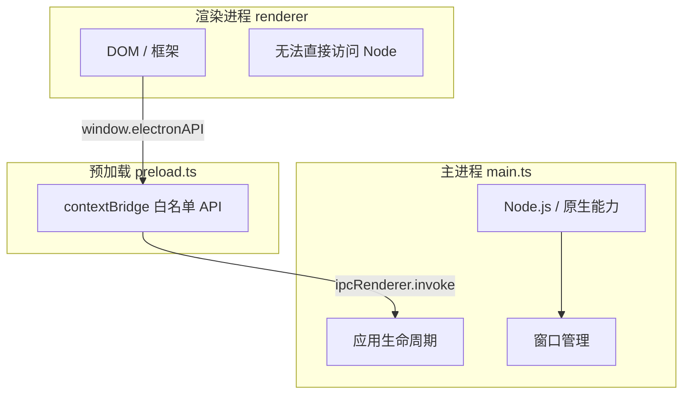
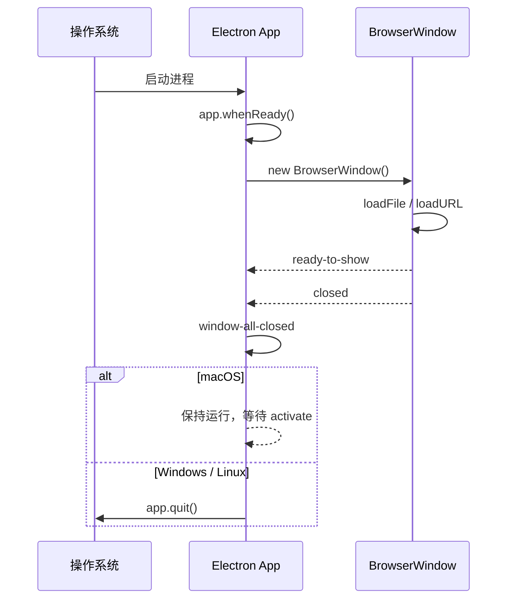

# 环境搭建与第一个应用

## 本章目标

- 搭建可用的 Electron 开发环境（macOS / Windows）。
- 理解 `main`、`preload`、`renderer` 三层结构，而不是把所有代码写进一个文件。
- 从零手写并运行一个最小应用，再用脚手架体验工程化项目。
- 完成第一次打包，知道产物在哪里、为什么需要打包。

## 环境准备

### Node.js 与包管理器

Electron 官方推荐使用 Node.js LTS。选择哪个 LTS 版本，取决于你使用的 Electron 版本内置的 Node 版本：

| Electron | 内置 Node | 建议本地 Node |
| --- | --- | --- |
| v45（当前文档基准） | Node 22.x | Node 22 LTS |
| v40 左右 | Node 20.x | Node 20 / 22 LTS |

本地 Node 主要用于运行构建脚本，**应用运行时使用的是 Electron 内置的 Node**。但原生模块编译时会受本地 Node 与 Electron ABI 差异影响，这部分在第 8 章展开。

```bash
node -v
npm -v
# 或者使用 pnpm / yarn
pnpm -v
```

### 平台构建工具链

| 平台 | 需要安装 | 用途 |
| --- | --- | --- |
| macOS | Xcode Command Line Tools | 编译原生依赖、签名 |
| Windows | Visual Studio Build Tools（C++ 工作负载） | 编译原生依赖 |
| Linux | `build-essential`、`python3` | 编译原生依赖 |

macOS 安装命令行工具：

```bash
xcode-select --install
```

Windows 建议安装 Visual Studio Build Tools，并勾选「使用 C++ 的桌面开发」。即使暂时不写原生模块，很多 npm 包也依赖它。

### 网络与镜像

Electron 的二进制文件较大，国内网络常见问题是安装卡住或下载失败。可以配置镜像：

```bash
# .npmrc
electron_mirror=https://npmmirror.com/mirrors/electron/
electron_builder_binaries_mirror=https://npmmirror.com/mirrors/electron-builder-binaries/
```

或者通过环境变量临时指定：

```bash
ELECTRON_MIRROR=https://npmmirror.com/mirrors/electron/ pnpm install
```

## 两条上手路径

### 路径 A：官方脚手架（推荐先体验）

Electron Forge 是官方维护的一体化工具，集开发、打包、分发于一体。

```bash
npm init electron-app@latest my-app -- --template=vite-typescript
cd my-app
npm start
```

生成的目录结构大致如下：

```text
my-app/
├── src/
│   ├── main.ts        # 主进程入口
│   ├── preload.ts     # 预加载脚本
│   └── renderer.ts    # 渲染进程入口
├── index.html
├── forge.config.ts    # Forge 配置：打包、maker、插件
├── vite.main.config.ts
├── vite.preload.config.ts
├── vite.renderer.config.ts
└── package.json
```

Forge + Vite 的优点是：主进程、preload、渲染进程分别构建，开发时渲染层有 HMR，打包配置开箱即用。缺点是配置层级较多，初学时不便于理解「到底发生了什么」。

### 路径 B：手写最小工程（推荐理解原理）

先不用脚手架，手写一个只有四个文件的应用。

```text
mini-electron/
├── package.json
├── tsconfig.json
├── src/
│   ├── main.ts
│   └── preload.ts
└── renderer/
    ├── index.html
    └── renderer.js
```

#### 1. 初始化

```bash
mkdir mini-electron && cd mini-electron
npm init -y
npm install --save-dev electron typescript
```

#### 2. `package.json`

```json
{
  "name": "mini-electron",
  "version": "1.0.0",
  "private": true,
  "main": "dist/main.js",
  "scripts": {
    "build": "tsc",
    "start": "npm run build && electron ."
  },
  "devDependencies": {
    "electron": "^45.0.0",
    "typescript": "^5.9.0"
  }
}
```

关键字段只有一个：`main`。Electron 启动时读取它，作为主进程入口。

#### 3. `tsconfig.json`

```json
{
  "compilerOptions": {
    "target": "ES2022",
    "module": "CommonJS",
    "moduleResolution": "Node",
    "outDir": "dist",
    "rootDir": "src",
    "strict": true,
    "esModuleInterop": true,
    "skipLibCheck": true,
    "sourceMap": true
  },
  "include": ["src/**/*.ts"]
}
```

这里刻意使用 CommonJS。预加载脚本在沙箱模式下对 ESM 支持有限，先用 CJS 减少变量。

#### 4. 主进程 `src/main.ts`

```ts
import { app, BrowserWindow, ipcMain } from 'electron';
import path from 'node:path';

function createWindow(): void {
  const win = new BrowserWindow({
    width: 1200,
    height: 800,
    show: false,
    backgroundColor: '#ffffff',
    webPreferences: {
      preload: path.join(__dirname, 'preload.js'),
      contextIsolation: true,
      sandbox: true,
      nodeIntegration: false,
    },
  });

  // 等首帧准备好再显示，避免白屏闪烁
  win.once('ready-to-show', () => {
    win.show();
  });

  win.loadFile(path.join(__dirname, '../renderer/index.html'));
}

app.whenReady().then(() => {
  ipcMain.handle('app:ping', () => 'pong');

  createWindow();

  app.on('activate', () => {
    if (BrowserWindow.getAllWindows().length === 0) {
      createWindow();
    }
  });
});

app.on('window-all-closed', () => {
  if (process.platform !== 'darwin') {
    app.quit();
  }
});
```

这段代码包含三个必须理解的点：

1. `app.whenReady()` 之前不能创建窗口，Chromium 还没初始化完成。
2. macOS 上关闭所有窗口通常不退出应用，`activate` 时重新创建窗口；Windows/Linux 则直接退出。
3. `webPreferences` 的安全三件套：`contextIsolation: true`、`sandbox: true`、`nodeIntegration: false`。

#### 5. 预加载脚本 `src/preload.ts`

```ts
import { contextBridge, ipcRenderer } from 'electron';

contextBridge.exposeInMainWorld('electronAPI', {
  getVersions: () => ({
    node: process.versions.node,
    chrome: process.versions.chrome,
    electron: process.versions.electron,
  }),
  ping: (): Promise<string> => ipcRenderer.invoke('app:ping'),
});
```

预加载脚本运行在渲染进程的隔离上下文中，是**唯一推荐的桥接位置**。它既能访问一部分 Electron API，又能把受控能力暴露给页面。

#### 6. 渲染层 `renderer/index.html`

```html
<!doctype html>
<html lang="zh-CN">
  <head>
    <meta charset="UTF-8" />
    <meta
      http-equiv="Content-Security-Policy"
      content="default-src 'self'; script-src 'self'; style-src 'self' 'unsafe-inline'"
    />
    <title>Mini Electron</title>
  </head>
  <body>
    <h1>Hello Electron</h1>
    <p id="versions">加载中...</p>
    <button id="ping">Ping 主进程</button>
    <p id="result"></p>
    <script src="./renderer.js"></script>
  </body>
</html>
```

#### 7. 渲染层脚本 `renderer/renderer.js`

```js
const versions = window.electronAPI.getVersions();
document.getElementById('versions').textContent =
  `Electron ${versions.electron} / Chromium ${versions.chrome} / Node ${versions.node}`;

document.getElementById('ping').addEventListener('click', async () => {
  const result = await window.electronAPI.ping();
  document.getElementById('result').textContent = `主进程返回：${result}`;
});
```

#### 8. 运行

```bash
npm start
```

你会看到一个窗口，显示版本号，点击按钮会通过 IPC 从主进程拿到 `pong`。

## 三层结构为什么要分开



- **主进程**：唯一能创建窗口、访问完整 Node.js 与系统 API 的进程。
- **预加载脚本**：在页面加载前执行，向页面暴露少量受控 API。
- **渲染进程**：普通的 Web 页面，默认被沙箱限制。

把三层混在一起（例如开启 `nodeIntegration` 后在页面里直接 `require('fs')`）开发最快，但会让任何 XSS 都升级为任意文件读写，属于事故级设计。后续第 5 章会讲完整的安全加固。

## 应用生命周期



| 事件 | 触发时机 | 常见用途 |
| --- | --- | --- |
| `will-finish-launching` | 应用开始初始化 | 注册协议、早期初始化 |
| `ready` / `whenReady()` | Chromium 初始化完成 | 创建窗口、注册 IPC |
| `activate` | macOS 点击 Dock 图标 | 重建窗口 |
| `window-all-closed` | 所有窗口关闭 | 决定是否退出 |
| `before-quit` | 开始退出 | 保存状态、清理资源 |
| `will-quit` | 即将退出 | 注销全局快捷键 |
| `quit` | 进程退出 | 最后清理 |

## 开发调试

### 主进程调试

```bash
# 方式一：直接向 Electron 传 Node 调试参数
npx electron --inspect=9229 .

# 方式二：在 package.json 脚本中固定
"dev:debug": "electron --inspect=9229 ."
```

然后在 VS Code 中附加到 `9229` 端口，或在 Chrome 打开 `chrome://inspect`。

### 渲染进程调试

开发时通过代码打开 DevTools：

```ts
win.webContents.openDevTools({ mode: 'detach' });
```

生产环境不要默认打开。更常见的做法是注册一个快捷键或隐藏入口，便于线上排障。

### 远程调试端口

```bash
npx electron --remote-debugging-port=9222 .
```

随后可以在 Chrome 的 `chrome://inspect` 中调试渲染进程，这对排查用户环境问题非常有用，但生产环境应通过 Fuses 关闭（见第 5 章）。

## 第一次打包

手写工程可以直接安装 `electron-builder` 体验：

```bash
npm install --save-dev electron-builder
```

在 `package.json` 中补充：

```json
{
  "scripts": {
    "dist": "npm run build && electron-builder"
  },
  "build": {
    "appId": "com.example.mini",
    "productName": "Mini Electron",
    "files": ["dist/**/*", "renderer/**/*", "package.json"],
    "directories": {
      "output": "release"
    },
    "mac": { "target": ["dmg"] },
    "win": { "target": ["nsis"] }
  }
}
```

```bash
npm run dist
```

产物位于 `release/`。打包细节（asar、签名、体积优化、增量更新）在第 7 章。

## 常见问题

### 安装 Electron 很慢或失败

优先检查镜像配置与代理；删除 `node_modules` 后重装。公司网络环境下，`ELECTRON_MIRROR` 与 `ELECTRON_BUILDER_BINARIES_MIRROR` 都要配置。

### `require is not defined`

渲染进程默认没有 Node 环境。不要通过打开 `nodeIntegration` 解决，应该把能力放进 preload，通过 `contextBridge` 暴露。

### `window.electronAPI is undefined`

通常有三个原因：

1. `preload` 路径不对。打包后路径会变化，建议用 `path.join(__dirname, 'preload.js')`。
2. preload 编译失败，`dist/preload.js` 不存在。
3. 页面在 preload 执行完成前访问了 API，检查脚本加载顺序。

### macOS 提示「无法验证开发者」

本地开发产物未签名会触发 Gatekeeper。开发阶段可在「系统设置 → 隐私与安全性」中允许；正式分发必须签名与公证，见第 7 章。

### 窗口打开后白屏

先看 DevTools Console 与 Network。常见原因是 `loadFile` 路径错误、CSP 阻止脚本、渲染入口构建失败。第 13 章有系统化的白屏排查路径。

## 本章小结

- Electron 应用由主进程、预加载脚本、渲染进程三层组成，职责边界决定了安全性与可维护性。
- `app.whenReady()` 之后才能创建窗口；跨平台退出行为要分别处理。
- 安全默认值应该是 `contextIsolation: true`、`sandbox: true`、`nodeIntegration: false`。
- 预加载脚本通过 `contextBridge` 暴露白名单能力，是主进程与页面之间唯一的推荐桥梁。
- 先用手写工程理解原理，再用 Forge/Vite 提升工程效率。

## 参考资料

- [Electron 官方教程：快速开始](https://www.electronjs.org/zh/docs/latest/tutorial/quick-start)
- [Electron 官方教程：教程前置条件](https://www.electronjs.org/zh/docs/latest/tutorial/tutorial-prerequisites)
- [Electron API：BrowserWindow](https://www.electronjs.org/zh/docs/latest/api/browser-window)
- [Electron API：app](https://www.electronjs.org/zh/docs/latest/api/app)
- [Electron Forge 文档](https://www.electronforge.io/)
