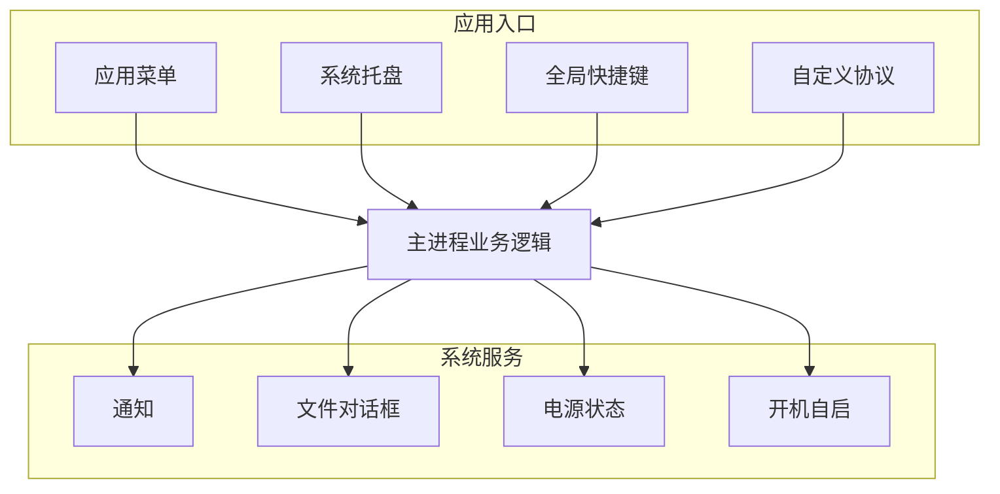
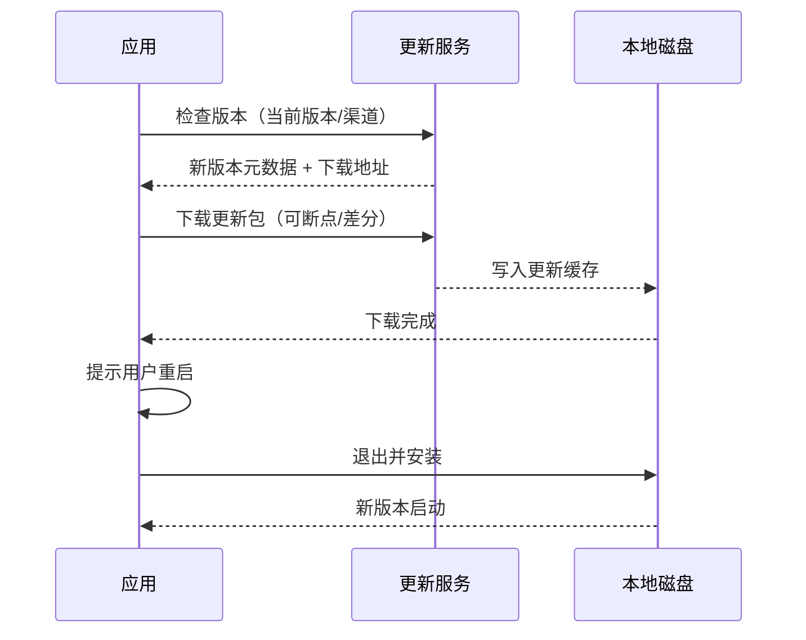

# 系统能力集成

## 本章目标

- 掌握桌面应用最常用的系统能力：菜单、托盘、通知、快捷键、文件对话框。
- 能实现自定义协议唤起、开机自启、电源状态监听。
- 理解自动更新的完整链路：检查、下载、安装、回滚。
- 知道每个能力在 Windows/macOS 上的差异与常见坑。

## 能力总览



这些能力全部在主进程使用，渲染进程通过 IPC 请求。

## 应用菜单

```ts
// src/main/system/menu.ts
import { app, Menu, BrowserWindow, shell } from 'electron';

export function installApplicationMenu(getWindow: () => BrowserWindow | null): void {
  const isMac = process.platform === 'darwin';

  const template: Electron.MenuItemConstructorOptions[] = [
    ...(isMac
      ? [
          {
            label: app.name,
            submenu: [
              { role: 'about' as const },
              { type: 'separator' as const },
              { role: 'hide' as const },
              { role: 'hideOthers' as const },
              { role: 'unhide' as const },
              { type: 'separator' as const },
              { role: 'quit' as const },
            ],
          },
        ]
      : []),
    {
      label: '文件',
      submenu: [
        {
          label: '打开文件…',
          accelerator: 'CommandOrControl+O',
          click: () => getWindow()?.webContents.send('menu:open-file'),
        },
        { type: 'separator' },
        isMac ? { role: 'close' } : { role: 'quit' },
      ],
    },
    {
      label: '编辑',
      submenu: [
        { role: 'undo' },
        { role: 'redo' },
        { type: 'separator' },
        { role: 'cut' },
        { role: 'copy' },
        { role: 'paste' },
        { role: 'selectAll' },
      ],
    },
    {
      label: '视图',
      submenu: [
        { role: 'reload' },
        { role: 'toggleDevTools' },
        { type: 'separator' },
        { role: 'resetZoom' },
        { role: 'zoomIn' },
        { role: 'zoomOut' },
        { type: 'separator' },
        { role: 'togglefullscreen' },
      ],
    },
    {
      label: '帮助',
      submenu: [
        {
          label: '官方网站',
          click: () => shell.openExternal('https://www.electronjs.org/'),
        },
      ],
    },
  ];

  Menu.setApplicationMenu(Menu.buildFromTemplate(template));
}
```

平台差异：

- macOS 第一个菜单必须是应用菜单，系统会自动补充「关于/服务/隐藏/退出」等行为。
- Windows/Linux 菜单挂在每个窗口上，没有应用菜单概念。
- `role` 让 Electron 使用系统标准行为与本地化文案，优先使用 `role` 而不是自己实现。

## 系统托盘

```ts
// src/main/system/tray.ts
import { app, Menu, Tray, nativeImage, BrowserWindow } from 'electron';
import path from 'node:path';

let tray: Tray | null = null;

export function createTray(getWindow: () => BrowserWindow | null): void {
  const iconPath = path.join(__dirname, '../../resources/trayTemplate.png');
  const image = nativeImage.createFromPath(iconPath);
  image.setTemplateImage(true); // macOS 自动适配深浅色

  tray = new Tray(image);
  tray.setToolTip('My App');

  const menu = Menu.buildFromTemplate([
    {
      label: '显示主窗口',
      click: () => {
        const win = getWindow();
        win?.show();
        win?.focus();
      },
    },
    { type: 'separator' },
    { label: '退出', click: () => app.quit() },
  ]);

  tray.setContextMenu(menu);

  tray.on('click', () => {
    const win = getWindow();
    if (win?.isVisible()) {
      win.hide();
    } else {
      win?.show();
    }
  });
}

app.on('before-quit', () => {
  tray?.destroy();
  tray = null;
});
```

注意事项：

- macOS 使用 Template 图片（文件名以 `Template` 结尾），系统会自动反色。
- Windows 托盘图标建议提供多尺寸（16/20/24/32），高 DPI 下才清晰。
- 托盘常驻应用要明确「关闭窗口」与「退出应用」的区别，避免用户找不到退出入口。
- `Tray` 必须在 `app.whenReady()` 之后创建。

## 通知

```ts
// src/main/system/notification.ts
import { app, Notification } from 'electron';

app.setAppUserModelId('com.example.myapp'); // Windows 通知必需

export function notify(title: string, body: string, onClick?: () => void): void {
  if (!Notification.isSupported()) return;

  const notification = new Notification({
    title,
    body,
    silent: false,
  });

  notification.on('click', () => onClick?.());
  notification.show();
}
```

差异：

| 平台 | 注意点 |
| --- | --- |
| Windows | 必须设置 AppUserModelId，且应用需要正确安装（开始菜单快捷方式） |
| macOS | 首次通知会请求权限，用户拒绝后需引导到系统设置 |
| Linux | 依赖桌面环境的通知服务，部分环境不支持点击回调 |

## 全局快捷键

```ts
// src/main/system/shortcut.ts
import { app, globalShortcut, BrowserWindow } from 'electron';

export function registerShortcuts(getWindow: () => BrowserWindow | null): void {
  const ok = globalShortcut.register('CommandOrControl+Shift+K', () => {
    const win = getWindow();
    if (!win) return;
    if (win.isVisible()) {
      win.hide();
    } else {
      win.show();
      win.focus();
    }
  });

  if (!ok) {
    console.warn('快捷键注册失败，可能被其他应用占用');
  }
}

app.on('will-quit', () => {
  globalShortcut.unregisterAll();
});
```

原则：

- 只注册少量核心快捷键，冲突概率随数量上升。
- 注册失败要能降级，不能影响应用启动。
- 退出时注销，避免残留占用。
- 不要抢占系统常用快捷键（如 `Command+Space`、`Alt+Tab`）。

## 文件对话框与文件系统

```ts
// src/main/system/dialog.ts
import { dialog, BrowserWindow } from 'electron';
import fs from 'node:fs/promises';

export async function pickAndReadFile(win: BrowserWindow): Promise<string | null> {
  const result = await dialog.showOpenDialog(win, {
    title: '选择配置文件',
    properties: ['openFile'],
    filters: [
      { name: 'JSON', extensions: ['json'] },
      { name: '所有文件', extensions: ['*'] },
    ],
  });

  if (result.canceled || result.filePaths.length === 0) return null;

  return fs.readFile(result.filePaths[0], 'utf-8');
}
```

保存对话框：

```ts
const { canceled, filePath } = await dialog.showSaveDialog(win, {
  defaultPath: 'report.csv',
  filters: [{ name: 'CSV', extensions: ['csv'] }],
});

if (!canceled && filePath) {
  await fs.writeFile(filePath, csvContent, 'utf-8');
}
```

原则：

- 文件读写放在主进程，渲染进程只拿结果。
- 打开用户选择的文件时，路径来自系统对话框，可信度较高；但仍要防止后续用拼接路径造成越权。
- 大文件使用流式读写，不要一次性读入内存。

## 自定义协议与深链接

自定义协议用于「从浏览器或其他应用唤起本应用」，例如 `myapp://project/123`。

### 注册协议

```ts
// src/main/system/protocol.ts
import { app, BrowserWindow } from 'electron';

const PROTOCOL = 'myapp';

if (process.defaultApp) {
  if (process.argv.length >= 2) {
    app.setAsDefaultProtocolClient(PROTOCOL, process.execPath, [process.argv[1]]);
  }
} else {
  app.setAsDefaultProtocolClient(PROTOCOL);
}

// macOS：通过 open-url 唤起
app.on('open-url', (event, url) => {
  event.preventDefault();
  handleDeepLink(url);
});

// Windows/Linux：通过 argv 传入
app.on('second-instance', (_event, argv) => {
  const url = argv.find((arg) => arg.startsWith(`${PROTOCOL}://`));
  if (url) handleDeepLink(url);
});

function handleDeepLink(url: string): void {
  const parsed = new URL(url);
  if (parsed.protocol !== `${PROTOCOL}:`) return;
  // 路由到主窗口
  const win = BrowserWindow.getAllWindows()[0];
  win?.webContents.send('deep-link', parsed.pathname);
}
```

注意事项：

- 开发模式下（`process.defaultApp`）需要把可执行文件与入口脚本一起注册，否则协议指向 Electron 本身。
- macOS 的协议声明还需要在 `Info.plist` 中配置 `CFBundleURLTypes`，打包工具通常会自动生成。
- 深链接参数必须校验，不能直接拼进命令行或文件路径。

### 应用内协议

如果只是让页面加载本地资源，使用 `protocol.handle`：

```ts
import { protocol, net } from 'electron';
import path from 'node:path';
import { pathToFileURL } from 'node:url';

protocol.handle('app', (request) => {
  const url = new URL(request.url);
  const relative = path.normalize(url.pathname).replace(/^(\.\.[/\\])+/, '');
  const filePath = path.join(__dirname, '../renderer', relative);
  return net.fetch(pathToFileURL(filePath).toString());
});
```

## 开机自启

```ts
// src/main/system/login-item.ts
import { app } from 'electron';

export function setAutoLaunch(enabled: boolean): void {
  app.setLoginItemSettings({
    openAtLogin: enabled,
    openAsHidden: true, // macOS：登录后隐藏启动
    args: ['--autostart'],
  });
}

export function wasLaunchedAtLogin(): boolean {
  return process.argv.includes('--autostart');
}
```

平台差异：

| 平台 | 行为 |
| --- | --- |
| macOS | 通过 Login Items 注册，`openAsHidden` 在较新系统上语义有变化 |
| Windows | 写入注册表 Run 项，安装路径变化后需要重新设置 |
| Linux | 需自行写入 `.desktop` 文件到 autostart 目录 |

## 电源与后台行为

```ts
// src/main/system/power.ts
import { powerMonitor, powerSaveBlocker, BrowserWindow } from 'electron';

export function setupPowerWatchers(getWindow: () => BrowserWindow | null): void {
  powerMonitor.on('suspend', () => {
    getWindow()?.webContents.send('power:suspend');
  });

  powerMonitor.on('resume', () => {
    getWindow()?.webContents.send('power:resume');
  });

  powerMonitor.on('on-battery', () => {
    // 降低动画频率、暂停非关键任务
  });

  powerMonitor.on('on-ac', () => {
    // 恢复正常策略
  });
}

let blockerId: number | null = null;

export function preventSleep(): void {
  if (blockerId === null) {
    blockerId = powerSaveBlocker.start('prevent-display-sleep');
  }
}

export function allowSleep(): void {
  if (blockerId !== null) {
    powerSaveBlocker.stop(blockerId);
    blockerId = null;
  }
}
```

典型场景：

- 视频播放、演示模式时阻止息屏。
- 休眠唤醒后重新建立网络连接、刷新数据。
- 电池模式下降低后台轮询频率。

## 自动更新

Electron 的自动更新有两套常见方案：

| 方案 | 依赖 | 平台 | 适用 |
| --- | --- | --- | --- |
| 内置 `autoUpdater` | Squirrel（Windows）/ Squirrel.Mac | Windows、macOS | 简单场景，自建更新源 |
| `electron-updater` | electron-builder 生态 | Windows、macOS、Linux（部分） | 通用 provider、差分包、灰度 |

### 更新流程



### 使用 `electron-updater`

```ts
// src/main/system/updater.ts
import { autoUpdater } from 'electron-updater';
import { BrowserWindow } from 'electron';

export function setupUpdater(getWindow: () => BrowserWindow | null): void {
  autoUpdater.autoDownload = false;
  autoUpdater.autoInstallOnAppQuit = true;

  autoUpdater.on('update-available', (info) => {
    getWindow()?.webContents.send('update:available', info.version);
  });

  autoUpdater.on('download-progress', (progress) => {
    getWindow()?.webContents.send('update:progress', progress.percent);
  });

  autoUpdater.on('update-downloaded', () => {
    getWindow()?.webContents.send('update:ready');
  });

  autoUpdater.on('error', (err) => {
    console.error('update error', err);
  });

  void autoUpdater.checkForUpdates();
}

export function downloadUpdate(): Promise<void> {
  return autoUpdater.downloadUpdate().then(() => undefined);
}

export function quitAndInstall(): void {
  autoUpdater.quitAndInstall();
}
```

### 更新策略

1. **分渠道**：stable/beta 分开配置更新源。
2. **灰度**：服务端按用户 ID 哈希返回不同版本，逐步放量。
3. **强制更新**：安全漏洞或协议不兼容时，提示不可跳过。
4. **回滚**：保留上一个可用版本，服务端能回退版本号。
5. **签名校验**：更新包必须签名，客户端验证后再安装。

## 系统集成排错

| 现象 | 常见原因 |
| --- | --- |
| Windows 通知不显示 | 未设置 AppUserModelId、应用未正确安装 |
| 协议唤起无效 | 未注册成功、开发模式注册路径错误、`Info.plist` 缺失 |
| 开机自启失效 | 安装路径变化、系统权限限制、Linux 未写 desktop 文件 |
| 更新下载失败 | 证书、代理、更新源地址、CSP/网络策略 |
| 托盘图标模糊 | 未提供高分辨率图或未使用 Template 图 |
| 全局快捷键无效 | 被其他应用占用、注册时机过早 |

## 本章小结

- 菜单、托盘、通知、快捷键、文件对话框是桌面应用的基础设施，都要在主进程实现。
- 平台差异集中在 macOS 应用菜单、Windows AppUserModelId、Linux 桌面环境。
- 自定义协议要同时处理 macOS `open-url` 与 Windows `second-instance`。
- 自动更新要覆盖检查、下载、安装、灰度、回滚与签名校验。
- 所有系统能力都要考虑失败降级，不能阻塞应用启动。

## 参考资料

- [Electron API：Menu](https://www.electronjs.org/zh/docs/latest/api/menu)
- [Electron API：Tray](https://www.electronjs.org/zh/docs/latest/api/tray)
- [Electron API：Notification](https://www.electronjs.org/zh/docs/latest/api/notification)
- [Electron API：globalShortcut](https://www.electronjs.org/zh/docs/latest/api/global-shortcut)
- [Electron API：autoUpdater](https://www.electronjs.org/zh/docs/latest/api/auto-updater)
- [electron-updater 文档](https://www.electron.build/auto-update)
