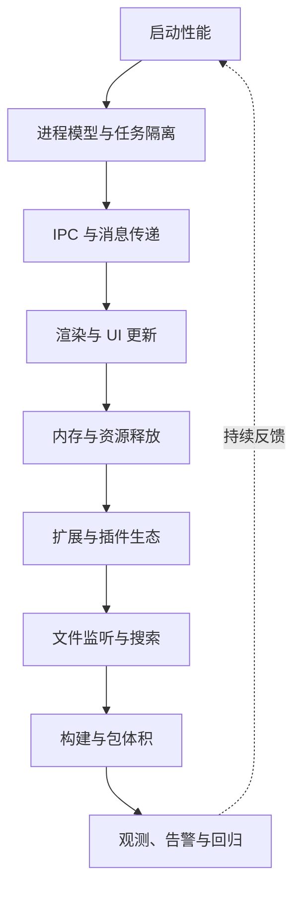
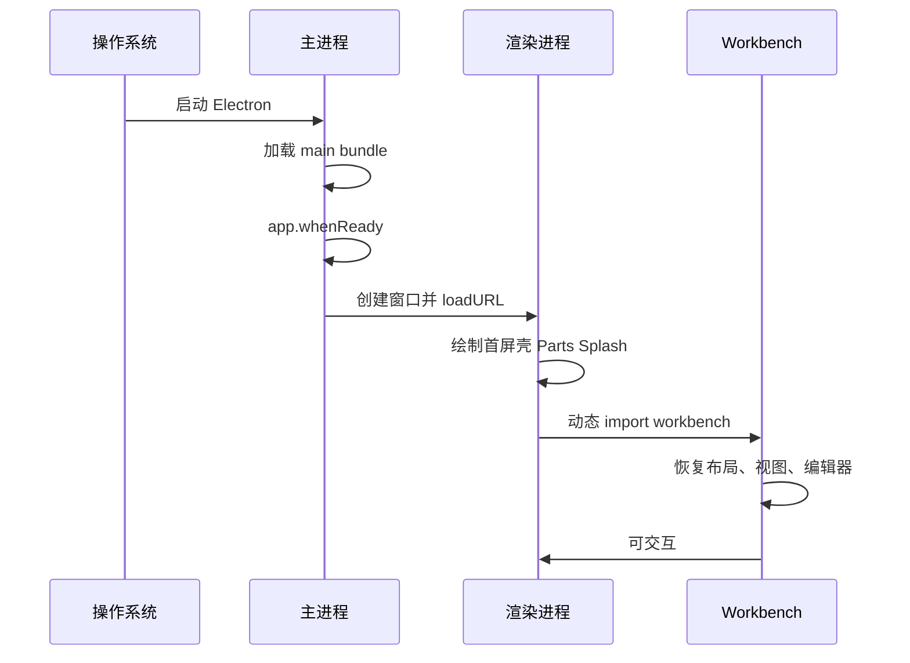
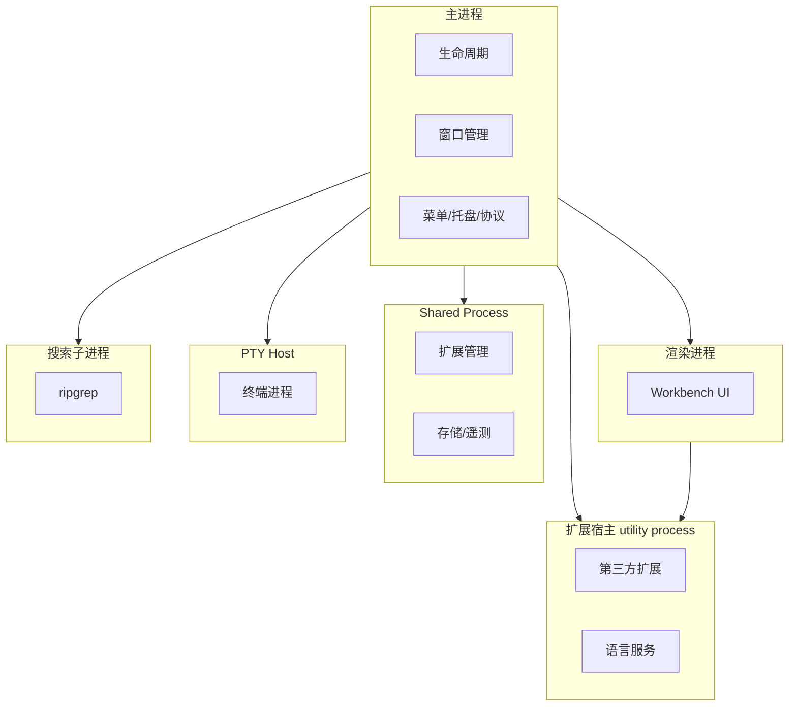
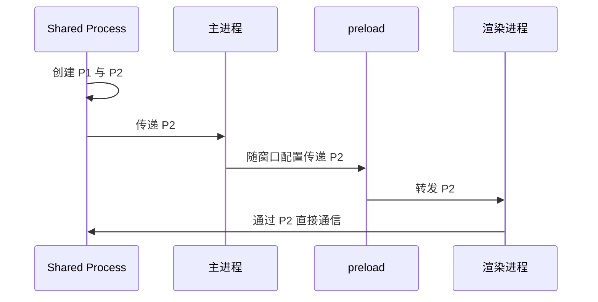
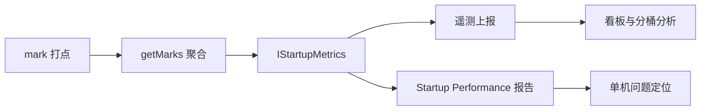

# VS Code 性能工程实战：从启动到大规模扩展

> 以 VS Code 官方文档与源码为样本，拆解一个大型 Electron 应用如何把「性能」从口号变成可测量、可归因、可持续的工程体系。

## 本章目标

- 理解 VS Code 的性能治理框架：指标、标记、阶段、进程、门禁。
- 看清启动、IPC、渲染、内存、扩展、文件 IO、构建体积七个关键战场。
- 能从 VS Code 的源码设计中提炼出可迁移到自有 Electron 应用的做法。
- 学会用「先测量、再归因、后优化、再防回归」的方式处理性能问题。

## 为什么以 VS Code 为样本

VS Code 是一个少有的、同时满足以下条件的样本：

1. **构建在 Electron 之上**，面临与普通 Electron 应用相同的 Chromium、Node.js、IPC、包体积约束。
2. **规模足够大**，包含编辑器、终端、调试器、源代码管理、扩展市场、远程开发等复杂功能。
3. **运行环境多样**，同时支持桌面、Web、Remote、Codespaces，性能策略必须兼容不同运行时。
4. **源码开放**，所有性能设计都能落到具体文件与实现，而不是只停留在宣传口径。

官方对架构的描述是：VS Code 把 Web 技术、Node.js 与原生能力结合起来，使用 Electron 承载桌面窗口，使用 Monaco 提供编辑器内核，并通过 tools service 架构集成语言服务与调试能力（[Why VS Code](https://code.visualstudio.com/docs/editor/whyvscode)）。

官方 FAQ 也明确表示：**Performance is our core priority**，并且把性能与安全、可访问性、Electron 升级并列为长期投入方向（[VS Code FAQ](https://code.visualstudio.com/docs/supporting/faq)）。

更重要的是，VS Code 面对的是**不可控的扩展生态**。官方 Extension Host 文档给出的目标是：扩展不能影响启动性能、不能拖慢 UI 操作、不能修改 UI。这不是靠「要求扩展作者自觉」，而是靠进程隔离、懒激活、性能归因与二分排查共同实现的。

> 说明：本章基于本地 `../vscode` 源码（2025-10 版本）与官方文档整理。源码会持续演进，具体行号可能变化，但设计思想稳定。文中链接指向 GitHub `main` 分支，便于对照。

## 性能问题地图

大型 Electron 应用的性能问题从来不是单点，而是一条链：



| 维度 | 典型问题 | 关键指标 | 主要杠杆 |
| --- | --- | --- | --- |
| 启动 | 白屏久、首屏慢、恢复慢 | 冷/热启动、首屏、TTI | 阶段拆分、延迟加载、code cache、首屏壳 |
| 进程 | 主进程被重任务阻塞 | 各进程 CPU/内存、响应性 | utility 进程、任务隔离 |
| IPC | 消息排队、序列化开销 | 往返次数、消息大小、等待时间 | 通道化、MessagePort、批量、取消 |
| 渲染 | 长列表掉帧、布局抖动 | FPS、长任务、INP | 虚拟化、分阶段初始化、合成动画 |
| 内存 | 越用越卡、泄漏 | 常驻/峰值、堆增长 | Disposable、LRU、进程级监控 |
| 扩展 | 某个扩展拖慢全局 | 激活耗时、未响应次数 | 隔离、懒激活、归因、二分 |
| IO | 大仓库搜索/监听占满 CPU | 事件数量、搜索耗时 | 排除规则、独立进程、限流 |
| 构建 | 包大、启动扫描慢 | 安装包、JS 体积 | 裁剪、压缩、name mangling、code cache |

这张图会在后文反复出现。VS Code 的核心方法论是：**每个问题都必须落到「哪个进程、哪个阶段、哪个指标、哪段代码」**。

## 一、启动性能：把启动拆成可观测的阶段

### 1.1 启动链路

VS Code 的启动可以粗略分为四段：



对应的性能标记贯穿主进程与渲染进程：

| 阶段 | 代表标记 | 位置 |
| --- | --- | --- |
| 渲染进程开始 | `code/didStartRenderer` | `src/vs/code/electron-browser/workbench/workbench.ts` |
| 首屏壳开始/结束 | `code/willShowPartsSplash` / `code/didShowPartsSplash` | 同上 |
| 加载 workbench 前 | `code/willLoadWorkbenchMain` | 同上 |
| workbench 加载完成 | `code/didLoadWorkbenchMain` | 同上 |
| 创建窗口 | `code/willCreateCodeWindow` / `code/didCreateCodeWindow` | `src/vs/platform/windows/electron-main/windowsMainService.ts` |
| 创建 BrowserWindow | `code/willCreateCodeBrowserWindow` / `code/didCreateCodeBrowserWindow` | `src/vs/platform/windows/electron-main/windowImpl.ts` |
| 恢复窗口状态 | `code/willRestoreCodeWindowState` / `code/didRestoreCodeWindowState` | 同上 |
| workbench 开始/结束 | `code/willStartWorkbench` / `code/didStartWorkbench` | `src/vs/workbench/browser/workbench.ts` |

### 1.2 性能标记系统

VS Code 没有在每个模块里直接调用 `performance.mark`，而是封装了一层统一 API：

```ts
// src/vs/base/common/performance.ts
export const mark: (name: string, markOptions?: { startTime?: number }) => void = perf.mark;

export interface PerformanceMark {
  readonly name: string;
  readonly startTime: number;
}

export const getMarks: () => PerformanceMark[] = perf.getMarks;
```

这层封装解决了两个问题：

1. **环境差异**：浏览器环境使用原生 `performance.mark`；Node.js 环境使用基于 `Date.now` 的 polyfill，并把 `timeOrigin` 作为第一条标记。
2. **统一采集**：所有进程都通过 `getMarks()` 拿到按时间排序的标记，便于跨进程对齐时间线。

这比「各写各的 `console.time`」强得多：标记名称、时间基准、采集方式都是统一的，后续才能聚合、对比、上报。

### 1.3 启动指标：不只看总耗时

启动总耗时只能回答「慢不慢」，不能回答「哪里慢」。VS Code 的 `IStartupMetrics` 把启动拆成了几十个字段：

```ts
// src/vs/workbench/services/timer/browser/timerService.ts
export interface IStartupMetrics {
  readonly initialStartup: boolean;
  readonly emptyWorkbench: boolean;
  readonly didUseCachedData: boolean;
  readonly ellapsed: number;
  readonly timers: {
    readonly ellapsedAppReady?: number;
    readonly ellapsedLoadMainBundle?: number;
    readonly ellapsedRunMainBundle?: number;
    readonly ellapsedMainServer?: number;
    readonly ellapsedWindowCreate?: number;
    readonly ellapsedWindowLoad?: number;
    readonly ellapsedWindowLoadToRequire?: number;
    readonly ellapsedRequire?: number;
    readonly ellapsedStorageInit?: number;
    readonly ellapsedWorkspaceServiceInit?: number;
    readonly ellapsedExtensions?: number;
    readonly ellapsedEditorRestore?: number;
    readonly ellapsedWorkbench?: number;
    // ...
  };
}
```

几个特别值得注意的字段：

| 字段 | 回答的问题 |
| --- | --- |
| `ellapsedAppReady` | Electron/Chromium 初始化花了多久？ |
| `ellapsedLoadMainBundle` | 主进程 bundle 加载花了多久？ |
| `ellapsedWindowCreate` | 创建窗口本身花了多久？ |
| `ellapsedWindowLoadToRequire` | 从 `loadURL` 到开始加载 workbench 花了多久？ |
| `ellapsedRequire` | 渲染进程加载 workbench 代码花了多久？ |
| `ellapsedExtensions` | 注册扩展并启动扩展宿主花了多久？ |
| `ellapsedEditorRestore` | 恢复可见编辑器花了多久？ |
| `ellapsedWorkbench` | 整个 workbench 加载花了多久？ |
| `didUseCachedData` | 这次启动是否命中了 V8 code cache？ |

此外还记录了系统信息（CPU 型号/核数/频率、总内存/空闲内存）、进程内存（working set / private / shared）、是否在虚拟机、是否开启屏幕阅读器、是否空工作区等，用于**分桶归因**。这比单纯看 P50 平均值有价值得多。

### 1.4 Parts Splash：先画壳，再加载内容

VS Code 启动时不是「等 workbench 全部加载完再显示窗口」，而是先把上一次的布局与主题恢复成一个静态壳：

```ts
// src/vs/code/electron-browser/workbench/workbench.ts（简化）
function showSplash(configuration: INativeWindowConfiguration) {
  performance.mark('code/willShowPartsSplash');

  let data = configuration.partsSplash;
  if (data) {
    // 恢复标题栏、活动栏、侧边栏、面板、编辑器区域的尺寸与颜色
    const splash = document.createElement('div');
    splash.id = 'monaco-parts-splash';
    splash.className = data.baseTheme;
    // ...
  }

  performance.mark('code/didShowPartsSplash');
}
```

在动态 `import` workbench 之前调用：

```ts
// 同一个文件，beforeImport 阶段
beforeImport: function (windowConfig) {
  showSplash(windowConfig);
  performance.mark('code/willLoadWorkbenchMain');
}
```

这段设计的价值：

- **消除白屏**：用户立刻看到熟悉的布局与背景色，而不是空白窗口。
- **减少布局跳变**：壳的尺寸与最终布局一致，workbench 接管时不会「跳一下」。
- **把「感知性能」与「真实性能」分开治理**：真实加载仍需优化，但感知上已经「打开了」。

这与我们在[启动性能优化](/electron/performance-startup)里讲的 `show: false` + `ready-to-show` + `backgroundColor` 是同一思路，VS Code 把它做到了更极致：**连布局和配色都提前画出来**。

### 1.5 生命周期分层：不是所有初始化都同等重要

VS Code 把工作台生命周期分成四个阶段：

```ts
// src/vs/workbench/services/lifecycle/common/lifecycle.ts
export const enum LifecyclePhase {
  Starting = 1,   // 启动必需，阻塞首屏
  Ready = 2,      // 基础服务就绪
  Restored = 3,   // 布局与编辑器恢复完成
  Eventually = 4  // 空闲后执行的非关键工作
}
```

贡献（contribution）可以注册到不同阶段。`Starting` 阶段的工作会阻塞启动，`Eventually` 阶段的工作会等窗口空闲后再执行。VS Code 还会记录每个阶段的贡献创建耗时：

```ts
// src/vs/workbench/common/contributions.ts
readonly timings: Map<LifecyclePhase, Array<[string, number]>>;
```

启动恢复时，它不会无限等待所有编辑器：

```ts
// src/vs/workbench/browser/workbench.ts（简化）
this.whenReady.finally(() =>
  Promise.race([
    this.whenRestored,
    timeout(2000)
  ]).finally(() => {
    lifecycleService.phase = LifecyclePhase.Restored;

    const eventuallyPhaseScheduler = this._register(new RunOnceScheduler(() => {
      this._register(runWhenWindowIdle(mainWindow, () => {
        lifecycleService.phase = LifecyclePhase.Eventually;
      }, 2500));
    }, 2500));
    eventuallyPhaseScheduler.schedule();
  })
);
```

这解决了一个常见矛盾：

- 如果等所有编辑器恢复完再进入 `Restored`，慢编辑器会拖累整个启动。
- 如果不等，某些依赖编辑器的贡献可能拿不到完整上下文。

VS Code 的选择是：**最多等 2 秒，超时后先进入 `Restored`，把非关键工作推到 `Eventually`，并在窗口空闲后执行**。这是典型的「用降级换确定性」。

### 1.6 启动剖析：`--prof-startup` 与 Startup Performance

VS Code 内置了启动剖析能力。使用 `--prof-startup` 启动后，`StartupProfiler` 会等待生命周期进入 `Eventually` 且扩展注册完成，然后停止 profiling，收集各进程的 profile 文件：

```ts
// src/vs/workbench/contrib/performance/electron-browser/startupProfiler.ts
Promise.all([
  lifecycleService.when(LifecyclePhase.Eventually),
  extensionService.whenInstalledExtensionsRegistered()
]).then(() => {
  this._stopProfiling();
});
```

它通过一个 marker 文件与主进程协作：渲染进程删除文件表示「可以停止」，主进程重新创建文件表示「已经停止」。最终产出主进程、渲染进程、扩展宿主等 profile，并引导用户附到 issue 中。

运行时还可以打开 **Startup Performance** 视图（`src/vs/workbench/contrib/performance/browser/perfviewEditor.ts`），它会生成一份 Markdown 报告，包含：

| 报告区块 | 内容 |
| --- | --- |
| System Info | 版本、OS、CPU、内存、是否 VM、是否空工作区 |
| Performance Marks | `import(main.js)`、`start => app.isReady`、`create window`、`import(workbench.desktop.main.js)`、`restore visible editors`、`workbench ready` 等阶段耗时 |
| Extension Activation Stats | 每个扩展是否 eager、加载代码耗时、`activate` 调用耗时、完成耗时、触发事件 |
| Workbench Contributions Blocking Restore | 哪些贡献在 `Starting`/`Ready` 阶段阻塞了恢复，总耗时多少 |
| Raw Perf Marks | 原始标记的时间戳、增量、累计 |
| Resource Timing Stats | 资源加载耗时 |

这份报告的价值在于：**它把「启动慢」变成了可逐行阅读的账单**。

### 1.7 Code cache：把编译成本摊到第一次启动

VS Code 的模块加载器支持 V8 code cache。首次加载时生成缓存，后续启动直接复用编译结果：

```js
// src/vs/loader.js（简化）
const cachedDataPath = that._getCachedDataPath(nodeCachedData, filename);
if (cachedDataPath) {
  try {
    const data = that._fs.readFileSync(cachedDataPath);
    options.cachedData = data.slice(16);
  } catch {
    // 缓存不存在，走正常编译
  }
}

// 编译后检查缓存是否被接受
_handleCachedData(script, scriptSource, cachedDataPath, !options.cachedData, moduleManager);
```

关键细节：

- 缓存文件带 16 字节头，读取时要 `slice(16)`。
- 如果 `script.cachedDataRejected` 为真，说明缓存与当前 V8 版本或源码不匹配，需要删除并重建。
- `didUseCachedData` 会进入启动指标，便于判断「这次启动到底有没有吃到缓存」。

VS Code 在 2022 年迁移到进程沙箱时，专门调整了 Chromium 的 code caching 策略。官方博客提到：Chromium 的默认策略只对访问频繁的网页生效，而桌面应用希望**每次启动都使用 code cache**，因此他们实现并启用了自己的缓存方案，并把它称为「改善启动时间的最佳方案之一」（[Migrating VS Code to Process Sandboxing](https://code.visualstudio.com/blogs/2022/11/28/vscode-sandbox)）。

对应到普通 Electron 应用：

- 主进程可以使用 Node 22 的 `module.enableCompileCache()`（见[启动性能优化](/electron/performance-startup)）。
- 渲染进程的 bundle 由 Chromium 的 HTTP 缓存与 code cache 处理，关键是**资源 URL 稳定、内容哈希合理、不要频繁失效**。
- 升级 Electron 后缓存会失效，这是正常现象，不要把它误判为性能回退。

### 1.8 启动优化可迁移清单

| VS Code 做法 | 你的应用怎么做 |
| --- | --- |
| 统一 `mark/getMarks` | 封装自己的 `perf.mark`，跨主进程/渲染进程对齐 |
| 阶段化指标 | 至少记录 appReady、窗口创建、页面加载、首屏、可交互 |
| Parts Splash | 用缓存的布局/主题画首屏壳，或至少设置背景色 + 骨架屏 |
| 生命周期分层 | 把初始化分成「阻塞启动 / 恢复后 / 空闲」三档 |
| 2 秒超时降级 | 慢资源不能无限阻塞首屏，设置超时与降级 |
| `--prof-startup` | 提供一键启动剖析与报告导出 |
| code cache | 主进程编译缓存 + 渲染资源稳定缓存 |
| 分桶归因 | 按版本、平台、架构、冷热启动、设备性能分组 |

## 二、多进程与任务隔离：主进程只做「指挥」

### 2.1 进程拓扑



| 进程 | 职责 | 为什么独立 |
| --- | --- | --- |
| 主进程 | 生命周期、窗口、菜单、协议、原生能力 | 必须稳定，不能承载重任务 |
| 渲染进程 | Workbench UI、编辑器渲染 | 受 Chromium 沙箱约束 |
| 扩展宿主 | 运行第三方扩展与语言服务 | 扩展可能崩溃、死循环、吃满 CPU |
| Shared Process | 扩展管理、存储、遥测等后台服务 | 避免占用主进程与渲染进程 |
| PTY Host | 终端伪终端管理 | 终端输出高频且可能阻塞 |
| 搜索子进程 | ripgrep 文件搜索 | CPU/IO 密集，需独立调度 |
| 文件监听 | Parcel watcher | 大仓库事件量大，需限流与排除 |

### 2.2 扩展宿主：用 utility process 隔离不确定性

VS Code 的扩展宿主不是跑在渲染进程里，也不是跑在主进程里，而是通过 `utilityProcess` 创建：

```ts
// src/vs/platform/extensions/electron-main/extensionHostStarter.ts
const extHost = new WindowUtilityProcess(
  this._logService,
  this._windowsMainService,
  this._telemetryService,
  this._lifecycleMainService
);
this._extHosts.set(id, extHost);
```

底层封装在 `src/vs/platform/utilityProcess/electron-main/utilityProcess.ts`，使用 Electron 的 `utilityProcess` 与 `MessageChannelMain`。这样做的好处：

1. **崩溃隔离**：扩展宿主崩溃不会带走主进程与 UI。
2. **CPU 隔离**：扩展死循环不会冻结窗口渲染。
3. **生命周期可控**：可以单独重启扩展宿主，而不重启整个应用。
4. **权限收窄**：扩展宿主拥有 Node 能力，但不等同于主进程的全部权限。

### 2.3 主进程保护

官方 sandbox 博客有一句关键提醒：

> 在 Electron 应用中，**不要给主进程塞太多工作**，因为它同时负责处理键盘、鼠标等用户输入。主进程一忙，整个界面就会无响应。

VS Code 的做法是把几乎所有重任务都移出主进程：

- 终端 → PTY Host。
- 搜索 → ripgrep 子进程。
- 扩展与语言服务 → 扩展宿主。
- 扩展管理、存储、遥测 → Shared Process。
- 文件监听 → Parcel watcher（带限流与排除）。

主进程只保留：窗口、生命周期、菜单、协议、原生对话框、少量协调逻辑。

对应到你的应用：

| 任务 | 不要放在主进程 | 推荐位置 |
| --- | --- | --- |
| CSV/Excel 解析 | 主进程同步解析 | utility process / Worker |
| 图片转码 | 主进程 | utility process |
| 日志聚合 | 主进程同步写 | 独立进程 + 缓冲落盘 |
| 全文搜索 | 主进程遍历 | 子进程 + 索引 |
| 终端/命令执行 | 主进程 | 独立 pty 进程 |

### 2.4 渲染进程复用

VS Code 在沙箱化过程中还做了渲染进程复用（renderer process reuse），减少反复创建渲染进程的成本。它的价值在「多窗口/多视图」场景尤其明显：

- 新窗口可以复用已初始化的渲染进程，减少 Chromium 初始化开销。
- 但复用会带来状态污染风险，必须严格清理全局状态、监听器与缓存。

这与我们在[进程模型与运行原理](/electron/process-model)中讲的 `WebContentsView` 多视图成本是同一个问题：**进程复用能省启动成本，但会增加状态管理复杂度**。

## 三、IPC：通道化、类型化、可取消

### 3.1 通道抽象

VS Code 没有让业务代码直接调用 `ipcRenderer.invoke`，而是抽象成 `IChannel`：

```ts
// src/vs/base/parts/ipc/common/ipc.ts
export interface IChannel {
  call<T>(command: string, arg?: any, cancellationToken?: CancellationToken): Promise<T>;
  listen<T>(event: string, arg?: any): Event<T>;
}

export interface IServerChannel<TContext = string> {
  call<T>(ctx: TContext, command: string, arg?: any, cancellationToken?: CancellationToken): Promise<T>;
  listen<T>(ctx: TContext, event: string, arg?: any): Event<T>;
}
```

一个通道同时支持两种语义：

- **命令调用**：`call` 返回 Promise，对应请求/响应。
- **事件订阅**：`listen` 返回 `Event<T>`，对应服务端推送。

这比裸 IPC 多出来的能力是：**取消令牌**。长任务可以被调用方取消，避免「用户已经切走，后台还在算」。

### 3.2 协议层

通道之下是一套自定义消息协议，请求与响应都有明确类型：

| 请求类型 | 含义 |
| --- | --- |
| `Promise` | 调用一个命令 |
| `PromiseCancel` | 取消一个进行中的调用 |
| `EventListen` | 订阅事件 |
| `EventDispose` | 取消订阅 |

| 响应类型 | 含义 |
| --- | --- |
| `Initialize` | 通道初始化 |
| `PromiseSuccess` | 调用成功 |
| `PromiseError` / `PromiseErrorObj` | 调用失败 |
| `EventFire` | 事件触发 |

这套协议让 IPC 从「字符串通道 + 任意参数」升级为「有请求 ID、有取消、有错误类型、有事件生命周期」的 RPC。

### 3.3 ProxyChannel：自动包装服务

手写每个方法的 IPC 包装很繁琐，VS Code 用 `ProxyChannel` 自动完成：

```ts
// src/vs/base/parts/ipc/common/ipc.ts
export namespace ProxyChannel {
  export function fromService<TContext>(service: unknown, disposables: DisposableStore): IServerChannel<TContext> {
    // 遍历服务属性，把 onXxx 事件与普通方法包装成 channel 协议
  }
}
```

注册到主进程 IPC 服务：

```ts
// src/vs/code/electron-main/app.ts（简化）
const extensionHostStarterChannel = ProxyChannel.fromService(
  accessor.get(IExtensionHostStarter),
  disposables
);
mainProcessElectronServer.registerChannel(
  ipcExtensionHostStarterChannelName,
  extensionHostStarterChannel
);
```

这套设计的约束也很明确：

- 事件名必须符合 `onUpperCase` 约定。
- 自动序列化只覆盖 `URI`、`RegExp` 等有限类型。
- `CancellationToken` 需要显式支持。

对应到普通 Electron 应用，可以借鉴为：

```ts
// 你自己的类型安全通道
interface IChannel {
  call<T>(command: string, arg?: unknown): Promise<T>;
  listen<T>(event: string): Event<T>;
}
```

配合 `shared/ipc.ts` 的请求/响应类型映射，就能得到比裸 `ipcRenderer.invoke` 更可控的 IPC 层（见 [IPC 通信体系](/electron/ipc)）。

### 3.4 MessagePort：让通信不经过主进程

沙箱博客里最重要的一条性能经验是：**不要让所有 IPC 都经过主进程**。

VS Code 用 `MessageChannelMain` 建立渲染进程与扩展宿主/Shared Process 之间的直连：



官方博客的原话是：替换 Node.js socket 通信为 message port 后，既满足了沙箱兼容，又保留了「不经过主进程」的性能优势。主进程只负责「牵线」，后续高频消息直接在两个进程之间流动。

这与我们在[IPC 通信体系](/electron/ipc)中讲的 `MessageChannelMain` 用法完全一致，只是 VS Code 把它用成了基础设施。

### 3.5 IPC 性能原则

| 原则 | VS Code 的体现 |
| --- | --- |
| 通道化 | `IChannel` 统一 call/listen |
| 类型化 | 请求/响应类型明确，错误可序列化 |
| 可取消 | `CancellationToken` 贯穿协议 |
| 直连 | MessagePort 绕过主进程 |
| 事件生命周期 | `EventListen` / `EventDispose` 成对出现 |
| 主进程轻量 | 重任务移出主进程 |

## 四、渲染与 UI：先壳后内容，按需创建

### 4.1 首屏壳与布局恢复

前文的 Parts Splash 是 VS Code 渲染性能的第一招：**在 workbench 加载前，先用缓存数据画出布局与配色**。这既减少白屏，也避免布局跳变。

对应到普通应用：

- 用 `localStorage`/配置文件缓存窗口布局、侧边栏宽度、主题色。
- 首屏 HTML 直接内联背景色与骨架结构，不等 JS 加载。
- 骨架尺寸与最终布局一致，避免 CLS（布局偏移）。

### 4.2 虚拟列表

VS Code 的文件树、搜索 results、扩展列表、问题面板都使用虚拟滚动。源码注释写得很清楚：

```ts
// src/vs/base/browser/ui/list/listView.ts
/**
 * The {@link ListView} is a virtual scrolling engine.
 * Given that it only renders elements within its viewport, it can hold large
 * numbers of elements...
 */
```

这意味着：

- 一万行搜索结果不会创建一万个 DOM 节点。
- 滚动时只更新视口内的行，复用行渲染器。
- 行高可以固定，也可以动态测量，但都要避免整表重排。

这与[渲染与 IPC 性能](/electron/performance-render)中的虚拟列表实现是同一思路。

### 4.3 编辑器渲染与文本缓冲区

VS Code 的编辑器只渲染视口内的行，文本数据则使用 **piece tree** 数据结构。官方博客《Text Buffer Reimplementation》详细介绍了这次重构：目标是在大文件、频繁编辑的场景下同时降低时间与内存开销。

对普通 Electron 应用的启示：

- **不要把「数据模型」和「DOM 渲染」绑死**。数据可以全量存在内存，但 DOM 只渲染视口。
- **选择合适的数据结构**。频繁插入/删除用链表、树或 rope，不要用大数组反复 `splice`。
- **大文件分块加载**，不要一次性 `JSON.parse` 几百 MB。

### 4.4 延迟贡献与空闲调度

VS Code 将非关键工作放到 `Eventually` 阶段，并用多种调度器控制时机：

| 工具 | 作用 |
| --- | --- |
| `RunOnceScheduler` | 延迟执行一次，可取消 |
| `Delayer` | 合并短时间内的多次调用 |
| `ThrottledDelayer` | 节流 + 延迟 |
| `requestIdleCallback` | 浏览器空闲时执行 |

源码中还有一个细节：在等待 workbench 脚本加载时，VS Code 会用 `requestIdleCallback` 创建一个 canvas 并取一次 2D context，提前触发浏览器的 canvas 初始化，避免用户第一次打开画布相关功能时出现明显卡顿：

```ts
// src/vs/code/electron-browser/workbench/workbench.ts
window.requestIdleCallback(() => {
  const canvas = document.createElement('canvas');
  const context = canvas.getContext('2d');
  context?.clearRect(0, 0, canvas.width, canvas.height);
  canvas.remove();
}, { timeout: 50 });
```

这是「预热」思路：把一次性初始化成本提前到空闲时间，而不是等用户触发。

### 4.5 渲染优化可迁移清单

| VS Code 做法 | 你的应用怎么做 |
| --- | --- |
| Parts Splash | 首屏壳 + 缓存布局/主题 |
| 虚拟列表 | 文件树、表格、日志、搜索结果统一虚拟化 |
| 视口渲染 | 编辑器/画布只渲染可见区域 |
| 分阶段初始化 | 阻塞启动 / 恢复后 / 空闲三档 |
| 调度器 | `RunOnceScheduler`、`Delayer`、`ThrottledDelayer` |
| 预热 | 空闲时初始化 canvas、WebGL、字体、Worker |

## 五、内存与资源释放：Disposable 文化

### 5.1 统一生命周期

VS Code 大量使用 `DisposableStore`、`DisposableMap`、`toDisposable` 管理资源：

```ts
// src/vs/base/common/lifecycle.ts
export class DisposableStore implements IDisposable {
  add<T extends IDisposable>(o: T): T { /* ... */ }
  dispose(): void { /* 逆序释放所有资源 */ }
}
```

典型用法：

```ts
const store = new DisposableStore();

store.add(emitter.event(() => { /* ... */ }));
store.add(setInterval(() => { /* ... */ }, 1000));
store.add(ipcRenderer.on('channel', handler));

// 页面/组件销毁时一次性释放
store.dispose();
```

这解决的是 Electron 应用最常见的泄漏源：**事件监听、定时器、IPC 订阅忘记移除**。

### 5.2 缓存必须有上限

VS Code 提供 `LRUCache`：

```ts
// src/vs/base/common/map.ts
export class LRUCache<K, V> extends Cache<K, V> {
  constructor(limit: number, ratio: number = 1) {
    super(limit, ratio);
  }
}
```

对于图片、语法高亮结果、搜索结果、语言服务响应等缓存，必须设置容量上限与淘汰策略，不能无限 `Map.set`。

### 5.3 进程级内存观测

`IStartupMetrics` 中记录了：

```ts
export interface IMemoryInfo {
  readonly workingSetSize: number;
  readonly privateBytes: number;
  readonly sharedBytes: number;
}
```

VS Code 还提供 **Process Explorer**（`src/vs/workbench/contrib/processExplorer/`），可以查看主进程、渲染进程、扩展宿主、Shared Process、PTY Host 等各进程的 CPU 与内存。这与我们在[内存与 GC 优化](/electron/performance-memory)中讲的 `app.getAppMetrics()` 是同一类工具。

### 5.4 扩展宿主崩溃与无响应

扩展宿主是独立进程，因此可以：

- 捕获退出事件并记录日志。
- 对卡死进程强制杀掉并重启。
- 把崩溃/无响应归因到具体扩展。
- 不影响主窗口继续使用。

对应到你的应用：任何可能崩溃或不稳定的第三方逻辑，都应该放进独立进程，并设计重启与降级策略。

## 六、扩展生态：隔离 + 懒激活 + 可归因

### 6.1 官方目标

Extension Host 文档明确列出三个「不允许」：

- 不影响启动性能。
- 不拖慢 UI 操作。
- 不修改 UI。

实现手段不是限制 API，而是**进程隔离 + 懒激活 + 性能归因**。

### 6.2 懒激活

扩展通过 `activationEvents` 声明何时激活：

| 激活事件 | 含义 | 性能影响 |
| --- | --- | --- |
| `*` | 启动即激活 | 直接拖慢启动，应避免 |
| `onStartupFinished` | 启动完成后激活 | 影响首屏后的资源占用 |
| `onLanguage:typescript` | 打开对应语言文件时激活 | 按需加载，推荐 |
| `onCommand:xxx` | 执行命令时激活 | 按需加载，推荐 |
| `workspaceContains:**/package.json` | 工作区匹配时激活 | 需要控制扫描成本 |

VS Code 会尽量延迟扩展激活，直到真正需要。这正是我们在[启动性能优化](/electron/performance-startup)中讲的「延迟加载」在插件系统上的应用。

### 6.3 Extension Bisect：二分定位问题扩展

当用户怀疑「某个扩展导致卡顿/崩溃」时，VS Code 提供 **Extension Bisect**：通过二分法禁用一半扩展，让用户确认问题是否复现，逐步缩小范围。

源码中的提示写得很清楚：整个过程会反复重载窗口约 `2 + log2(n)` 次（`src/vs/workbench/services/extensionManagement/browser/extensionBisect.ts`）。

这比「让用户一个个禁用扩展」高效得多，也是插件生态性能治理的必备工具。

### 6.4 Extension Host Profiler：把耗时归因到扩展

VS Code 可以采集扩展宿主的 V8 CPU profile，并把调用栈映射到具体扩展 ID：

```ts
// src/vs/workbench/services/extensions/electron-browser/extensionHostProfiler.ts
const profile = await this._profilingService.stopProfiling(id);
const extensions = this._extensionService.extensions;
return this._distill(profile, extensions);
```

归因逻辑用 `TernarySearchTree` 按扩展安装路径匹配调用帧 URL，最终得到「哪个扩展占了多少 CPU」。

对应到你的应用：如果支持插件/脚本，必须提供**按插件归因的 profiling**，否则性能问题永远只能「猜」。

### 6.5 运行时扩展视图

VS Code 的 Runtime Extensions 视图会展示：

- 扩展是否已激活。
- 激活耗时。
- 是否未响应。
- profile 时间。

这把「扩展性能」从黑盒变成了可观察数据。

## 七、大仓库 IO：监听、搜索与排除

### 7.1 文件监听

VS Code 使用 `@parcel/watcher`，并在 `src/vs/platform/files/node/watcher/parcel/parcelWatcher.ts` 中实现了：

- include/exclude 模式解析。
- 事件合并（`coalesceEvents`）与去重。
- 事件过多时的限流与告警。

源码中有一条很实用的告警：

> 当短时间内收到太多文件变更事件时，会开始忽略/节流，并提示使用 `files.watcherExclude` 排除大量变化的目录（例如编译输出）。

对应配置：

```json
{
  "files.watcherExclude": {
    "**/node_modules/**": true,
    "**/out/**": true,
    "**/dist/**": true,
    "**/.git/objects/**": true
  }
}
```

### 7.2 搜索：独立进程 + ripgrep

VS Code 的文本搜索使用 `@vscode/ripgrep`，在独立子进程中执行：

```ts
// src/vs/workbench/services/search/node/ripgrepTextSearchEngine.ts
import { rgPath } from '@vscode/ripgrep';

const rgDiskPath = rgPath.replace(
  /\bnode_modules\.asar\b/,
  'node_modules.asar.unpacked'
);

let rgProc: Maybe<cp.ChildProcess> = cp.spawn(rgDiskPath, rgArgs, { cwd });
```

两个细节值得注意：

1. **asar 路径修正**：ripgrep 是可执行文件，必须从 `app.asar.unpacked` 加载。
2. **线程数可控**：通过 `--threads` 限制并发，避免搜索吃满 CPU。

### 7.3 三层排除

| 配置 | 作用 |
| --- | --- |
| `files.exclude` | 文件树中隐藏 |
| `search.exclude` | 搜索时跳过 |
| `files.watcherExclude` | 文件监听时跳过 |

三者目的不同，不能只配一个。大仓库场景下，排除规则直接影响 CPU、内存与 IO。

### 7.4 大文件与文本缓冲区

VS Code 的 piece tree 文本缓冲区针对大文件与频繁编辑做了优化。普通应用可以借鉴：

- 大文件不要一次性读入字符串再 `split`。
- 使用流式解析、分块加载、虚拟滚动。
- 对超大 JSON 使用流式 parser，而不是 `JSON.parse`。
- 对频繁插入/删除的数据结构，避免大数组 `splice`。

## 八、构建与体积：更少的代码意味着更快的启动

### 8.1 打包、压缩与 name mangling

VS Code 的构建链路包括 bundling、minify、name mangling 等步骤。官方博客《Shrinking VS Code with name mangling》给出了公开数据：

- JS 体积减少约 **20%**。
- 节省约 **3.9 MB**。
- 收益不仅是下载/磁盘，还包括**启动时更少的代码需要扫描、解析、编译**。

name mangling 的核心难点是「安全」：不能随意改公共属性名，否则动态访问、序列化、外部 API 都会坏。VS Code 的做法是利用 TypeScript 类型信息，识别可以安全压缩的私有属性，并用 workerpool 并行处理：

```ts
// build/lib/mangle/index.ts（简化）
class ShortIdent {
  private static _alphabet =
    'abcdefghijklmnopqrstuvwxyzABCDEFGHIJKLMNOPQRSTUVWXYZ1234567890$_'.split('');
  next(): string { /* 生成短标识符 */ }
}
```

这不是普通项目必须做的优化，但它说明了一个原则：**体积优化要从构建链路解决，而不是靠运行时补丁**。

### 8.2 asar 与解包

VS Code 的 asar 构建支持 unpack/skip/duplicate 三类 glob：

```ts
// build/lib/asar.ts
export function createAsar(
  folderPath: string,
  unpackGlobs: string[],
  skipGlobs: string[],
  duplicateGlobs: string[],
  destFilename: string
): NodeJS.ReadWriteStream
```

- **unpack**：原生模块、外部可执行文件、必须真实路径的资源。
- **skip**：测试、文档、源码等不需要进入产物的内容。
- **duplicate**：需要同时存在于 asar 内外两侧的文件。

这与[构建、打包与分发](/electron/build)中的 `asarUnpack` 规则一致。关键不是「会不会配」，而是**知道什么必须解包、什么绝对不能解包**。

### 8.3 体积与启动的关系

| 体积问题 | 启动影响 |
| --- | --- |
| JS bundle 过大 | 解析、编译、执行时间增加 |
| 资源文件过多 | 文件系统扫描、asar 读取变慢 |
| 原生模块过多 | 动态库加载、初始化成本 |
| 语言包/locales 过多 | 安装体积与启动扫描 |
| source map 进入产物 | 体积增加，可能拖慢读取 |

对应做法：

- 依赖裁剪 + `files` 白名单。
- 图片/字体压缩与子集化。
- 删除 source map 与测试文件。
- 原生模块按平台/架构拆分。
- 开启压缩与 code cache。

## 九、观测与回归：把性能变成持续数据

### 9.1 从标记到指标

VS Code 的链路是：



关键字段不只看耗时，还包括：

- 版本、平台、架构、是否最新版本。
- CPU 型号/核数/频率、总内存/空闲内存。
- 是否虚拟机、是否 ARM64 模拟。
- 是否空工作区、窗口数量、恢复的编辑器类型。
- 扩展激活统计。

这些字段让「启动慢」可以被拆成「某类设备 + 某个版本 + 某种工作区 + 某个扩展」的具体问题。

### 9.2 单机诊断

| 工具 | 用途 |
| --- | --- |
| Startup Performance | 查看本次启动的阶段账单与扩展激活耗时 |
| Process Explorer | 查看各进程 CPU/内存 |
| Extension Host Profiler | 按扩展归因 CPU |
| `--prof-startup` | 生成启动 profile |
| `--status`（如适用） | 查看进程与诊断信息 |

### 9.3 回归防护

VS Code 的做法可以概括为：

1. **持续记录**：每次启动都采集指标，而不是等用户投诉。
2. **分桶对比**：按版本、平台、设备、冷热启动对比。
3. **性能标签**：issue 与 PR 使用 `perf`、`perf-startup` 等标签跟踪。
4. **体积监控**：代码体积变化会被持续关注。
5. **复盘机制**：性能问题修复后沉淀为规范或工具。

对应到你的团队：

- 把启动、内存、体积纳入 CI 门禁（见[工程化、CI 与稳定性](/electron/engineering)）。
- 每次发布后对比 P50/P95，而不是只看平均值。
- 建立「性能问题 → 指标 → 代码 → 修复 → 回归」的闭环。

## 十、给 Electron 开发者的 20 条可迁移清单

| # | 维度 | VS Code 的做法 | 你的应用怎么做 |
| --- | --- | --- | --- |
| 1 | 启动 | 统一 `mark/getMarks` | 封装跨进程性能标记 |
| 2 | 启动 | 拆分 `IStartupMetrics` 阶段 | 至少记录 appReady、窗口、加载、首屏、TTI |
| 3 | 启动 | Parts Splash 先画壳 | 缓存布局/主题 + 骨架屏 |
| 4 | 启动 | 生命周期四阶段 | 阻塞启动 / 恢复后 / 空闲三档 |
| 5 | 启动 | 2 秒超时降级 | 慢资源设置超时与兜底 |
| 6 | 启动 | `--prof-startup` | 提供一键启动剖析 |
| 7 | 启动 | code cache | 主进程编译缓存 + 稳定资源缓存 |
| 8 | 进程 | 扩展宿主 utility process | 第三方/重任务独立进程 |
| 9 | 进程 | PTY Host 独立 | 终端/长任务独立进程 |
| 10 | 进程 | 主进程只做协调 | 禁止主进程同步 IO 与重计算 |
| 11 | IPC | `IChannel` 通道抽象 | 统一 call/listen，类型安全 |
| 12 | IPC | MessagePort 直连 | 高频通信绕过主进程 |
| 13 | IPC | 取消令牌 | 长任务支持取消与超时 |
| 14 | 渲染 | 虚拟列表 | 文件树/表格/日志统一虚拟化 |
| 15 | 渲染 | 视口渲染 + piece tree | 大数据只渲染可见区域 |
| 16 | 内存 | Disposable 文化 | 监听/定时器/IPC 订阅统一释放 |
| 17 | 内存 | LRUCache | 缓存必须有上限与淘汰 |
| 18 | 扩展 | 懒激活 + Bisect + Profiler | 插件按需加载、二分排查、按插件归因 |
| 19 | IO | Parcel watcher + 排除规则 | 监听限流、`watcherExclude` |
| 20 | 构建 | bundling + mangle + asar | 体积预算、依赖裁剪、按需解包 |

## 本章小结

- VS Code 的性能治理不是「某个神奇优化」，而是**指标、阶段、进程、工具、规范**的组合。
- 启动优化的核心是：统一标记、阶段化指标、首屏壳、生命周期分层、code cache、超时降级。
- 多进程与 utility process 把不确定性隔离出去，主进程只做协调，避免输入与界面被重任务拖垮。
- IPC 的进化方向是通道化、类型化、可取消、可直连；MessagePort 是绕过主进程的关键工具。
- 内存治理靠 Disposable 文化与有上限的缓存；扩展治理靠隔离、懒激活、二分与按扩展归因。
- 大仓库 IO 的关键是排除规则、独立进程、限流与合适的数据结构。
- 体积优化要从构建链路解决；观测与回归要让性能成为持续数据，而不是一次性运动。

## 参考资料

### 官方文档与博客

- [Why did we build Visual Studio Code?](https://code.visualstudio.com/docs/editor/whyvscode)
- [Visual Studio Code FAQ](https://code.visualstudio.com/docs/supporting/faq)
- [Extension Host](https://code.visualstudio.com/api/advanced-topics/extension-host)
- [Migrating VS Code to Process Sandboxing](https://code.visualstudio.com/blogs/2022/11/28/vscode-sandbox)
- [Shrinking VS Code with name mangling](https://code.visualstudio.com/blogs/2023/07/20/mangling-vscode)
- [Text Buffer Reimplementation](https://code.visualstudio.com/blogs/2018/03/23/text-buffer-reimplementation)

### 关键源码

- [performance.ts](https://github.com/microsoft/vscode/blob/main/src/vs/base/common/performance.ts)
- [timerService.ts](https://github.com/microsoft/vscode/blob/main/src/vs/workbench/services/timer/browser/timerService.ts)
- [perfviewEditor.ts](https://github.com/microsoft/vscode/blob/main/src/vs/workbench/contrib/performance/browser/perfviewEditor.ts)
- [startupProfiler.ts](https://github.com/microsoft/vscode/blob/main/src/vs/workbench/contrib/performance/electron-browser/startupProfiler.ts)
- [ipc.ts](https://github.com/microsoft/vscode/blob/main/src/vs/base/parts/ipc/common/ipc.ts)
- [extensionHostStarter.ts](https://github.com/microsoft/vscode/blob/main/src/vs/platform/extensions/electron-main/extensionHostStarter.ts)
- [listView.ts](https://github.com/microsoft/vscode/blob/main/src/vs/base/browser/ui/list/listView.ts)
- [parcelWatcher.ts](https://github.com/microsoft/vscode/blob/main/src/vs/platform/files/node/watcher/parcel/parcelWatcher.ts)
- [ripgrepTextSearchEngine.ts](https://github.com/microsoft/vscode/blob/main/src/vs/workbench/services/search/node/ripgrepTextSearchEngine.ts)
- [mangle/index.ts](https://github.com/microsoft/vscode/blob/main/build/lib/mangle/index.ts)

### 本专栏相关章节

- [启动性能优化](/electron/performance-startup)
- [内存与 GC 优化](/electron/performance-memory)
- [渲染与 IPC 性能](/electron/performance-render)
- [IPC 通信体系](/electron/ipc)
- [构建、打包与分发](/electron/build)
- [进阶：Chromium、V8 与 WASM](/electron/advanced)
